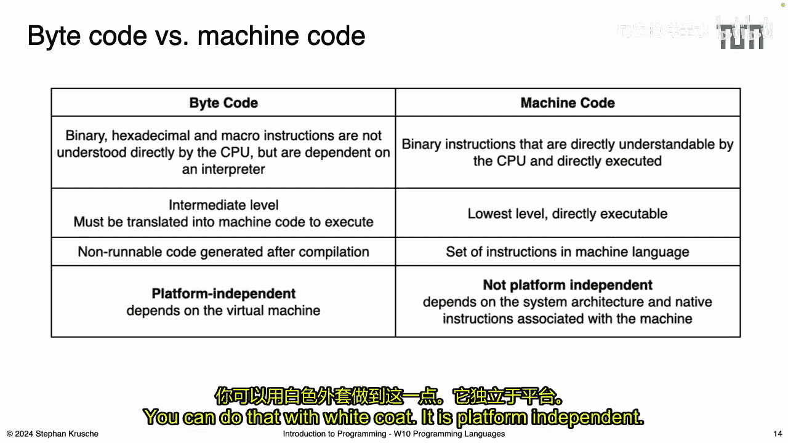

# 【全集】慕尼黑工业大学 计算机编程：从入门到实战 中英字幕 p43 Lecture 43 - 语言处理与程序逻辑建模核心 -BV1WFrTBZExY_p43-

Great let's start， welcome everyone to today's Christmas workshop in the chorus Introuction to programming to programming。

 it's a real pleasure that we talk to you today， not just me but also with a few female tutors I'll tell you a bit more in a second and the workshop today is about programming languages。

 so today you will also learn a bit more about what programming languages are and what other kind of programming languages we have in computer science。

 not necessarily just purpose programming languages but also domain specific ones。😊。

This is our last workshop for this year but we still have a few plans for next year so stay tuned when we talk about graphical user interfaces recursion with a follow up on mech sort。

 yeah remember we had the Clhanger recently and concurrency and then we also talk a little bit about the next steps in your career beyond programming before we will have the final course review。

😊，We assume you have a good understanding about all the basics and the learning goals for today are that you are able to explain the differences between compiled languages on the one hand and interpreted languages on the other hand。

 we will also distinguish general purpose and domain specific programming languages。

 we will talk about syntax trees and you should be able to create syntax trees for simple programs in order to visualize how the program works。

And the second visualization is done with control flow diagrams where you can basically show the different branches based on if else statements or while loops in your program。

 and last but not least we'll cover regular expressions that are relatively helpful for input validation and for making sure that certain strings follow certain patterns。

The workshop today will be given by four excellent female students in our computer science program Yana will start and then later on Yasmina。

 Catherine and Emma will take over and it's a real pleasure that we can offer this in order to show you the female perspectives of computer science and also how students see that with their own experiences and I know I'm still a young professor but I'm much far away from you than the students and the tutors are so we hope that they can bring in some insights from their perspective and I would like to hand over to Yana now who will start so thank you for taking over this。

 it's great to have those female role models in place， Yana。Okay， hi。😊，I'm Yao。

 as Shefah mentioned already， I'm one lead tu， my topic is communications actually。

 so I hope nobody actually talk with me because if you did。Something went wrong。Also。

 this is actually my last day of work because in January， I'm not here， sadly。

 I'm on a sceptcle if you say so。😊，So I can do whatever。😊。

Stefan said he's going to trust me and I'm totally misusing his trust and as he always tells me I'm Che Si。

 so I will do it differently， I love what you do really great work。😊。

I would do something else because I love interaction guys。😊，And I will ask you a lot of questions。

 and I hope you all are going to participate in the lecture。

 because if nobody is going to raise his hand， I will call somebody out。Like。

 I will point to you and tell say， you go。You with the gray pulley。

 you are going to answer my question so I hope you will do something also the guys who watch per video。

 you can like write this in Atemis or also the guys who watch it as a video， maybe stop。

 think about the question and then listen to it again。😊，So let's start。

First I want to point out very， very important people in computer science here Fe。

 we have Catherine Johnsonsen， she also got her own movie as you can see it's hidden Figure。

 she worked for the NASA and was a mathematician and she was very critical for the Apollo mission actually。

 also Margaret Tempton， maybe you know her， she was the lead programmer in Apollo 11。😊。

Also Francis Ellen was very important because she was the first female computer scientist who won the Turing Award and touring award is our Nobel Prize because forever recent the Nobel Prize doesn't have a category for Comp Science。

 so we made our own award it's called Turing Award， do you know why it's called Touring Award。😊，Yes。

Okay， who was Ellan Turing？よし。Exactly， we call him the godfa of computers。 Actually。

 he broke in the Second World War， the enigma machine of Ado Hitlerla like the Nazis。

 So he's very important for us。 He was also gay。 So it's actually。😊。

Great influence for people in computer science who are from the HQQ+ community。

And he sadly also killed himself because of that， because at that time。

 homosex L was forbidden in Great Britainden。So I'm doing the overview and also talk about the main particular languages and later on Yasmina is going to talk about syntax trees。

 then we have the control diagrams， which is presented by Katherine and then lastly Emma is going to talk about。

😊，Regular expressions。So first question or second one， why do we have programming languages？😊。

Why don't I use German or English or Russian to talk to the computer？Exactly， like。He said。

 if you don't hear it， or heard it Comp human languages is still unprecise。 Like， if I tell you。

 please turn on the beamma， what you're going to do， The left beamma， the right beamma， both。

And in computer languages， we can precisely decorate which beam object we're going to turn on。

So problem languages are instructions to the computer。Sadly enough。

Java is still not readable by the computer。 It's a high level language。

It's too close human language that's easier for us to write。

 but the computer only understands zero ones， so we have to translate it to a binary。

Which is readable by the computer and also executable， that translation is called compilation。

So I said， oh， no， we will talk about high level languages later more。

Why don't we have universal languages？😊，There's different reasons。

 one is computer science really started in the 1970s and at that time we have different requirements on program language than today。

 like today we have LMMs， we have big data and databases and at that time we hadn't。

 so we have legacy systems。😊，Also we have different kinds of applications。

 maybe we want to program a web page so we're going' to use HTML and not Javava。

 you could use Javava， but you shouldn't。So to the categories。

 there are three huge way of categories， how to。Say which。

ALanguage is what like we have the high level language。 Chavez 1。

 It is the closest to human language。 Youll program it in it。 We have normal words。嗯。But we have。

 it's very slow。And we are。We don't have the control as we have in assembly or machine language assembly is。

 as you can see on the right。Still with have words like move for ads， but it's。Harder to program。

And the computer still doesn't understand it， and that's why you need to under the bottom the machine language。

 this is the lowest language we can program， you shouldn't do it because it's way very hard。

 but you could。They can also categorize high level programming languages。

 Chava is an object oriented one and Chavascript would be a scripting language。

 object are attendeded means that we have classes like a movie class or a main class and we can create objects right。

 we have the hidden Figure object or the Godfather object， so that's object oriented。😊。

Then we can differentiate between compile and interpreted languages。A compile language would BC C。

An interpreted one would be Python。 I think you all heard one of these two languages already。

So in a compiled one， we have our source calls， our programming code， we call it HOOC。

 and we compile it directly to a binary， and then it is ready to run。

Then in one has a about machine between those two stages。And。Question to you， guys， again。

What are the advantages of a compiled one？Henceint， think about a speed na or a difficulty。Yeah。

 correctly。😊，And student answered that compile one is faster。 That's true。

 and we can directly say and see， please save my variable at that space， right we can。

Do a lot of optimization and speed it up， but it is way， way， way harder to write than Python。

And also Python， you can run on different machines because you have the word machine on it。

 and it is ready to run。So a Cha。Is both？We can have hybrid and hybrids between compile and interpreted ones。

Why do we do that， Because we have advantages of both worlds。

 also disadvantages like Javava gets compiled first， and then the executable。Is executed by the JVM。

 which is the Cha Wel machine。And。Jama is faster than Python， which is a only interpreted language。

 but it is slower than C， but for that it is still easier to write than C。

So the last overview slide is about bycode。And machine code。

 the biggest difference is that machine code is only runnable on a specific platform。

 let's say you have machine code of Intel， you can't write or run this machine code on an AMD machine。

 That's not possible。You can do that with white code， It is platform independent。

