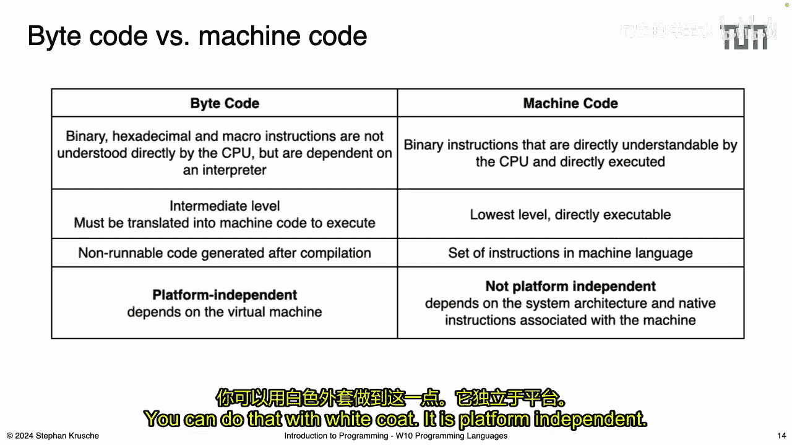

# 计算机编程：43：语言处理与程序逻辑建模核心 🎄

在本节课中，我们将学习编程语言的核心概念，包括编译型与解释型语言的差异、语法树、控制流图以及正则表达式。我们将通过清晰的解释和示例，帮助你理解这些概念。

## 概述

欢迎来到今天的圣诞研讨会。今天我们将探讨编程语言，了解计算机科学中不同类型的编程语言，包括通用编程语言和领域特定语言。这是今年的最后一次研讨会，但我们明年还有更多计划。

## 编程语言基础

上一节我们介绍了课程概述，本节中我们来看看编程语言的基础知识。

### 为什么需要编程语言？

人类语言不够精确。例如，“请打开灯”这个指令是模糊的。编程语言是给计算机的精确指令。然而，像Java这样的高级语言计算机无法直接理解，需要编译成二进制代码。

### 编程语言的分类

以下是编程语言的三种主要分类方式：

1.  **按抽象级别分类**：
    *   **高级语言**：最接近人类语言，易于编程但速度较慢。例如：`Java`。
    *   **汇编语言**：使用助记符，比机器语言易读，但计算机仍无法直接执行。
    *   **机器语言**：由0和1组成，是计算机直接执行的语言，但极难编写。

2.  **按范式分类**：
    *   **面向对象语言**：基于类和对象的概念。例如：`Java`。
    *   **脚本语言**：通常用于特定任务或自动化。例如：`JavaScript`。

3.  **按执行方式分类**：
    *   **编译型语言**：源代码直接编译成可执行的二进制文件。例如：`C`。优点是执行速度快，但编写难度较高。
    *   **解释型语言**：源代码通过解释器逐行执行。例如：`Python`。优点是跨平台性好，编写简单，但执行速度较慢。
    *   **混合型语言**：结合了编译和解释的特性。例如：`Java`先编译成字节码，然后由Java虚拟机（JVM）解释执行。它比纯解释型语言快，比纯编译型语言易写。

### 字节码与机器码

机器码依赖于特定硬件平台，例如为Intel处理器编译的代码无法在AMD处理器上运行。字节码是平台独立的中间代码，由虚拟机（如JVM）执行，从而实现“一次编写，到处运行”。

## 语法树

上一节我们介绍了编程语言的分类，本节中我们来看看如何用语法树可视化程序结构。

语法树是一种树状图，用于表示程序代码的语法结构。它有助于理解代码是如何被解析的。

## 控制流图

上一节我们学习了语法树，本节中我们来看看如何用控制流图可视化程序的执行路径。

控制流图用于展示程序中基于条件语句（如`if-else`）或循环（如`while`）的不同执行分支。

## 正则表达式

上一节我们介绍了控制流图，本节中我们来看看正则表达式，它常用于输入验证和字符串模式匹配。

正则表达式是一种强大的工具，用于定义字符串的搜索模式。

## 总结

本节课中我们一起学习了编程语言处理与程序逻辑建模的核心概念。我们探讨了编译型与解释型语言的差异，了解了通用与领域特定语言的区别，并学习了如何使用语法树和控制流图来可视化程序结构。最后，我们介绍了正则表达式在输入验证中的应用。希望这些知识能帮助你更好地理解编程。