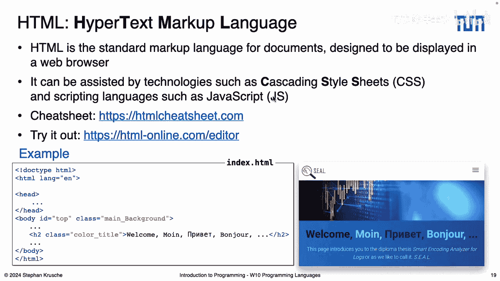
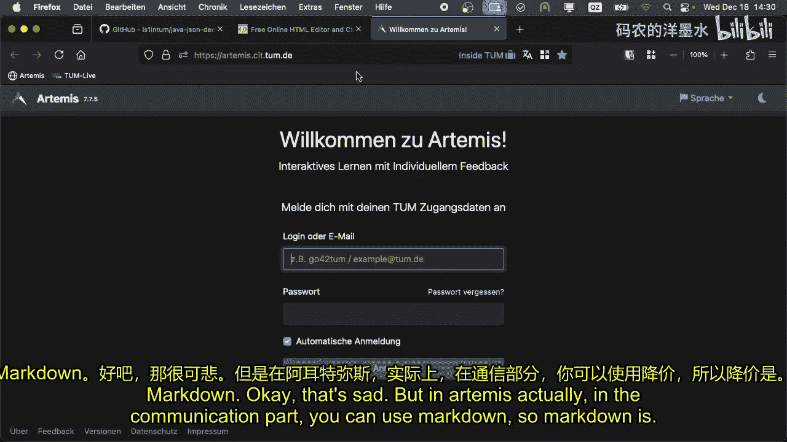
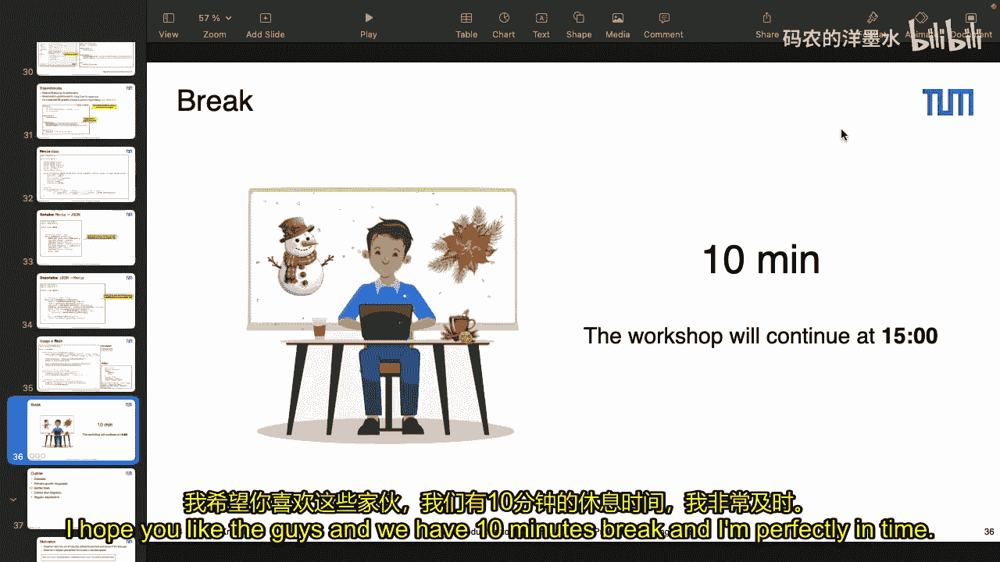

# 【全集】慕尼黑工业大学 计算机编程：从入门到实战 中英字幕 p44 Lecture 44 - 领域特定语言 -BV1WFrTBZExY_p44-

So the main specific language is。 Does anybody know what a domain specific language is。

Like you can raise a hand。Wow， not even the two dress， okay。Com mind specific languages are。

Programs or languages who are specifically designed for one task。 For example。

 HTMLML is designed to program web pages。 You can't use a DSL HL for， I don't know。

 writing a database。There are general purpose languages like Java。

 which are the opposites you can use them for whatever， you could write a web page in Java。

 but you shouldn't。And you can't always separate these two categories because。Let's take Python。

 Python is a GPL， but nowadays Python is mostly used for machine code or II because it's quite easy for us to write in it。

 So sometimes the use case changes of a GPL to a DSL more Of course Python is used， for example。

 if you。Go to the security course in To， we use the Python to like hack into things in examples。

So you you can use Python somewhere else too， of course。

The advantages of these of course are more efficient。

 you don't have to overhead like Java when you want to write a web page like HTML。Better quality。

 code quality， but of course it's a higher learning curve。

 and you need people who can write and read those languages so it could be there could be more effort to configure it and also to uphold the system over the years。

So that was a lot of theory。AndNow I want to talk about some DSLs。

 They are marked yellow on the slides。 The first one is HTML， then we have Cha。XML and Yao。

 Markdown and Gradle。And in Gadle， we do actually a short project。Before that。

 does anybody have questions？Okay， great。HMO。HML is used as a web page。

Or in the web browser we write web pages with it and we can。

Go into the browser and see what I mean with that。Okay， on the left side you see the webp page。

 on the right side you see the code and you see the tags like H1。This is the heading。

 this is the biggest heading。 we also have H2， which is here， this is a smaller heading。

 As you can see， some useful features is smaller than you can edit this demo text。

We can also em links or pictures like here。There we have a link you can do with different commands。

 you can different stuff with it。With also a cheat sheet。

 I would recommend to open that in the supervis exercise because you shouldn't like learn the text by heart。

 of course， if you use HTML lot， you already know how to do a H1 heading but just use a cheat code cheat sheet and that's fine。

Below you see example， I brought this with me because this actually on the right side is my web page for my or what my diploma thesis。

And I will use my diploma thesis throughout these examples to showcase you how DSS are actually used in the industry because I work together with a book like。

Company， and I designed a system for them。So you can see that I made the map page for my deployment thesis here H2。

 which is the welcoming part on the right side you can see。In H， we also use CSS。

 These are styling sheets， so we can like color these things。Calor title would be CSS。

And we also use scripting languages， because maybe I want to get。

Data for my database and I can't use HTML for that because HTML is only for web pages。

 so I have to use the scripting language in my HTML code to get objects and data from my database also if you click on a button that would be a function and a function would be implemented by JavaScript。

Mockdown。Okay， that's said。 But in ultimately， actually in the communication part。

 you can use markdown。 So markdown is。

Is a documentation tool we use as a programmer like you see below in this example。

 we use this to write tutorials， it's very easy to use， it runs on every machine。

 not like Word as you know for Microsoft and if you have a MacBook， it's hard to write together。

 so we use easy to use tools like marks to write tutorials。You have for the H1 heading。

 you have one sharp for H2， two shops， when you want to have a bolt text， you just use two stars。

Sadly， I wanted to show you how to do it in Artemis but I can't right now because I'm not logged in but you get a point。

 maybe you can try it out in the channel of the communication from today from the lecture。

 I will not be mad。I will tell my later。So Jason， Jason is a data exchange format。

And does anybody know or。Think what to know what the data exchange format is。Yes。

That's totally correct。 Yeah， how do you know that。Okay， okay yeah Jason is relatively new。

 this means it's only 25 years old and it is as he told you guys。

 but I will repeat it format and for mostly databases but to exchange data between two programs tools applications let's say I wrote in Java a database about movies and Stefan wants to write in Javascript a web page and uses my database well we can use text files because they suck let's be real and it's too much overhead。

 we want a structured way so we both can communicate together。😊，We use data exchange formats。

 and Jason would be one of them。 It is very easy to read。 It's human and machinechiable， readable。

 and it is structured in the key and value pairs like a hash map。

You can see below I have the example of Javava with the class movie where we have the verbalable string。

 title， an array string， which is a genreres and an in chat which is a year next to we have the object。

 we have a movie object it's called Hin Figure and it's a history drama movie and it was from 2016 and Cha looks like that。

😊，It's quite easy to read right， so we have our array here， the in here and these are chest strings。

😊，And this as a title would be the key， and hintfi would be the value。XML is also database。

 a database format， exchange format， it is a little bit harder to read in my opinion。

 as you can see we have not keys but tags like HTMLM， like we have the title tag。

 that's the beginning and thiss the end。😊，It is also readable by human admit machines and it is actually used by Microsoft that's very important and also in robotics。

 like I program robotics， I use XML。It looks maybe a little bit funky。

 but when you work with it one two days， it is quite easy。Then Yamal， which is my personal favorite。

 it's nowadays called Yamal and Markup language， Sha Yamal。

 but in the beginning it was actually called yet another mark up language。

 but they changed it because of legal reasons and also because they wanted to sell the company and it's not that easy to pitch somebody to invest in their company if they have a choke name。

 you know，And fun fact， there are different databases and one of the biggest databases we use is called MongoDB。

 so some people don't want to change a choke name to something else and it is actually very good so we use MongoDB all the time。

😊，But that's a different point。 Yamla is also human and machine readable。It's very close to Jason。😊。

So this is the Yal。 And if you go back to Cha， it looks very similar， right。

 You don't have the brackets。And we list our array like this， but that's it。

We can also use Yao to configure。Applications。That's another use case for Yal。

So I talked about a lot about now different DSLs。 And now I want to talk about my diploma thesis to show you。

Use case because last year a lot of people wrote in a feedback in our course， oh。

 it's too theoretical， we don't have that many use cases like what how can we use。

 what we learned in this course in the real world well。That's one thing。 like my diploma thesis。

 I owe everything what you learned I used in my diploma thesis。Iput chasing and had to make。

A dashboard out of it。It's called Smart Ecoding Ana for locks。 And now a question to you guys。

 what is a log file。Any guess what a lock file is。Exactly， in a log file。

We computer scientists are control freaks， we want to have all the data and we want to keep the data and save it somewhere and this is our protocol it's called a log file so if you for example。

 open WhatsApp at 6 pm it will get lo in a log file if you have an error message it will get locked in a log file and we use this log files to analyze the data for example。

 oh， at 6 pm or the people writes Whatsapp message so we need more server and more capacities because everybody's writing and using our app。

Or if we have error messages， we read through that and can solve our problems。

So I worked actually for a company called BiMovinging。And bitm is a streaming provider。

 but not as you may think， like Netflix。No we do the backend the technical things。

 like one of our customers is actually Hulu， and if you stream on Hulu。

 it's not available in Germany， but in America， for example。

 you will use the code of my company because we are the backend of technology how to stream movies。😊。

Because Huulu is not a technical company。 they don't want to do anything with that。

 They don't want to like have to deploy computer scientists。

 They just want to accompany your does that。 and they can complain to the company and that's it。So。

And we programmed like for the customers， it's important how fast can be the movie like screenre。

 right we don't want to wait 10 seconds to start a movie and then only like see a black screen for 10 seconds and then it starts。

 so we change the code all the time。But how do we know that our code got fast and it's slower。

 and that's what we wanted to do， we wanted to analyze our log files where we like saved。

 how many CPUUs we like used and how long it took to start the movie actually。The problem is。

 a huge company like beenMoving has hundreds of thousands of log price every day。

 and no human can read through them。 So we need a system who fills us through them， analyze them and。

Priinnt them out in a graph because a human can easily read a graph。

 but it can't reach thousands of lo fileses。So this is the data flow。Of my program。

 we have a lot of applications。 You don't need to know anything about that。 Just we have our input。

It's a Cha file， and then we have our dashboard， which is called Kaana， which is the graph。😊。

And lock search， for example， would be the filter， elasticasticse would be the database。

And all these applications in the light blue box are actually in Docker。

Does anybody of you know what Dca is。Yes， that is a good point。 A keyword is containers。

 What is a container。Yeah， but what do we put in talk， why would do we have containers。

 What is a container like？It is hard to explain， right？So a container is a box。 you can like。

That's why we call the container like。Kubbaana is in its own container as is El search and don't in this box。

 they're separated and they don't interact with each other or only if they allow that。

 so I can update El search and it will not influence Kbaana and that's very important for us。

 If you want to update things and they might change dependencies or what else and that's。

Very hard to maintain。 So that's why we use docomm。 So Docker is a management tool。

And if you're going to take the course Id like Iphoney software Tech introduction to software Technic。

 like next semesters， you will going to rely Docker actually， and we program Docker in the Yamal。

 it's called Docker compose。 And in this Docker composeos， wewrite whats。This is our management file。

 And we write O。 We have the application Kana。 It's that name。 the contain the name is the Kiana。

 This is a peer address。 And in what sub are we。 So these are like management。Instructions。

So the last film I'm going to talk about is graadle。Does anybody know what Gadle is。Guys， come on。

 you know what greatest。 Everybody had the greater build error one time in this course。

 You can tell me you never had greater problems because I had greater problems all the time。

 Like last year， when I held their lecture， I had greater problems on this laptop， so。😊。

What is graadle， You all use it， so you should know what graadle is。You mean version， right。

 which our version to use。Yeah yeah， it built。 yes， it builts our code， for example。😊。

I have the same example， I want to write a database about movies。

 and I want to pass them in Cha to a Cha object because I want to send it to Schfhan again for the web page。

I don't want to write a adjacent Baza。 I don't like， I don't care。 I don't want to do this。

 I can reuse code from other people。 They are safe in a central repository。And shared。

 publicly shared。 And Gil can。Download。Those codes。

 dependencies plug in frameworks and build it into my code。 if I say that， the build is cleaning。

 compiling， build and then test。 That would be the right way to do it。So let's do a project together。

Just to know， down here， I have a link to a GiHub project where you can see the full code。

 but we will do it together。So first， we're going to。Create a new project。We call it。Movie。

You have to select radle and also groovevy， that's very important。 Don't use Kotland。

And then we're going to give it a group I D， like。Okay， Toma Asa， for example。

And we need to wait a little bit that it builds okay now built and we go to the build grade file you see the plugins ID would be Javava that's because we use the program Javava if you use like Kotland that would be sending Kotland then we have our group I which is the Tomasa with our version。

 our repository where we download our code this would be maybe central our dependencies。End a test。

So let's go back to our。Slides。And let's copy and paste new Parklands。

That would be the checker framework。And application， the checker framework is for testing。

 purpose only and application is that。Great knows that we have an application。😊。

Then we want to use the cha parcel。This is parel and this is a checker framework。And then。

 let's add the application。So the next step would be to build it。

 So you click on Gril on the right side， and then。This went then， and then it should reload。Yes。

 now it's built。 and now let's create a new cause。CallLet's call a class movie。

And now let's copy paste what we have here。 These are like the examples from before。

 We have the mobiles title genres year， and we have a constructor。And the two string。

The constructor has， again， the same parameters and assigns them to the variabless， global variables。

 and the string just prints out the movie in a chase format。

The next part would be to create the twochas methods。And this method， we。

We create the chasings object。 We have to import the Cha object。

 and the Cha object can only be imported because we have the gradle。

Built and the plugin in our griddle， because Cha object is not in the standard library of Javava。

We also have to implement lists。And the race。Okay。Next point is to actually implement a second constructor where we get a chosen object and。

Chase an object and。Assign them to our global betters。

So the important thing here is that we have the same keywords as in the two Cha， if we would。

 for example， change the title to， I don't know。Sefan。We're going to get an  error later。

 But keep that in mind that we are going to have an  error。

 The important thing is that Jason can have a good string in。

 but we don't have directly method to change the array to。The' chasing the right to a newer rate。

 that's why we have a loop here。Now， we want to。R run this in our main method。

We threw that out and copy paste that。 again， we have to import the chosen object class。

And that's it。 So in in our mainine， we have our new object movie， which is the Hifi movie。

 and we want to translate it to Jason。😊，I'll utilize it to chase and return a string。

 and then we want to take this string to Jason and change it to a movie object again。

So how do we run it， we have to go to the terminal。And right points。G little rule and say Ron。

 this command is also in the slides， and you can see your kids built building。

And we have a build failed。 Why do we have a build failed。Yes。Exact。

 we have a build fair because Im very dumb and I have the key run。 It's Jeff Un right。 Now。

 I have to change it to title。Let's run it again。And now it shouldn't fail， hopefully， oh， it failed。

Oh no， did I misspell it too？No， I don't think so。So now we have to read our Billf。

 which is also a very important lesson to read the。Air messages。也不是说。Yeah。

 but it doesn't really stand out， right。あす。My path is wrong， oh， true。I changed it。

I don't care to change it actually。回窗。Where should I go？😊，You mean I changed it here， right？

D Tom answer。No， that's actually right。 This one， this one。Oh yeah， this one， yeah。

 we have to change it in。Then we run it again。And if it's successful， let's go。嗯。

So what did you learn。Don't change anything。 What Stean said up。Also， we can now use cradle。

 finally after 10 weeks using it without knowing we know how to use cradle， let's go， as you can see。

😊，Spelling mistakes happen all the time。 And yes， I talk the whole lecture about movies。

 The whole thing was about movies， Like with the diploma pieces was about movies。

 all the examples about about movies。 Yes， I did it40 minutes talking about movies。😊。

And that's also a call to watch movies and don't work too much over at Christmas。Break。

 and that's it from my side。 I hope you like the guys。 and we have 10 minutes break。

 And I'm perfectly in time。 Let's so and go。😊，Okay， thank you guys。

