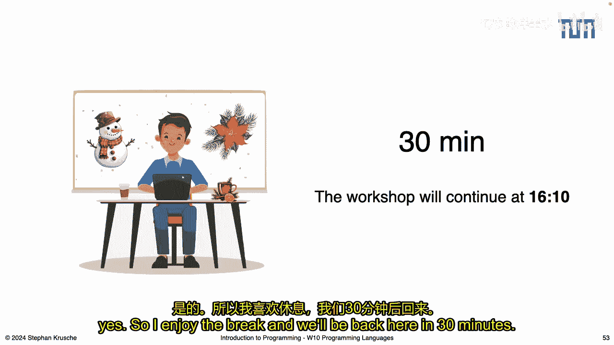

# 【全集】慕尼黑工业大学 计算机编程：从入门到实战 中英字幕 p45 Lecture 45 - 语法树 -BV1WFrTBZExY_p45-

Okay。I hope that everyone's back from the little break and I will take over the next part of the lecture。

 hi everyone， my name is I Mina and I normally hold tutor sessions and special hi to my students here or to those who are watching。

😊，Okay， then I hope that I can follow Y Yna's professional footsteps and finish my part also on time。

 so let's get started。😊，Okay， so。During my part of the lecture。

 I will try to teach you the syntax tree， but before we actually start learning about the syntax trees。

 I would like to give you some overall motivation for them and some intuition behind them so that it's easier to understand them afterwards。

Now we've all heard about grammars before， grammars are part of every language。

 whether it be English， German， Chinese， it doesn't matter， grammar is a standard part of them。

 and to define grammar， we can say that it refers to a set of rules that defines the structure and the syntax of a language。

I took out one example from the English language for the past， perfect。

 for the past in reported speech。Meaning like after I had finished my presentation。

 I realized that I had forgotten to include an important detail and hopefully this doesn't happen to me today。

Similarly， in each programming language， there is a defined grammar。

Now weve all seen already when writing code that certain syntax must be followed right， for example。

 an if statement needs to be followed by a condition or an expression in the brackets。

 similarly for four loops， we need to have semicolons within the two brackets。

So if you can see each language has a grammar and a grammar being a set of rules that that language needs to adhere to。

Here， an important note about programming languages is that adherence to this grammar。

Trump's immediate meeting， what do we mean by that。

 it surely happened to you that when you were writing your code that even though the code runs。

 it still doesn't do what you want it to do。😡，This happens because what you write can be grammatically correct。

 but it doesn't have to be logically correct right， your logic can still be wrong。

 meaning your meaning is wrong， but the code still runs even though it does rubbish。

 right that is because you adhere to these grammatical rules。

And these grammatical rules are defined for each language and one example you can see here on the left side of my screen。

 some of them should already look familiar for you， I mentioned earlier that we have。Oops。

 don't allow that we have an if statement and that an if statement is followed by if condition then statement。

And here I have one little example， oops， not this， I didn't want to do that。Okay。

 here I have a little example on the right， just one simple if statement。

 if temperature is less or equal to zero， then we set the description for freezing。😊，Our code。

 whatever we write is just text right， essentially we're just writing text and now when we want to check whether or not our text follows the grammatical rules。

 we simply go step by step through our text and try to apply a grammatical rule that is strictly defined。

You can see here a little time lapse for our little example。And I'll let it run until the end。Yes。

 and in the end， we get something that looks like this。😡，If you look really carefully。

 you can see that the original code is still kept inside。

 you just have this a little additional information around it。This additional information。

 along with the original cold， is called a parse tree。

A partry is really easy to generate because it only consists of taking your code。

 applying grammatical rules， and printing it out。😡。

Nothing more than that There are a lot of programs that already do this for you。

 there is not much logic to it is just take your code and try to see if you can produce it by applying your grammar。

Now， this is really convenient because this is necessary for the computer in order to later on further analyze your code so that we can come from something like text to code generation。

So。Now that we've seen parse trees， we know that they contain our original code。

 let's say in this example we have two times7 plus3， just the simple matte expression。

 and if we look at the parse tree， it's kept inside but we just have some additional information here。

Now for further analyzing of the code， it might not be as convenient to keep all of this cold around and to pass it on to further analysis right。

 because if you look at this example， even with one if statement。

 you end up at something huge like this， like it's a huge tree for just three lines of code。😡。

So that is why smarter people before us thought， okay， maybe I don't need to save all of this。

 maybe I can just select the things that I want to keep for further analysis and disregard the rest。

 and that's how the syntax trees come to life。Essentially， our goal is to get our code。

 which is essentially just the text and try to analyze it to see if we adhere to the grammatical rules of the said language。

Each language has its own grammar， like Liana pointed out earlier that different types of problem languages。

 they all have their grammar， Java has its own grammar。And from that grammar。

 we can generate a parse tree and then later on simplify it in an abstract syntax tree。

Absx syntax 3 is then unused to analyze the code further。

 and it's basically your intermediate result that is used in compiler。😡，Okay。

Any questions so far on the general idea behind it on the。Kind of meaning of it。Okay。

 then I take the silence that everyone understood what I'm talking about。😊。

But yes let's define it in a concrete way， so a syntax tree is just a tree representation of your text。

Nothing more， it's written in a formal language and each note should represent a part of your code。😡。

It's up to the developer of the syntax tree to decide which parts of the code structure of the grammar they want to keep and which parts they want to omit that's why it's a bit more tricky to generate an abstract synic street than a parse tree because a parsh tree you just take the grammatical rules and you spit out a result whereas with syntax trees。

 you have more freedom into what you want to have and what you don't want to have it's used in compilers。

 program analysis and program transformation systems。

And here we have one example that we can go through together so you can see that syntax trees are nothing more than properly reading out your code。

I hope that within your tutor sessions， when you did the presentations。

 your tutor corrected you and your terminology and that over the semester you practiced the proper way of explaining your code。

 because if you did， then the syntax trees will come really easily and naturally to you because it all boils down to properly reading the code。

What do I mean by that？Let's take this little while loop that should denote the Euclidean algorithm。

And if you take a look at here。We have two big blocks， right， we have one while loop。

And we have one return statement。So when creating a syntax tree。

 I can kind of take a step back from my program and try to see what big blocks I have in my code。

Here it's whileup and the return statement， so I can immediately write two branches for it。

 one for the while， and one for the return statement。

Because the return statement only returns a variable A。

 that means that I can just immediately write returnturn and then one note for the variable named A。

For the whileop， it gets a bit more complicated because here we have。More code inside now。

 what does the viral loop contain of？A while loop should have a condition。

And also a body right those are the two building blocks of the viop。

 so that's exactly what you write out， you say， okay， in our vi loop。

 we have a part for the condition and we have part for the body。

Now you again take a step back and you look at， okay， what is my condition？

And you will kind of see this pattern when we have comparing operation that it follows kind of like a zigzag structure。

 right， so you have your comparing operator and。Two variables or constants that you are comparing against right。

 so we have variable B should not be equal to constant with a value of 0。

 so it's kind of like zigzag。All right。So apart from the condition， our while loop also has a body。

 this body in this case consists of an if statement。So that's exactly what we write。

 We have an if body， We have a condition， and we also have an else body。In our condition， again。

 it's a zigzag pattern， right， A， bigger than B done。Then when we go next we look， okay。

 in the case that the if body is true， in case that the condition is true， then what is our if body。

 if body is an assignment because we are assigning the value operation to variable a。

 and what are we doing？We are。Doing a minus operation， variable A， minus variable B。And that's it。

 It's just reading out your code。 What am I doing， I have an if statement。Which has a condition。

 a the body。And in the end， we top it off with an else branch where again。

 we have one assignment operation where we assign to the B， b minus a。So。Again。

 it's only following the grammatical rules and reading out your code properly。

Is it a bit more clear now how it works？Okay， I see a lot of nodding has any questions。😊，So far， no。

 okay。So again I'm going to say this， just take a step back from your code and try to see what are the big blocks of my code and read it out properly。

 that's it， you can't make a mistake there。Now， why are they used？

Syntax trees are really convenient to analyze。It serves as an intermediate representation of your code。

 meaning you're not analyzing lines and lines of lines of text， you're analyzing a structure。

And it has a strong impact on the final output of your compiler。

It leaves a lot of room for a building on top of the core requirements because each developer can add some enhancements to it。

 meaning you can store the position in the source code in order if you want to debug more useful error messages right so inside of a syntax tree。

 you can choose what information you want to add on which can then be easier to debug or to eliminate mistakes。

Now I've mentioned this that you can do a lot of freestyling with the syntax trees。

 but of course they have some minimal requirements that each syntax tree needs to fill out and when you think about it they're really logical right for example the order of the executable statements must be preserved what we mean by this is for example here the return a shouldn't go prior to vi loop right then our logic for our code will be broken so you need to somehow preserve the ordering of your statements。

Also， the variousialo types in the location of each declaration must be preserved and naturally the left and right components of binary operations。

 why because， for example， in our case， we want to do a minus B and not the other way around。

 so that's an also thing that we need to keep in mind。So if you take a look at the core requirements。

 you can see that each of them when you actually start to build your syntax3。

 they naturally come to mind that need to be preserved， but other than these minimal requirements。

 you can basically build them as however you'd like。Now， where is their usage。

 you might be wondering that this really sounds too abstract or that you don't really see where you've seen it。

 but you have， because you know， when you're writing something in intelligent and then it gets read underlined。

 for example。That's based on the syntax tree because the syntax tree serves as an intermediate representation of your code and when you write something and for example。

 you misspell a variable， it will look at the generation of the syntax tree and will see that something is wrong and then it will let you know。

 it will tell you， okay， this is not how it's supposed to be。

It's also used in the verification of the code， verification of the code just means that you prove that the code does what you want it to do。

 this is really easy in some cases， however it gets more difficult based on how much user input you actually have like if you have a lot of user input then it's more difficult to prove that your code does exactly what you need it to do。

And naturally it's used for code generation because it is an intermediate representation of it。

And let's see how this all looks in one timeline。Let's say that I am working on a computer and I have some lines and lines of code。

 this can be any type of code， it can be your homework solutions， whatever。

And let's say that for now， we are looking at the new symbol one。All right。

 so how do we go from our source code to something like co generation？First of all。

 our lines and lines of codes needs to be somehow transformed so that we can actually do some operations on them。

 so I take each symbol or better words each word or however you want to pronounce it。

And I put it in a metaphorical box， let's say， called tokenken， and I say give this a label。

 for example， if I take the one， I can put one in a box and say this is an integer。

 and this will be a token designated for this one。So I say take the one。

 put it in a box and call it an integer， this integer， and pass it on further。

 and this is done repetitively for each symbol or word that you have in your code。

So we firstly generated these tokens， we say， take this， label it， take this， label it。

 and then you pass it on further。And out of these tokens， you get your syntax tree。

This syntax tree is then checked。Okay， do you respect all of the grammar rules of this language or do you not respect the grammar rules of this language if yes。

 then you ship it off to codegen where we actually build the code and where everything training is translated。

 if not， you will get an alert and it will say hey， something is wrong。

 you have a syntax error you have a syntax error online， whatever。

And this you have encountered a lot of times in intelligence so far。And as I've said。

 this is a core feature of IDEs or why they're so practical。

 like because of this kind of like helping hand， like AS treess are giving you kind of this helping hand。

 like， hey， here you have a syntax error or here something is wrong or here something is wrong。

It's really nice and this of course， is a feature called round trip capability。

 meaning that you can manipulate the source code and it will be reflected back to you in a form of。

Consistent change throughout the code What do I mean by that is I will quickly take over Jonna's code orrianna's code。

And if we look at here。Let's say that I want to take one attribute right and let's say that you're in an exam and you created。

 I don't know， private string title， however you misspelled it or you want to change it to something else。

 and theoretically you can go step by step and change it everywhere。Like this。

And everywhere in your code， you can be like， okay。

 I'm going to search for it manually and replace it。 However， this is really time confusing， right。

 Like who would want to do this。 So what you can do is。

Right click on this if a right click would work。Okay。And then。Under refactoring。

 there is this really nice option called Rename。And now when I write something else and press enter。

I can automatically change it anywhere。And this is a really neat trick， right。

 because now you save yourselves a lot of time and it's always going to be reflected in your code so you don't really have to worry about it。

 right？And this is possible because of this syntaxt tree。

 because of this intermediate representation of your code so that when you change something in one node。

 it automatically gets changed everywhere else。Is this okay so far？Any questions？All right。Now。

 one thing that's important to know here is that you don't always keep track of the syntaxtry of your entire code。

Because there can happen that the code base is really。

 really large and then if you would to at all times keep the entire syntax tree somewhere。

 then it would mean that you it's enormous amount of memory like it's really hard to maintain。

 so that is why only parts of the syntax tree are kept at the time depending on what part are you' currently working on。

Yes。And I think for you， the most important thing to know is how to read it properly。

 how to create it， and also how to use the benefits of it， one of them being refactor。Now。

 let's try to do one more example we have here a simple code， and let's see how we would do this。

 how we would translate this to a syntax tree。Okay。So what are the big building blocks of my code？😡。

I see here that I have some declarations， assignments， and also the third block。

 which is a big if statement。In this if statement， I again then have a condition。

We have a right statement that writes either one or zero， so how do I turn this into a syntax tree？

Let's start slowly and create first the parts of the tree。

 which will then we connect into the full one。So。X， greater than 0。What do we have here。

 This is part of our condition， right？And condition is consistent of an expression， comparator。

 and another expression。So this is just defined in the grammar。And then in our case。

 our expression is going to be of name x， because here we have an x。

And another expression is going to be a number zero with the comparator being the greater sign。

So it's just reading out nothing more。The right statement， what do we have here？Right。

 is a statement。Which inside has one expression， which is a number 0。

The brackets would just add next to it。The same thing goes for another right statement。So in the end。

 all I'm doing is reading out the code while following the grammar rules， that's it。

 that's fairly simple。And if you combine everything， if you look more closely。

 here we have our three building blocks that we saw on the previous slide。And。

This is all connected to our program， so what do we have here。

 we have a program that starts by declaring a type end of name X。We have a statement of name X。

 which is read in。We have another statement， which is an if condition containing of two expressions of name x and number zero。

We have one right statement with the expression number one。

 and we have another right expression with the number zero。So far so good。Does this make sense。

 kinda， yes， or it doesn't completely make sense？Okay， I see some nodding heads。

 so I guess it's fine if you have some questions of course you can ask， I don't bite。Okay， all right。

 then we do some exercise together and we try to create a syntax tree for the following program。

And for that， you can use a pollen。So let's go to a pollen。And when you go to the new diagram。

 there is an option to create a syntax tree。So I'm going to wait for a couple of seconds so that everyone can open a pollen。

Choose the syntax tree。And afterwards， click on createate diagram。And I prefer the light mode。

 I know that's not really popular amongst programmers。

 but to me I really enjoy working more in the light mode rather than the dark mode。Yeah。Allright。So。

 let's。Let's see， what do we have here， so who can help me here， who can tell me？

Where can I start at least， like based on the things that we have seen before。

 like the couple of examples that we've already encountered， how would you start。

 how would you approach this？yes， yes we can do that would you like now at this point let's say that you have to do this on your own right you have to make a decision like what would make more sense for you to start with right you can either start by building these little blocks and then combine it kind of like from down till up into syntaxtry or you can start from program then first thing than the second thing and then how it all connects together it's personal preference。

Okay。No。Let's say that we have。Our program， right？ So this is our program， and we have。

Some statements。It with conditions and declarations and everything。Let's start firstly。

 I will start with the while statement。Because that's the largest part of this code。

 So if we we know that according to the grammar。While is a statement。

 I will use the short STM for statement to not write everything all the time。So。We have a statement。

And。It's a wild statement， okay。It's a wild statement。Okay， it's gonna be like that。

And I can immediately put the brackets。I know I'm gonna have x here。I'm going to have a greater。

So the original code is going to be there nevertheless， right。

 like the original code is going to be there， you just need to fill out the middle part。嗯。

And the closing bracket。So。So far， this is everything that we have in our while loop， right。

 And now we can fill out what each thing is。So。Inside of the brackets， we have a condition。

According to the grammar and a condition is determined by an expression。

 comparator and an expression。 We've already seen this here inside of the code。It is the same thing。

So。We can write a condition。Expressions。And one comparator。Okay。那。Now， what is our expression。

 in this case， the expression is going to be name X。So we add name。And connect it to X。Similarly。

 for the zero， our zero is going to be an expression， which is a number。Which is then on zero。

So again， we add that and just connect it。To other blocks。EThe lines are bit， are bit not that good。

 but I hope that you understand what I'm going at。And our comparator is just the sign greater。

Finally， and then we can connect all of that to a condition。Cool。

Is this okay so far like what I did here is just we have our original code which is always going to be present in the syntax tree and what we did is just read it out properly and define what everything is right so our program has a statement which is a while statement it consists of a condition condition consists of two expressions and in our case the first expression is of name x。

 the second expression is number0 and the comparator is just greater。All right。

 so that would be that part of the tree。😊，And then。On the right side， if we take a look here again。

 what is our program？Inside of the wild body， we have one right statement。

 and we also have another statement which assigns。X minus-1 to x。So that's exactly what we do。嗯。

So I just copied some stuff around to not。Write it from the beginning again。

 And then here we just say that we have one right statement。 We again have the brackets。

Let's not forget the semicoe。And this statement should be connected。To the expression。

 which should be connected to the name， which should be connected to X。If a pollen would cooperate。

Yeah， it cooperates kind of。All right。😊，Here， what's missing is are also the lines for the brackets and for the semicolon。

 but I would admit showing them now because I think it would be too messy on the board。

 but if you do it on your own you have to add the lines as well to the brackets from the statement to the brackets and also here as well to the semicolon。

 but I think it's going to get really， really messy if I include it now。Allright。Alright， cool。

Would someone have an idea what I can do next？An overall idea， what are we missing？

How can we do the statement below right， like， how would you approach this？What do we have here。

 How would you read this out， Okay， okay， that's going in the right direction。 You're almost correct。

 You're almost there。But it's a pretty good guess， so again， we have a statement。😊，I'm going to。

Cludeed from here。那。Or not。O。So we have a statement。And then， our statement。On its in its core。

 I would say。Is going to have an expression。An expression。 and this should be x -1。Now x。

 we all know that it's a name right， we have seen it here as well。

 however the minus in this case is not a comparator because we're not comparing anything。

 so it's going to be a binary operator right because we are doing some operation。And in this case。

 it's going to be a minus， but it can be anything， it can be plus it can be multiplied。

 it can be divide， if you're doing some mathematical operation。

 it's always going to be a binary operator and if you're using comparison signs。

 then it's going to be a comparator。Okay。So that's exactly what we write， so our expression is again。

Entailing two expressions。One of them being name X。Let's see。Yes。

 and then we have minus in the middle。And。1。Minus is going to be a binary operator。

And one is naturally， a number。And now， let me just connect everything。All right。

This is the biggest part of it， but remains is to just do the assignment。

 meaning that that x should be equal to the result of this operation。

And we can simplify it to just saying。Name。And connected to the statement。

This should be connected up。But I'm not going to do other lines because it's going to be really then hard to read。

And naturally never forget the semi columnonss in the end。All right。

 so this is the other part of our tree。And。What we are missing is just the index that is going to be a read in。

U。But I think that part is really easy， you just add again。A statement。

And you say that you have a type because down we have an int and an int is a type。We again， have X。

 which is a name。Again， we have equals。This should be separated。So， the brackets again。And also。

 the semicolon never forget that one。I should probably be big。Yes。Exactly。And I guess here。

 the lines won't hurt because we have nothing in between so we can add them。Alright。

And this all connects。To our program。All right。So let's look at this one more time。

So what do I have here， I have here a simple program that I can technically divide into two big blocks right。

 o I have one declaration in Is which is read in and I also have one while loop。

So I can firstly write that inside of my code。Pholder for two statements。

 so these are my two big blocks。And now when I try to read the while loop。

 what does the while loop consist of， and while loop consists of a condition。

 and then you ask yourselfs， okay， what does the condition consist of？Expression and a comparator。

 And then you just fill it out。Then in the wild body， you have two statements。Which are right X。

X is a name and an expression。And later on in the other statement， we just have x。

 which is equal to the x minus1， and then we go upwards from there。

Our statement is an expression which again consists of two expressions， one being name X。

One being number one。We want to do x minus1， so we add one binary operator for the minus。

 and in the end we don't forget the semicolon。All right。

The part on the left is just decing the type int。With the name X being read。All right。

So any questions regarding the solution for that part？All right。

Now I want to quickly recap everything to just see if we are on the same page。

 so who can tell me the general intuition behind syntax tree。

 like where have you seen them before or where in your code。

 have you seen them without knowing that that's based on the syntax tree？Yes。嗯哼。😊，Yes。

 yes exactly so basically all the changes in your code right when you have some errors like the syntax errors are based on the syntax tree。

 meaning it alerts you that something is wrong in your code， youll misuse the grammar。All right。

 useful feature for you is the refactor that's also based on the syntaxt tree that you can use in the exam。

 the homeworks later on if you do something with coding so that you don't have to manually search for stuffing code。

 you can directly use it。Syntax trees are really neat and convenient for intermediate code representation and it affects largely how the output of the compiler later on is going to be。

Any questions regarding anything that I've said in the last 30 to 40 minutes？Alright。

And then thank you for your attention， I hope that I didn't scare you a lot with this。

 I mean it's a bit more abstract to grasp， but you've already worked with this and not scary so I think you'll all manage to do it properly。

😊，Okay， thank you for listening and I think now youll have a big break if I'm not mistaken， yes。

 so I enjoyed the break and we'll be back here in 30 minutes。😊。

