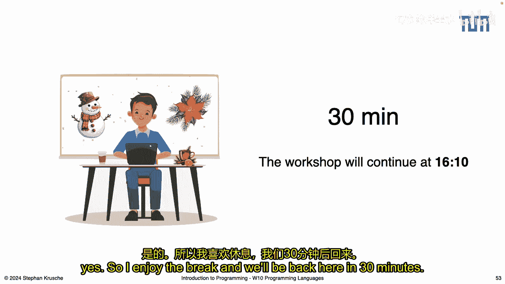

# 计算机编程：从入门到实战：45：语法树 🧠


在本节课中，我们将要学习语法树的概念。语法树是程序代码的一种树状表示形式，它在编译器、程序分析和程序转换系统中扮演着核心角色。我们将了解其动机、构建方法以及实际应用。

## 语法树的动机与直觉

上一节我们介绍了语法树的基本概念，本节中我们来看看其背后的动机。

每种语言，无论是英语、德语还是中文，都包含语法。语法指的是一组定义语言结构和句法的规则。编程语言同样拥有其定义的语法。例如，`if` 语句后必须跟随括号内的条件或表达式，`for` 循环的括号内需要分号。

遵守语法规则优先于代码的即时含义。这意味着，即使代码能够运行，其逻辑也可能是错误的。这是因为代码在语法上是正确的，但语义（即意图）是错误的。

我们的代码本质上是文本。为了检查文本是否符合语法规则，我们需要逐步遍历文本，并尝试应用严格定义的语法规则。这个过程会产生一个**解析树**。解析树很容易生成，它只是将代码应用语法规则后打印出来，其中包含了原始代码和额外的结构信息。

然而，解析树通常非常庞大，即使对于少量代码也是如此。为了便于后续分析，我们需要一种更简洁的表示方法。这就是**抽象语法树**的由来。它的目标是从代码文本中，选择需要保留的关键部分进行分析，而忽略其余细节。

## 什么是语法树？

现在我们已经了解了语法树的动机，本节中我们来正式定义它。

语法树是代码文本的树状表示。它用一种形式化语言书写，树中的每个节点都代表代码的一部分。

生成抽象语法树比生成解析树更具挑战性。因为开发者需要决定保留语法结构中的哪些部分，省略哪些部分。它被广泛用于编译器、程序分析和程序转换系统。

构建语法树的核心在于**正确地阅读代码**。你需要从程序中退一步，识别代码中的大块结构（如循环、条件语句），然后按照语法规则将它们逐层分解。

以下是构建语法树的一个关键步骤列表：
*   识别代码中的主要语句块（如 `while` 循环、`return` 语句）。
*   对于每个语句块，根据其语法结构进行分解（例如，`while` 循环分解为条件和循环体）。
*   递归地对每个子部分应用相同的分解过程。
*   将分解后的部分按照树形结构连接起来。

## 语法树的核心要求与应用

上一节我们学习了如何构建语法树，本节中我们来看看它必须满足的核心要求以及实际应用场景。

虽然开发者可以自由决定语法树的具体形式，但它必须满足一些最低要求，这些要求通常非常符合逻辑：

*   **可执行语句的顺序必须保留**：例如，`return` 语句不应出现在 `while` 循环之前。
*   **变量类型和每个声明的位置必须保留**。
*   **二元操作的左、右分量必须保留**：例如，`A - B` 与 `B - A` 是不同的。

语法树的应用非常广泛，你可能已经在不知不觉中使用过它：

*   **集成开发环境中的错误提示**：当你在 IDE 中编写代码时，如果出现语法错误（如下划线警告），这通常是通过构建和分析语法树实现的。
*   **代码验证**：用于证明代码行为符合预期。
*   **代码生成**：作为编译器中的中间表示，用于最终生成目标代码。
*   **重构**：例如，在 IDE 中重命名一个变量，该更改会自动应用到所有引用处。这得益于语法树作为代码的中间表示，使得一处修改能全局同步。

需要注意的是，由于代码库可能非常庞大，通常不会始终在内存中保存完整的语法树，而是根据需要动态加载和操作部分语法树。

## 语法树构建实例

为了加深理解，让我们通过一个具体例子来实践如何将代码转换为语法树。

考虑以下简单的代码片段：
```c
if (x > 0) {
    write 1;
} else {
    write 0;
}
```

我们如何将其转换为语法树？以下是构建步骤：

1.  **识别顶层结构**：这是一个 `if` 语句。
2.  **分解 `if` 语句**：根据语法，`if` 语句包含一个条件、一个 `then` 分支和一个 `else` 分支。
3.  **分析条件 `(x > 0)`**：这是一个比较操作，包含左表达式 `x`、比较符 `>` 和右表达式 `0`。
4.  **分析 `then` 分支 `write 1;`**：这是一个 `write` 语句，包含表达式 `1`。
5.  **分析 `else` 分支 `write 0;`**：这是一个 `write` 语句，包含表达式 `0`。

最终，我们可以将这些部分组织成一棵树，根节点是 `if` 语句，其子节点分别是条件、`then` 分支和 `else` 分支，并继续向下分解。

## 综合练习与总结

现在，让我们尝试为一个更复杂的程序构建语法树，以巩固所学知识。

考虑以下程序：
```c
int x = read();
while (x > 0) {
    write x;
    x = x - 1;
}
```

构建其语法树的思路如下：

1.  **识别程序的主要块**：整个程序包含一个声明语句 `int x = read();` 和一个 `while` 循环语句。
2.  **构建声明部分**：声明包含类型 `int`、变量名 `x` 和初始化表达式 `read()`。
3.  **构建 `while` 循环**：
    *   `while` 语句包含条件 `(x > 0)` 和循环体。
    *   条件 `(x > 0)` 可分解为：左表达式 `x`、比较符 `>`、右表达式 `0`。
    *   循环体包含两个语句：`write x;` 和 `x = x - 1;`。
        *   `write x;` 是一个写语句，其表达式是变量 `x`。
        *   `x = x - 1;` 是一个赋值语句。其右侧 `x - 1` 是一个二元操作表达式，包含左表达式 `x`、二元操作符 `-` 和右表达式 `1`。

通过将这些部分按树形层级连接起来，就得到了完整的语法树。

---



本节课中我们一起学习了语法树。我们了解到语法树是代码的树状中间表示，它通过遵循编程语言的语法规则，提炼出代码的核心结构。语法树不仅是编译器工作的基础，也为IDE的智能提示、代码重构和错误检测提供了强大支持。掌握如何阅读和构建语法树，有助于我们更深入地理解代码的结构和编译过程。