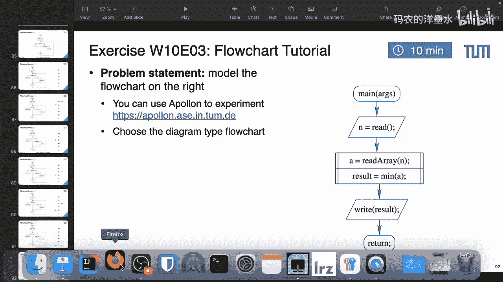
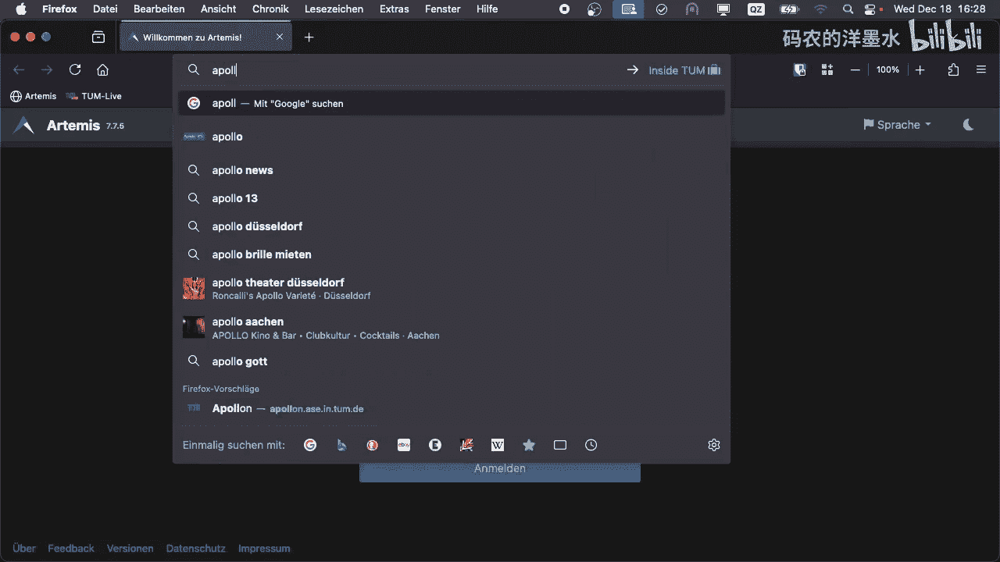
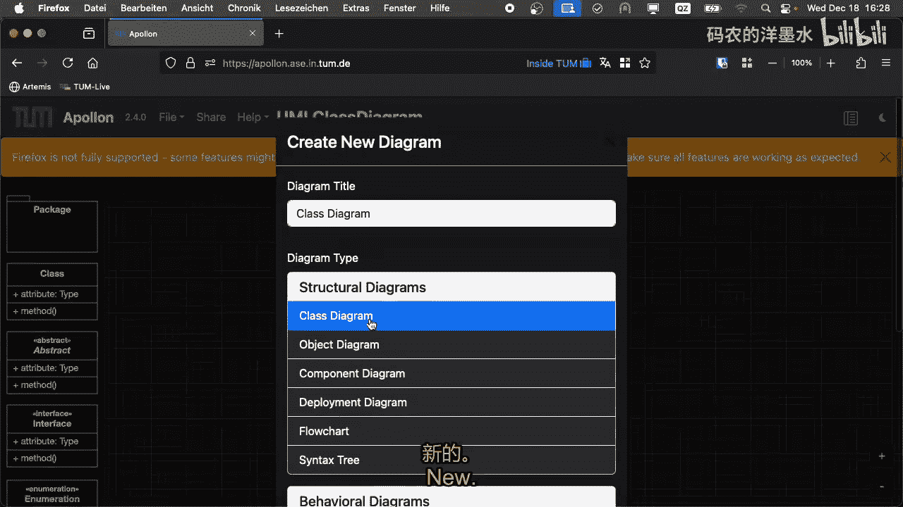
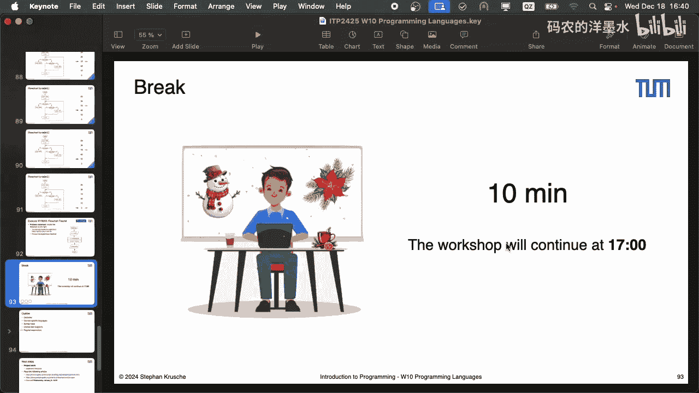

# 【全集】慕尼黑工业大学 计算机编程：从入门到实战 中英字幕 p46 Lecture 46 - 控制流图 -BV1WFrTBZExY_p46-

So。Welcome back everyone， today I will be presenting to you the topic of control flow diagrams。😊。

Now let's look into it。嗯。Imagine。You're navigating a city with multiple hos。

Detours and traffic lights Now a controlled pro diagram is like a map that guides a journey。

 so showing you all possible parts and decisions。😊。

The execution of a program corresponds to a singular path to a control flow diagram。

Let's have a look at the basic elements。At the starting， you have the start node。

 which is symbolized by a rectangle。We rounded corners。It shows that our algorithm begins。

 the end of our algorithm is symbolized by the end node or stop node。In。Of course。

 we can also show other stuff like we can read input and we can write output。

 and these blocks are symbolized by using a parallelogram shape。In Java， of course。

 there is not just a simple read or write function， but read actually stands for inputread。read in。

 and writeite is short for system out line。😊，Now we do this to make our diagrams shorter and more visually appealing so that they're not trust one cluttered mess。

 but we can easily grasp the content at one glance。Of course， we can also depict assignments。

 they are symbolized by a simple rectangle。😊，Yeah。Now， let's look into more complicated structures。

 We have the conditional branching。The condition as you can see， is in a diamond shape。

 and when we evaluate it， we either go down the yes branch or a no branch。

 depending if the condition is being fulfilled or not。These different branches。

 they can come together again in what is called a confluence。

So you have these two arrows and one leads into the  auto。

These arrows generally are just control flow transfers between the nodes。As you can see here。Now。

 for the loop， we combine two elements which we just now saw。

 the conditional branching and the confluence。You have again your condition in the diamond shape and you can imagine it like a while loop so if this condition is fulfilled。

 we go into the loop body and in this loop body of course， in Java。

 you can have anything that you can imagine so you can have assignments， you can have input output。

 or you can even have other statements， or more loops， everything is possible here。

At the end of this statement and we have a confluence through the control flow transfer。😊。

Back leading into the condition we evaluate。And once this condition evaluates to false。

 we go down to no branch and we are done with the loop。Now let's look at an example。

 does anyone remember or recognize what this does exactly？Yes。That is correct。嗯。

Yes that is correct exactly what I actually wanted to come to is that this algorithm it finds the greatest common divisor of two numbers which as you said already。

 and these numbers or integers are read from the user and as long as these integers are then unequal to each other。

 we subtract a smaller one from the bigger one。😊，And。In the end， we don't print this result。Now。

 let's go a bit more slowly through this algorithm。At first， as you can see the declaration。

 now we don't have actually we don't actually declare the variables in the control flow diagram。😊。

That that you could say is like once again to just reduce to clutter and keep it more manageable and。

To have a better overview， you could see。So you can just imagine the declarations at the start node。

Then we have the user input？As you can see again， read is the appbbreviation for inputread or read end。

 and we can have multiple statements in one node。😊，After we have read the input。

 we then go to the beginning of our loop， so it this corresponds to the beginning of our wild loop and we evaluate this condition。

If this condition evaluates to2， we go into the loop body。Which then， as you can see。

 is the if statement。We have a conditional branching in a conditional branching， as you can see。

 but it's pretty simple。😊，Then again， if x is smaller to y，tract we subtract x from y。

 and otherwise we go down the no branch and subtract y from x。Finally。

 then when this condition x unequal to y， when it evaluates falls， we print our gaze。And。

Right is again， here short for system our line。Now let's have a look at this example again。

 but with two concrete numbers。Not yet， I forgot something。😊。

So the execution of the program corresponds to a path through the control flow diagram from the start node to the end node and all these nodes lying on the path are operations to be executed all the conditions to be evaluated in the process so as if you go back if you would read for x and y for example。

 20 and then you check is x unequal to y is 20 unequal to 20 no， so you would just write 20 then。

 we don't even execute this part on the right side here。

And to determine the successor at the branch note， the condition for the current values of the variables must be evaluated that you already saw just now。

 but now we located it in an example。So we read in the starting x equal to 18 and y equal to 24。

Why don't you guys do it with me， what happens next？What do we check， It's pretty simple。

You just have to follow the arrows。Yes。し上げ。This is different。Exactly。So is x unequal to y？

Is 18 unequal to 24？Exactly， so x is unequal to 24， so we go down to yes branch。😊，Now。

 is x smaller than y？Yes。So then what we do we subtract x from y， so 24 minus 18 is 6。

 so our new value for y is 6。Then we again， we followed this transfer。

 we go back to the starting of the condition。 we check is again x unequal to y。

 so it's 18 unequal to 6。Yes， is 18 smaller than6 no， so we subtract y from x， so 18 minus6 is 12。

 that's our value for x。Then again， is 12 unequal to 6， yes， is 12 smaller than 6， no。

 so 12 minus 6 is 6。😊，That's our new value， again， for x。And now finally， is6 unequal to6？No。

So we write our result， which is six。😊，Now as you can see。

 the great thing about control flow diagrams is that for any Java program you write。

 you can also construct a control flow diagram and the reverse direction also applies that means for any that means for any control flow diagram you can imagine you can also write a Java program。

 however， it could be just more difficult to do so。😊，Nevertheless。

 it is something that I can recommend because imagine you' are debugging a complex Java program and you need to figure out why certain code is not being executed。

So how to actually trace the logic behind the scenes， you can， for example。

 then make a control flow diagram and on a sheet of paper and try to understand why is。

Something not being executed。But also， for example， for your project， a bombumer game。

 it could be a good intermediary step before you start writing code。So you have your partner。

 maybe you want to implement a certain logic like how your enemies move around。

 so you can make you can draw a control flow diagram。

 then implement it and also use this control flow diagram to explain what you actually implement it and maybe even use it in your presentation at the end。

Now， what do you do if you have a huge project like your bomber game。

 the control flow diagram for that would be giant and just unmanageable。

 what do you do if you want to call functions， how to do that。So let's have a look at that。

The first change we make is actually for the start node of the function。

 so we now write the name of the function and also the input parameters into the start node。

To called in a function， we have a rectangle with two lines on each side。And for each function。

 we then have a separate sub diagram。 That means it's a lot easier to maintain an overview because they don't have one giant control flow diagram。

 but rather， you have multiple smaller ones。And the end note change is that instead of writing stop。

 you actually write a return statement。Of course， a control flow diagram could have multiple return statements。

 just as your Java code。😊，So we can have multiple end nodes。Let's have a look at another example。

 So here we have our methone main。And we read user input and this user input is in the form that another method called Read array can pass this and transform it into an array。

So we give our input N to the method and then what happens there。

 we don't know this is like a black box， so we just know that at the end the result we get back。

 that is an array。Dad out there。A， we then give to our method minimum。Amin。

And min presumably calculates the minimum element in our array。And that result。

 we then write to the console。So we don't exactly know what's going on， but we can use the functions。

Now， let's have a look at how min could be implemented in the form of a control flow diagram with the help of an example。

So。Here we have the example， the first thing we do as you can see。

 we take an intermediate result and this intermediate result is the first element in B。

 as you all know， arrays start are being indexes and arrays start with zero。😊。

Then we introduce our helper variable， I。And。As I just now mentioned。

 because indexes start with zero， here I starts with one。

Then as long as this index I is smaller than the length of the array。

We want to continue traversing the array， trying to find if there's any smaller elements。

Then our intermediate smallest result， which at the beginning is the first element in our ArabB。

So let's go through it。 So we the first thing we do is。We look at 34。

 that's the second element in our array， we check is 34。😊，Smaller than 20。 It is not。

So we just in command I and look at the next element。Now is 12 smaller than 20， Yes， as you see。

 the screenarrow is moved in。😊，So our new result is now 12。We again in I look at the next element。

Is 45 smaller and 12。 No， it is not。 So we go down here is no branch in command I and again。

 look at the next。At， at the next。Position。So is 12 smaller than 12。 Now， Take here， it's smaller。

 It's not equal。 So is 12 smaller than 12。No， so again， we just go ahead and command I and track。

Is now3 smaller and 12。Yes， it is， so our new result will be set to three。Then again。

 we would in I and track， but is I smaller the length than the array than the length of the array。

It is not anymore， so that's our result and we return the result here。

Do you have any questions about control flow diagrams。Okay。

 then we have a small exercise for you just to model this flow chart on the right。

You don't need to model the specific functions like red array or min。

 just this as you can see it here， and for that you can use a pollen。😊，So， what you do is。嗯。

You go to Apollon。

And you say fine。New。

And then you choose flow chart as type。And then you can create a diagram。

 as you can see here on the left side， you have the terminal， the processes， the decisions， etc。So。

 yeah， if you need any help。Let the tutors know， and。We will be there。Okay。Then。

Thank you for your attention， If you have any questions， feel free to come to the front。

We are a lot of tutors here。And there is a 10 minute break now， so we continue at。1650。

