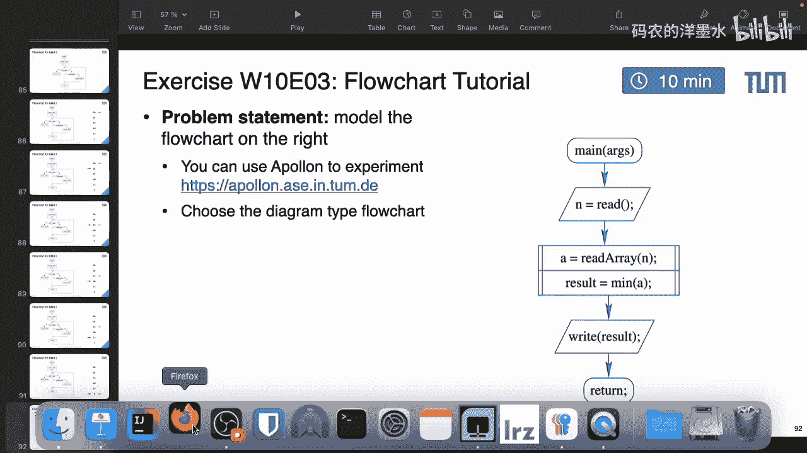
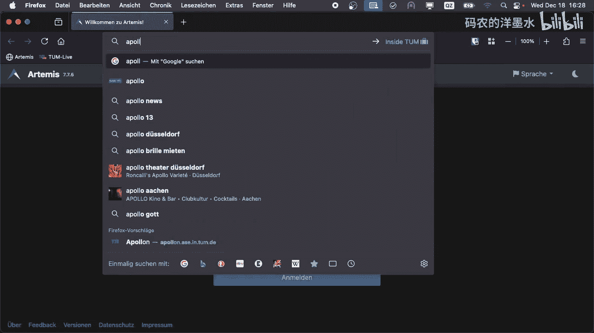
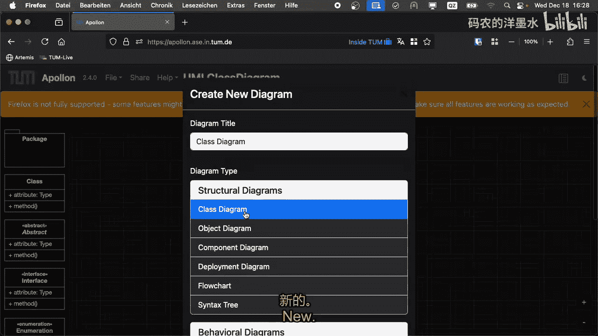
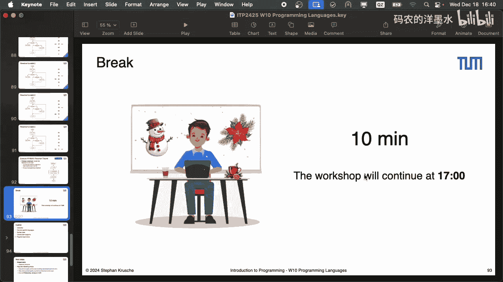

# 计算机编程：从入门到实战：46：控制流图 📊

在本节课中，我们将要学习控制流图。控制流图是一种用于描述程序执行路径的图形化工具，它清晰地展示了程序中的所有可能路径和决策点，就像一张指引程序旅程的地图。

## 基本元素

上一节我们介绍了控制流图的概念，本节中我们来看看构成控制流图的基本元素。

*   **开始节点**：表示算法的起点，形状为圆角矩形。
*   **结束/停止节点**：表示算法的终点。
*   **输入/输出节点**：表示读取输入或写入输出操作，形状为平行四边形。在图中，`read` 是 `input.read` 或 `readIn` 的缩写，`write` 是 `System.out.println` 的缩写。
*   **赋值节点**：表示变量赋值操作，形状为普通矩形。
*   **条件分支节点**：表示条件判断，形状为菱形。根据条件是否满足，程序会沿着“是”或“否”的分支执行。
*   **汇合点**：不同分支的路径可以在此重新汇合。
*   **控制流转移**：节点之间的箭头，表示程序执行的流向。

## 循环结构

了解了基本元素后，我们来看看如何用它们表示更复杂的结构，比如循环。

循环结构结合了条件分支和汇合点。它类似于 `while` 循环：首先判断条件（菱形节点），如果条件为真，则进入循环体执行语句；循环体结束后，控制流通过汇合点返回条件节点进行下一次判断。当条件为假时，程序沿“否”分支离开循环。

循环体内可以包含任何语句，如赋值、输入输出，甚至是其他循环或条件语句。

## 实例解析：求最大公约数

理论需要结合实践，让我们通过一个具体算法来理解控制流图的应用。

以下是寻找两个整数最大公约数（GCD）算法的控制流图。

该算法的逻辑如下：
1.  读取两个整数 `x` 和 `y`。
2.  进入循环，判断 `x != y` 是否成立。
3.  如果成立，则判断 `x < y` 是否成立。
    *   如果 `x < y` 成立，则执行 `y = y - x`。
    *   否则，执行 `x = x - y`。
4.  循环结束后，输出 `x`（或 `y`，此时两者相等），即为最大公约数。

程序执行对应着从开始节点到结束节点的一条路径。路径上的所有节点都是要执行的操作或要判断的条件。在分支节点处，需要根据变量的当前值来评估条件，以决定后续路径。

让我们用具体数字 `x=18`, `y=24` 来演练一遍：
1.  判断 `18 != 24`？是，进入循环体。
2.  判断 `18 < 24`？是，执行 `y = 24 - 18 = 6`。
3.  返回条件判断 `18 != 6`？是，进入循环体。
4.  判断 `18 < 6`？否，执行 `x = 18 - 6 = 12`。
5.  返回条件判断 `12 != 6`？是，进入循环体。
6.  判断 `12 < 6`？否，执行 `x = 12 - 6 = 6`。
7.  返回条件判断 `6 != 6`？否，退出循环。
8.  输出结果 `6`。

## 函数与方法调用

对于大型项目，控制流图可能变得非常庞大。这时，我们可以通过引入函数来模块化图表。

主要变化如下：
*   **函数开始节点**：在圆角矩形内写明函数名和输入参数。
*   **函数调用节点**：用一个两侧有双线的矩形表示。
*   **函数子图**：每个函数拥有独立的控制流子图，这有助于维持清晰的概览。
*   **函数结束节点**：不再使用“停止”，而是使用 `return` 语句。一个函数可以有多个返回节点。

例如，一个 `main` 方法可能调用 `readArray` 函数来获取数组，再调用 `min` 函数计算最小值。我们无需在主线图中展开函数内部逻辑，只需将其视为黑盒。

## 函数实现示例：求最小值

让我们看看 `min` 函数的一个可能实现。假设输入数组 `B = {20, 34, 12, 45, 12, 3}`。

其控制流图逻辑如下：
1.  初始化 `result = B[0]`（即 `20`），初始化索引 `i = 1`。
2.  循环判断 `i < B.length`？
3.  如果成立，则判断 `B[i] < result`？
    *   如果成立，则更新 `result = B[i]`。
    *   否则，不更新 `result`。
4.  执行 `i++`，然后返回步骤2进行下一次循环判断。
5.  当 `i` 不再小于数组长度时，循环结束，返回 `result`。

执行过程：
*   `i=1`，`B[1]=34`，`34<20`？否，`i++`。
*   `i=2`，`B[2]=12`，`12<20`？是，`result=12`，`i++`。
*   `i=3`，`B[3]=45`，`45<12`？否，`i++`。
*   `i=4`，`B[4]=12`，`12<12`？否，`i++`。
*   `i=5`，`B[5]=3`，`3<12`？是，`result=3`，`i++`。
*   `i=6`，不满足 `i < 6`，循环结束，返回 `3`。

## 工具与练习

你可以使用绘图工具（如 Apollon）来绘制控制流图。在工具中选择“流程图”类型，即可使用左侧提供的各种形状（终端、处理、判断等）进行绘制。

尝试将本节课提到的 `main` 函数调用 `readArray` 和 `min` 的流程绘制成控制流图，无需展开函数内部细节。

## 总结

本节课中我们一起学习了控制流图。它是一种强大的可视化工具，能够清晰地描绘程序的执行逻辑和所有可能路径。对于任何Java程序，你都可以构建对应的控制流图，反之亦然。在调试复杂程序或设计算法逻辑时，绘制控制流图是理清思路、发现问题的有效方法。通过将函数模块化，我们还可以用其来管理大型项目的逻辑结构。

---

