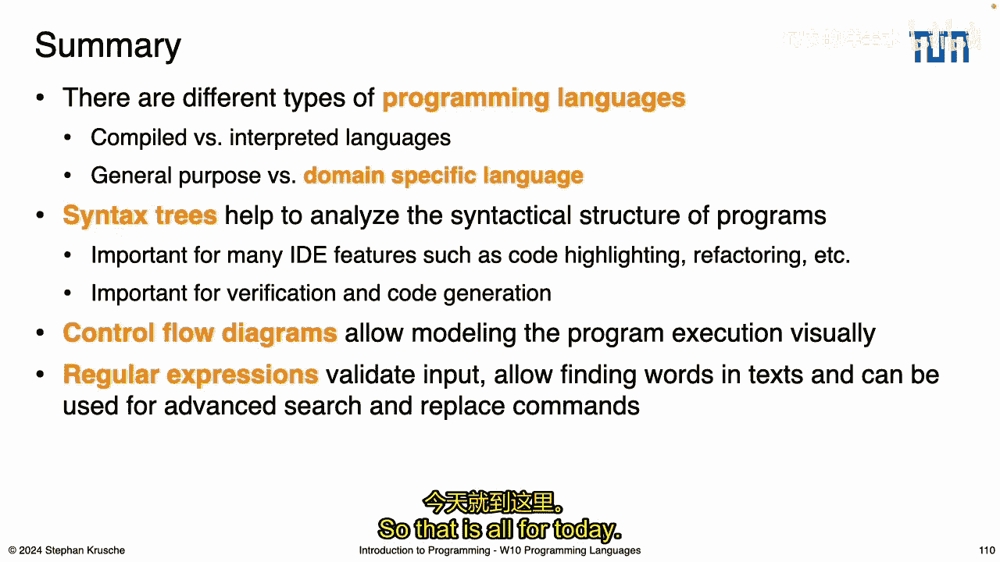

# 【全集】慕尼黑工业大学 计算机编程：从入门到实战 中英字幕 p47 Lecture 47 - 正则表达式 -BV1WFrTBZExY_p47-

Hello， everyone， can we continue， please？

So hello everyone， my name is Emma， maybe some of you remember me from being here every Wednesday with you as a part of the lecture support team。

 today I have an opportunity to conclude this workshop and talk to you about a couple of a very interesting topic。

So before we even start， as it has been announced， we will be talking about regular expressions。

 so I was just wondering how many of you actually know or have ever heard about regular expressions。

 you can just raise your hand。One person。Okay， I guess good enough。

So before we actually go into what regular expressions are and how we use them in Java I will give you a couple of motivational applications of this concept in maybe a bit broader sense so that we just grasp the concept together so as you can see on the slide there are a couple of applications in which we can use regular expressions such as in searching。

 replacing validating coordinating and reformatting text so let's just go over each one of them probably one of the most commonly refer to application of regular expressions is in searching so what regular expressions are for now you can think of them as a patterns or like a mini formula that enables you to search for a specific types of strings in a very large body of text why is this so useful you can imagine having a very very large body of text and you。

ha to extract all the places in text where email addresses occur so one way to do this would be to go line by line through this text file and manually extract each of these email addresses。

 but alternatively if you want to speed up this whole process you can just define a regular expression which would essentially map all of these email addresses for you automatically。

The next very common application of regular expressions is in replacing particular items so we can again imagine either a very large body of text in which you want to replace specific strings with an alternative strings my friend Yna the beginning mentioned HTML files in case some of you forgot those are basically just the text files that are used to structure what pages that we have and in these text files we commonly come across something which is called text so using these replace features of regular expressions。

 what you can do is for example switch all the uppercase tags with a lowercase equivalentence so again instead of going one by one through the text you can do this very fast using regular expressions。

😊，The third application is probably one of the which you are most familiar with and itss validation of the input。

 so you can imagine when you want to create an account on some website and you have to set up a password and in order to be able to create this account you need to make your password according to certain constraints or requirements。

 for example， you have to use uppercase letters， lowercase letters。

 specific digits or specific symbols in order to be able to complete the creation of the account。

 so the logic behind that checks if you actually satisfied all of these constraints in your password is based on regular expressions so you can essentially define a pattern that will check for you if the entered password or really any string complies with a set of constraints that you want to impose。

Then we have also coordinating actions， so for this application you can imagine having a very。

 very big directory that contains multiple files and you want to process only a certain subgroup of these files that for example satisfy a certain condition。

 so maybe it could be that you want to process only the files that all in name have a specific prefix。

 so instead of going through the directory looking at each files separately。

 you can again define this pattern that will be able to identify all of these files for you automatically。

And lastly， we also talked about formats of different。

text files and here we can also find one additional application of regular expressions so you can imagine having two different programs where they are somehow bridged in a sense that the output of the first program is used as an input to the second program but the problem could be that the output of the first program so the layout of the output does not comply with the input requirements of your second program and in order to do this very quickly so to adjust the layout of the output of the first program to satisfy the constraints of the input of the second program what you can do is you can use regular expressions that do this adaptation or conversion quite quickly and efficiently。

So now that we motivated why we learn about this topic。

 let's look closely what regular expressions are， so I hinted at the beginning regular expressions just present basically a very a sequence of characters that can be really of any length and complexity that specifies a search pattern that you can then use and apply on your body of text to match certain portions of this text what you can find in literature regular expressions are usually and most commonly referred using this abbreviation。

 so Regg X， which stands for regular expression， or sometimes they are also used as Regg XP。

 which is most more commonly used in programming environments。

 as far as I remember in JavaScript to create a regular expression object you would write something as new reg XP。

And at the very beginning when these expressions were developed they were also called rational expressions。

 and this name is very the legacy name of these expressions and it has its roots in the area in which these expressions were initially developed。

 so theoretical computer science and formal language theory where they were initially used to describe something that we call regular languages。

😊，So as mentioned before， mostly they are used in string searching algorithms to either find or find and replace certain strings and also input validation which ties to our example about the password creation。

Luckily these expressions are supported by many programming languages and editors what is important for you to understand at this point is that they are applied to the text from left to right and we can look at the example that we have here to understand it better so orange in orange we have ABA which is essentially our regular expression what this regular expression will match it will essentially match any appearance of the characters ABA exactly in this order in our body of text for now we have a really small body of text which is this string here in bold。

But there are a couple of things that you need to realize here， so we start， as I said。

 matching from left to right， so our regular expression would match ABA so the first three characters of our string and from this point on what you can imagine is that these three strings have been consumed so they don't really。

 in a sense exist anymore and we can only start matching so we can continue matching from our character B。

You can also see at the end of this sentence that we successfully matched the first three characters of our string。

 so we said they are consumed and we cannot reuse them for continuing to match。

So our next character is here B， but our regular expression here says that we need to start matching from letter A。

 and this point that I said about consuming already matched characters is here important because you cannot start matching from the third character so here again ABA because this third character A has already been matched in the first matching iteration so we are stuck here at the character B and because our regular expression demands for the match to start with A。

 we have to skip this B， or in a sense it doesn't match。

 which is why we have this an empty space in our output。We skip over B。

 our cursor is here at a next A， and again we can realize we have this exact sequence of characters that we can match with in response to our regular expressions。

 so we match this is one，2，3， four from the fifth letter so we match a， BA again。

 so you can also see that here on the output。And at the end we are left with only B， but these two。

 they don't again match according to our regular expression because as we said。

 we need to start with character A， so these two last characters are left unmatched。

 which is why we have an empty space here， so the main takeaway we match from left to right and what we match。

 we basically consume， we cannot reuse it in the further matches。Okay。

 so that was a very simple example， now we can look at a little bit more difficult example than the one before。

 the important thing to realize here is that regular expressions offer us a very nice and concise way to essentially specify what kind of strings are to be found in our desired set of strings。

 so naive approach would be to literally list string by string and say okay。

 these strings that I listed out are supposed to be found in my set of strings。😊。

This could take quite a while if you have a lot of strings to write out and include in this set。

 so what we can essentially do is we can write out a very simple regular expression that is basically able to match to all of these strings and here we have exactly an example we have three you can see the curs of yeah perfect you have three essentially words。

And in the orange we have crafted one version of a regular expression that would match to all of them so let's break it down together so what this regular expression actually demands from the string to have in order to be matched is to start with the capital H and we can agree that all of these three strings start with capital H then we look what is to be found within these two within these parentheses so the important thing to realize is that we have two operators here to consider so this vertical line is essentially like an or operator which says you either match what is left of the vertical line but still within the parentheses or you match what is right of the vertical line but again within the parentheses and then we also have this question mark operator which basically says the character that is to be found in front of the question mark can but also doesn't。

Have to exist so it can be in the string， but also doesn't have to be。

 And then at the end we have N D L N D I No sorry N D E L which are basically just letters that also have to be present at the end of our words So how do we know that they actually match to all three of these strings。

 we said at the beginning Each of them do start with H then we can consider the first string the next character after H is a So when we come to this parentheesis part。

 we wouldn't match this a special a in German language with two dots。

 we would look at the right part of the vertical line and here we have a so this would be a match and we said that the question mark essentially says that E can but also doesn't have to exist in the first case we don't have E that follows a so this would be also fine and then we have the ending end the。

EL， which matches perfectly to the first word， similarly for the second two words。

 the second two word， so the second word essentially we have this a with two dots which is why we would match to the left part of the vertical line and then we completely skip everything that's on the right because we already matched with what is on the left and then we have again this ending and the last word we match right off the vertical line and we would match both of these letters because E also appears here and this operator allows us to match E in this case and then we again have this ending。

😊，The important thing to say and you will realize this as we continue further is that this is only one way how we can write out this regular expression to match all of these three strings。

 so there are many different ways how can you write the same the regular expressions that is supposed to match on all of these three strings as well。

 so this is not a unique and fixed way， how to do it。😊，And as hinted here at the end of the slide。

 there are many operations besides this alternating one。

 so this vertical line that we discussed and the question mark which essentially says Ken or doesn't have to exist。

 and we can realize that and understand that from this a bit more more complex regular expression and the main purpose of this regular expression is to essentially match every mostly every occurrence of the email addresses。

 so today it could be it could happen that there are some more difficult email addresses that wouldn't be matched。

 but in general sense this regular expression would essentially match to all of the email addresses that exist in your body of text。

So let's break it down together and understand what is happening here。

 so we start from these two slashes which essentially say， okay。

 my regular expression exists between these two slashes。Then after we have this。

We consider what is inside of this square bracket。Inside of this square bracket。

 what this essentially means that at the place where your cursor is in text。

 the character that you have at this place， where the cursor is has to match any of these specifications within the square brackets。

 so what do we have here we have a backslash W， which in the world of regular expression。

 regular expression means word， any letter， it can be lowercase or uppercase， any number。

 so from zero to nine。So yeah， this is thenot any letter， uppercase， lowercase or any number。

 or at the exact place where a cursor currently is in text， we are to sign dot， this lower line。

 percentage sign plus or hyphen。😊，What this plus here means it means that any of the characters that match to the specification inside of these que brackets can occur at least once or multiple times so to understand this better I will give you an example I will use my own TUM email to demonstrate this so this bracket is essentially supposed to match everything that comes before the E sign so my email address would be Emma which is my first name and all of these letters EA would be matched using this first part that you have in the bracket because we have this plus sign we can repeat the letters and therefore match them so first time we would match E then because we can repeat the elements that are specified in this bracket we would match M then a then I have a dot which would be matched by this element and then I have my last name which would also fully be matched with this first part。

Within the bracket。Then comes Ed sign also in my email。

Then this square bracket here is responsible for matching the domain name part of your email address。

 in our case it would be TUM， we again here have slashW which matches any character， any letter。

 lowercase uppercase， any digit， dot and hyphen， so in this case we would use up TUM。

 we have this plus sign which says we can match at least one letter or as many as if we want。

 the first time we match T and then we have U and M。After this plus sign we have backslash dot。

 this is very important to say because dot on itself in the world of regular expressions is a specific it's a specific operator we will later on see what it is on its own it's called wild card and it can essentially replace any character but to match a little dot so the dot we have in our email we have to use backslash to escape it so this would match we had here TUM dot and then we have to also match the top levell domain name of our email which is in our case D and that would be matched by this the last part of our regular expression so what this here means is that the last part can be any letter lowercase or uppercase but the last part can only have。

😊，At least two letters or at most four， because this is the standard way to define the top level domain name of our email。

 so it can be DE， it can be calm， or any other variations。

 usually not more than four letters are consumed or less than two。

This was a bit more complex example， we will have a couple of more so you will get used to it。

 but before we do more examples and before we go on to any possible questions I will just present you quickly a cheat sheet that you can use in understanding the way these regular expressions work so we said that the dot on its own without the backslash is called a wild card which means that it can match any possible character so really any character except a new line we already have seen this so this matches any word and in the world of regular expressions。

word stands for any lower or uppercase letter or any number。Then backslash D matches any digit。

 backslash S matches any white space then we have。Like a negation for these from second to the third。

 so capital W essentially matches to anything that's not word。

 so anything that's not lowercase or uppercase letter or a digit then D intuitively matches anything that's not a digit and the capital as matches nothing everything that's not a white space。

 you can also use again as we saw in the previous example these square brackets which essentially say that at the given position in your text you have to match any of these three that are defined here so either A B or C if you use this head sign。

 you can basically match anything that is not a B and C so it kind of behaves as a negation here as well you can also define a range so this would match any letters that exist in this range。

Very important to mention are these escape characters so if you really want to match a literal dot or a star sign or in this case really a backslash you have to escape it using a backslash because otherwise the dot would be treated as a wild card not as a literal dot and the star sign here would be treated as a quantifier which we will see here now we can also use tab new line and carriage return and very important for you now is to understand how the quantifiers work so we said when we have a star in our text we match zero or more occurrences if we have a plus we have to match at least one a or more if we have a question mark we don't have to match a but we can also so this is from the very first example if you remember。

If you use curly braces and define a constant in this case， five， you would match exactly five A's。

If you use two comma nothing， this would match at least two occurrences of A or as many as you want。

Or as many as there are better said here you define a strict range so from one occurrence up to three and this one is very interesting I had to also Google it myself so one thing about the quantifiers in the regular expressions is that they are very greedy in a sense that they try to match as many characters as possible so you can imagine a very very simple example where in your body of text you have four a's one after each other of course and then you have as your regular expression just a plus which would mean you match1 a or more because the regular expressions are greedy a plus would match all four of them but if you use a question mark after the plus you say hey regular expression be lazy and match as。

As few characters as possible， so if you were to write a plus question mark。

 even though you have four A's， you would only match the first A。

 and it's exactly the same for the second example here。

 you define range at least two A's or as many as it's possible to match。

 again in our case in which we have four A's， if we use this lazy approach。

 we would literally only match the first two， but if we were just to write a curly braces two comma nothing。

 we would match all four of them。And then we come to this infamous vertical line or essentially an alternation operator which tells you。

 okay， at this current position， I either match AB or I match CD so this is yeah a very common cheat sheet to just understand how regular expressions work。

😊，I have a couple of examples following this cheat sheet， but before I dive into them。

 are there any questions so far？Regarding we can also go back to any of the slides that I went through。

If there is any question。Okay。I mean feel free to interrupt me at any point okay so let's just analyze any of all of these examples just to get a better feeling of how regular expressions work so we said when we define a constant inside of the curly brackets we essentially say okay we have to match this many instances of this character so this way if we have a regular expression written like this。

 we would match exactly five A's in our text of body again if we have three we would just match three ends。

This， if we have a regular expression written like this。

 we would have to match any four letters which is what we define with this range。

 so really any lowercase letters at least four times not at least exactly four times because we don't have range in here within the curly brackets here we have range for letters and also how many times they need to appear so with this regular a regular expression we really want to match any sequence of lowercase letters so any sequence that is at least six characters long but it can also be longer longer than six the important thing is that it is at least six characters long here we really define a very fixed range so the sequence of lowercase letters for a successful match has to be at least eight characters long or at most 11 and we can also do the same example with the digits so we here really look for a。

ence of 11 digits， so digits can come。 They can be any digit within this range。Okay。

 any questions here？😊，Doesn't seem so。A very intuitive tool that you can also explore on your own if you just want to experiment with how these regular expressions actually match is on this website。

 I believe it's called Regix R。So essentially you come you can follow this link to visit this website and it's really really easy to use in the first parts of the top part of the website allows you to define your regular expression which you can see here and we just have one regular expression as an example in the window below you define your text that you essentially want to match and when the text is like balded in blue。

 that means that using your regular expression so it means that this string would be matched using your regular expression so regular expression would match this string and what is also very useful is that in the very last window here you can really see the definition of everything that you use in constructing your regular expression so here just an example that the first thing that we define here was this range for any lowercase letter and here we get a very nice intuitive explanation what this part of our regular expression means。

So in case you really want to get a better feeling of how these regular expressions work。

 I would highly recommend to check out this website。😊。

Now we will look into a little bit more advanced examples but if we break them down nicely and easily it's very。

 very intuitive to understand so the first example would essentially match any 24 hour time match that appears in your text and how do we know that so we can first focus on this first parentheses so everything between these two dots over here because this would match any hour so how do we know that is that if our hours go from zero to nine we can decide to have leading zero so this question mark says either of these two can appear but they don't have to so if you want to have a leading zero in front of nine you can have zero9。

😊，But you also don't have to have it because we have this question mark making it optional。

But then if you want to match all the hours going from 10 to till 19。

 so you have to start with one which is ensured by this one over here。

 don't be confused by this question mark again， it only stands here as an option so it can appear but it doesn't have to but in case we want to match any hour from 10 till 19。

 of course we're going to need this one from here， so we basically get one from here and then any digit from zero to9 would match。

Or if our hours start with two， we have to have two and then any digit in the range from zero to three because we don't have any hours that are above 23。

So this would ensure that you have a correct hour then we have semicolumn or yeah I'm not sure if that's the way to call it two dots。

 let's say it like that and we want to match minutes now so minutes we know that they go from 0 to 60 excluding 60 so 59 and we want to make sure that the first digit is in the range from0 to five so any really any number in this range and the second one can go from zero to9 which would cover all the numbers from0 to 59 and then we also have the same logic for seconds but we encapsulate this part of the regular expression in parentheses and say question mark because maybe sometimes we want to match seconds but we also maybe don't want to so this would essentially match even if you have only an hour and minutes because again this question mark says we can have match in this we can match something from this parent from this parenthesesis。

Or we don't have to。A very similar logic is applied for the date format。

 of course in German notation here， and we can quickly try going through it。

 so we have a leading zero for any date for any date that is below 10 and then we match from one to9 or。

😊，Or yeah， from one to 10。Let me check， so this is zero from one to9， or we have。

Okay this is 12 okay， so this is for any day that is either starting with one or starting with two and then basically we can use this notation to say any digit can follow so what we could have we can have 11th and then we would consume one from here and then one coming from here or we can have 17th for example and we consume one from here and7 from here or we can have also days that start with two in this case we would match this to here because the point is to match either of the digits that are within these square brackets。

And the second digit would come from this， so if you have 20th we would have two from here and zero from here and so on and so forth。

 but we can also have a case in which the date starts with three。

 so those are only two cases so we would have three of course and then we can have either zero or one so again important thing to remember is that either we need to match either of the two that are here。

 then again we have a dot and then we basically have the same logic for month so here we would match any month that so we would put of course a leading zero in front as you can see here in this example and months that go from one to nine so this would match anything from January to I guess September so if you have October you would then match what is right of the vertical line and basically you can match October。

 November December with this part over here because the first digit has to be one。

And then we can have either digit within this range，0，1 or two。

We again have the dot and the same logic applies for the year here we only match years starting with one。

9 or two，0。AndBa we say， okay， the last two digits can be any two digits。

 but we make sure that there is only two of them just to have a proper year in the end。

And with this regular expression， as it's noted here。

 we wouldn't essentially match any impossible dates such as this one here。

Perfect we have more examples so again if you want you can write a regular expression that would essentially match your TUM online identifiers so remember at the beginning we have two characters then two digits and then three characters and this is essentially how we define the regular expression so we say any two characters make sure really it's two of them then we say any two digits we constrain it with the constant here between the parentheses following the backslash D and then in the end we say okay again we need to make sure that any lowercase character follows after these two digits and we make sure that the three of them actually follow so you can check for yourself but both of these examples would actually be matched by this regular expression。

The email one we don't have to really go through again because we had the example at the beginning。

 if you remember when we were introducing regular expressions， again。

 we say that this is not the perfect way to match all the email addresses because new versions of email addresses could exist and they wouldn't cover be covered with this regular expressions。

 but any standard email address such as the ones that we have here as an example would be successfully matched by this。

Regular expressions。And at the end we have a very interesting regular expression that's maybe a little bit complex but we can try to understand it。

 so this regular expression contains an operator that we didn't introduce so far and it is called a positive look ahead look ahead operator so what this operator essentially does。

 it doesn't move the cursor so it doesn't consume any of the characters。

 remember we said at the beginning the characters that don't do match in the iteration they are kind of consumed and we cannot reuse them but what positive look ahead does。

 it doesn't consume any characters so it literally doesn't move the cursor from the current position but it just checks if somewhere in your sequence of text。

 this is being satisfied， the condition inside of the parent' disease is being satisfied。

 so this logic is essentially used for the validation case that we introduced at the beginning where you want to check if your password really does contain the characters that we demand。

It does and we don't really have to check in what order these characters are。

 but we just need to make sure that they exist somewhere inside of our password and for that we use this positive look ahead again。

 it doesn't move， it doesn't consume any characters it just checks if those are there so here specifically this positive look ahead operator is just this question mark and equals。

So these two together make up this positive look ahead operator so what we basically say okay just check for me that somewhere in your password you you have at least one occurrence of lowercase letter what is this before we have dot and star which essentially dot we said it can be it can match to any character this is a wild card and the star says zero or as many as we want so we essentially hear say it doesn't matter if there is something before this lowercase character or there's nothing so they can be immediately there。

 just check if there's at least one occurrence of lowercase letter and the second one works in the same way we have positive look ahead here。

 we say before this parentheses actually occurs we can have anything or we don't have to have anything so anything is really this dot we don't have to have anything or we can have as many。

We want is this operator star here and then we say at least we need to have one uppercase character。

 then we also want to maybe demand that we need to have at least one digit so we again say。

 okay please check if immediately follows a digit or I can have some characters before。

The digit follows and at the end， which is very important to say that our expression essentially has to be at least eight characters long。

 which is what we define with this last part we say the expression needs to contain lowercase uppercase letters。

 which we also wanted to check with this positive look ahead operator or digits。

 which is this last part of the look ahead positive look ahead operator and we say that at least the sequence needs to be long eight characters。

 it has to be eight characters long at least， but it can also be longer。😊。

So a very simple way how to ensure that the constraints you really want to impose on the password are being met。

Okay。So now， first of all， are there any questions to this more theoretical part of the regular expressions？

No， okay， so now we can essentially look how this works in Java。

 so we have defined in our playground class a string。So yeah string of text。

 so we have this very long string that essentially represents text that we want to use to see which parts of these texts this text are matched by our regular expression。

😊，So this is a text we're working with and now what we want to see here is we want to print essentially if there we want to check if there is any is there any sequences within this string that match the regular expression that we defined here what is important to understand why do we use two backslashes here。

 that is because in Java when we write just a single backslash。

 you know this is used as a beginning of the escape operator so you maybe remember a new line so you would start with a backlash n。

 so if you only write one backslash， Java will think okay this is a start of the escape operator and we start thinking that you want to essentially use an escape operator but not the regular expression。

 but then it would find this W and it wouldn't know what is this kind of escape operator doesn't exist。

 so it would throw an exception for you？That's why we want to escape this escape operator by using an additional backslash and what this translates to is really match any word。

 and we said any word is any lowercase or uppercase letter or any digit。And we say， okay。

Match me one word and then you can also match any character after this word and any character can。

Come after after this word or it doesn't have to， it can come like as many times as you want or it doesn't have to come at all and of course the method that you use to essentially applies is regular expression to your text over here is matches so this is one of the methods that you can apply on the string objects and what it essentially does it implicitly。

Compileles or converts， in a sense this regular expression into a pattern object that we will look into a bit later。

 but for now just understand this as take your text and apply this regular expression to your text and see if anything matches if something matches we print true and really in our case we do manage to match quite some things in our text because there are as we said there are multiple。

 we essentially match the whole string because as I said。

 the backslash W matches any lowercase or any uppercase letter in this case we start with uppercase T and then we have this dot that can match anything as long as it's not a new space。

But here we don't have a new line operator， so it would essentially match the whole string。

Then what we can also do is we can take our string and split it at every position where we have a space because if you remember backslash S you is used to match spaces and when we have plus what we said we need to at least match it once or as many times as we want and what this line would essentially do it would initialize your array of strings with every and each word that we have in our text string so it will literally split the string everywhere where you have a space and will fill up your array over here what you can also do is you can then check if this really worked and then you can see how long your array is and in case you do really try this out on your own you can see that this line would output 14 for you which is exactly how many words we have in our。

Big string over here。What we can also do is we can really go through the string and print out every word just to make sure that we really do have every word from our initial string as a separate element in our array and we can just implement a very simple for loop that does does for us so it will print each and one of these word in a new line and then just for fun what you can also do you can see that your text string here。

 every word is separated by a white space， but what you can do is you can essentially separate every occurrence of the white space which would be matched by this。

By a tab， so this would essentially make a tap space between each of your words。

 and if you print that out， you would see that really every white space has been replaced by a tab。

Perfect， and this is exactly what is explained here in yellow。

 so I just explained it to you in words。😊，And before we do a small exercise I will then present as promised what pattern object essentially is。

 as we saw in this example here we are calling matches directly on our string object and what this does is it implicitly essentially converts our regular expression into something which is called a pattern object。

 why this is not so nice to use all the time is every time you call matches on your text。

 this implicit conversion happens so your reconverting your expression over here into pattern object over and over over again。

 but to essentially avoid that we can just create a pattern object。

At once and then applied to all of our strings。Which is essentially what we do here。

 so we create an object of the pattern class and we compile our regular expression。

 yeah we compile our regular expression into an object of the class pattern。

And then what we can do is once we have our pattern。

 which you can imagine it as representing our regular expression or our mini formula to match the strings。

 we can call onto this pattern match， which is a method that essentially returns an object of the type match。

And it takes as an input the string that you want to match， and then you say okay。

 so basically what this line translates to is look at this string and see if it matches according to my regular expression。

 so now you're calling matches on the matcher object because we said the pattern when you call match on the pattern you get as a return object of the match class。

 so again just to repeat once more with this line you say okay。

 please consider my string over here and check if it matches if the pattern that I define in the line before。

 would match the string。And you can do that for all of these strings and just to be sure that this really works。

 we decided to print them out in console and you can also verify this on your own。

 the first two strings would essentially match， which is why we turned true and the last two would not match according to the definition of our regular expression。

What we can also do is then another example here where we want to see where we want to say that word color can be written with or without you。

 so we again create our pattern。Pattern object here。

 so we compile our regular expression into the pattern object。

And we create in this case explicitly our match object and we say， okay。

 please check if anything in this string that I have over here would be matched according to the pattern that I created in the line before。

 what is also important to say these pattern objects are stateless which means that once you in a way initialized the pattern object with a specific regular expression。

 you can really change it on the go， so this pattern really reflects this regular expression and this pattern here really reflects this regular expression that you have here。

Why we created this matcher object over here is because once we have this object we can do more advanced checks。

 let's say it like that on our string， so on our matchcher object we can also call methods such as find。

 start and end， so what find does， it checks if it can actually find match anywhere in your input string if it can。

 it returns true。You can also use find， for example， in a while loop because。

It will matching after so it will just continue in each iteration matching through your input string。

 the start method would essentially return you the index of the character at which the match starts so in our case here we said the regular expression is supposed to match color either written with you or without so if we call start on our match object it would return4 because C here starts as the fourth index and then we have again end which would return to you index after after the last matched character so here the last character would be R and it's at the index position8 so and would essentially return to U9 because that's the index position after the last character has been matched。

But be careful in case you call start or end and there is no match at all， so for example。

 here we have this pattern ABC and we are trying to see if our input string which is。

Wwhichch we defined here contains any sequence at any position that follows A B and C。

 it obviously doesn't because we don't have that sequence in here， this would return your false。

 that's correct， but if you instead of find here call either start or end and there is no match at all。

 the illegal state exception would be thrown so you have to really be careful when calling these two methods you really have to make sure that there exists a match at some point in your input string given your regular expression and then you can extract essentially the information where it starts and where it ends。

Perfect， any questions in regards to these two examples？No。

 you also have these annotations here which can help you maybe understand if you decide to go through these slides on your own。

But if there are no questions at this point maybe we can move on to a small exercise so you can really try it out on your own in intelligentJ。

 so the exercise is very simple， you can also look at the exercises that I presented it's really based on the exercises I presented so far so what you're required to do is you need to craft essentially a regular expression for file endings in Java code so more specifically these are the endings that your regular expression should be able to match and endings such as this one for example。

 is the one that wouldn't be matched。So file endings should have between two and four characters。

 remember this is important for the curly braces， they can only include letters。

 again remember the ranges， the range way of writing the matching for the letters and numbers and if it's easier for you you can make use of this website that are presented to you so it's just res are where you can try it out to see if this really matches and yeah base your solution maybe on these examples over here to guide you through。

So for this you have 10 minutes。And then we can discuss the solution together so we will resume now hopefully some of you manage to implement the solution if not you can always ask any questions that you have in your tutor sessions so here we have a very we have a sample solution here so basically what you do is just compile your regular expression again into the pattern object we said any lowercase letter uppercase letter digit that appears in sequence at least two but at most four times what we did here is we also compiled an array of endings just to make sure that we actually managed to match them with our regular expression and in the end you have a very nice lambda function in case you remember with these in the previous previous classes so what this regular what this lambda function would essentially do it would print each of these endings in a new line followed by these two dots and then it would assess。

Tell you if it matched or if it didn't。hopefully for all of the strings that you have at the beginning。

 the match would be resulting in true， and only for the last one it would be resulting in false。

Perfect， so now we are through the last section of this workshop and here I have a couple of next steps for you。

 of course you should be working on your project work。

 so implementing the game in Team here we have also two references that you can check out one is on regular expressions in Java and the other one is on the flow charts which my friend previously presented and yeah this is all due to 8th of January so you have quite some time over the break to check these resources out and also work on the game。

To summarize today's workshop we learned that there are different types of programming languages so they're compiled and interpreted languages。

 their general purpose and domain specific languages。

 we also looked into syntax trees and we learned that they help to analyze the syntactical structure of programs。

 they're important for many IDE features such as code highlighting。

 refactoring and so on so forth and they're also important for verification and code generation。

 at the end we also looked at control for diagrams which allow us to model the program execution visually。

😊，And in this last part of the workshop we looked into regular expressions which we can use to validate input。

 allow finding words in text and can be used for advanced search and replacement commands。

 so that is all for today， thank you for attending and happy holidays。

