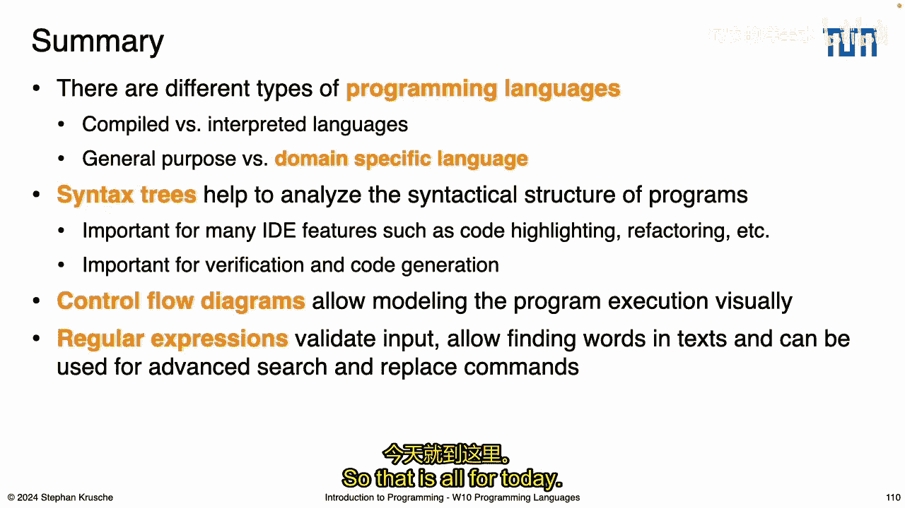

# 计算机编程：从入门到实战：47：正则表达式


在本节课中，我们将要学习正则表达式。这是一种强大的工具，用于在文本中搜索、匹配和操作字符串。我们将从基本概念开始，逐步深入到更复杂的模式匹配，并学习如何在Java编程语言中应用正则表达式。

## 概述

正则表达式是一种由字符序列构成的模式，用于定义字符串的搜索规则。它们广泛应用于文本搜索、替换、输入验证、文件筛选和格式转换等场景。理解正则表达式将极大地提升你处理文本数据的能力。

## 正则表达式的应用

在深入了解其工作原理之前，我们先看看正则表达式的一些常见应用场景。

以下是正则表达式的几个主要应用领域：

*   **搜索**：在大量文本中快速定位特定类型的字符串，例如提取所有电子邮件地址。
*   **替换**：在文本中批量替换特定字符串，例如将HTML标签统一转换为小写。
*   **验证**：检查用户输入是否符合特定规则，例如密码的复杂度要求。
*   **协调操作**：根据文件名模式筛选和处理特定文件。
*   **重新格式化**：调整文本格式，使其符合另一个程序的输入要求。

## 正则表达式基础

上一节我们介绍了正则表达式的应用，本节中我们来看看它的基本概念和匹配规则。

正则表达式通常缩写为 **Regex** 或 **Regexp**。它们本质上是一种模式，用于从左到右扫描文本并进行匹配。匹配到的字符会被“消耗”，无法在后续匹配中重复使用。

考虑一个简单例子：正则表达式 `ABA` 应用于字符串 `ABABAB`。

1.  从左开始匹配，成功匹配前三个字符 `ABA`。这些字符被消耗。
2.  从第四个字符 `B` 继续。正则表达式要求以 `A` 开头，但当前位置是 `B`，因此不匹配。
3.  移动到第五个字符 `A`，成功匹配 `ABA`。
4.  最后剩余的 `B` 无法匹配。

因此，匹配结果是两个 `ABA` 序列。

## 构建正则表达式模式

正则表达式提供了一种简洁的方式来定义一组字符串的匹配规则，而无需逐一列出。

以下是一个匹配三个特定单词的例子：`Handel`、`Händel`、`Haendel`。

使用的正则表达式是：`H(a|ä|ae?)ndel`

让我们分解这个模式：
*   `H`：匹配开头的字母 **H**。
*   `(a|ä|ae?)`：括号内是一个选择组。
    *   `|` 是“或”运算符。
    *   `a` 匹配字母 **a**。
    *   `ä` 匹配字母 **ä**。
    *   `ae?` 匹配 **a** 后跟一个可选的 **e**（`?` 表示前面的字符出现0次或1次）。
*   `ndel`：匹配结尾的字母序列 **ndel**。

这个模式可以灵活地匹配所有三个单词。需要注意的是，实现同一匹配目标的正则表达式通常不唯一。

## 正则表达式语法详解

为了构建更强大的模式，我们需要了解更多的操作符和语法。

以下是一些核心的语法元素：

*   **基本匹配**：
    *   `.`：通配符，匹配除换行符外的任意单个字符。
    *   `\w`：匹配任何单词字符（字母、数字、下划线）。等价于 `[a-zA-Z0-9_]`。
    *   `\d`：匹配任何数字。等价于 `[0-9]`。
    *   `\s`：匹配任何空白字符（空格、制表符等）。
*   **取反匹配**：
    *   `\W`：匹配任何非单词字符。
    *   `\D`：匹配任何非数字字符。
    *   `\S`：匹配任何非空白字符。
*   **字符组**：
    *   `[abc]`：匹配 **a**、**b** 或 **c** 中的任意一个。
    *   `[^abc]`：匹配除 **a**、**b**、**c** 外的任意字符。
    *   `[a-z]`：匹配 **a** 到 **z** 范围内的任意小写字母。
*   **转义字符**：要匹配特殊字符本身（如 `.`、`*`、`\`），需要在前面加反斜杠 `\` 进行转义，例如 `\.`、`\*`、`\\`。
*   **量词**：
    *   `*`：匹配前面的元素零次或多次。
    *   `+`：匹配前面的元素一次或多次。
    *   `?`：匹配前面的元素零次或一次。
    *   `{n}`：匹配前面的元素恰好 **n** 次。
    *   `{n,}`：匹配前面的元素至少 **n** 次。
    *   `{n,m}`：匹配前面的元素至少 **n** 次，至多 **m** 次。
*   **贪婪与懒惰**：默认情况下，量词是“贪婪的”，会尽可能多地匹配字符。在量词后加 `?` 可使其变为“懒惰的”，尽可能少地匹配。例如，对于字符串 `"aaaa"`，`a+` 会匹配整个字符串，而 `a+?` 只匹配第一个 `"a"`。
*   **选择**：`(ab|cd)` 匹配 **ab** 或 **cd**。

## 复杂模式示例

掌握了基本语法后，我们可以分析一些更复杂的实用正则表达式。

**匹配24小时制时间**：`^([01]?[0-9]|2[0-3]):([0-5][0-9])(:([0-5][0-9]))?$`
*   `^` 和 `$` 分别匹配字符串的开始和结束，确保匹配整个时间字符串。
*   `([01]?[0-9]|2[0-3])`：匹配小时部分（00-23）。
*   `([0-5][0-9])`：匹配分钟部分（00-59）。
*   `(:([0-5][0-9]))?`：可选的秒部分。

**匹配TUM在线标识符**：`^[a-z]{2}\d{2}[a-z]{3}$`
*   `[a-z]{2}`：匹配两个小写字母。
*   `\d{2}`：匹配两个数字。
*   `[a-z]{3}`：匹配三个小写字母。

**密码强度验证**：`^(?=.*[a-z])(?=.*[A-Z])(?=.*\d)[a-zA-Z\d]{8,}$`
*   `(?=.*[a-z])`：正向先行断言，确保字符串中至少有一个小写字母。
*   `(?=.*[A-Z])`：确保至少有一个大写字母。
*   `(?=.*\d)`：确保至少有一个数字。
*   `[a-zA-Z\d]{8,}`：匹配由字母和数字组成、长度至少为8的字符串。

## 在Java中使用正则表达式

理论部分已经介绍完毕，现在让我们看看如何在Java程序中实际应用正则表达式。

Java通过 `java.util.regex` 包中的 `Pattern` 和 `Matcher` 类来支持正则表达式。

**1. 使用String类的便捷方法**
对于简单的匹配，可以直接使用 `String` 类的方法。

```java
String text = "This is a sample text.";
String regex = "\\w.*"; // 匹配一个单词字符后跟任意字符（除换行符）零次或多次

boolean matches = text.matches(regex); // 检查整个字符串是否匹配
System.out.println(matches); // 输出: true

String[] words = text.split("\\s+"); // 按一个或多个空白字符分割字符串
System.out.println(words.length); // 输出单词数量

String replaced = text.replaceAll("\\s+", "\t"); // 将所有空白序列替换为制表符
System.out.println(replaced);
```
注意：在Java字符串中，反斜杠 `\` 是转义字符，因此正则表达式中的 `\w` 需要写成 `\\w`。

**2. 使用Pattern和Matcher类**
对于需要重复使用同一模式或进行复杂操作的情况，使用 `Pattern` 和 `Matcher` 类更高效。

```java
import java.util.regex.Pattern;
import java.util.regex.Matcher;

// 编译正则表达式，创建Pattern对象（可重复使用）
Pattern pattern = Pattern.compile("colou?r"); // 匹配"color"或"colour"
Matcher matcher = pattern.matcher("The color is red and the colour is blue.");

// 使用find()方法查找所有匹配项
while (matcher.find()) {
    System.out.println("Found at index: " + matcher.start() + " to " + matcher.end());
    System.out.println("Matched: " + matcher.group());
}
// 输出:
// Found at index: 4 to 9
// Matched: color
// Found at index: 27 to 33
// Matched: colour
```
`Pattern.compile()` 将正则表达式预编译，效率更高。`Matcher` 对象提供了 `find()`, `start()`, `end()`, `group()` 等方法用于高级匹配操作。

## 练习与总结

**练习**：编写一个正则表达式，用于匹配Java源代码文件的常见后缀（如 `.java`, `.class`, `.jar`）。要求后缀名长度为2到4个字符，且只能包含字母。

**示例解决方案**：
```java
Pattern fileEndingPattern = Pattern.compile("\\.[a-zA-Z]{2,4}$");
String[] endings = {".java", ".class", ".jar", ".xml", ".txt", ".html", ".jpeg"};
for (String ending : endings) {
    boolean isMatch = fileEndingPattern.matcher(ending).matches();
    System.out.println(ending + " : " + isMatch);
}
```

**本节课总结**：
在本节课中，我们一起学习了正则表达式。我们了解了它的基本概念、丰富的语法规则以及在实际编程中的应用。重点包括：
1.  正则表达式是一种用于文本匹配的强大模式语言。
2.  它通过一系列特殊字符和操作符来定义复杂的搜索规则。
3.  在Java中，可以通过 `String` 类的便捷方法或 `Pattern` 和 `Matcher` 类来使用正则表达式。
4.  掌握正则表达式能显著提高文本处理、数据验证和字符串操作的效率。



正则表达式是程序员工具箱中一个极其有用的工具，值得花时间深入学习和练习。