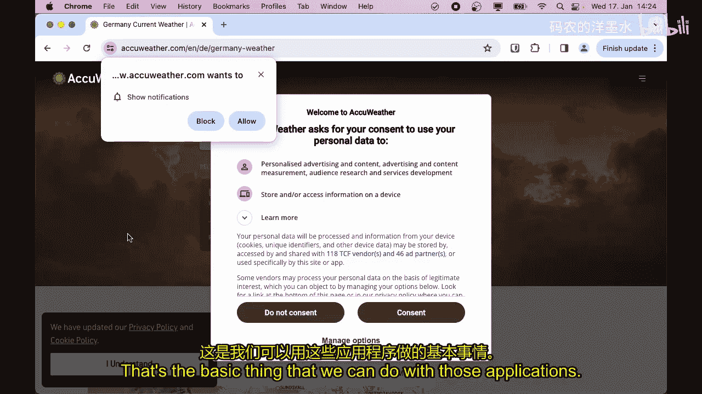
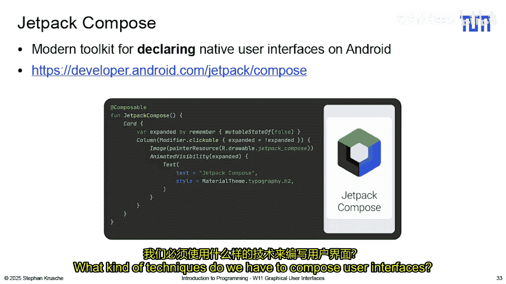

# 【全集】慕尼黑工业大学 计算机编程：从入门到实战 中英字幕 p48 Lecture 48 - 可用性 -BV1WFrTBZExY_p48-

Welcome to today's lecture in the course introduction to programming。

 we will focus on graphical user interfaces today and we are approaching the last couple of lectures until we have a course review in the end。

We focus on the importance of usability and prototyping today and hope that you appreciate this。

 that usability and user experience is really important for your end users in order to use the application that you develop as part of your programming experience。

You should be able to differentiate between different frameworks for graphical use interfaces that we shortly introduce you。

 at least from an overview perspective。😊，We'll talk about model view controller and important。

Design principle when creating user interfaces and you should be able to at least roughly explain it at the end and we'll talk about layouts。

 shapes and controls and we use as one particular example for a framework for graphical user interfaces Java FX however again the same idea applies as to your normal programming skills。

 try to understand the concepts behind the framework so try to understand what shapes are what layouts are what controls are and then take Java Fx as one example actually it's your second example Liipptd X is the first one now we show you Java Fx and then we hope you get a better understanding of how graphical user interfaces work and we'll start with usability。

Graphal user interfaces are not new。 They are developed since a lot of years now and they basically allow you to communicate with the computers through symbols visual metaphors pointing devices so nowadays we interact with graphical things with our computer actually in the old days when the first people did computing。

 they didn't have graphical user interfaces。 they only had console lines terminals。

 something like this if I opened the terminal I can still go back into this old world and type in something and this was the only way to interact with the computer and this was already more modern yeah in the earliest days they had punch cards with holes inside right so you see that computing changed a lot now we have really nice graphical user interfaces and not only on big desk computers but also on。

😊，Mobile phones。And graphical user interfaces are typically user friendly in terms of interaction。😊。

But there are also a lot of bad examples and we will show you a couple of them today。

But the idea is that any action that you can do with the computer or with the computer program is somehow。

Put into the user interface， and。Depending on its importance。Very big or very small。

 easy to find or hard to find。 And you need to guide your end user through your interface。 Yeah。

 we have an example of the terminal， As I said in the old days， people had to type in commands。

 There were no graphical icons。 There were no mouse pointers。 They only had a keyboard to do that。

And when it comes to user interface and interaction design I could give you a lecture series of 10 lectures just about this。

 but of course we are short on time therefore I can only give you the most important aspects what you have to understand is that this is not only a computer science topic but also a topic that goes into psychology。

Because if we think about how we as human。Use。Technology。

Based on the different senses that we have seeing， hearing， touching， speaking。

 you can design a lot of different things。And 1020 years ago， this was still easy。

 we had a mouse pointer。 We had a keyboard， and we had a couple of buttons。 Nowadays。

 it's much more complicated。 You have speech recognition， you have the mobile phones。

 You even have eye tracking。 so in a couple of weeks。

 Apple will introduce its vision pro and probably visual computing will become even more important and they track the I。

 So when you look at a specific symbol with your eye， you control computer already。

 I trust as one example。 So nowadays， it becomes more and more immersive， more and more complex。😊。

Now， when we talk about the human， or her brain， the sensors。

 then those different senses can interact with the hardware。

 they do not directly interact with the software。 This is very important you first interact with hardware。

 you look at a screen and the screen is hardware， you hear something from the headphones。

 you control a gamepad in when you play on the Xbox or the Playtationer and so on。

 So first of all you get in touch with the hardware。

 Now the hardware actually translates through input output based on integrated circuits。

All the signals that you。Get from the computer or in put into the computer。

Using different subsystems in the operating system and then basically passes this to your software。

 So whenever theres an input from the user clicking on a mouse，That points on a button。This is。

Operated by the operating system。Handled by the operating system and then forward it into the user space of the software into the application that you develop。

 So when you develop something you typically use a framework nowadays and you say。

 please tell me if the user clicks on this particular button or please tell me if the user moves the mouse so that I can react to it just as two small examples。

And then within the user space within your application or in the frameworks。

 and we also have framework developers， you can develop different algorithms or just handle the user input appropriately in this so-called input output loop So whenever the user clicks on something you might change the user interface。

 a very simple thing is if you go to a browser。😊，And I go to Google， for example。

 and I don't know how is the weather。Today。😊，YeahAnd now I click on this and the user interface changes。

 right， I do some input。And then I get some output。

 That's the basic thing that we can do with those applications。

 and this is visualized in this input output loop。

And of course， this is a very simple example， but all the other interactions that you can think of may be eye tracking speech recognitioner is the same idea。

😊，And this also means that a graphical user interface framework typically focuses a lot on those input output mechanisms。

😊，So you designed a use interface like a button。And then you listen to so called actions or events。

If the user clicks on the button， you get an event and then you can handle it appropriately based on the context and the conditions that you currently have。

So this is important to understand， we bridge the gap between the human and the software by using different hardware devices or so called peripherals。

😊，Any questions regarding this？Here's an example， MacOS， some of you are using it。

 it has very specific design elements， one that is， for example。

 particularly distinguished to Windows is that you have those three little dots in the upper left corner while on Windows you have some in the upper right corner that's a small distinction and as you see there are different opinions how to design good user interfaces not only for big companies but also for the users of the operating systems。

 there are kind of flame wars between Android and iOS or between MacOS and Windows。

 what is the best operating system and people can probably argue ours about it and never come to an agreement。

Here's an example of Windows with its specific task bar and notification area and a start button。

 which is very famous to Windows that you have to start button that you can click onto and we see a more modern version of tiles。

 I think this is Windows 8 but to be honest I'm not sure it could also be Windows 10。😊。

It doesn't really matter。There's also Android mobile operating systems where you have smaller screen space and where you additionally to the mouse input which is still quite normal to computers to notebooks you have a touchpad or a mouse。

 but in addition to that， you have or actually as an replacement to that。

 you have touch input and even multitouch so with multitouch we suddenly learn new gestures on how to control computers。

 mobile phones in particular and one very important gesture that you might all use is when you open a map and you can make it larger or smaller。

 you use the multitouch gestures to do that pinch to zoom， this is how it is called。

And you probably all have used that before， so mobile phones have a very specific way of how we deal with them。

 and for them it's even more important to have a great usability because even more people use mobile phones nowadays than computers in particular if you think about your parents or your grandparents。

😊，IOS with its specific differences to Android and its focus on security and usability。😊。

And heres another example of a user interface， but now we leave the operating systems and go to the application area。

 so here we have Excel， which is an application that is available for Windows， MacOS。

 probably also Uni it's also available on the browser and in mobile operating systems you see a version here that should be Windows right we have the symbols in the upper right corner and you see it's not the easiest application。

😊，And it's probably also an application that is not used as it is intended by its developers。

Developers have very specific intentions when they design the software。

 but users sometimes use it differently。😊，And Wordt and Excel are very good examples for that because in Excel you can do certain things with formulas。

 but not everyone does that or there are a lot of detailed use cases and tricks and tips that you can do with Excel but not many people know them。

 many people just use them for very simple use cases and you see that the user interface is quite complex we have a lot of elements and enough bar in the ribbon we have a lot of different interactions that we can do。

 a lot of buttons， a lot of elements sometimes it's also not really clear is it the status that we see or is it something that we can interact with and as you probably know Excel and application that has been available for more than 20 years so usability and user interfaces also evolve over time。

Here's another example control rooms in nuclear power plants and as you see those are not very modern and also quite complex。

 assume you press the wrong button and you suddenly have an issue in your power plant。

 it might not be a good idea。And here you need experts。

 you need people who are dedicatedly trained to operate those systems。 Yeah。

 you cannot just give a random person access to those control rooms and then。

Pray that everything will work out。 Yeah， this is not possible。

 And this also brings us to the idea of manuals。 So the more complex your user interface is the more necessity you have to come up with a good manual。

And there are different opinions about that。 Some people say if you need a manual。

 it's a bad user interface。😊，But sometimes we implement complex systems and sometimes we can't make them easily accessible for all kinds of end users。

 Of course， we have so called。Technology users that are very aware of new technology or also called early adopters who are typically quite aware of how user interfaces work。

 but you also have my grandmother or my grandfather who are probably not very much into technology and who have hard issues even to use a mobile phone because the buttons are not large enough。

And as a developer you need to take this into account。

 so in a nuclear power plant I can live with a manual。

 but when it comes to doing a phone call on my mobile phone。

 it would be good if I don't need a manual and even if my grandma don' doesn't need a manual。😊。

And there are also examples of disasters based on bad user interfaces。

 and here is one with an erroneous missile alert that happened in Hawaii。

So what happened here basically everyone in the island get got this message so assume you are on Hawaii I mean you would do holidays there but people also live there and you would suddenly get such a message it reads emergency alert ballistic missileile threat inbound to Hawaii seek immediate shelter this is not a drill。

😊，How would you react？So you would probably ask someone else。

 is this fake or did you also get this alert， and then if two， three。

 five people in your knee area tell you， yes， I also received this， would you take it serious。

 who would take it serious？that's the majority who would not take it serious。Okay。

 reading my after listening to my lecture， you probably mistrust something like this， but yeah。

 probably most people would take it serious yeah and I mean。😊，We live in a dangerous world， right？

 They are not only good people in the world。 So， yeah， what would you do， I mean。

 seek immediate shelter。 Where in this building would you seek shelter。No one knows， right。

 because we are not we don't have experience with such avasion。 Okay， so you see。

 this is really bad if something like this comes to your mobile phone。 Yeah。

 and this is a message received by all residents of Hawaii。 It happened six years ago。

 almost at the same day。😊，And fortunately， this was a false alarm。

And how did it come to this false alarm because this is not intended use of software or hardware systems right。

 I mean， you don't want to put people in such a situation that they fear they get killed in a few minutes。

Now， this is the user interface that the person had to use in order to control the whole situation。

if you look at it， I see text in blue underline， so it's probably some kind of link or in this case it's even a button。

😊，And now if you look at this， you see that there are two different entrances， PAcom。

 whatever this means state only， and then drill PAcom state only。😊，And what happened， actually。

 the controller should have used the drill button to actually test if the system works if everyone got the message。

And accidentally pressed the wrong button。And you see with this kind of user interface。

 this is easily possible。RightBecause there is not even a distinction。

 it's not even indicating the importance of the action with colors。

 maybe there is not even a confirmation dialogue， I don't know whether there was one there was no screenshot of that but if you do something like that dash and for this user interfaceF there should at least be a confirmation dialogue and of course the two actions should be clearly distinguished。

 distinguished so that you don't do a mistake because in both scenarios if there is a real situation you would like to press the correct button and if there is a test or drill you would also like to press the correct button。

😊，So what was the problem if we analyzed this afterwards and if we tried to come up with better use interfaces。

 different the options were differentiated poorly， there was possibly no confirmation screen and the developer also completely underestimated that this is a stressful situation right if there's a real alert。

 you don't want to take 10 minutes to read the manual how this works。

 you want to immediately notify everyone。😊，And then there's a big gap between the designer。

 how the designer intended the system to use and the user or the user model。So。

One example of how you should not design your user interfaces。

 and there are many other examples that you can find online。

So after seeing all those interfaces and talking about disasters。

 let's quickly get back to the theory and think about what usability actually is。😊。

Many people use the term， but actually don't really know what it means。

 Uability measures how well a user can use or utilize the system functionality。

And it is based on five different categories。And it's important that we are able to measure it。

Some people have the feeling that it is a conducibility。or hope that it is a good usability。

 but we are not in church and we are scientists， so we need facts。

 we need measurements and this means we need to be able to measure it and therefore we have those categories first learnability。

 how easy can I learn a system。😊，How fast can I learn a new system and of course this depends also on the complexity of the system。

 if I have a very simple system， it's easier to learn， if I have a very complex system。

 it's difficult to learn， but I can still implement a couple of cues in order to make it easier。😊。

Efficiency measures how many steps I need to use to actually complete particular tasks that I'm interested in。

And you can typically increase it for power users when you implement shortcuts or then you implement standard data that is inserted into certain fields。

 and then you only need to change it if you deviate from the standard。😊。

Memorability measures how quickly a user can reestablish proficiency after not using the system。

 so if I have used it once and in six months I come back and want to use it again。😊。

Do I still remember it because there are certain design clues or it follows certain best practices。

 or did I forget everything and I have to relearn it again？Arrors is another category。

 how many errors can I make， simple examples， you all experienced this if online。

 if you go to a website and you have to enter your date。😊，In the old days。

 there was only a text field。😊，And then you could enter whatever you want and then there was maybe some kind of validation afterwards and nowadays we always have those nice calendar and time pickers and with those。

 especially on mobile phones， you can't really enter a wrong date。

 you can't enter 31st or February anymore so you can the system basically prevents you from doing mistakes。

😊，But then also how severe are the errors and how easily can you recover from them。

And last but not least satisfactionist or user experience， and this is a little bit subjective。

 how pleasant is it， how much fun does it make to use the system， would I use this on my own。

 or do I only use it if someone else forces me to use it？😊。

So this is something that really goes into your feelings and into your emotions as well。

And if you have an application and you're good at all those five categories that's quite rare because some of them also have a tradeoff。

 the better their learnability is most of the times diverse the efficiency in the system because learnability means that it's an easy user interface even if you have complex functions and it also means you need to navigate multiple times and then efficiency can lag。

😊，So it's not easy to achieve good values in all five categories。

Many people simply claim their system is easy to use， but in my opinion。

 and in the opinion of many researchers， this is one of the most frequently misused term。

 especially in marketing。😊，And I know management students learn marketing as well。

 and marketing is important to sell software。😊，And maybe for some end users。

 this is a convincing argument if you say it like that， but as a software developer。

 you should not never say that because this。😊，Tends to be wrong or to phrase it a bit more harsh。

 This tends to be bullshit。In many cases， systems are unusable。

 even if they are advertised as being easy to use， and users have extreme difficulties in learning how to use the systems。

😊，And this is not new， Jacob Nielsen， one of the experts in usability in research has nice articles that are also good for beginners and has an article about anybody can do usability。

 he claims that usability is like cooking， everybody needs the result。

 anybody can do it reasonably well with a bit of training， however。

 if you would like to become a master， it takes years to produce a really nice usability。😊。

And this means that， on the one hand。😊，We need to teach everyone how to do fairly good usability。

 but when you have teams that produce software， you also need dedicated people， experts who really。

 really， really focus on the usability of the system。

And user interfaces are hard to design because the developer who designs the system and who initially also tests the system from the end user perspective。

 you all are developers when you implement something and you all are also kind of users when you test it。

 but you're not the real user of your software。😊，At the end you want to sell it and there's someone else who uses it and this person might not have a tech background。

 might not have any development skills， so those are different persons and software engineers or programmers mostly communicate with other developers。

😊，And。In rare cases， they actually communicate with the real end users。

But user interface development is all about communicating with the user right if I design a system with a welcome message。

 I communicate with the end user， the end user is the person who will read it。

 it's not a direct synchronous communication， but it's an indirect asynchronous communication。😊。

And if the end user types in something。He or she also somehow communicates with me because I have implemented all those nice algorithms and if I decide to take the user input not into account because I never thought about it。

 then I do poor communication in that sense。😊，Additionally。

 you could claim the user is always right because the user decides whether to use the software or not。

 or even pays for it， puts money into the company， hopefully。😊，So if you have consistent problems。

 this is definitely the fault of the system and not of the end user。😊，However。

 you could also argue that the user is not always right， because users are not the design experts。😊。

And we also when we build houses， we ask the users for their opinion。

 but we also do not tell them you have to construct it in the end。

 right and you have to live with all the consequences of the decisions we actually try to consult them。

 we try to give them advice， and this is also something that we need to do。

And user interface design takes a lot of time， a lot of effort。

 there are estimation that 50% of design， implementation and maintenance of software with graphical user interfaces goes into the development of the user interface。

😊，Managers must also be involved。 There's also something like usability management in a company where you have a lot of products you need to manage usability and if management doesn't appreciate usability because they think it's worth this。

 then how should the developers do it if there are no incentives in the end。

 So this is also a management topic。😊，Great， so much about the theory now let's get back to a couple of examples and I quickly would like to show you usability tradeoffs with the example of Microsoft Vert。

 you see that I really love Microsoft as a company and their products。

 I love them so much that I include their software into my slides。😊。

Maybe not always in the best sense， but I hope you can learn something out of it and I actually have a question for you how do you insert a table of contents into Microsoft Vert so assume we have opened Microsoft Wordt。

 this is the Mac edition but it looks quite similar to the Windows Ed。😊。

What do you need to insert a table of contents into Microsoft Word。

 can anyone tell me without looking at the solution in the slides？Has any one of you。

Doneone that before。If you've never integrated a table of contents。

 then you're probably also someone who is not using it correctly by the definition of Microsoft。

 by the way。Okay， anyone。Okay， let's wait for some students before the tutors will answer the question。

 It doesn't have to be correct。 Yeah， I just want to claim something here or prove something here。

Yeah。Yeah that's already a good solution， yeah， you have very experienced Microsoft values I would guess。

 I mean， if you're new to the system， how would you do it？😊，I mean。

 I would never go to references if I'm the first time using Microsoft Word， yeah。Yeah。

 I would probably look at insert。😊，Or maybe even layout design， Yeah， insert design， layout。

 maybe somewhere here， right， I would not go to references。 A table of condens is not a reference。

 in my opinion， yeah。But okay， so let's give it a try。 Let's click on insert in the ribbon interface。

 and then I get pages， table， pictures， shapes。 Yeah， but there's no table of contents， right， Okay。

 didn't work out。 We won't give up。 Let's do a second attempt。😊。

Let's click on the insert in the menu。 Yeah， you see we have the insert in the menu。😊。

And there's also nothing about it。 And youre right。

 the correct solution is to click on references in the ribbon interface。

 And this is a very good example for the trade of learnability versus efficiencyi if you know that，😊。

You don't care if you know where to how to do it， you click on references and you insert it and you just need two clicks in order to do it。

And probably someone has decided， oh， insert already has so many elements。😊。

It should be in another menu。 Yeah otherwise， it will not fit。 And on smaller screens。

 we do not have enough space。 and then I need a third click because if I。Make the screen smaller。

 Then suddenly those elements collapse， and I only see the three to five most important。

 So I need another click， and therefore they have it under the references。

 So if I know it's under the references， I need two clicks。

Click on referenceences and click on table of contents in then I'm done。

But this is really difficult to learn， and I would assume that 80% of Microsoft Word users don't know it immediately how to do it。

😊，Nowadays we can look it up on Google and ChetGPT can tell us as well。

 but this should not be the intention of how you design a user interface that someone needs to Google how to use it in the end or even ask an AI to allow you to do it。

😊，There's actually a second solution that you can do in the insert menu， you have index and tables。

 but then you need to know that a table of content is the same as an index and then you can also use it like this。

😊，Okay， so I hope that I could make the proof now that Microsoft Wordt is not an application that is really easy to learn even for very basic use cases。

Now how do you come up with better user interfaces。

 one technique that software developers use is prototyping prototyping basically means you create a mockup or a first draft of the user interface and you show it to other people you externalize the knowledge in your head that you have about how the user interface should look like and then try to evaluate it。

 try to falsify it and try to discuss it with other people so it's an early sample of a model。😊。

And it allows you to test the concept that you have in mind。 And it's very。

 very effective because if you have。If you don't take a lot of time and just draw it on paper or use any tool that you want。

 you can come up with the user interface very quickly， just in five to10 minutes， evaluate it， see。

 okay， this does not work， and then you don't even have to touch code。So by prototyping。

 you can avoid directly going into code and first explore the different possibilities and this can be a very fast process with instant gratification。

 you immediately understand if it works out or not。

 and it improves the communication between multiple people within your team but potentially also with end users。

And mistakes can be found very easily and the faster you find mistakes， the less costly they are。

 If you first develop the whole system， and then at the end， you find out it's unusable。

 you probably have to go back and redo everything again。

 So if you find it out in the beginning and you can。Do it right correctly or in a better way。

 right from the beginning， then you save a lot of money。

And if you do it in a very simple way on paper， then it's also a very small overhead。

 Of course big companies， they do AB testing， they test it with a lot of focus groups。

 and they also come up with new innovative user interfacephas and then prototyping can be a more complex process。

 but for small applications you can come up with something very easily。

And something that you have to understand here is that in Germany， in particular。

 we have this opinion in the society that failures are bad if you fail， you're not good。😊。

And someone else is better。And this is quite sad because another approach would be failures are good。

Because if I fail， I can learn something out of it。 and next time I can make it better。

And this is something that Henry Pedrovsky actually used and this is much more common in the US and he used it in the paradoxical approach to design。

 so he says better information comes from designers that fail rather from those that succeed or think they succeed all the time。

😊，And if you think about disasters， then we as a society。

 we always learn better from a disaster than from something that almost failed or。😊，Yeah。

 so to speak， succeeded， but was not perfect。So if you have a bridge and a bridge falls down then you can learn from it and this is what they actually experience so a famous quote from him was that success in engineering is defined by its failures and if you take this into account and if you think about it you are not the first programmers in the world。

 not the first software developers in the world， then you can really learn from the mistakes that others did。

😊，And some people also call this destructive innovation。 So you first need to destroy something。

 and then you can actually innovate by learning from the failure。And in that sense。

 knowledge must be falsifiable。So you could say there is no truth in particular when it comes to software development and user interface design。

 there is not just one way how to do it correctly。😊。

But what you can do is you can come up with an idea or with a model how you would like to build it。

 and then you can try to falsify it， so you try to disprove the theory。

 you try to disprove your hypothesis and the earlier you do this。

 the earlier you can react to it if I have an idea of a startup。

And I first do it for five years before I evaluate it， pro and then I hear， oh。

 no one is interested in this idea， then I will not succeed。

But if I make a minimum viable product MVP and bring it to market very， very quickly。

 maybe after one or two months。I can prove my hypothesis I。Identify， does it work or not。

 Should I proceed with this idea or should I come up with another idea。

 And it's the same with software development and user interfaces。 And this is the way。

 or this is the reason why we use Eile methodologies nowadays so often because we would like to。

As soon as possible， give the software and the user interface to the end users and let them try it out and get feedback in order to improve。

Now， when you develop a system that includes a user interface。

 you also need to test whether it works out or not， and there are different techniques。

 how to do that you can validate the requirements of end users。

 you can test the user interface with end users using usability testing and if you do usability testing。

 you actually try to disprove the model that you have in mind about the user interface。

Usability testing is one technique where you basically try to watch behind a real end user。

 how he or she interacts with the system based on certain scenarios。

 and then you let the user perform certain tasks and you observe if the user actually knows what to do or if the user is completely lost or if the user succeeds or fails and you can also ask users why they do it like that。

 you can learn from them and it's typically enough to if you have five test users。

 five is already good you do it with five test users， you get feedback。

 you implement that and then you again do it with five test users so you don't need thousands of end users in order to find out if you have a good usability or not。

Another technique is your heuristic evaluation， when you do that you basically take experts into account and you try to identify usability problems based on heuristics based on rules or best practices that have been developed beforehand。

😊，Here are 10 examples of heuristics and due to time reasons I will not go into detail。

 I give it to you there even a poster and an article online that describes them in detail we have visibility of system status。

 a match between the real world and a system， user control and freedom， consistency and standards。😊。

We have error prevention， recognition rather than recall flexibility and efficiency of use。

 aesthetic and minimalist design， recognize， diagnose and recover from errors。

 and last but not least help and documentation。😊，And those ten heuristics could be a guideline。

 so you could develop a user interface and hopefully take those into account initially。😊。

But then you could also， after you've developed it， you could also take some time aside。😊。

Use those tenuristics and go through a user interface and ask do we do good error prevention。

 do we have good error messages， yes or no， and then you can evaluate it and if you say no。

 then you could say okay， let's improve it in an ex iteration。

 let's improve our error messages so that our end users can understand what kind of errors happen in the system。

😊，Great， so much about usability， user experience， prototyping and techniques。

 how to come up with good usability。 We hope you have an overview。 and this is a starting point。

 There's a lot of things behind that。 and you will also see that in the references in the end。😊，Now。

 before we actually do a break， Ill quickly would like to talk about GuI frameworks and the differences that we have here。

😊，So first of all， you need to think about what kind of application do you develop？😊。

Is it for the Web， Is it for mobile， Is it for。Desktop computers and then you typically need to decide what kind of operating systems you would like to support and based on that you have a lot of different choices in the web you need to deal with HTML and CSS When you go for MacOS and iOS you can use Cocoa Cokua touch which is kind of deprecated so Apple wants you to use Swt UI nowadays。

You could use donet in the Windows world on Android they have chat back compose and if you are developing user interfaces with Java。

 there's AWT swing， Java FX， LipCDX as a game engine and a couple of more and while AWT and swing are kind of outdated and not really maintained anymore Java FX is a more modern approach to use and this is why we focus on Java FX in this lecture as well。

HtML is a building block for the web so every web developer somehow has to deal with it with CSS and JavaScript you can manipulate the appearance and the functionality of the website but HTML basically provides user interface elements and layouts for text。

 links， buttons， and so on and with CSS you can then allow CSS allows you to define styles for those elements in order to define the color。

 the size， the font and so on and there's a lot of documentation out there。

 so this is just for you to know that the web is built mostly on HTML and that HTML in some sense is a language that allows you to come up with user interfaces。

Here's an example for Swift UI， it's a quite modern way to declare user interfaces for any Apple platform。

 so it works on iOS， watch OS， Mac OS， and the new ViO E that will be final released in a couple of weeks。

😊，And Apple has quite nice tutorials for that and what is really nice here is that you don't have to write a lot and you can immediately in a preview see the user interface so this is there are nice tools behind it that go beyond traditional IDEs where you can immediately see the impact of your code towards the user interface so you can also do very quick prototypes and evaluate if something works and if it doesn't work you can change it easily。

😊，Chaetback compose for Android goes into the same way。

 it's a modern toolkit for declaring native user interfaces on Android and here you see it's a little bit closer to Javava actually you have sometimes similar keywords and here you see that you can also define elements and image or an animation a column and it's not really like traditional code where you have I don't know image image equals new image something like we will learn today it's more declarative so you have the outer elements of the user interface layout here and the inner elements are nested in the structure that you see here。

😊，But this lecture is not about that you fully understand this。

 this is more that you see what kind of techniques do we have to compose user interfaces？

