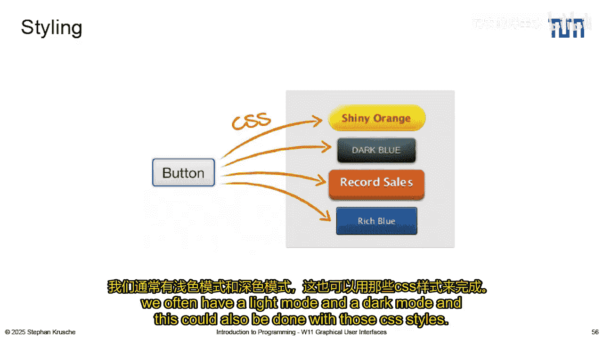

# 【全集】慕尼黑工业大学 计算机编程：从入门到实战 中英字幕 p49 Lecture 49 - JavaFX -BV1WFrTBZExY_p49-

Great， let's continue in our next unit。 We like to go into more detail of one particular。

Framework for graphical user interfaces for Java and this is Java Fx it's an open source framework that allows you to build user interfaces for desktop mobile and embedded systems based on Java。

 there are tutorials online that you can use and that we reference as well later on and it has a large set of built in components like buttons。

 text fields， tables， trees so that you really can easily come up with simple but even more complex user interfaces。

 you can use techniques from the web so with CSS you can define style sheets and apply them manually or programmatically。

 it can even do 2D and 3D graphics and has a web view in order to display web applications。

It's written in Javava， so completely compatible with your skills and platform independent。

 It has a built in。Language or domainspec language。

 FXML that allows you to create user interfaces separately from implementing the application logic。

 something that we have seen in the examples before as well。

 and it even includes a scene builder that allows you to drag and drop elements into your user interface so you can use a user interface to create a user interface。

😊，How does FXML work， It's an XML based domain specific language that allows you to build the basic structure of the user interface and to separate the application logic into your code and there's a tutorial online an introduction to FXML we do not want to go into too many details here because that's already quite advanced。

 but you can see that。Based on those XML texts， you define a grid pane with a specific padding。

 then you have a text welcome， a label， username， a text field in order for the user to enter the username and not a label for the password and the password field in order to type in the password。

 password field has a build-in feature that after typing the password， it's not visible anymore。

 there are those dots so that people behind you can't see your password。

Then there is some space in between and then we have a button that is aligned right with the name or text sign in。

And with that you can basically come up with the main building blocks of your user interface and what you can also do is you can define so-called actions。

 so if the user actually presses the button， then we have this on action element here。

And then you can refer a method in your code to handle Subit button actioner。

 and this will be invoked。And if you remember about this input output loop that we talked about in the beginning。

 this is one of those inputs， then you can configure that the operating system will make sure to invoke the specific method。

 handle， submit button action in your code， and then you can react to this user input。😊。

With the scene builder， you can create the user interface visually and the scene build level automatically create the corresponding FxML for you。

 you can also look it up and change it in the FxML and then the scene builder that change so you basically have a visual representation of the user interface and this is particularly helpful for prototyping and for creating a first draft and MVP of your user interface as quick as possible。

😊，Therea is this website that describes more about the scene builder。

Here you see an example integrated into the Nebeans IDE。

 we have the elements in a library on the left side and then with drag and drop you can put them into your user interface。

 you can compose the user interface as you want， on the right side you have an inspector where you can change the properties。

 you can， for example， apply certain styles or define certain values based on the element of your library and then come up with something that makes sense in a visual way。

😊，A Java FX application is made out of a stage， scenes and nodes。

 the Java FX application could actually have multiple stages but in most cases simple ones only have one stage in a stage I could then have multiple scenes and in a scene that's our main container for a window I have notes and those notes can have other node inside and you could for example have a vertical layout of elements here which is a node and then you can add children。

 other node and those could be a button， an input a password field。

 a table and so on and that's a basic idea so you have the stage。

 the scene and then within the scene you have a hierarchy of notes。😊。

You can see a visual example here， this is a simple Java F X application。

 the stage is basically the full window with the menu bar in the top which is already provided to you。

 you don't need to implement the behavior on Windows that you have the X button in the right upper corner。

😊，You also have a title and an icon and then below the menu bar your scene actually starts and within the scene you can have multiple node in this example we have only one node so it's a very simple scene just a button。

 click me。😊，Great， and now we would like to get into action and create our first simple Cha FX application together。

 so start your IDE and let's do that together now and if you have any questions raise your hands we also have the tutors around they can help you in case you experience issues so I'll open Inche。

😊，And I create a new gradle project， so I say new project。And I。Call it Java F X hellello world。😔。

Store it in a default。😔，Location， we use Java， graadle。😔，Gruvy and our。Sorry， not yeah， it's here or。

😔，TE。as。 this is wrong， it should be the E to AS EIN。😔，No。T E to INACE， that's it。

And then we click on create。And this is not yet a Java Fx application。

 this is a simple Java application。😊，You can configure the SDK and wait until Gadle has built everything。

😔，Now in the next step， we need to open our graadle file and need to configure the application in a way that we can actually use Java Fx Java FX as an external dependency that is not built into Java。

 so we need to tell our project that we would like to use it。

And you can simply copy and paste this file or do it individually。

 copy and pasting it is a bit easier， so I recommend this。So you open on the source main Javava。

 as sorry not on this is not a Javava file， you go to build dot cradle on the root folder。😔。

And then you can basically replace everything with what you've seen in the slides and reload cradle and this will make sure that the appropriate plugins are downloaded in this particular example we download a Java Fx plugin which will make sure that we download all Java FX dependencies and also bindings to your native operating system。

 so if you use Windows you will have a slightly different external set of external libraries than I have because you see we define a couple of modules here at Java FXspace Java FX controls。

 you see them on the left side under external。Libraries as well。 and I， for example。

 then have a native binding with the Me architecture。With 64 bits for arm。

You might have something else for Windows or UniX， so this actually makes sure that the application will run on your particular operating system。

Great， and yeah we do not have many things here， we basically have this Java of X plugin in a specific version and this allows us to define the version。

 which is also 17 like the Java version that we have and we have our main class name and the main class name is not yet realized so this is something that we need to make sure later on that we don't call it main but Java of X hello world。

Any questions so far？Great， then we would like to create a new package within our。Project。

 if this is not yet available and add a new class called Javava F X Hello world。 So let's see。

 I already have the package。 If you don't have it， make sure you create。The package。

 and then within the package， I can just press command n。

New class and give it the name Chava F Xhelello World。And then I also copy everything from the slide。

 and then I'll explain it to you in a minute。Here we go。 if your graadle file。

Was successful in downloading the dependencies， there should be no errors for the imports that you have here。

Here we import the Java FX application and the Java FX stage in order to use those classes。

And our own Java FX hellello world class extends the Java FX application。😊，So we extend application。

 this is a subclass， remember， inheritance。And when we extend。An abstract class， so in fact。

 application is an abstract class。We need to implement all the methods that are abstract so if I would not implement this method。

 Intelliche would immediately warn me and suggest to implement the start method。

 I could do that as well。Implement it， but then it would be empty and if you copy the code from the slide。

 then we basically call the input parameter primary stage。

 this is the primary stage of our window and within Windows those primary stage we set a title that's a prebuilt method of the framework。

And we call show in order to make it visibleable to the user。

And this is quite common for application development with graphical user interfaces that you have a framework。

 the framework does a lot of things for you， but then gives you customization possibilities。

 and this is one of those we extend the application and then the application when we run the app。

 we invoke the start method and we can design our user interface within the start method。

 we can use the primary stage that has been created for us and manipulate it however we want。😊。

Now we can't really start the application yet， I think we have to do a bit more。

 so after finishing this step， we now need to make something that is probably new to you and this is we need to modularize the application。

And this is because Java Fx also uses modules with modules you can basically structure large applications into smaller subsystems and simplify the development so what we do is we go to our main package。

This one here。And we create a module info Javava， so we do command n。

 and this is predefined template that we have here， so we don't have to do this on our own。😊。

And with we already get some existing code in there and within this module definition。

 we basically define the dependencies to other modules and whether our module is visible to other modules as well。

 so this is all about information hiding and making it the dependencies explicit。😊，And again。

 you could copy and paste slide 46。or the code of slide 46 and enter it here and what do we specify we specify that we require the graphics part of Java Fx。

 the FxM L part， the controls part， so those are the ones that we kind of。😊。

Integrate into our application and use， we require them if they are not available。

Within the scope of our project， our project will not work。And what we do is that our package。

 our package is called the ETom IN ASE， we open this。

 we make it available to the framework so that the framework can use it。😊，And we also export it。

That's basically what we do here and you do not fully need to understand this。 These are just。Yeah。

 mechanical things in the background that you need to configure in order to make it work。

 but basic idea is。Some subsystems depend on other subsystems。

 and we can configure those dependencies here。Any questions so far？Great。

 then we can go to Java F X hellello world and click on the Run button。😊。

And hopefully it works it needs to compile a bit and here we are now we have our very simple application and if you don't believe me that this is our application。

 you can actually try out and change it and say primary stage instead of set title to hellello and world。

 we call it ITP， we run the application again。😊，And now it's called ITP and it might look slightly different for you if you use Windows。

 you have the buttons in the upper right corner to close the application。

 I have it in the upper left corner so I can close the application as well。😊。

And we can also do everything what we know from normal Java console applications that you have developed so far。

 we can debarg the application， we can do log statements or console statements to the terminal to identify what's going on。

 so everything what is possible normally is also possible here。Great。

 any questions to this very simple Java Fx application from scratch？

Okay so from now on we assume that you are able to do that and we will show you a couple of other examples within the lecture and then you can always come back to this playground。

 hellello world playground， and if you like to understand it or try it out。

 copy and paste the code from the slide， put it into the main class that you have here。

 into your application into the start method and then try out how it works with buttons。

 how it works with rectangles， how it works with styling and so on， and so on and so on。😊，Great。

 now coming back to the slides， I quickly would like to tell you something that is important for applications and this is the life cycle。

 so every graphical user interface framework has a so-called lifecycle and this is because there is a run loop in the background which is typically a while true loop that reacts to events that coming from the hardware potentially and it has to make sure that everything is working correctly everything is set up correctly and the second reason is that a graphical user interface has to be rendered on your screen。

😊，And if you change your user interface， the framework has to rerender it if you change a button the color of a button from green to red。

😊，This should go very smoothly， right， so your application needs to make sure that you have。

 for example， 60 frames per second。😊，And within those。

Milliseconds that you have time to do something， the life cycle actually takes place。

And we can distinguish between the whole application life cycle and between the life cycle offuse。😊。

First， we would like to talk about the life cycle of the whole application。

 so when you create an application and start it， then the init method of the application is。😊，Called。

Now， we didn't deal with the init method because we just reused the one from the super class。

 but you can override it and you can customize it。Then the start method is called。

And now the application is in the foreground and the runtime waits for the application to finish。😊。

And the application only finishes if you。Kill it。Or if the end user presses the red X button or the。

Yeah X button on Windows for the last window so only when all windows are closed then the application also closes before the application closes。

 the stop method will be invoked and within the stop method that we also did not overwrite you can clean up anything so if you still have files open and you would like to close them you can do that or if you have network connections and you need to save something into the cloud。

 you could do that so that the user does not lose data and you can overwride in it start and stop to perform any initialization or cleanup of the resources by your app。

Great， now let's extend our tutorial a bit and let's go back into our Cha FX hellellog app and now we would quickly like to try out FxML。

😊，So what we do now is we basically adapt our example。

And change the code in the Cha F X hello world to this。 So instead of defining our user interface。

On in code， instead of defining buttons， button equals new button。

 layout equals new layout and then layout at children But， instead of doing that。

 we would like to import an FXML file。That we design in a separate file and then。

Define the user interface in there。So let's see how that works， yeah。

 we also need to throw an exception so you probably copy and paste everything that's easier。

And also what do we do is we load the file using the FxML loader class。

 and this will be part of our project and we create a scene。😊。

Based on the parent route that we get from the file。

And then we put the scene into our primary stage and the scene will then wrap the root element。

 and the root element is something like a node， a apparent node that we have here。😊。

So we have the code in order to load the file， but we don't have the file yet。

 before we actually create the file， we now would also like to introduce a new concept a controller。

😊，A controller is a class that controls your application and that makes sure that you interact with the end user accordingly and instead of handling everything within the view class or within the application class you might have multiple controllers later on depending on what you show in your application and one could be that for the sign in view we have to sign in controller and the sign in controller。

 we can then handle the actions of the end user and if the end user types in the correct username and password we can forward the user to the next page or if the user types in the wrong password we can show an error message and this is nicely done in a controller that then has the reference to all the views in our user interface and can interact with the user interface and with our model that we have in the background in a database we might have stored。

Creedentials of the user。So let's create this sign in controller class。

 there's a little trick that you can do here， you can just copy and paste everything。😊。

And instead of creating a new class， you can just paste it when you have the package open and then everything will be pasted automatically for you and you don't need to do it manually and the name will automatically be derived from the code。

So what do we have here， we have a password field that is one user interface control， a text。

 and a method， and all those are annotated with the@ FxML annotationer。

 which basically tells your IDE that they are used in the FxML file and that it can then also make sure that the names are correct because if the file is inconsistent with your code。

 it will not work。😊，Great， so with this we can basically control our application and now we need to create the example file so in the resources folder here so still on the main but not in the JavaA in the code folder in the resources folder。

 we now create a new file。😊，Call it example。t Fxml and copy and paste everything from slide 50。

Now we don't assume that you fully understand how this works as I said before you can use the scene bill in order to create this。

 but I'll quickly go over it to show you how it works we have a couple of imports those are similar to the one in Javava except that we have those interesting way of writing them here and then we basically define a grid pain a grid pane is a layout we will see later on what it means and this grid pain is。

😊，Belongs to our sign in controllertroller， so the pane。

 which is basically something like the whole window。

 will be assigned to the sign in controllerroller， the sign in controllerroller is responsible for this pain。

We can do some alignment and some properties of this within the XML tech now。

Then we have a text welcome， we have a label username， a text field where the user can interact with。

 we have another label password， a password field and our sign in button。

 so it's basically the same example that we have seen before and within the assign sign in button we have to action handle submitmit button action。

😊，And we can even navigate so I can command， click on it and go to the code。

 or in the code I can command， click the method and go back to the FxM alpha。

 so Intelliche is so nice that it combines both。😊，For a couple of elements。

 UI elements I would like to reference them in code in order to use their values in particular the text fields。

 and I can do that by using this Fx ID element here and giving them a name and with that I basically can reference them in the code so if I command click into the password field here。

 I will see that this one is basically injected into my sign in controller。And later on。

 I can access its values here。Same for the action target and the action target is basically where we would like to put in our text here so whenever the user now clicks the submit button we will say sign in button pressed by setting this on the text which is called action target and of course you might now say action target is not the best name and then we can also refactor it so Intelliche also offers us refactoring possibilities I can say refactor rename and this is maybe not action target maybe I call this info textex for example and then I refactor it and now I have infotex here I have infotex for my attribute and also when I use the attribute。

The good thing is if it's annotated with FxM L and it's。😊。

Used in the file then I don't need to take care that those values are null because the framework will make sure that they are not null the framework basically reads your XML file and for every element that it has it will create a new object for the grid pane for the text for the label and so on and all the ones that are referenced here will be automatically inject it and you don't need to do this on your own so this is quite comfortable。

And here you also see that it is referenced within the Xim alphapha。Any questions regarding this？

Okay， I don't see a ahead。 so now we can basically run the application again。

 So go back to our Java F X hellello world class， click the run button。

And now our user interface looks differently if this doesn't work for you。

 some configuration is wrong， you might have the example file in the wrong folder or you might have a typo here or there。

 and then you need to identify it and fix it if you don't get any compile errors。

 then it's probably not so easy but then you can ask one of the tutors in order to help you。Great。😊。

So much to our second tutorial， so you have seen a very simple Charfx application without FxML。

 how to get this done from scratch， and we also showed you how to design the user interface based on FxML。

 we have given you an FxML file but you could use the scene builder to create this or of course you could also manually design this and probably。

😊，Intelliche even has some nice suggestions， so if I create a text and I close it here it will be automatically appending the closing tag so you don't need to it's not like a simple text editor it really helps you to design this and we can give it a try right so maybe not a text here。

 maybe a text in the end here so let's quickly change this and we add another text。And we give it。

The row index。😔，7， so one more。And column index1 is fine。 and what do we want to put in here。

 Maybe we'll say text equals。Exit。I'm not very creative right now。

 and now if we start the application again。You'll see we have another text called exitit here and with that。

 you could theoretically， if you're familiar with it， you could design your user interface in here。

Cool， if there are no more questions， then we'll continue and before we go into the longer break。

 I'll quickly give you an overview of the most important Java FX concepts we talk about layouts。

 controls for user input shapes and styling and for all those we will have a more detailed session after the longer break。

😊，We have a couple of different layouts in Java F X， and you see the most important ones here。

We can have simple vertical layouts called webox so we have multiple elements and they are stacked vertically。

 we can also have an Hbox， we can have a tile pane， a grid pane。

 a border pane where we focus on five elements， top left right bottom and middle a stack pane where you put them on top of each other a flow pane and an anchor pane and all those can be configured differently and allow you to structure the user interface in a way that suits you best and this is typically the outer structure of your view that you design and then within those vboxes you could even have another nested layout so it could have a vbox layout and within the vbox layout I could have an Hbox layout so this can become relatively complex with this hierarchy that you can define here。

😊，We have a lot of different standard controls for user input， you can use those standard controls。

 but you can also come up with your own controls if you are advanced。We have accordions。

 we have checkbox， we have links， we have toggle buttons， we have progress bars。

 we have simple labels， simple text fields， tables treeviews where you can do something like a file system for with folders and files so there are lots of different prebuilt user inputs and here the idea is always that you have this model view controller style so the view is actually the user input element。

 so the view does not handle the interaction on its own the view delegates the interaction to the controller like the sign input controller that we have seen so every user input within the view if I press a button if I select an element in the treeview or in the list if I choose something in the choice box then this interaction goes to the controller and then the controller has a model for your application。

😊，In order to act on it。 So if I， for example， click on a button to delete an element。

From a list of elements that I have that is shown， then the control level will basically make sure that this is also deleted in your model。

😊，AndThen when the model is updated， it can send update events to the view and the view can also request a model in order to display it。

 so let's assume you have a list of docs and you show them in a user interface with an image and a name。

😊，And you can add new docs to the list， but you can also delete existing docs so there's a delete button and when you press the delete button。

 you make sure that in your model， you also delete the do element。That was selected。

And then you update all the views that display your dogs because you might have multiple views and you might need to synchronize the data in between。

😊，AndSo we fulfill the input output loop with the end user。

 remember the brain and the senses of our end user input goes to the view， but the view doesn't。

Deal with it internally， it delegates to the controller， the controller might change the model。

 we might also update the view in case the lockin is correct and we navigate to the next page and then we can display the changed data or the updated view again to the user。

And by using model view controller， you separate the tasks in a way that it's more easy to reuse them and more easy to change them in the future。

😊，So much about controls for user input next we have a lot of different shapes that we can draw with Java Fx。

 simple lines or more complex lines， we can draw text， the rectangles， circles， ellipse。

 and so on and for all of those of course you have to define certain properties， the color。

 if you have a polygon， how many points you would like to use， if you have a circle。

 what is the radius， if you have an ellipse， what is the we radius， what is the H radius， and so on。

 so all those predefined shapes， have certain values， if you fill them。

 you can use them in your application to draw really nice user interfaces or images。

When it comes to styling， the default styling is a bit ugly and boring as you have seen。

 but you can come up with your own styles， shiny orange， dark blue。

 rich blue or anything that you like based on shadows based on multiple colors based on different fonts based on insets paddings so there are a lot of different ways to style your user interface and you can apply a styling to one specific UI element but this might be cumbersome I don't want to apply a styling to every button that I define in my application and with CSS cascading style sheets you can basically make sure that all the buttons are displayed in shiny orange or in rich blue and with that you could even allow end users to customize it and provide them with multiple style options and if you for example use websites and applications nowadays we often have a light mode and a dark mode。

😊，And this could also be done with those CSS styles。

