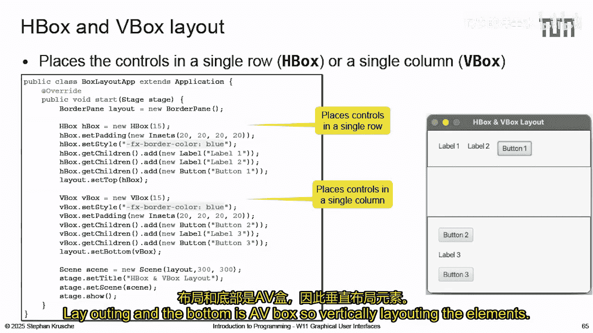

# 【全集】慕尼黑工业大学 计算机编程：从入门到实战 中英字幕 p50 Lecture 50 - 布局 -BV1WFrTBZExY_p50-

So the next one is about defining layouts in JavaFX you have seen that we have a couple of different ways like Hbox v box and different other layouts and in order to define those you have to understand that in JavaFx。

Potentially different to other systems， we start with the coordination system and00 in the left upper corner。

So。Why values， if they are positive， they show down， yeah this is important to understand。Now。

The class layout basically decides how the subnotes that we add to the layout are distributed within the window。

Remember， we start with a stage that consists typically of one scene。

 but can also have multiple scenes。And within this scene。

 we have a root node and this root node is a layout。😊，And within the layout。

 in this case it's a pane， we can have multiple control notes。

 so if the controls are aligned or if they form a matrix。

 whether the controls become smaller and larger when the window is resized or not。

 this is all decided by the layout and Java Fix allows you a couple of。😊。

Ways how to customize the behavior。Now here's an example and for all those examples you can always now copy and paste them into your Java FX playground that we developed before the break。

 we have a stack layout app here， again this extends our application and now we create a stack paine by saying stack pain equals new stack pane and then we go to the stack pane。

 get children， this is a list of elements that are within those within this layout and then we add a new label。

And here we only have one label， that's it， nothing else。And if we would add additional labels。

 those would be added like in a stack on top of the other ones。

And then we put the pane as the root element into the scene and the scene is put into the stage。

 so this is how it always works those four lines will most of the time be the same or at least quite similar and if you have different layouts you can define them here in the beginning。

 you wrap the layout in the scene and you wrap the scene in the stage and then you show the stage that was initially created by Java Fx。

Any questions regarding how we define a layout in code and how we add elements to it？Great。

 then here's an example of the flow layout， the flow layout places the controls row by row horizontally or column by column vertically。

😊，And if we overflow， they will automatically get into the next row。

Now the flow pan can be created like this， we can set a couple of values or properties like the horizontal gap and the vertical gap。

😊，We can also set the alignment， whether we want to align it left， Sandra， right。

And then you see we again invoke get children at all and now we have a couple more in the previous slide we only added one element to the list and now we add multipleable elements to the list and let's try this out how it works so we can copy and paste this。

😊，Go into Intelliche， just create a new app， the flow layout app。

 and you see the imports are basically missing， but you can come up with those on your own。

And by using indy chain。😔，So and we can even use star imports to make that easier。😔，Here we go。

And now if we start the applicationer。Then we have the same as in the screenshot on the slides。

Label1， label 2， button one， label 3 button2， and now you see if I make this larger。

 it will be one row and it automatically overflows into multiple rows if I make the application smaller。

This is the behavior of the flow layout and you can also quickly try out what happens if I leaf out the two buttons。

 for example， like this and I'll start the app again， then I just have three labels， so this is also。

😔，Relatively fast to come up with a user interface。😔。

Next we have the gridit layout in the grid layout we have multiple elements within rows and columns so we really have a gridit and those gridit elements can have indices a column index and a row index。

 so label one is in column0 and row zero remember computer scientists start to count at zero。😊。

And bottom one is in the first column， but still in the。Row 0， also of column1， row 0 and。😔。

With that we can actually place the elements how we want and also make sure that they are。

 some of them are aligned in particular ways， so here for example， button one。

 button two and text field one are aligned left in the second column。And again。

 we can define the horizontal cap and the vertical gap between the different elements。😊。

And as you've seen before，00 starts in the left upper a corner， that's how it works。

Any questions regarding the gridit layout？Great， then we have。😊。

Border layout the border layout is particularly helpful if you have a navigation bar in the top。

 some bottom information， maybe some menu on the left and some menu on the right and in the center you have the main content of your application and with that you can then。

Define those five areas。 Yeah， so the border pane has the set top set bottom， set right。

 set left and set center method。 And within those， you can actually have your own layout so I could have a。

Flow layout here and an H box here and a V box here， this is perfectly fine if it makes sense。

 of course， if you design an application like this。

 it might become more complex and you should really think about what you would like to achieve。

In addition， we have a custom layout here that extends our stack pane so we can also come up with custom layouts here we have it as an inner class and what we do is in the custom layout that we specify a specific style。

 for example here that the border color is blue and that we have specific insets for the padding so that we have enough space in between the elements。

Any question regarding this？Okay， so example for border layout and a custom layout。

Now we have Hbox and Vbox， those are relatively simple。

 we again have get children and then we add elements。

 the H box takes a value as an input parameter that is probably related to spacing can have a padding and can have a style so all elements can have a style and this is defined in CSS notation。

 so you always have a key colon and a value。And then we have the H box and the we box and we have the border pane layout and you see the border pan layout in this example doesn't have a left and a right element。

 so this is also possible that you only define certain elements here。And the top is an H box。

 so horizontal layouting and the bottom is a we box， so vertically layouting the elements。

