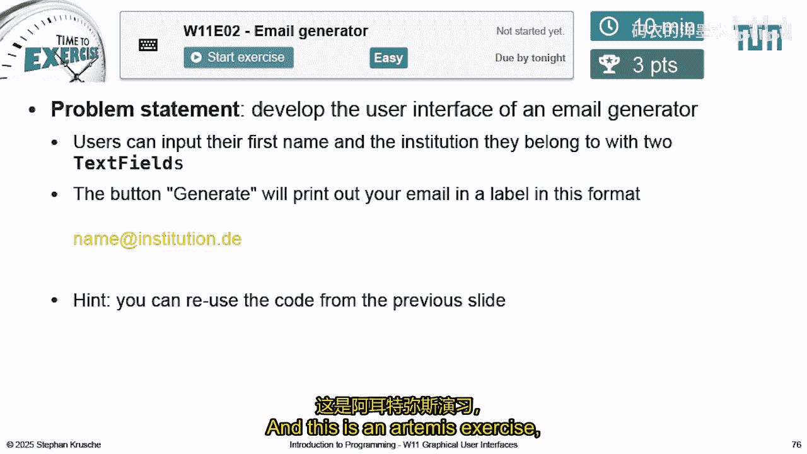
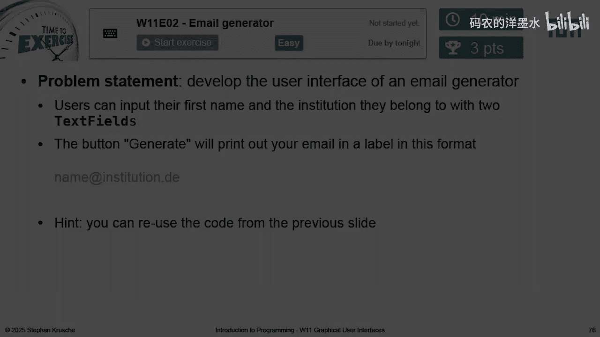
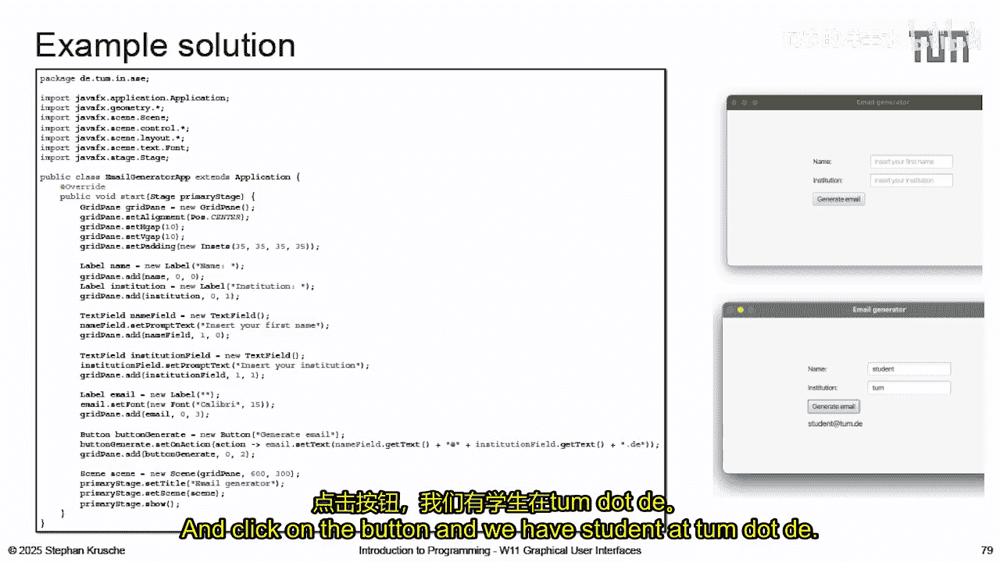

# 【全集】慕尼黑工业大学 计算机编程：从入门到实战 中英字幕 p51 Lecture 51 - 用户输入 -BV1WFrTBZExY_p51-

In the next unit， we would like to talk about user input。Again。

Model view controller we've discussed it shortly before the break let's recap the most important aspects user input is first of all handled within the view within the control for example the button but the button should not decide on its own about the control logic what actually happens no the button instead delegates this to a controller and the controller has all the implementation logic the algorithms and the distinction what you actually do the controller can act on a model or can display different views and navigate to the next view if this is relevant and whenever a model is changed maybe not directly by the user but also from the outside world if you have an application for stock exchange the stock changes over time and if the model gets updated there should be an update in the view as well so we have this observer mechanism here that the view observes the model and all model changes。

reflected in the view accordingly and of course， the view can also request new data Another example for that is if you have a list of elements with a ping mechanism。

Then this means that you do not display all the elements because this might not be feasible。

 might not fit on your page， but you only show 20 elements。😊。

And if I click on the next button to see the next 20 elements I need to fetch them potentially first from a server。

 and then into the model and then if I have them in my model I can display them in my view。

 and then the view， the list of elements doesn't change。

 it just displays different data based on the models based on the objects。

 the data objects that I have defined in my application。😊。

Any questions regarding Model View controller？If you want to learn more about this。

 I recommend to take the course introductiontro to software engineering。

 because there you will practice this with a couple of examples and also see barvaris of Model View controller。

When it comes to user input， there are a couple of predefined controls like the text field and the password field that allow you to deal with user input so if I have a text field。

 it will be automatically possible for the endT user to click into it to focus on it。

And to type in some text， and this text is then accessible to your application and can be used in order to compute something。

There are also elements to provide some status to the program like a checkbox。

 if you have two options。And the user can decide which options you would like to he or she would like to do and you can have a checkbox and then the user can select something or provide a status information and some controls also allow you to see information。

 a label is not really editable， this is or lets read only to the end user a list view and a table view contains data yeah you can display data users can scroll through it on a mobile device for example。

 and then you could combine it， you could for example。

 say I have a list view and all elements in my list are buttons this is for example how an email app typically works that you have a list of emails on your mobile phone。

And then you press with your partner with your finger on one of those emails。

So there is some kind of click mechanism behind it or button mechanism behind it。

 and then you navigate to the next page and you see the full text of the email。😊。

And this is why we need list views or table views。There's a full range of predefined controls in Java FX。

 I will not be able to go through all of them but we listed them here and we have the link to the documentation where you can find out more。

 they are also date pickers， scroll panes， sliders， hyperlinks。

 so everything that you need for the design of simple user interfaces and as I said before you can also come up with your own UI controls that you design and use in Java FX but of course this is a bit more complex then。

😊，A couple of examples we have a grid pane again here with some labels and in the label if you create a new label you basically specify its text and then you can define the font and you can add the label into your layout and you see that we have a couple of different labels here some of them have text。

 some of them have numbers and some of them have a specific font。

 some of them have a specific fill color so basic properties can also be changed directly but as you've seen before we could also use CSS styles for that and the label is probably the most basic UI control for read only information。

We can have buttons， buttons are interesting because buttons allow us to interact with the application and they fire so-called so-called action events。

 for example if the user clicks on them if the button was pressed and those action events can be defined in Java f X as you have seen it in the XM alpha as a reference to the method or you could also invoke the set on action method and if you call the set on action method you can pass an anonymous inner class or you can also pass a Lada expression so here you see the set on action method with a Lada expression and the a Lada expression here is really simple we just print out something to the console but of course we could also do more complex things like saving the data or deleting data or closing the application whatever we want。

😊，So the old way of doing it， anonymous inner classes and the new way of doing it would be Lada expressions。

Any question regarding that？Okay。😊，Now here's an example how to use the button within an existing app。

 we have the button app with just one button print Hello Inf。😊。

And we have again a rebox as a very simple layout with some properties then we create the button。

 we set the on action event， very simple one， add the button to the children of the rebox and then specify scene and stage。

And now if you press the button， you get a system out printline and you can do this as often as you want。

Buttons can also include graphic elements with the set graphic method。

 you could even have a progress bar within a button， so for example， if you do a long actioner。

 you can visualize the progress to the user， you can put an image as or even put another button into a button。

 even if this doesn't really make sense。And here's a more complex example。

 we have two buttons the show and the delete button。

 the show button has an action where we set text to a specific label and the delete button has an action where we basically set an empty text or we basically delete the text from the label and now if you create an application out of it if you click on show then the text will be shown and if you click on delete then the text will be removed again relatively simple example but you see。

This already consists of around 25 lines of code， so this is already a little bit of writing。

But the good thing is that there are a lot of examples out there and also in the slides that you can use for the in class exercise that we will do in a few minutes。

Now， another control that is quite important is the text field。😊，When we have the text field。

 we typically would like to access the text of the text field and this means we either predeefine it。

 we give we as a program give it a value or if the user has given it a value then we would like to retrieve the value and do something with it and here's a very simple one where we have a text field the user can type in something then we click on the printout button and then the text is basically put into a label。

😊，So we define a label and we have a text field called Txt。And then in the set on action。Method。

 we add or we pass a lambda expressioner。 and this Lada expressioner。

Gets the text from the text field and directly sets it to the text of the label。And in addition。

 it sets the fill color to blue violet， which is something that we could additionally do here。

 which would not be necessary。Any questions regarding text field？Button actions。

And how to get the text and use it for some other UI elements。😔，This does not seem to be the case。

 then we ask you to do a small in class exercise where you can develop a very。

 very simple user interface for of an email generator。

The idea is that the user can input the first name and the institution they belong to into two different text fields and then you have a generate button and this generate button will print out the email in a label of this format name so the text of the first text field。

At institutional， the text of the second text field。de。😮，And if you want。

 you can reuse the code from the previous slide for the text field app。

Now you already have a text field， you have a button。

 you have a label and adapt it so you have two text fields where the user knows which one to use and if you click on print out it basically generates the email and this is an Artemis exercise so please go to Artemis and start the exercise。

Okay， due to time reasons， we need to continue， but you can finish the exercise until the end of tonight and also get additional feedback from Artemis。

Let's have a quick look at the example solutioner， here is one possible solution how to do this。

 we have the email generator app with a grid pane and a couple of values to make a nice user interface。

Then we have a first label called name， we added to a gridit pane， a second label institution。

 we added to the gridit pane at a different。Row index。

Then we have a text field where we set a prompt text， insert your first name。

And we also add this into the grid at a specific column and row position。Next， in the second part。

 we add another text field for the institutional。Set the prompt text， insert your institution。

 and also add it to the grid pane。And then we have the email。

 the label that we would like to generate。And a button to generate this so much to the setup of the user interface now the。

Input will be。Genenerated into output when the user presses the button。

So on the generate button we have the set on action and we use a Lada expressioner and when this La Lada expression is invoked。

 we set the text of the email label。To name field get text plus the Ed symbol plus institutional get text plus。

de。YeahAnd this。Code is invoked whenever the user presses on the button so we could even put a breakpoint in here and verify this if we debug the application。

And then we add the button also to the grid pane again at a specific index。

 and then we finalize the application。No， if we。Look。Into this。 And put the。codeode into one slide。

 it looks like this， I'm not sure if you can read this anymore but from the PDF later on you can get it also make sure that you have the right imports and then it would look like on the right side yeah you have to name on the left side on the right side the text field with the prompt text you see this is gray it indicates what I should do here same for the institution and then the generate button and if we don't do anything the label will be empty。

But if we name， for example， student and tomb。And click on the button and we have student@Toom。te。

