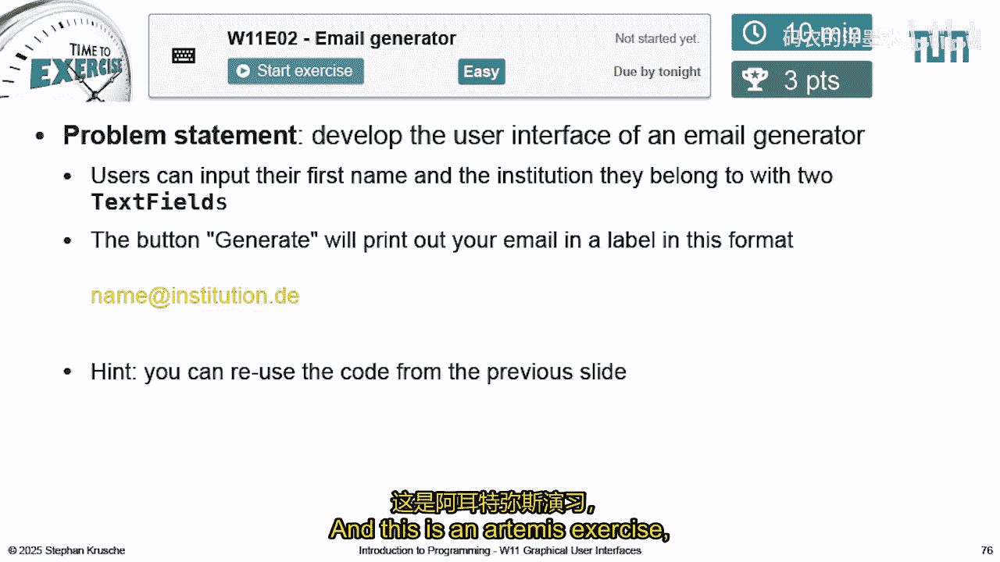
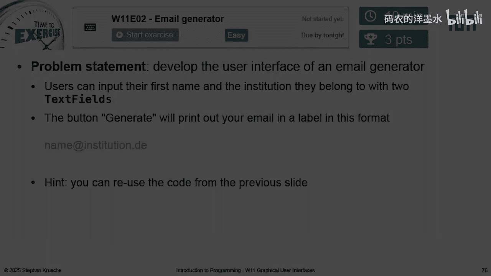
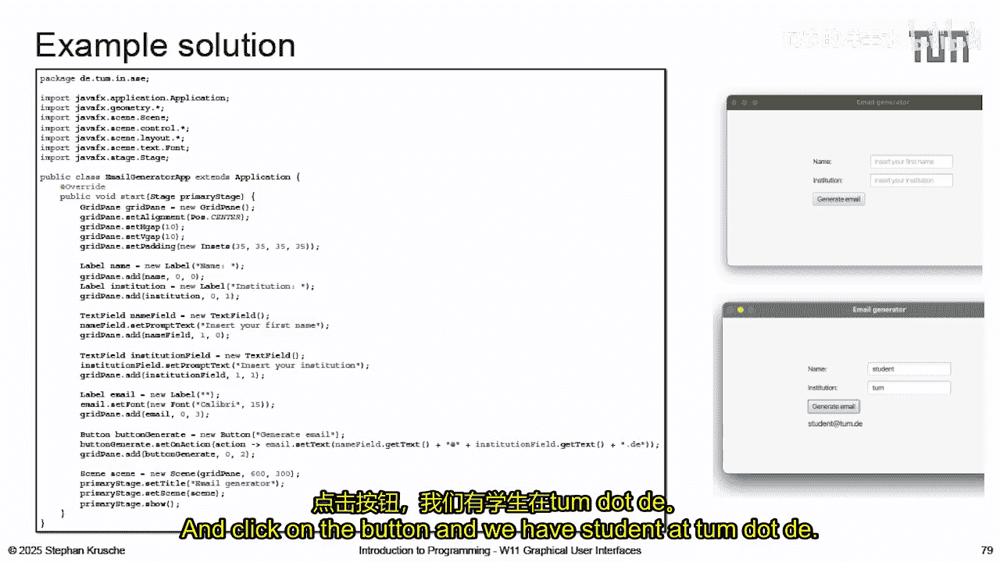

# 计算机编程：从入门到实战：51：用户输入 👨‍💻

在本节课中，我们将要学习如何处理用户输入，这是构建交互式应用程序的核心。我们将回顾MVC模式，并介绍JavaFX中一些预定义的UI控件，如按钮和文本字段，并通过一个实例练习来巩固所学知识。

## 回顾MVC模式 🔄

上一节我们介绍了图形用户界面的基础。本节中，我们来看看处理用户交互的经典架构模式——模型-视图-控制器（MVC）。

*   **视图** 负责处理用户输入。例如，按钮是视图的一部分。
*   **控制器** 包含实现逻辑和算法。按钮不应自行决定控制逻辑，而应将其委托给控制器。控制器可以操作模型或显示不同的视图。
*   **模型** 代表应用程序的数据和状态。当模型被更改（无论是用户操作还是外部事件，如股价更新），视图应相应更新。
*   **观察者机制** 视图观察模型，所有模型的变化都会相应地反映在视图中。视图也可以向模型请求新数据。

另一个例子是分页列表。如果列表元素很多，可能无法全部显示在一页上。此时可以只显示20个元素。当用户点击“下一页”按钮查看下20个元素时，控制器需要（可能先从服务器）获取数据，更新模型，然后视图再根据模型中的新数据对象更新显示。列表视图本身没有改变，只是显示了基于模型的不同数据。

## JavaFX中的预定义控件 🧩

理解了MVC模式后，我们来看看JavaFX中用于构建视图和处理输入的一些基本构件。

JavaFX提供了一系列预定义的控件来处理用户输入。

以下是几种常见的控件类型：

*   **文本字段** 和 **密码字段**：允许最终用户点击、聚焦并输入文本。这些文本随后可被应用程序访问和使用。
*   **复选框**：用于提供状态选项，用户可以在两个选项中进行选择。
*   **标签**：对最终用户是只读的，用于显示信息。
*   **列表视图** 和 **表格视图**：包含数据，用户可以滚动查看（如在移动设备上）。这些视图可以与其他控件结合，例如，列表中的每个元素都可以是一个按钮。邮件应用通常这样工作：手机上的邮件列表，用手指点击其中一封邮件（背后是点击或按钮机制），就会导航到下一页查看邮件全文。
*   **其他控件**：还包括日期选择器、滚动窗格、滑块、超链接等，足以设计简单的用户界面。当然，你也可以设计和使用自己的UI控件，但这会更复杂一些。

## 控件使用示例 💡

现在，我们通过一些具体例子来看看如何在实际中使用这些控件。

### 标签示例

我们再次使用网格面板，其中包含一些标签。创建新标签时，基本上是指定其文本，然后可以定义字体并将其添加到布局中。你可以看到这里有多个不同的标签：有些有文本，有些有数字，有些有特定字体，有些有特定的填充颜色。基本属性可以直接更改，但如前所述，也可以使用CSS样式来实现。标签可能是用于只读信息的最基本的UI控件。

### 按钮与动作事件

按钮很有趣，因为它允许我们与应用程序交互，并触发所谓的动作事件（例如，当用户点击、按钮被按下时）。在JavaFX中，可以像在FXML中看到的那样，将动作事件定义为对方法的引用，也可以调用 `setOnAction` 方法。

调用 `setOnAction` 方法时，可以传递一个匿名内部类，也可以传递一个Lambda表达式。这里我们看到使用Lambda表达式的 `setOnAction` 方法，这个Lambda表达式非常简单，只是向控制台打印一些内容。当然，我们也可以做更复杂的事情，比如保存数据、删除数据或关闭应用程序。

使用匿名内部类是旧方法，而使用Lambda表达式是新方法。

### 按钮应用示例

这是一个在现有应用中使用按钮的示例。我们有一个只有一个按钮“Print Hello TUM”的按钮应用。我们再次使用VBox作为非常简单的布局，并设置一些属性。然后创建按钮，设置其动作事件（非常简单的一个），将按钮添加到VBox的子节点中，最后指定场景和舞台。现在，如果按下按钮，就会在控制台得到一行输出，并且可以多次执行此操作。

按钮还可以通过 `setGraphic` 方法包含图形元素。你甚至可以在按钮内放置进度条（例如，在执行长时间操作时向用户可视化进度），或者放入图像，甚至将另一个按钮放入按钮内（尽管这通常没有意义）。

### 复杂按钮示例

这是一个更复杂的例子。我们有两个按钮：“显示”按钮和“删除”按钮。“显示”按钮有一个动作，将文本设置为特定的标签；“删除”按钮有一个动作，基本上将标签的文本设置为空或删除文本。现在，如果由此创建一个应用，点击“显示”时文本会显示，点击“删除”时文本会被移除。这是一个相对简单的例子，但你可以看到，这已经由大约25行代码组成，所以已经需要写一些代码了。好处是，有很多现成的例子（包括幻灯片中的例子）可以用于我们稍后将进行的课堂练习。

### 文本字段控件

另一个非常重要的控件是文本字段。当我们有文本字段时，通常希望访问其中的文本。这意味着我们要么预定义它（由程序赋予一个值），要么在用户输入值后，我们希望检索该值并用它做些什么。

这里有一个非常简单的例子：我们有一个文本字段，用户可以输入内容；然后我们点击“打印输出”按钮，文本基本上就被放入一个标签中。我们定义了一个标签和一个名为 `txt` 的文本字段。然后在 `setOnAction` 方法中，我们传递一个Lambda表达式。这个Lambda表达式从文本字段获取文本，并直接将其设置为标签的文本。此外，它还将填充颜色设置为蓝紫色，这是我们可以额外做的事情，但不是必需的。

## 课堂练习：邮件生成器 📧

掌握了文本字段、按钮动作以及如何获取文本并将其用于其他UI元素后，我们请你完成一个简单的课堂练习：开发一个非常简单的邮件生成器用户界面。

构思是：用户可以在两个不同的文本字段中输入名字和所属机构，然后有一个“生成”按钮。点击此按钮后，将在标签中以 `名字@机构.de` 的格式打印出电子邮件。你可以重用上一张幻灯片中文本字段应用的代码。你已经有一个文本字段、一个按钮、一个标签，请调整它，使其拥有两个文本字段（让用户知道每个字段的用途），并且点击“打印输出”时基本上就是生成电子邮件。这是一个Artemis练习，请前往Artemis并开始练习。

由于时间关系，我们需要继续，但你可以在今晚之前完成练习，并从Artemis获得额外反馈。

## 示例解决方案 👀

让我们快速看一下示例解决方案。这是一种可能的实现方式：

我们有一个邮件生成器应用，使用网格面板和一些值来构建美观的用户界面。然后，我们有一个名为“Name”的标签，将其添加到网格面板；第二个标签“Institution”，以不同的行索引添加到网格面板。

接着，我们有一个文本字段，设置了提示文本“Insert your first name”，并将其添加到网格的特定列和行位置。接下来，在第二部分，我们添加另一个用于机构的文本字段，设置提示文本“Insert your institution”，也将其添加到网格面板。

然后，我们有用于显示生成结果的电子邮件标签，以及一个用于生成它的按钮。以上就是用户界面的设置。现在，当用户按下按钮时，输入将被转换为输出。

在生成按钮上，我们设置了 `setOnAction` 并使用一个Lambda表达式。当这个Lambda表达式被调用时，我们设置电子邮件标签的文本为：`nameField.getText() + “@” + institutionField.getText() + “.de”`。每当用户按下按钮时，这段代码就会被调用。我们甚至可以在这里设置断点，在调试应用时进行验证。

然后，我们再次将按钮以特定索引添加到网格面板，最后完成应用程序的构建。

如果把代码放在一张幻灯片上，看起来就是这样。如果你现在看不清，稍后可以从PDF中获取。请确保导入了正确的包。运行后，界面如右图所示：左边是标签，右边是带有提示文本的文本字段（灰色提示应在此处输入的内容），机构字段同理，然后是生成按钮。如果我们什么都不做，标签是空的。但如果我们输入名字（例如“student”）和机构（例如“tum”），然后点击按钮，就会得到 `student@tum.de`。

## 总结 📝

本节课中，我们一起学习了如何处理用户输入。我们回顾了MVC模式如何将用户界面、业务逻辑和数据分离。我们重点介绍了JavaFX中的基本UI控件，特别是用于触发操作的**按钮**和用于接收文本输入的**文本字段**。通过**邮件生成器**的练习，我们实践了如何组合这些控件来创建一个简单的交互式应用程序：获取用户输入，处理它，并更新界面显示结果。这是构建更复杂应用的基础。