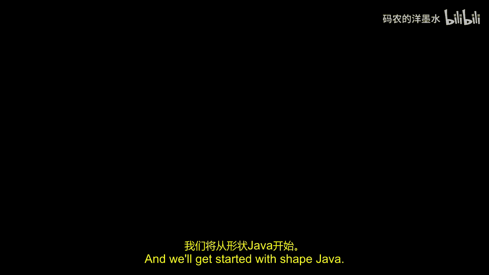
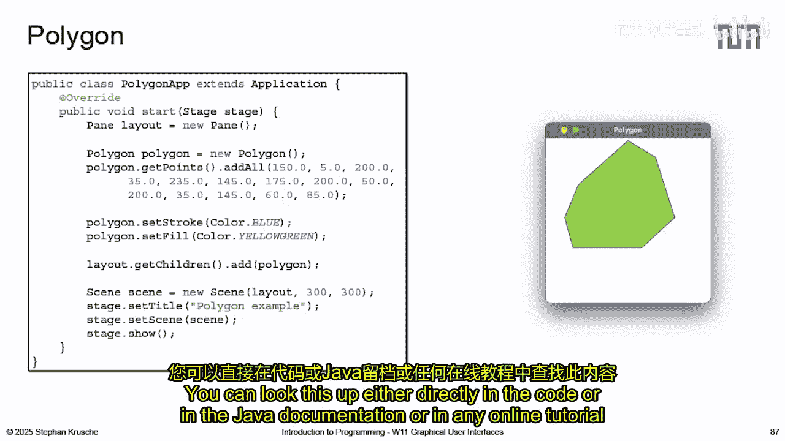

# 【全集】慕尼黑工业大学 计算机编程：从入门到实战 中英字幕 p52 Lecture 52 - 图形形状 -BV1WFrTBZExY_p52-

And we'll get started with shapes。

Java FX provides many different shape classes for us in order to draw text， lines， circles。

 rectangles， and so on。And you see a small class hierarchy here。

 a shape is a subclass of node so it can be added into a layout and we have it's an abstract class and we have a couple of concrete subclasses like text。

 line， rectangle， circle， and so on。And here's already a first example how to create a line。

It's simple line equals new line， and then we have four parameters， the start x value。

 the start y value， the end x and the N y value。We combined bind a line。

Based on its X property to a layout。 So the application that you see here。

 if I increase or decrease it。Then it will basically also。Change the lines accordingly。

We can define a stroke with， this is the width of the line。

 the blue one here has a width of three and the red one has a width of five， so the red one。

Looks a bit thicker。And when we have two lines like the line one and the line two here。

Then we can also add them to the layout in this case， a simple pane。And。Yeah。

 this is how it looks like now what is a bit interesting in this example here is that the starting point and the end point for the line is the same in both examples so providing those。

Does not really make a lot of sense here， we could also say。We leave it out if it would be possible。

 what is more important that we bind the end property of line one to the layout。

And similar we do this for line two， we bind the start property X and end property for y。

 So with that， we basically make sure that the lines change whenever we。

Resize the application and we can give this a try， so let me copy and paste the code into Intelliche。

Into my playground。😔，Here we go， so now I have the line app。😔，And I need a couple of imports。😔。

That's always a bit cumbersome， here we go。😔，And the scenes missing。And now， if we。

Start this application。 you see the same screenshot as in the slides， and now if I。Change。The size。

 you see that the lines also change。Because the。End or start values are bound to the layout to the end of the layout。

 and if I resize the application window， then the layout size also changes and Java fX automatically redraws the line for us。

So that's an example how you can bind a shape towards the properties of a layout。

Any questions regarding this？Okay， then we can also define a rectangle。 A rectangle has also four。

Parameterters in the constructor， the x and the y well u of the starting point and the width and the height。

We define a white rectangle R1 on the right side and a black rectangle。R two？

And add them to the layout in addition with a couple of text elements as well in order to distinguish them。

And next we have a four loop where we basically draw four different rectangles。And use random colors。

 so if you start this application multiple times。These four rectangles that overlap each other will look slightly different。

Because we use random values for the color。Any questions regarding rectangles？So it's quite similar。

 just a different class and a different。Name and then we again can use properties like the stroke and the fill color。

Or。Change。Are there attributes like the rotation based on certain angles？Great。

 then we have a circle， a circle has a center x and a center y value for the middle of the circle。

 and then it has a radius so that we can draw it， we have a stroke color that's the color around the circle。

😊，And a fill color。 and we can then put it into our layout。So again， relatively simple。

 instead of saying rectangle， rectangle equals new rectangle， you say circle。

 circle equals new circle and change different properties。😊，And when you do that。

 it's also quite important that you understand how to read such classes。

 yeah to be honest I'm not an expert in Java FX so I don't know what kind of properties a line has and there are two ways of looking this up。

 I can go into the Java documentation。Or if I'm in my。

It integrated a development environment and Teleche， I can also just click into it。😊。

And then I see the code， now the code， I don't want to read all the code。

 that's probably not a good idea， but if I open the project structure on the left。

 I can also see what kind of methods I have。And with that I can play around and of course I can also just say line1 dot and then see all the values that I could potentially change。

And this is something that a developer， a programmer needs to do， you get some new framework。

 some new API and then you need to be able to inspect it and to identify what kind of methods can I invoke what kind of properties can I change and nowadays this is of course a bit easier we can even use AI in order to guide us through the usage of such a framework。

We can also draw ellipses， ellipses are length circles but have two radius。

 a radius x and a radius y， and therefore we can also have it differently in that sense a circle has the same radius x and radius y value。

A polygon consists of multiple points and in this example we add the points directly so we say polygon get points at all and then we always have x and y value again x and y value x and y value。

 so in total we have one，2，3，4，5，6， seven points and the last line to the origin point will be drawn automatically。

And we again have this beautiful blue stroke color and yellow green filled color that becomes more and more ugly whenever I look into it。

😊，But yeah， this is the example in the slides。Any questions regarding polygons？Yeah， go ahead。

This was based on the here in Intelliche。 So I just click command。

And then you see elements are underlined。And whenever I click on one of those elements。

 it jumps to its definition。That's the idea。On a Mac， you say command on Windows control。

So for me control doesn't work， but for me on a Mac command works。

 and then it jumps to the definition。And here this happens to be the class itself。

 and then on the left side， you can open the structure。

And the structure is always a summary of all class properties。😊。

You can also customize it sort it alphabetically by visibility and so on。

And then you can see what you can actually do and an alternative way is to open the Java documentation and this you would typically do in the browser so I can say Java FX。

Text。Documentation or text field documentationer。And then this is not a used version。

 but this would be the Java documentation you know I have。State my opinion on cookies。

And then you can scroll down and then you see a text field extends a text input control。

 there's some documentation text， and each property is specified here what it actually means and what you can do with it。

So that's basically the Java documentation。Great， so much about shapes。

 you've seen a couple of those all the others work similarly， they just have a different name。

 a couple of different attributes， you can look this up either directly in the code or in the Java documentation or in any online tutorial that provides youa。

😊。

