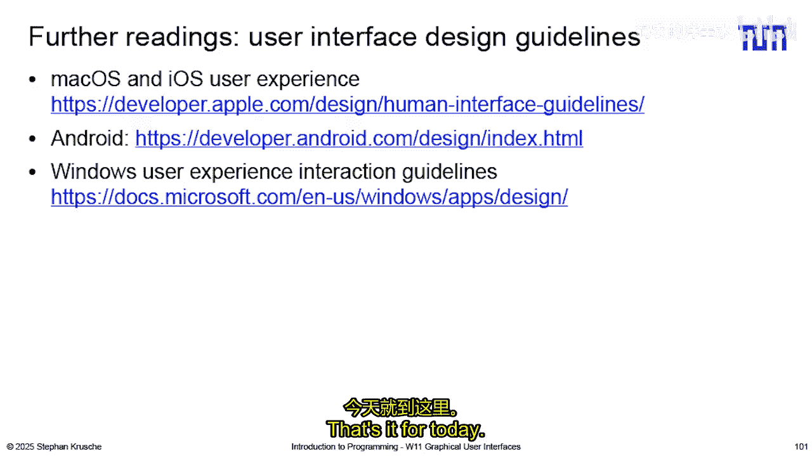
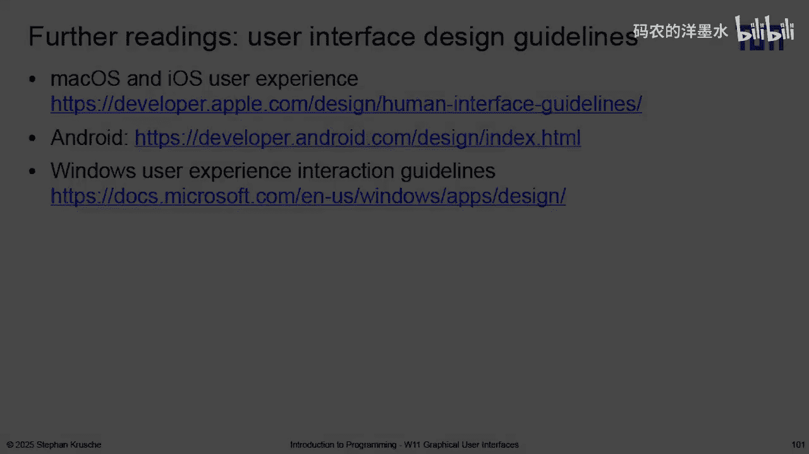

# 【全集】慕尼黑工业大学 计算机编程：从入门到实战 中英字幕 p53 Lecture 53 - 样式设计 -BV1WFrTBZExY_p53-

Last but not least， we'll talk about styling。😊，Javef X allows you to style properties for all kinds of elements like stages。

 layouts and controls and if you provide a consistent style to the graphical user interface this can improve the user experience of the application that you develop in particular it can increase whether people have fun with your application or not。

 if they see an ugly green yellow color or if they see beautifully designed applications like the examples that you see here where the right side is always the better version on the left side some heuristics are not fulfilled。

 for example here the contrast between gray and purple is not really good and you almost can't read it and on the right side we have an example where it's a little bit unclear what the primary action is so I have a lock in and then I suddenly have the same button representation。

For lock in sign up and for password however， if I already have an account。

 the primary action is to log in so it makes sense to highlight this button the most the secondary action if I don't have an account which might be I don't know for 10% of the user is to sign up for the account so this would be the secondary action we somehow make it obvious but not too obvious。

And last but not least for password is maybe a use case for 1% of the users。

 at least if you don't change all passwords due to security concerns。

And then this is the terernary action here， you the third action in terms of priority。

 and therefore it's almost not visible， it doesn't disturb me。

 and those clues can be realized with styling。There are a lot of best practices when it comes to styling。

 we don't tell you all the best practices because this would basically。

Not be possible in such a lecture， but we tell you the most important aspects how you can realize styling from a technical point of view。

You always can set the font directly on controls like a label。

And you can use existing font on the operating system like Callibre。

 you can also specify the font weight and the font size。You can also specify the fill color。

 It's called text fill with the。Property or method set text fill。

And you can use different kind of colors。 There are some predefined colors like color green。

 You can use the web color code。 You can use the red， green， blue color codes between 0 and 255。

You can also use the gray color range to represent gray colors。

 and you can also use color based on the scheme for you saturation and brightness。

 And if you've never heard about。RB RGB or A HSB， then you can use this in several applications。

 So I， for example， use this often in keynote， so if I make sure that I have the right yellow color here。

 I unfortunately don't have a styling that does that automatically for me。

 I have some predefined styles here。But what I typically do is I make sure that I have the right one here and here in this color picker。

 that's a graphical user interface for keynote or keynote。I can。Select colors in different ways。

 I have this color range here。I have the gray scale slider in percentage。Yes so now you see it's。

 it's gray。 This would be the gray R。GB value here。Let me。😔，Undo this action。

Then we can also specify the hex color values。 Those are the web colors in six different。

Values following a Hxet SmL format。 you can see the。

Indentture values between 0 and 255 that we use for our GB here。

And probably I can also go to other ways here， C M Y K would be possible in this example。

 and HSB H satation and brightness would also be possible。

 So you have a full range of defining colors and you can use your preferred weight。

We can define positions， X and y position of a conl determine where it is located within the parent container。

 but of course this depends on the layout for certain layouts。

 you cannot really change it because the placement is done automatically。

But if you have a label and this is possible of the layout。

 you can say set layout X and set layout Y。And of course。

 you could also change those over time if you want。And。Most importantly， we can use CSsS styling。

 so CSsS cascading style sheets allow you to separate styles from the actual code that defines the。

Graphical user interface and by separating this you can make those styles reusable so you can define a consistent button style with a primary。

 a secondary and so on style for all the different buttons based on they have importance。

And whenever you then decide to use the primary style， you just。

Assign the style to the specific button。And with that。

 you can make this quite reusable Cascading style sheets always have a selector。

 which is basically the name， the key to which we refer later on。😊，And property values。

 So for each property， like the font size， the font family， you can have different values。

 And you can see this in the web as well。 So if you open Chrome or any other browser。

And you then open the development tools。 so I can click on view developer and then say inspect elements。

Then I can see the styles on the right side here as well。

 and I can see within the body element of this website， which is now highlighted in blue。

 I have a white background color。And a kind of black， grayish text color。

 The fond family is Deja Vior。Never heard of it and as a fallback aerial， Helvitica and Soarif。

Fund size is 14 and margin is0。And so this is a cascading style sheet。😊。

And this is one way of defining the styles， and you can see multiple styles here。

Even the computed ones， you can play around with them， you can change them。So every web page in the。

Worldwideide Web that is to defined online works of this。

 And you have the tools in your browser to inspect this。 and Javaf X works similarly。

Here's another example， we could say that we have a style for a label with the font family cursive。

 size 14 point， style italic， weight bold and border style dotted。

 and then we could use this and assign it to specific labels later on。

Any questions regarding CSS or styling in Cha FX？Great， then。

We have one more exercise for the last 10 minutes of this lecture。And in this。

 we would like you to be creative and draw our tomb logo。In Java FX using rectangles。

And if you carefully look at the tomb logo， you will see that it follows a pattern。

 so it's actually not that difficult to draw it。You have some starter code here that you can find in Artemis as well。

And you basically just need to draw a couple of rectangles。And there are two ways of throwing this。

 so I'll give you this as a hint， and to show you this hint。

 let me zoom in my presentation and make the tomb logo as large as possible。😊，Now。

 if you look at this， you will notice that the tomb logo consists of one，2，3。F。5。Vertical rectangles。

And a couple of horizontal rectangles that combine those。So you could either say。

 I'll start with a white rectangle。And then add a couple of those blue rectangles。By the way。

 they all have the same size， also the horizontal ones， you can double check this。

Or you can combine it in a way that they have the same size。 So this is one way of doing it。

 The other way of doing it would be you have a blue rectangle。You start with a blue rectangle。

And then on top of that， you put white rectangle。 Can you see that that we have one，2，3，4。

5 white rectangles。YeahSo and that might be even easier because then you don't have to think about horizontal rectangles whatsoever。

 you just need to identify the x and y values here。

And you can use our starting code here because in the starting code。

 we basically give you units and the unit is 50 and we say that the whole picture has the unit 24 times 50 and 15 times 50。

As height and width and one of those units then can also one measurement unit can also be used for the rectangles later on。

So give it a try， try itous， the idea of this exercise is to draw the tomb logo。

 you'll find it on Artemis。So if you navigate into the course。😔。

You should be able to see the tomb logo application and there are also some hints where you can see a bit further how the tomb logo actually is made up based on blue and white rectangles。

And the pink lines here are only for your reference， we will not draw them into your solution。Yeah。

 and you now have a couple of。Minutes in order to work on this have fun。 if you need help。

 raise your hands， we again have very strong support here。

And then I'll show you an example solution in around 10 minutes and then we wrap up the lecture。

 have fun。Okay， the time is over officially， so who of you was able to draw the tomb logo？Okay。

 a few。For the others， you still have time until tonight， I show you a potential example solution。

 but you can also try it on your own。Notice that。Notice that Java FX is an important topic for us。

 graphical user interfaces and usability are really important for software engineering。

 so there are high chances that there will be an exercise based on Java FX in the final exam。

So this is an example solutioner， we have a tome logo application。Where we used the tomb blue。

 remember this0， 101 and 189， that's the DNA of our university。And we have a pan。

 And now what we do is we add rectangles to this pan。And we have a method here at rectangle to Pa。

 this is the one that we provided to you。And the difficult part is basically that you find out。

What kind of rectangles we have here， And you see we have five vertical blue rectangles。

 three horizontal。Blue rectangles and for the scene we basically reus the code that we had so this is all what we ask for calling eight times the add rectangle to pane method with different values based on the unit that we have above here and of course this then also involves a little bit of debuing and trying it out and we hope that。

Yeah figure here basically help you to get a better understanding of how you can set those values and if you carefully look at those values here。

 the x and y values， you will see that we reused them here as well 4，8， 12， 1620 and so on， 4，8， 12。

 16，20， those are the starting points of some of the blue rectangles。

And then you'll notice that the vertical ones always have the same height and width。And even for the。

Horizontal ones。You can draw three of them。And as you have the vertical ones already。

 they also all have the same size。If you draw the vertical ones。Completely。

Then you can draw the horizontal ones in a way that they all have the same size you So you have three times the width here。

Three times to with here， three times to with here and three times to with here。

 and this is how we come up with four of them and this is our example solution， any questions？😔。

Regarding this exercise。Okay， make sure you understand this again， this is important for the final。

Great， what are the next steps？😊，A quick summary for today。

 usability and user experience are important and I think you can all feel that if you have to use applications that are poorly designed and that you always like it better if you have a really really good design so they can be a deciding factor whether an application in particular and startups is successful or not there are several techniques to come up with a good usability we talk today about prototyping but also about usability testing and heuristic evaluation。

Take them into account， read more about them if you have time， because if you。

Manage a software team in the future， or if you are part of a software team as in the role of a developer in the future。

 you will need to deal with usability。Of course there is not just only one Gi framework similar to how there is not just one programming language。

 but the concepts behind this， and this is what we focus in the outline as well are similar in every GI framework you need to talk about controls。

 input， shapes， styling and so on， so in that sense they are quite similar。

 but of course the actual practical implementation might differ a lot。😊，We've talked about layouts。

 controls， shapes and styling at the example of Java FX so you should know how to deal with those from now on。

 you will have more time to practice this in the Tu exercises。We have a lot of references。

 not only ones where you can find more about Java FX but also a couple of books and a couple of aspects regarding usability。

 I can particularly recommend the book from then Norman the design of everyday things because you also learn about why doors are designed like they are designed or why certain things in your private and real life are designed in the way as they are designed so it's really a nice read look it up and take it into your next vacations to learn more about this that's it for today have a good evening and see you next time。

