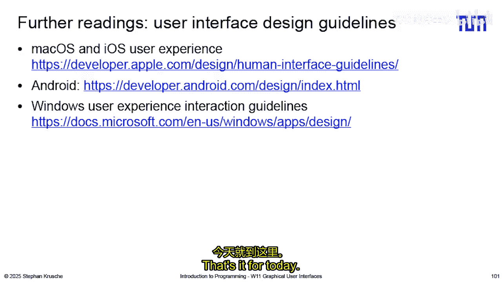
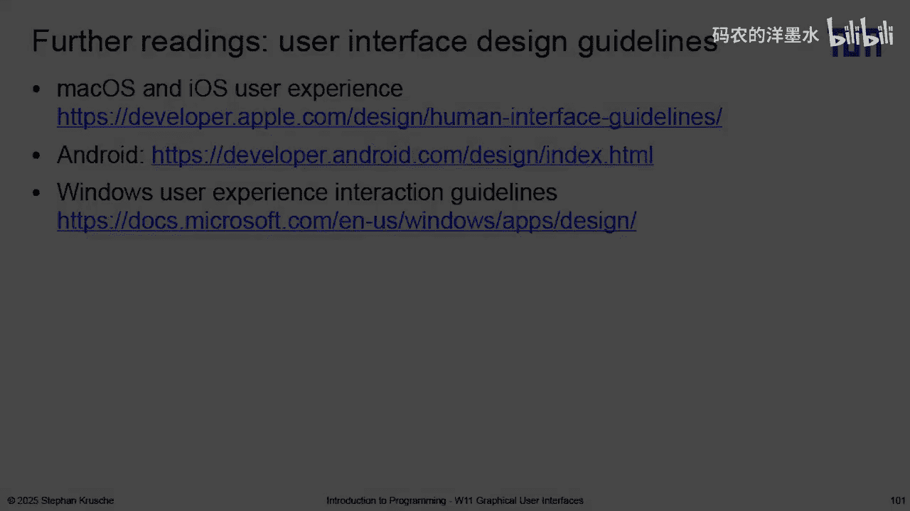

# 慕尼黑工业大学 计算机编程：从入门到实战：53：样式设计


在本节课中，我们将要学习图形用户界面（GUI）开发中的一个重要方面：样式设计。我们将探讨如何通过样式设计提升应用的用户体验，并学习在JavaFX中实现样式的技术方法。

## 概述

样式设计是GUI开发的关键环节。为界面元素（如窗口、布局和控件）提供一致的样式，可以显著提升应用的用户体验。一个设计精良的界面能增加用户使用应用的愉悦感。

上一节我们介绍了布局和控件，本节中我们来看看如何为它们添加美观的样式。

## 样式的重要性

对比以下两个例子，右侧的设计通常优于左侧。左侧设计中，灰色与紫色的对比度不佳，导致文字难以阅读。右侧设计中，主要操作（登录）与次要操作（注册）的视觉层次不清晰，降低了使用效率。

通过合理的样式设计，我们可以解决这些问题。例如，将最重要的“登录”按钮设计得最突出，将次要的“注册”按钮设计得可见但不抢眼，而极少用到的“忘记密码”链接则可以设计得非常低调。

## 样式设计技术

在JavaFX中，有多种方式可以为控件设置样式。

### 直接设置控件属性

你可以直接在控件上设置字体、颜色和位置等属性。

*   **字体**：可以使用操作系统已有的字体（如Calibre），并指定字重和大小。
    ```java
    label.setFont(Font.font("Calibre", FontWeight.BOLD, 14));
    ```
*   **颜色**：可以设置文本的填充颜色。
    ```java
    label.setTextFill(Color.GREEN); // 使用预定义颜色
    label.setTextFill(Color.web("#FF5733")); // 使用Web十六进制颜色码
    label.setTextFill(Color.rgb(255, 87, 51)); // 使用RGB值（0-255）
    label.setTextFill(Color.hsb(360, 100, 100)); // 使用HSB（色相、饱和度、亮度）值
    ```
*   **位置**：在某些布局中，可以手动设置控件的X和Y坐标。
    ```java
    label.setLayoutX(100);
    label.setLayoutY(50);
    ```

### 使用CSS（层叠样式表）

CSS允许你将样式代码与定义图形用户界面的业务逻辑代码分离。这种分离使得样式可以复用，便于维护和保持一致性。

CSS样式规则包含一个**选择器**（Selector）和一系列的**属性-值**对（Property-Value Pairs）。选择器是后续在代码中引用该样式的键名。

以下是一个CSS样式定义的例子：
```css
.my-label-style {
    -fx-font-family: "Cursive";
    -fx-font-size: 14pt;
    -fx-font-style: italic;
    -fx-font-weight: bold;
    -fx-border-style: dotted;
}
```
在JavaFX代码中，你可以将这个样式类（`.my-label-style`）分配给特定的标签控件。

网页开发也广泛使用CSS。你可以在浏览器（如Chrome）中打开开发者工具（Inspect Elements），查看并实时修改任何网页元素的CSS样式，这有助于理解和调试样式。

## 实践练习：绘制TUM徽标

现在，我们将通过一个练习来应用所学知识。请在JavaFX中使用矩形绘制慕尼黑工业大学（TUM）的徽标。

以下是实现思路：
1.  观察TUM徽标，它由**5个垂直的蓝色矩形**和**3个水平的蓝色矩形**在白色背景上组合而成。
2.  有两种绘制思路：
    *   先绘制一个白色背景矩形，然后在上面叠加蓝色矩形。
    *   先绘制一个大的蓝色矩形，然后在上面叠加5个白色矩形（覆盖部分区域以形成图案）。这种方法可能更简单，因为无需单独考虑水平矩形。
3.  我们提供了起始代码，其中定义了一个`unit`（单位）为50。整个画布宽为`24 * unit`，高为`15 * unit`。每个矩形的尺寸和位置都应基于这个`unit`来计算。

例如，垂直矩形的起始X坐标可能是`4*unit`, `8*unit`, `12*unit`等。所有垂直矩形具有相同的高度和宽度，所有水平矩形也是如此。

请尝试完成这个练习。理解如何在JavaFX中计算位置和绘制形状，这对后续学习和考试非常重要。

## 总结

本节课中我们一起学习了GUI开发中的样式设计。
*   我们认识到**用户体验（UX）和可用性**至关重要，良好的设计是应用成功的关键因素之一。
*   我们探讨了实现良好可用性的技术，如原型设计、可用性测试和启发式评估。
*   我们以JavaFX为例，学习了**布局、控件、形状和样式**的核心概念。尽管不同的GUI框架具体实现不同，但这些核心概念是相通的。
*   我们介绍了在JavaFX中应用样式的两种主要方式：直接设置控件属性和使用CSS。
*   最后，我们通过绘制TUM徽标的练习，实践了使用矩形和坐标计算来构建图形界面。





建议你阅读更多关于可用性的资料（例如Don Norman的《设计心理学》），并在未来的项目开发中充分考虑样式与用户体验。