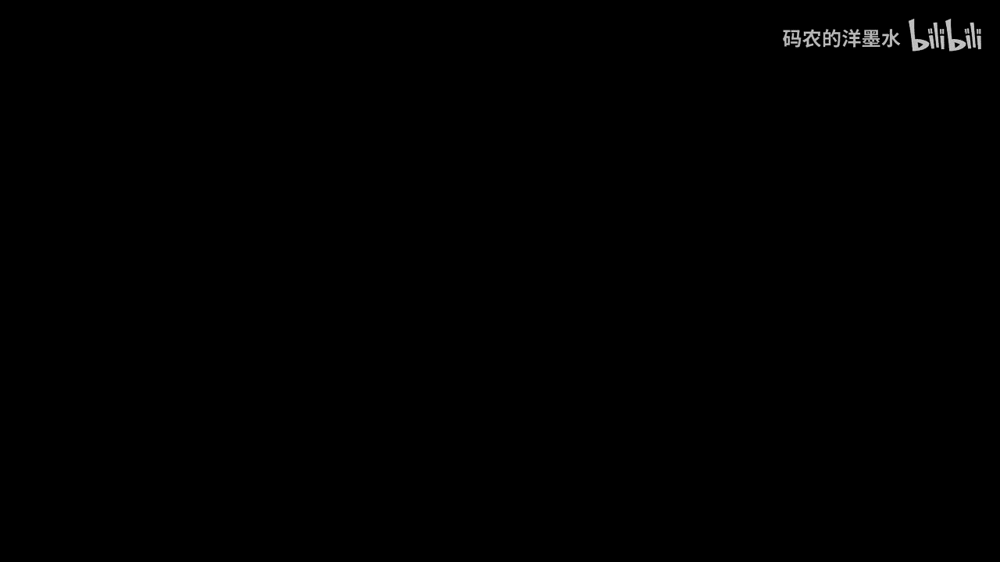
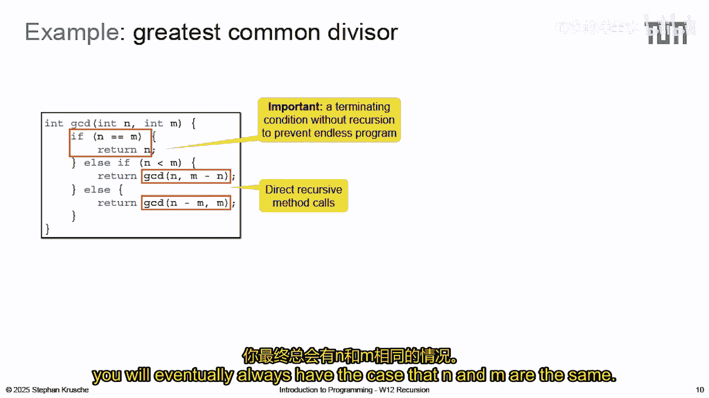

# 【全集】慕尼黑工业大学 计算机编程：从入门到实战 中英字幕 p54 Lecture 54 - 递归的原理 -BV1WFrTBZExY_p54-

So as Stefan is unfortunately ill today， you have the pleasure to spend the wonderful lecture of recursion together with my colleague Patrick and me。

 I will do parts one to three， and Patrick will parts two parts two and four。😊。

So when you think about Beck， what you learned at first， how did you handle large amounts of data？😊。

What you did was you traversed it iteratively so you had a long list or one or three dimensional and you went element by element through it。

 this is called an iterative process Today we actually learn a separate approach to handling large problems an advantage of this is this can do quite powerful stuffs this is the recursive process。

😊，And this is then the pre last topic， like next week。

 we'll also have a bit of look into software engineering and。😊，嗯。😊。

Like multi threading and that stuff， but today， like a really important。

 but sometimes quite difficult part recursion。This is what you should know so far。

 like you should know the basic concepts of object oriented programming。

 you should know the basics of iterative programming。

 you should know how to implement simple algorithms。

 especially with the iterative process and last week we learned how Gose works and how the user can interact with the program。

😊，And today， we will learn to understand what is the terms indirect and direct recursion。

We understand， like。How to apply it to algorithms， and especially if we understand what is a terminating condition。

 which is a crucial part of recursion。For the first part。

I would like to give you like start with a short story。

 like once someone told me in order to understand recursion。You need to understand recursion first。

This might sound like a very pointless definition of it。

 but that's the true meaning of what recursion is， you know？😊。

You need to use recursion to learn recursion。 So the basic principle， also what we had so far was。

All the methods that we define call some other function。

But what is new now is that a function can also call itself。In many cases。It's quite a useless thing。

 because if we always。Called a function with the same input。 We will never really end。

 We will not approach。A better way of getting the program。 We would run in an endless loop。

So the idea of recursion lies in the principle of divide and conquer。😊。

Have a difficult problem in the beginning。Solve one small part of it。

And then run it again through it so that step by step， you decrease the problem size。

Until you have a problem which you can solve immediately。So divide and conquer。

 divides the problem into steps。Start conquering the last one， start solving it。

Then go one step back， solving the bigger， solving the bigger。

 solving the bigger until you solved the overall problem。

 So combining these two partial solution into a total solution。😊。

The basic principle of recursion is that we run the same pattern form of a calculation over and over and over again。

 but every time we solve a bit of the problem， we make it a bit easier until we arrive at this trivial point。

And the way how we do this in Java is we have a function which can call either itself。All we have。

 for example， function A， which calls function B， and the function B calls function A again。😊。

That's the difference between direct and indirect recursion。

 one is the version where we call it all the time itself。😊。

And the second way is where we call another function and this function call the first one again。

And recursion is so far as we learned today， the standard implementation of this divideiding conquer principle。

A bit more formal method is that a method AAF is called directly recursive if it。

If the method called for F occurs in the body of F itself。And indirectly。

 if the method call of F appears in the body of a method G。And then。In F， the body of F。

 there is a method called 4G， for example。And for each of these recursive calls， we have a new。

instance of this respective method， so each instance have therefore its own local variables and parameters。

 which are usually not visible from the outside but ordered in a kind of a stack you already know like the data type of a stack and this is how Java works internally。

 it just stacks them。😊，On top of each other。 And then as soon as we have the trivial case。

 we go back down again until we are at the base where we started initially。

Let's think about a very simple recursive function， which is the factorial function。😊。

Factctorial function N exclamation mark， this is a mathematical notation for this。

 calculates the product。😊，From one to and so on， until n。So recursively， we have at first。

A difficult problem， like N。Viactctoria is a difficult problem。But a bit easier is to solve n minus1。

And we know we already have one solution is that part of our final solution is N。 So what we do。😊。

We take n times and then the recursive call。N -1。 So we have n。

 We know that's one part of the solution， and the rest will be taken again called by this algorithm over n -1。

So in every recursion step。😊，We decrease。The difficulty of the problem until we are at factorial0。

 that's our trivial， simple， easy problem to solve because we know it's one。

So F one and then we know the previous problem was two， so if one times two we can calculate it。

 the previous problem was three， we calculated it again and so we go back the stack down until we have this really wide。

😊，That really。White calculation， which we then can solve。This is for N larger one。

 a Java code for this would look like this， you see here the definition。😊。

Ass a static function for the factorial function here。😊。

And the simplest one case is n is smaller or equal to0， in this case， it's mostly equal。😊，To0。

 then we know we have to return one。And for everything else， we return。N times。

 And then we hear this is the recursive call factorial of n -1。So inside the function。

 we call the function itself， and inside this， we call it again and again and again。😊。

Until we reached a simple point。Here we have what we have here is this direct recursive call because we are calling the function inside of itself。

 we don't have an indirect case where we call it from another method。And very important。

 this one is a terminating condition which we can actually reach。

 So as we make the end smaller and smaller， it will eventually reach one so we can be sure that this。

😊，Recursive function will eventually terminate。So what happens inside here is we call， for example。

 the factorial function with four。And this is one line version of what we have in the Java code。

 So in case for。Is bigger than0， which is the case we call four times factority4 minus-1。😊。

We call it this is basically three， so we call it again here with three， which is also larger than0。

 two is larger than0， one is larger than0。😊，And then finally， Si is not larger than0。

 so we return one。And here you see in this chain at the bottom， we now have four。

 times 3 and times 2， times 1， times the trivial version solution one。

And this then gives us at the end the result。Now， let's think about a case where it actually does not terminate。

 So what happens if N， for example， we check here if n is equal to 100。And we make it smaller。

 and let's imagine we have a starting factorial- we call this it's a start of factorial with a number smaller than n than anywhere way to gets smaller and smaller and smaller。

😊，it will never end， so eventually we have here an exception which is probably also part the name of your favorite programming websites。

 take overflow。😊，This is， as I told you at the beginning。😊。

Every factorial call will be inside will be basically put on top of the stack。

 and eventually this stack gets too large for the computer to even store and then we have a stack overflow error so the computer says like there's not enough storage anymore to store these intermediate results。

Therefore， we also have to make sure that our function。

 which we use terminates if it's a recursive function。

One example here for a function which will eventually terminate is the function for the greatest common Vi。

 I think you probably all heard that back then in high school math。😊，The idea is basically to find。

The greatest number between n and M， which can divide both。So for the case。

 the trivial case that n and M are equal。😊，We can either return M or N because they are equal。

 But this is definitely then。The greatest common divor。If n is smaller than M。We call。

The function again。 But now the second argument， instead of M， we use M minus n。Because。😮，If。N and M。

Have the same greatest common division。 So does a linear combination between both of them have the same greatest common division。

😊，And for the case that n is larger than M， we subtract M from n and then call the function again。

These again， are here direct recursive calls。And important。

We need this terminating condition and because we are making it always smaller and I can guarantee you。

 even you take this algorithm and run it， you will eventually always have the case that n and M are the same。

