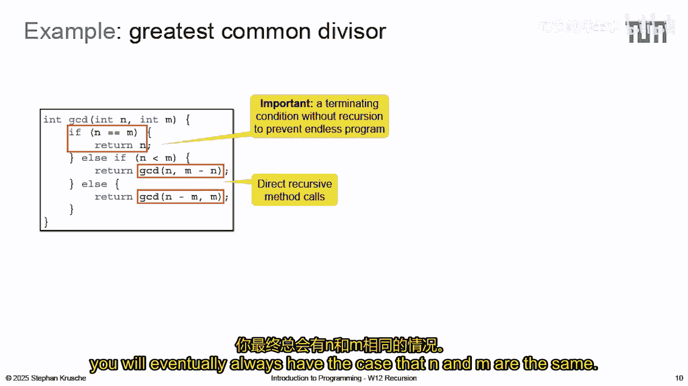

# 慕尼黑工业大学 计算机编程：从入门到实战：54：递归的原理


在本节课中，我们将学习递归的原理。递归是处理复杂问题的一种强大方法，它通过将大问题分解为更小的相似问题来求解。我们将了解直接递归与间接递归的区别，学习如何将递归应用于算法，并理解终止条件在递归中的关键作用。

## 递归的基本概念

上一节我们介绍了迭代处理数据的方法。本节中，我们来看看另一种处理问题的强大方法——递归过程。

递归是计算机科学中的一个重要概念。其基本思想是：一个函数可以调用自身。这听起来可能有些奇怪，因为如果函数总是用相同的输入调用自身，程序将永远不会结束，陷入无限循环。

递归的真正力量在于“分而治之”的原则。开始时，我们面对一个困难的问题。我们解决其中的一小部分，然后对剩余部分再次运行相同的算法，从而逐步减小问题的规模，直到遇到一个可以立即解决的简单问题。然后，我们通过组合这些部分解来得到最终解。

递归的基本原理是，我们反复运行相同模式的计算，但每次计算都使问题变得更简单，直到达到一个平凡点。

在Java中实现递归有两种方式：一种是函数直接调用自身，称为直接递归；另一种是函数A调用函数B，而函数B又调用函数A，这称为间接递归。

更正式的定义是：如果一个方法F在其方法体内调用了F自身，则F是直接递归的。如果一个方法F在其方法体内调用了方法G，而方法G在其方法体内又调用了F，则F是间接递归的。

每次递归调用都会创建该方法的一个新实例，每个实例都有自己的局部变量和参数。这些实例通常对外部不可见，但会以一种“栈”的数据结构形式在内部组织起来。Java内部正是使用栈来管理这些调用。当达到平凡情况（终止条件）时，程序开始逐层返回，直到回到最初的起点。

## 递归示例：阶乘函数

为了理解递归如何工作，让我们看一个简单的递归函数示例：阶乘函数。

阶乘函数在数学上表示为 `n!`，它计算从1到n的所有整数的乘积。递归地看，计算 `n!` 是一个困难的问题，但计算 `(n-1)!` 则稍微容易一些。我们知道，`n!` 的解的一部分是 `n` 乘以 `(n-1)!` 的结果。

因此，在每一步递归中，我们都将问题的规模减小（从n减到n-1），直到达到一个平凡情况：`0!`，我们知道它等于1。然后，我们沿着调用栈返回，组合这些部分结果。

以下是阶乘函数的Java代码实现：

```java
public static int factorial(int n) {
    if (n <= 0) { // 终止条件
        return 1;
    } else {
        return n * factorial(n - 1); // 递归调用
    }
}
```

在这个函数中：
*   `if (n <= 0) return 1;` 是**终止条件**。它定义了最简单、可以直接求解的情况。
*   `return n * factorial(n - 1);` 是**递归调用**。函数在这里调用自身，但参数变小了（n-1）。

这是一个直接递归的例子，因为函数在其自身内部调用了自己。

让我们以计算 `factorial(4)` 为例，看看内部发生了什么：
1.  `factorial(4)` 调用 `4 * factorial(3)`
2.  `factorial(3)` 调用 `3 * factorial(2)`
3.  `factorial(2)` 调用 `2 * factorial(1)`
4.  `factorial(1)` 调用 `1 * factorial(0)`
5.  `factorial(0)` 满足终止条件，返回 `1`
6.  然后程序开始返回：
    *   `factorial(1)` 返回 `1 * 1 = 1`
    *   `factorial(2)` 返回 `2 * 1 = 2`
    *   `factorial(3)` 返回 `3 * 2 = 6`
    *   `factorial(4)` 返回 `4 * 6 = 24`

最终得到结果24。

## 终止条件与栈溢出

上一节我们看到了一个正确终止的递归函数。本节中，我们来看看如果递归没有正确终止会发生什么。

终止条件是递归函数中至关重要的一部分。它确保了递归过程最终会停止。如果没有终止条件，或者终止条件永远无法达到，函数将无限地调用自身。

每次递归调用都会在内存栈上占用一些空间来存储该次调用的局部变量和返回地址。如果递归调用过深（例如，由于缺少终止条件或参数未向终止条件收敛），栈空间将被耗尽，导致“栈溢出”错误。这意味着计算机没有足够的内存来存储所有中间调用。

例如，考虑一个修改版的阶乘函数，其终止条件是 `if (n == 100)`。如果我们用小于100的数（如5）调用它，函数会不断用 `n-1` 调用自身，数值变得越来越负，永远无法等于100，最终导致栈溢出。

因此，设计递归函数时，必须确保：
1.  存在一个明确的终止条件。
2.  每次递归调用都使问题更接近终止条件。

## 递归算法应用：最大公约数

理解了递归的基本结构和终止条件的重要性后，我们来看一个更实用的递归算法例子：计算两个整数的最大公约数。

最大公约数是能同时整除两个数的最大正整数。计算GCD的一个经典递归算法是欧几里得算法。

其递归思想如下：
*   **终止条件**：如果两个数 `n` 和 `m` 相等，那么这个数本身就是它们的GCD。
*   **递归步骤**：
    *   如果 `n < m`，那么 `gcd(n, m)` 等于 `gcd(n, m-n)`。
    *   如果 `n > m`，那么 `gcd(n, m)` 等于 `gcd(n-m, m)`。

这个算法的关键在于，`n` 和 `m` 的最大公约数与 `n` 和 `m-n`（或 `n-m` 和 `m`）的最大公约数相同。通过反复相减，我们使两个数不断减小，最终它们会变得相等，从而触发终止条件。

以下是该算法的Java实现：

```java
public static int gcd(int n, int m) {
    if (n == m) { // 终止条件
        return n;
    } else if (n < m) {
        return gcd(n, m - n); // 递归调用情况1
    } else { // n > m
        return gcd(n - m, m); // 递归调用情况2
    }
}
```

这个函数也是直接递归的。因为每次递归调用，参数 `n` 和 `m` 都在向彼此靠拢（通过相减），所以最终一定能达到 `n == m` 的终止条件，从而保证函数会正确终止。

## 总结

本节课中，我们一起学习了递归的原理。

我们首先了解了递归是“分而治之”原则的一种实现，它通过函数调用自身来将复杂问题分解为更小的相似问题。

我们区分了**直接递归**（函数调用自身）和**间接递归**（函数通过其他函数间接调用自身）。

我们认识到**终止条件**是递归函数不可或缺的部分，它定义了最简单、可直接求解的情况，并确保递归过程能够结束。缺少或无法达到终止条件会导致栈溢出错误。

通过**阶乘函数**和**最大公约数**这两个例子，我们实践了如何设计递归函数，包括定义终止条件和编写向终止条件收敛的递归步骤。

递归是一种强大的编程工具，尤其适用于解决具有自相似结构的问题，如树形结构的遍历、分治算法等。掌握递归思维，将帮助你更优雅地解决许多复杂的编程问题。



