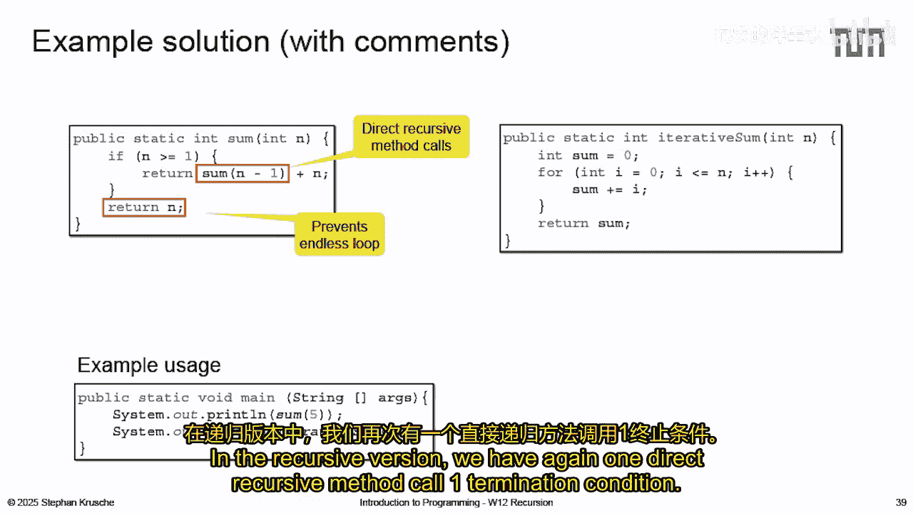

# 【全集】慕尼黑工业大学 计算机编程：从入门到实战 中英字幕 p55 Lecture 55 - 汉诺塔示例 -BV1WFrTBZExY_p55-

Let's dive into。

A bit more difficult example of it。There was by the French mathematician， Edward Lucas。

There was like a mathematical approach which was presented as a simple game。

 which in the original was the towerist in Vanasi in India。😊。

But it's more commonly known as the Towers of Hanoi。The idea is in the original story。

 we have three pillars。And one of these pillars contains 64 golden disks。

Every disc above another disk is smaller than the disk below it。

 So we have kind of a disc pyramid with 64 golden disks。

There will be an obvious reason why we don't go through 64 in this example， but just through four。

But the rules apply the same here。The rules for Tower of Hanoi is that you move this pyramid stack from the leftmost pillar to the rightmost pillar。

But in every move， you are only allowed to move one pillar or one disc or ring here in each turn。

 And it's not allowed that the larger ring。Can be placed on top of a smaller ring。

So these are the basic rules of the game。Well， let's try it out。So we have our base situation here。

 four discs are on pillar one。For the first topmost element。

 this is the only one which we can move because the elements below are blocked。We have two options。

 we can either choose two or three。Later you will see why it's obvious that I'm now choosing to move it over to two。

Next element。The next， the top boss element now on one cannot be put on pillar 2 because it's larger than the element which is currently on2。

 so it is just one possibility and this is to move it to pillar3。Okay。Now， we cannot move。

Any disc from pillar one because two and three both contain a smaller one。

So only we have two possible moves， either we move the element3 back to one。

 which would be quite endlessless because we don't approach a goal。

Or we put the element from two to three。Easy so far。Then for the next step。

 we put themost element of one now and two。We move the topmost element from three to one。

The topmost element from three now to two。And topmost from one to two。Now， imagine。If。

The discs that we now have on pillar 2 would be on pillar 3。Then we would have solved。The problem。😡。

If we consider only n-1 disks。So this is now important now we have like an intermediate goal。

 we would have solved the problem for a bit of an easier case， what we are now doing here。😊。

Is we now have to move the bottommost element from one to 3。And then sort back the elements。

 I will now skim a bit faster through it。Over to three。Any questions about that so far？

Seems quite simple。But how do we do that in code？this is now the first time where the power of recursions is very visible。

😊，For the case that we have zero elements。Oh， it's quite easy the problem， right， Si elements。

 we don't have to do anything。Even for one element， the problem is also trivial。

 Move it from pillar 1 to pillar 3 done。A problematic if the stack gets a bit larger。

But keep in mind what we said before。Recursion we can use if we have a large problem and we can have an approach to solve it if it's a bit simpler。

 like we have a base case。😊，And we can solve every step in between。

So the idea how would resolve solve is is。For a tower which has the height H， we move。

Every single element。Above H， so H minus1 elements， to pillar2。

Just currently don't ask how we moved it， Let it be a problem for the later you。 At first。

 just imagine we achieved this step。Then we move the bottommost element。😮。

And then we sort or removed all the elements from two back to three， Also that's again。

 a problem for the later U。And the first and the third step， this is where we now use recursion。

 because you saw。We solved it the problem now for H， given that we have a solution for H minus-1。

 but the solution for H minus1 can be solved if we have a solution for H minus-2。😊。

So it will be again and again again， a problem for the later you until the later U eventually arrives to the case where he says。

 I just have to move one element。That's a simple case。That's basically the second case。

 move the lowest slice to the target position。And why this， we can solve this quite complex problem。

😊，This is how it would look like in code now。😊，So in case the height。

 which you have for the tower is larger than0。😊，We approach the following。 At first， we have to find。

A free spot where we can put the element。Therefore， we have a free function， which I will。😊。

Explain you in a bit。But assuming we have that function， we know where to move the element， we move。

All the elements。From which are above until like the excluding the bottom most。

 we moved from the first pillar to our free spots， this is basically the second line here move height minus1 from element place a to the free place。

😮，Then we do this one move where we say the bottommost， we move from A to B here。

 so actually into the target position。And then we move。Or the other elements。

 which we temporarily park on this middle pillar。On top of the element。

 which we just moved one step before。And these are recursive calls， So we can say like。

Make the problem a bit smaller。And eventually， because we always decrement height in every recursive call。

 we eventually will have the point where we have height zero， where we just don't do anything。😊。

Important here， A and B have to be different from each other it would be just too easy if we say we move the pillar from where it is to where it is。

😊，And A is then always the target pillar and B the sauce pillar and B is the target pillar。

Here again， we have direct recursive method calls。The problem just which we have to solve right now。

 because you see like。The lowest three lines of code we already solved system out print All and isn't easy stuff you learned it pretty much in lecture1。

Recur， of course， you you now learned。But you can directly use them because you already have the method in front of you。

 So there's just one method which is left to solve。 and that's the free method。So for example。

 if we consider here， if we have to move an element from pillar 1 to pillar2。

Our free spot is pillar 3。 If you have to move it from pillar 1 to pillar 3， it's pillar 2。

So this matrix basically shows us because we say we are not allowed to move an element from the pillar where it is to the pillar where it is。

😊，The diagonal line is not filled out， but the rest here kind of makes sense， I would say。

How do we solve this is well we have an intermediate step， what we can see here？😮。

Is that the result kind of depends。On the multiplication of the two elements。

 so that's a step in between so for example here if we fill out one plus two， we have three here。

 one plus three， we have four， and this is our intermediate step to solve the free problem in the following way。

😊，Imagine if we would use a switch statement for this so have。

basically have a way to solve the problem for a plus B in case it's three。

 we would return three if it would be case4， we would return two and five we would return one。

 keeping in mind basically what we had here is an intermediate step。We could do that。

But it's a bit unpractical。 We have a switch statement here。

 there's an easier way to solve this in math， and this is6 minus a plus B。😊。

If we imagine that we have a plus p3 here，6 minus3，3，6 minus4 is2。6 minus5 is1。Yeah。

6 minus default doesn't work， so the lower one is a bit difficult to handle for the default case。😊。

But we saw here we assumed that there is no default case。

 that is just disallowed to move it from the same pillar。

 so we can just more or less ignore it default case here。So this is now the code。

Of how this movement should work we have on top。The movement operation。

 which we had a look before below， we have the free method。And then just at the bottom。

 we have the main method， which just reads at the beginning。The height of the tower。And then just。

Starts with the first recursive call。 This is the so-called initial call。

 So it has this initial call with the height which we just entered。

 and we want to move it from pillar 1 to 3。And then the recursive method calls itself again and again and again。

 and in every time that it calls， you have another system out printer and command。😊，So step by step。

We get an overview of all the moves that we can do。Before we go to this。

Just like as a small thought experiment， we just did it now with four。before disks。

 and you already saw it was quite a number of moves that we have。Now。

 imagine in the original idea with 64 disks， we have about 18 quintillion movements。😊。

Roundabout calculate the number of movements by2 to the power of the number of disks， minus1。

So if we imagine。That each movement would just take a tenth0 of a second。

 it would take us 58 billion years to solve this， and the university is only 14 billion years old。

 or just imagine like if we would have to document each move in one byte， which we could roughly do。

 we would end around basically the full documentation of all moves would take around 18 extraab byte。

😊，It's 18，000 Peterbte。Just like to give you a perspective of what a gigantic。Problem。

 just 64 disks can be。So if someone would move that by hand。

 they wouldn't make it until the end world ends， so this is a problem which is practically unsolvable。

 just theoretically as a thought experiment， it could work。😊，So now for the exercise。😊，On Artemis。

Your task would be now to create a recursive functions that can determine the sum of integers from0 to the value n。

 the value n should be a input parameter。 you should think about what is the trivial case。

And then summ it up step by step until you have your final result， and for this。

 please use recursive calls。In the first version， in the second version。

 try to implement the same thing using what you already learned， the iterative approach， for example。

 using a follow loop。😊，But this you have five minutes， so please open。

 I think the exercise should be an artemist。😊，So okay。

 I think that should now be for most of you enough time， so let's quickly go through the solution。So。

Summing up is really easy， if you have。An input which is smaller than one。

Because we just have integer， it can， in this case， just be0。Then you return0。0 is。

Basedase very neutral element in。Summing numbers because it doesn't change anything in the value。

For everything which is edtable or larger into one。😊。

You know that the number itself will be part of the solution。And then in the next step。

 you just decrease the problem size， so n minus-1 and put it again in the sum function method。

And add to the result that you have so far。 So eventually you will have， for example。

 if you start with some8， you will have8 plus。7even plus 6 plus5 plus four plus3 plus plus1 plus0 at the end。

For the small bonus， we just assume that we have。 we want to do it iteratively。 so we have。

ASome local variable in order where we sum the elements on it。And then we just have an for loop。

 which goes from I to N。And we put an every element to this local variable。

 added onto the local variable， and at the end， return to a solution。

There would be the two ways of using it in the main method once via just the sum。

 which is a recursive version and the other one， the iterative version。

And they should give you the same result。In the recursive version， we have again。

 one direct recursive method call。

And one termination condition。