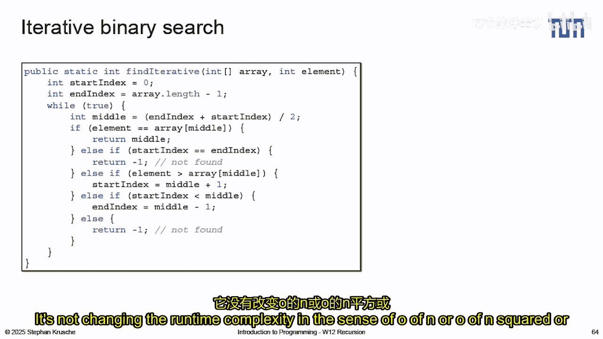

# 【全集】慕尼黑工业大学 计算机编程：从入门到实战 中英字幕 p56 Lecture 56 - 二分查找示例 -BV1WFrTBZExY_p56-

Okay。So the next example for recursion we are going to look at is a bit simpler than the first one。

And it's called binary research。Let's imagine you have a list or an array of numbers。

 and you want to find out is the number7 contained in that list and if yes， where？

So what would be our like na approach our first approach。

 it would be probably we go through the list from the beginning to the end and if we encounter the number seven。

 then we return the index where we currently are。And if we never find that。

 we go through the entire array and we never find a 7， then we return a -1。

 So that's what we see in the code down here。So if we look at an example， we have an example list。

 and we search for the number 7， we compare the 17 to the7， it's not a7。

 we compare the three to the7， still not a seven， and we do that for all the entries until we reach the actual7 and in that case we know okay it's there and at index 0。

1，2，3，4，5，6， oh7 as well。So we return seven。In this example。

 because it's at a seven position we compared the number7 to under7 other entries in our array。

 so let's say we have a very， very large list with I don't know millions of entries then we would have to do millions of comparisons which is not very performant so in the worst case that would be。

As many comparisons as there are entries in the list， but on average， it's half of it。

So there must be a way to do that better， right？And that's where binary research comes in。

 so it works the following way。We sort Delray。Like normal with any sort algorithm。

 and then we just look in the middle of that array。

If the seven or whatever value we are looking for is smaller。

 then what is in the middle of the array， then we know we only have to look at this side of the array and can completely forget the other side。

If7 is greater than the middle， then we know we have to look at this side and can completely forget the start of the array。

And that's why it's called binary search， so we have always two options。

 either we go to the left or we go to the right。So let's have a look at an example。

 the same one again。😊，We look at our example array in the middle， there's a5。

So7 is greater than five， so we can throw away this entire section of our array。

 and we only have to look to the right。Then we look again in the middle。 now there's a9。

We see the7 is smaller than the nine， so we only have to look to the left from there so we can throw away this part of the array。

And then we have an array left with the length of one， we look again in the middle。

 which is obviously the only entry in an array with the length of one。And we see it's a 7。

 and we find it。 And then we return the index wherever we are at。 So in this case， it's。Yeah。

 it's the same， okay。Good。So and we see we didn't need seven comparisons in this case。

 but only three comparisons because we just halfal the length of the area we are looking at three times。

So and for any array that's like that has millions of entries。

 we know we just need n comparisons if it has a length of 2 by the power of n。

So in code that's also relatively simple to do now that we know how recursion works。

 so first we specify a method called find and we tell it okay， here's the array we want to search。

 element is the number we are looking for and start and end index is the area in the array we're currently looking at。

And in the beginning。That's why we create another overload here that's just the entire length of the array。

 right， so from the start to the end。And if we wanted to find an element， we would call this method。

 which was then internally called the more complex method for us。

So if we have a look at how we implement this first method。

Then we just do what we just saw the example first。We calculate the middle。

 and we do that by adding the start index to the end index and dividing it by 2。So in the first case。

 that's zero plus the length of the array， so we are in the middle。

Then we check if we already find our element that we are looking for， if yes， we'd return the index。

Of the middle。Then the next check is is our start index equal to the end index。

 so suppose we have half the length of the array over and over and over and over again。

And in the end， we only have an array left with the length of one。

And we just checked is that element the element we are looking for and it is not。

Then we know the element we are looking for is not in our array because we can no longer hal it。

 right， So we return -1。But if the array is still longer than one。

 we just compare our element to whatever is in the middle whoops。And if it's larger。

We moved the start index to the middle plus one。 so we like in the example。

 we throw away the left part。And if it's smaller， we throw away the right part by moving the end index。

I think that should be a pretty straightforward implementation。

Would like to invite you to have a look at this for， I don't know，20，30 more seconds。

And if there's any question， please raise your hand。This is a very， very important algorithm。

 by the way。Something that could come up in an exome too， maybe not that I looked at it， but。Okay。

 and I hope you all。This is our recursion here， right， so we call find inside of find。So， you see。

That we we built something here that's called a call stack。So we call find In or find over and over。

With our array called a and index at the number7 we are looking for。

And then it calls the internal find method for us with the start index 0 and the end index 8。

 So that's where what we had in the example， right。And then we see， okay， we have to go to the right。

 so we move the start index from 0 to5。As seen here the on the right。

And then we move the end index back to5。 And we have And as now these the start index and the end index are equal。

 we only have an array with the length one left。And you see we call find， In， find， In， find。

 and that is called a call stack。And after we find our value， we return the index， so we return 5。

 and that call again returns 5， returns 5， returns 5 until we are back at our original call。

So that is。Ya。A call stack， a call stack usually works by the last and first out principle。

 so whatever method call we initiated last is also the first one to finish and then we can build a stack up and build a stack down。

Now we have to make sure that if we do build a call stack like this。

 a recursive call stack that our recursive method also terminates at some point。

 so because if we do this indefinitely， our program will crash at some point。So in our case。

 we can we see， okay。There are two things that could happen when we call our find method。

 The first thing is。That start index is equal to end index。 And in that case。

 we always terminate a function， right， So either。At that index。

 there is the element we are looking for， then we are happy。 And otherwise。

 we have the comparison that checks of star index equals and index。 And in that case， we return -1。

 So in that case， we always return， and we stop the recursion。😊，And in the second case。

 if start index and end index are not equal。嗯。We know that we are calling the method on some sort of interval in our array with more than one element。

And in that case， we have two subcases， so either the call again terminates directly because we yeah we were lucky and found the element we were looking for right in the middle of this intervalir。

Or else， we still know that it will terminate at some point because we make the length of the next recursive call only half as large。

 right， so we make it half， half half until we finally have an array with the length of one。

And similar techniques to prove a termination of a recursive algorithm can be applied to all sorts of these problems。

 but it's very difficult very difficult and important whenever you work with recursion to make sure that this is actually the case because otherwise。

 if there are cases where your recursion never terminates。

You or your users will have a problem very quickly。

There's also an iterative version of binary research that I want you to be aware of。

Which is not using recursion， but that's possible as well。So let's have a quick look through this。

So we in this case， instead of passing the start index and index to the next call。

 we will just keep it in variables so we initialize it with0 and the length of the array minus1。

Buthich is the last index。 And then we just have a loop in which we over and over half the array length。

 So we calculate， oops， we calculate the middle。Then we check again， is our element in the middle。

 if yes， we return that index。It's pretty much the same algorithm。

 It's the exception that instead of calling our method again， we just have a loop。

And and update our variables instead of passing them as new parameters。I will also keep this open。

For a little while。Please let me know if there are any questions about the iterative approach of binary research。

Okay， if not， I have a question to you guys， actually。Do you see。Come on， this condition here。

 where we check if the start index is smaller than the middle。Why do we do that here。Right， it start。

 it's starting to search on the left part。 but couldn't we that。

 Couldn't we do that without this check。I mean， what if start index is not smaller than middle。

What does happen then？Yeah， so the answer is nothing。

 It's an optimization which cuts off a few cycles in the end。But technically， we wouldn't need it。

 Yeah， right。 So we do this check。 But if we didn't do it。

 we would just reduce the indexes until they are the the same。

 And then we would return due to this condition here。 So it's just an optimization。Technically。

 we' we won't need it。 So if you， for example， look at the implementation of binary research on Wikipedia。

 you will see that this is not there because it's not needed technically。

 but it's an optimization that we can do。Yeah。😊，no。It doesn't。

 it's basically just cutting off a few of the loop cycles。

But it's not changing the runtime complexity in the sense of o of n or O of n squared or something。

