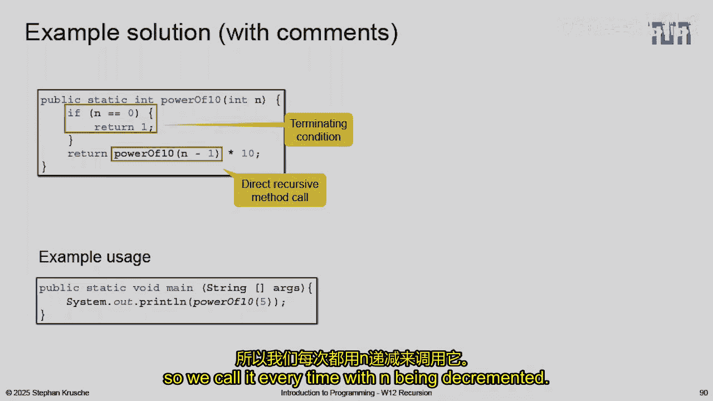

# 【全集】慕尼黑工业大学 计算机编程：从入门到实战 中英字幕 p57 Lecture 57 - 科赫雪花示例 -BV1WFrTBZExY_p57-

So okay， Ra， welcome back。Now we're getting into a bit more fancy part， I would say。😊。

Another very nice and this time very optical but on the other hand。

 a bit math heavy example for recursion is Co snowflake。😊。

The idea of a co snowflake starts very simple， a co snowflake is with kind of a curve which is a fractal you probably have seen on the internet these very fancy pictures of different kinds of fractals and Co snowflake is one of them。

😊，It works in the following step， we start with one straight line。

 which is usually a connection between two points。What we do in every recursive step of a costna curve is we remove the middle part。

Of each straight line。And add an equilateral triangle in this middle part of it in this middle third。

And when we do this， for example， here， we see we edit here one alateral triangle。

 and then for example we edit here in this part， now also an alateral triangle in this part。

 in this part and in this part。😊，And in the next step， we do it again with every straight line。

And here you can already see this snowflake like shape。This is basically just for one line。

 usually you do it with a triangle， so you already have one triangle and then you see here on the left。

You would add like in theory， another triangle on it， then smaller triangle on it。

 but what we are now approaching in the next 40 minutes more or less is to understand how it works when we just exchange lines in the middle part of a triangle。

Sill， first thing is quite easy。We have a line。And we separated two parts， into three parts。

 like every part is now a third of the previous line length X。😊。

And then we add a triangle so that both sides of the triangle， which are now visible here。

 are also a third of the length。Now we need to find like we know that when we separate this triangle in the middle。

The rest of the distance here would be one/ sixth of a triangle。

But and this is now our important question。What is the， What is the height of this triangle。

 And here， our good old friend， Ma comes in。So let's start with the Pthoreian Fuem。

 which is probably one of the most famous formulas in mathth。😊，A squared plus b squared is E squared。

Let's enter like the information that we have。 We know that C squared， the hypothesis is。

A third of x around the length。While this part here is a sixth。Of the bench。

Now we want to find out what is。H。At the end， because this is what we need to find out for calculating the algorithm。

 So let's。Change a bit like the order of the opera with a bit of fancy F and term changing。

 we result in a sorry we result in h is x times the square root of 3 divided by 6。

If you have any questions about this， I would be very happy to later on show you。

 even if you would like to see why this is the case。

 it's just a bit too long now to explain it here in detail。

And we can now use this information to define our points， which。Creates these lines。

We just defined by now that our first point is always zero at the point，0，0， x is0， y0。

The second point is at。A distance x， so a distance x on the X x is don't get confused like one is a unit of distance and the other one is just an x' definition。

 so at the point x0。😊，We know that this point is after a third of x。

 the this point is after2 third of x。😊，This point has the height of x squared。

Basically the distance to the null points of x squared because it's pretty much at the half of this line。

And we know now by calculating via the Pthagoran theorem that the height is x times the square root of 3 divided by 6。

😊，We could， in theory， with this， calculate all the different points of each step。Of the snowflake。

 but the problem is， if you have seen probably， let's skip a bit ahead。Here， for example， with this。

It's not that easy anymore because of two things like。Keep just for a short moment。

 this line in mind。This line。Is not horizontal， it's tilted。😡。

And it also does not start at the point00。 So this assumption here doesn't hold。

And the assumption that the full system is horizontal also doesn't hold。😊。

So we don't have the two requirements which would allow us with this very easy mathematical procedure to calculate actually where this part of the snowflake is。

😊，So what are we going to do？Translation and rotation。

First thing which we need to do is somewhere this line， which is just somewhere tilted and displaced。

We at first move it to the origin。And then we rotate the line by a certain angle of phi。

So that it's horizontal。Then suddenly these two requirements are fulfilled again。

 and we can basically apply this easy algorithm， which we saw just a few seconds ago。😊。

And then as soon as we apply the algorithm with all the new lines that we have， we rotate them back。

So we reverse step two， and then we move them， reverse step one so that they are at their old position just now with a few more points inside which creates this new。

 nice triangle。😊，What do we need for rotation， basic triogonmetry？

You probably all know back then from school the six basic operations of trigonometry， which is sine。

 cosine， tangans。Co tangs， c cons and co secs， usually we just need sine cosine and tang because the other three we can usually get the result by just dividing one by sine cosine a tang。

😊，As we learned also in school， the sign is the relation between the opposite and the hypotheus。😊。

The cosine between the asoccents and the hypotheus and the tangs。

 the relation between the opposite and the aoscent。So far， nothing new from school。

Also we need here a function called arcang， which when we enter here。

 the relationship actually gives us the angle on which the tangs was applied to。😊。

Which will be very important when we want to calculate actually the angle via which we need to rotate it。

😊，Now， this function is called arcton or A time。How are we going to do this rotation？

 So imagine like we have a certain point， X and y。😊，And。Which currently has a y value。

 this y and x value。And we can also write D value because I think you can remember before the sign was opposite the relationship of the hypothesistheus and the opposite。

😊，We know here the opposite because it's H， and while the sign we can calculate the y value of this。

 or rather we know the hypothesistheus length which just H and y this relation。

 why this and the relationship between the opposite and the hypothesistheus。

 we can calculate the y its。😊，Basic mathematical operation here。 And similar， we can calculate the x。

 which is。Cosine of the angle times。The value of H。Why are the。Arc tongue。

 we can input the relationship between y。And。Between y and x。

 in order to get the angle of which currently H is tilted in real respect to the x axis。This a。

 we can then also input into the sine and the respective cosine。Now。

 imagine we want to rotate this age。 This means we need a different angle the。Offset of the angle。

 which is marked here by phi。Will basically give us the new value。

So what we're using here is basically were just adding a certain value phi onto the existing alpha and then put it in the sine and the cosine。

😊，And apply edge on it in order to get our new。X and y and this x and y with this little marking here are actually not derivatives。

 they are just saying like this is the new point。😊，Next part， addition theorem。

 this form2 formulas are quite simply provable via Euler theorem via Taylor row and a bit of mathth around it。

😊，And we can use these to formulas to simplify our sine and our cosine。

 which we have here in y n in x。😊，嗯。Then we basically know we can also know the sine and the cosine here of a。

🤢，Because this is again like this relationship here。

 so we have here y equal sine of alpha times h and we can。

Change the terms so that we resolve it to sine alpha。Which would be then y divided by H。Sorry。

 y divided by H， and then we insert this result into sine alpha and cosine alpha here via this， this。

 we insert it here， and we insert it here so that suddenly our new x and y value do not contain any alpha anymore。

😊，Or contain any H anymore。 Both of these， basically both elements of these terms are now dropped。

So we have now a formula which just depends on x y。And fee。

Basically what I now explained is now more or less on the slide here。

 so step by step at first we have like the formula a plus5， we replace it via the addition theorem。

 we now substitute sine alpha and cosine alpha by y divided by H by x divided by H。😊。

That means our H will be dropped。And then we resolve with this form where we do not have any H or any alpha anymore inside it。

 and the same thing also for y。And don't worry， it will not get more math today。😊。

So this is more or less the most meffy slide you will have。How would we realize such a thing in Java？

Well， we use the class point。It is like what I told you before a point。

Is the start and the end of a line？And。Yeah， the base case would be just to draw this line between the two the。

Beginning and the end， and the recursive case would be then just to create the triangle inside of it。

This is how a point would look like， so it has。A X and Y value， it has a constructor。

 it has two getters and one setters， it has the rotate function， which we had before。

With like the cosine and sine， which both come from the math package of Java。We have the translate。

 which we beforees said， which just moves our point， this is very simple。

 it's just adding an x value and the y value to the existing one。😊，And a simple to method。

Any questions about that or any of the previous slides。I don't see any hands。

 I hope you're not completely confused panelo。Okay， yeah， as I said， like the road head function。

 we can just。Apply the rotate function to our point basically we can just call the rotate function or method on our point class and provide a fee parameter and then it will apply the rotation on it。

 you can use the translation。We can call the translation method on the point class。

In order to move the point。Now about the flake。Basically， the pattern that we have。

 which is more or less a combination of points。only we can define the full flake by the points。

And then basically， user interface like Java FX will just draw the lines in between。😊，So this。

 this flake class has a points attribute， which is a list of points realized here as an error list。

 it has a constructor with two arguments so we can initialize it with two points。

 which in the QI library we will just draw a line in between， we have a get a function， fl of half。

 we have a two string method。😊，Now this is a bit of a bigger method。

 so I let's go through it step by step。The first thing is that we have again。

 a terminating function because， you know， we don't want our algorithm to go endless。

 eventually we want to terminate it， and this is the case when depth reaches zero， then we're done。😊。

If the math A and2 function will。Return the angle of the point when it gets as a parameter。

 the y value and the x value of the endpoint。And here we have the rotating function， which will。

Rotate the full thing。 So at the beginning， you just see our first step。

 We just find out how much we need to shift our point。 Then we need to。

Moved the point via the translate function。Then we need to find out what is the angle of our line。

Then we rotate the end point respectively in the opposite direction of the angle so that our line is horizontally。

And at this moment， we already fulfill。All the requirements which we have to apply are our simple algorithm at the beginning。

😊，And in these next lines here， you see exactly the values which I described before。

Let just quickly check if I see， for example， that the first helper point would be x divided by3。

And the x value and0 on the y value， this would be here the first point and then all the other points。

 so we define all our helping points to get this triangle。😊。

And in every step after we create the point， we rotate at first the point back。Because you know。

 at the beginning， we just rotated the whole line and normalized it。

 and now we rotate the point backs and shift it again so that they are at the point where they should be。

😊，And then。This is basically like this we create these。This triangle， and we shift it and rotate it。

Then we add all of these points to our list of points which should be drawn at the end。

Then we remove everything， basically we redo everything which we did at the beginning because at the beginning we just rotated and moved the line。

 and right now we need to rotate it it back and move it back。😊。

So that the start and the endpoint also work。And then you see now we have one， two， three。

 four new straight lines where we can all go through with the next step and say like all of these straight lines also now need a triangle。

 and this is the recursive part。After creating the line。

 shifting everything back to where it should be， now we need for every straight line that we have。

 we need to apply the algorithm again。😊，As long。As we haven't reached the depth that we want to do。

 This is。 So this is the difficult。 This is basically now simplifying the problem we。

Dremented the depth。And in the next step， we have them to do the next step。

 except we already reached step 0 and we're done with the algorithm。

One thing which I wanted to mention here， which might sound。A bit confusing by now is。

 why have we just。Translated the end point and not the start point。

 And this is actually because this formula。Works independently of where the start point is。

 It already assumes that the start point has a。Correct coordinates。

 but the exact values of the start find are actually not important to rotate it。

 to shift it correctly， and to create a triangle。是哦。

This is basically this and here you see basically again a graphic of these new midpoints that we have as well as to start an endpoint and then we just need to rotate and shift them in the right place。

😊，The same thing would work with an iterative approach where we just start with a list of new points。

😊，And value for the endpoint， and then we do the same thing。

But each point we add again now to the list。And then the list will basically have to go again over the next step。

 so this what happens here， newpoints。 at。And basically all the points which we use so far。

 we can clear them up and then go again over the whole thing。

Is there any questions for any of these two algorithms？Or are you all confused now？I hope not。

So yeah， this is basically here， this iteration step instead of the recursion step。😊。

We have a start point and an end point defined， which is just the next two elements that we get out of our list。

And。Yeah， we just do not add the endpoint because it will be then processed in the next iteration。

Basically， after this full follow， then we will add the endpoint。And this is how we would use it。

 this is a basic Java Fx application， you can maybe remember it because we extend the application class for it。

😊，We have a start of an endpoint of a line， and then we import the start point and endpoint as parameters into our。

Recursive snow and into our iterative snow。And for the first one， we input a adapt of five。

 and for the second one， we input a adapt of four。We create a new pain where we can draw all of this。

And after basically we initialize both and we have two flakes。

 we can both draw them onto the pane by getting going step by step， through every point。

 put them down， and then draw a line between these two points。Add it to a scene， add a title。

Call show at the end。 And this is how it looks like for four。Ofpha5。

In case you're interested in this code， specifically there is a link on the slides where you can download the full project。

 where you can run it， where you can prove if I'm right for what I explained to you。😊。

I would encourage you at home to debug it， to really go step by step to it and try to understand what it just told you。

 I know at the beginning if it's a bit much math and a bit hard to understand。

 but as soon as you run it， step by step through it， you will understand。How it works。Good。

 so far to a long talk about mathematical topics now to a bit easier math problem for you。😊。

The task would be to calculate the end power of 10 using recursion， for example。

 the zero power of 10 should be surely one， the first power of 10 should be 10。

 the fifth power should be 100，000。😊，For this， you have five minutes I will check。

Exercise on Artemis is already open， I hope it should be。It's 10。3。😔，And I think。Po3。

 it should be opened 150，50 to 1525， so yeah it should be visible for you。

Please you have five minutes and afterwards we'll have a quick walk over the solution and if you have any questions。

 tutors， please also move on the sides， raise your hand if you have any questions。😊，Okay。

 five minutes are over， raise your hands， who needs more time。I don't see any hands。

 so that's really good。😮，Let's go through the solution so the simple one is。

The most easiest case is if n is equal to0。Then we return the value1。

And the other possibility is if we have a value which is larger than0。

 then we return 10 times the results of the same function or method call with n minus1。😊，For example。

 it would be used like this where we say power of 10。With the parameter and is five。

 and we call it into a system out print airline in order to get the result written in a console。

This is the terminating condition。😊，So the trivial base case。And this is again。

 a direct recursive method called inside this， so we call it every time with n being decremented。😊。

