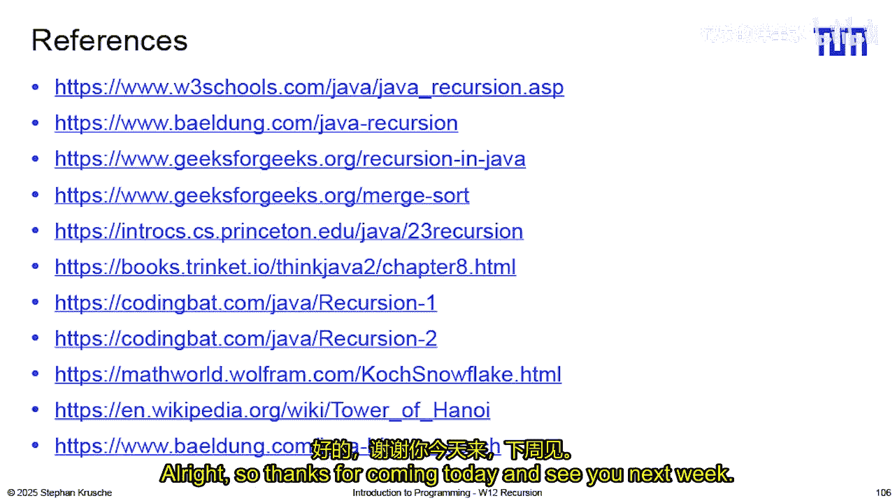

# 【全集】慕尼黑工业大学 计算机编程：从入门到实战 中英字幕 p58 Lecture 58 - 归并排序示例 -BV1WFrTBZExY_p58-

All right， so our next thing that we're going to be talking about is merge sort。

Does anybody remember Merar， or we've actually talked about it in this class before？

I think I see a couple of faces over there， yeah。Can anybody explain to me what merge sort was。

 what did we do with it last time just quickly？That's exactly right yeah。

 so merge sort is a recursive algorithm I'll repeat what you just said。

 the idea behind merge sort is we've got one big long sequence of elements that we want to sort。😊。

And in order to sort them， we use the divide and conquer approach。

 so recursively we split it up into two separate pits and then those separate halves。

 we split up into two separate halves themselves and then those also get split up and we split and we split and we split until we're just left with little tiny trivial。

😊，wo sequence events， two sequence things and though we can just sorting that is just as simple as flipping it or not flipping it right and so if we break down this problem into a whole bunch of little tiny tiny baby lists that are super easy to sort。

😊，Then。We can sort all of those little tiny lists and then zip them all back up together to result in one big long sortrded final list and so this is a perfect candidate for a recursive function what we did last time was not recursive we hadn't covered it yet but what we did last time this was just the zipping so you may remember this code this is where we had two lists as parameters and we wanted to merge them together so we assumed that they were sorted last time and that was a question that some of you had how do we know that these were sorted that's what we're going to be covering today how do we sort these in the first place。

😊，But this is the last step of merge sortt taking two sorted lists and bringing them back together。

 and we do this over and over and over again for all the different little tiny lists that we made。

So I'll go through this code real quick， pretty much， we just go through。

 we start at the beginning of each of the lists that we want to merge and we look at which one is smaller。

😊，Because the smaller one is the one that we want to take first。

 so we take that and we put it into the new one and then we go one over and we look at the next one and we tried to find the smaller one。

 pretty much we go through the entire list and eventually we will have run out of elements in one of the lists or hopefully both and then once we've run out of elements in one or both of the lists。

 we just go through the remaining list and put the rest in the result。😊。

Are there any questions about this， the zipping up procedure before we move on and talk about how we？

Got here。With the sorting。Okay， I don't see any questions， so I'll move on。😊，So。

Let's talk about the strategy that we're going to go with for a recursive merge sort function。

 so if we have。The merging of two lists， if one of these two lists is simply empty。

And that's trivial right to merge a list with an empty list is just the same as keeping the original one right so that's the trivial case if one of the two lists A and B is empty。

 then we just return the other one that's already done， we don't need to do anything。😊，Otherwise。

There must be of the two first elements。A smaller one， if they're equal。

 then it doesn't matter which one we take， but there's going to be we can choose the smaller element。

So then we take that， we put it into the result。And then。

We can think about this in terms of just repeat from the beginning。So。

All that we've done is we've found the smallest one we've got the smallest element。

 and then we just put the rest of the elements on following that same strategy。

 so we always just keep taking the smallest one so you can see how this could be turned into a recursive function in that we have two lists。

😊，And we have。The first couple of catch cases in case one of them is just empty。

 then we just return the other， but otherwise， let's check the first elements of both of these lists and see which one is smaller。

And that smallest element we can add to this new list。

And then the rest of the elements in this result list will just be the same strategy over and over again。

 so we call merge recursive again。😊，Except this time。

 one of the lists has had one of its elements removed。Right， so we take the smallest element out。

 That leaves the。Original list modified。Then we can recall this method with the two lists again。

 one of which was modified， one of which has one fewer element。

 and by doing this every time we call our method recursively。

 one of those lists will be a little bit smaller and eventually both of them will be completely empty or one of them will be empty and we can simply return the other list。

So let's go through this。Yeah， I mentioned the terminating condition。

 if one of them happens to be empty， then we know that we've reached the end of that list。

 we can simply return the other one。😊，And once we've found the smallest one。

 all that we have to do is recall the original method with this modified list。😊。

And add on the rest of the elements。So。Let's look at an example。 So we've got this list here。

 which is。Unsortted。And if we split this into halves。

 you can see that we simply just cut it right in the middle， we haven't done any sorting yet。

Now we can sort this。呃。And then we can mix them back together again。

So this zipping process here at the end here， all that this was was we take two halves and we just put them next to one another again。

We take the two halves and this is the procedure that was described in the code on the previous slide。

 so we've got negative 3 here， which is the smallest element between negative 3 and 1。

That's the smallest element so we take that first and then you can imagine just removing this from this list so we only have  zero and 17 remaining and then we start over。

 we think okay， we've got this list 0 and 17 and we've got 179 let's look at the first element of both of these we've got zero and we've got one。

Zero is smaller， so we take zero again， and now this list has only got 17 remaining。

And you can see how we're just。Continuously taking off the smallest element off whichever list has it。

 so now we've got a list that only has the element 17 and then the other list still has 1。

7 and9 well now the first element of this is 17 the other first element is one one is obviously smaller than 17 so that is the one that we take off that time and now we've got a list 17 and a list 79 then we would take off 7 that's the smallest one and then we would take off nine and then we would take off 7。

😊，And we end up with this zipped up sortdid list at the end。Are there any questions about that？Okay。

Let's take a look at some more code here， this is some code that allows us to split lists in have。

So if we've got an input list list and we call this method left half。

 what we want out of this is to be the left side of that list。

 so pretty much the first half of the elements and the way that we can do that we can create a new array list here。

😊，And we can iterate through the original list up until list dot size divided by two。

 so we want to stop midway through the list。And for every index that we've iterated over。

 we can just add the element at that position， so pretty much we go through the list elements from the beginning。

 but we stop in the middle。😊，And we aggregate all of those into a new list。

 and that's what we return。That's not that complicated， then in the right half。

 we're doing something very analogous， except in this case。

 we start from the middle and we continue to the end。😊。

So you can see that these two methods do largely the same thing except。In opposite ways。

 so we've got one method that returns the first half of the list。

 the other method returns the last half of the list。

And then you can think about this recursive method， sort， merge sort。Which takes in one list。

 which should be sorted and all that we do。In order to sort this list is we split it up into its left half and its right half。

😊，We sort those individual halves。And then we merged them back together。

That seems like magic how on earth did we sort the entire list just in these simple steps。

 that's the magic of recursion， we're calling this sort method here again。😊。

And sort is this is itself， thats this method calls itself。

 and so what we do with the left half is we go in and we split the left half up into a left half and a right half。

Yeah， and then with each of those halves， we go back and we call left half and right half and you can see that we've got this this terminating condition here。

 where if we ever get down to a list that has just the size one，😊。

Then it's already sorted right then there's nothing else that we need to do so this will split the list in half as many times as needed such that we only have little tiny trivial lists and then we zip them back up together and the merge recursive method is what does that that's the zipping part。

So。Merge sort is a。It's a very smart algorithm that looks deceptively simple because it can be implemented like in such few lines of code。

 its as many recursive functions are， it does so much more just than it even looks like。😊，So。

As another example of recursion。Are there any questions about merge sort before we move on to the next exercise？

Anything that I can explain again that didn't quite make sense。All right， I don't see any hands。

 so let's move on into the exercise。Who of you has heard of the Fibonacci sequence before？Okay。

 I see a few hands， Does anybody want to explain to me what the Fibonacci sequence is？

There's an example of it right here， what's happening here。Yeah， exactly。

 so it's a very simple concept， we start with zero and one。And we add those together and we get one。

 that's the next sequence， and then we've got one and one， add those together， and we get two。

 then we've got one and  two， we add those together to get three。Two and three make five。

 three and five， make eight， five and eight， make 13 and so on。And you can see that。

Following these simple rules， the numbers start to get bigger and bigger and bigger at an accelerating rate。

And the n element at any point in this list is always going to be equal to the sum of the two previous elements。

 so for instance， if I ask you， what is the Fibonacci number 15？

You could define that as just Fibonacci 14 plus Fibonacci 13。

And each of those you would define as Fibonacci 14。

 you could define as Fibonacci 13 plus Fibonacci 12。

And you can see how this recursive definition will lead you all the way back down to zero。

One of the first elements， So Fibonacci1 is just Fibonacci 2 is one， right。呃。So。

Your job now is to write this in code and I swear it's as simple as it sounds。

 it'll look like magic when you figure it out because all that you need to do is define this function Fibonacci in terms of itself。

 so a Fibonacci of n is equal to Fibonacci of n minus1 and Fibonacci of n minus2 always。

 that is always the rule。😊，So。Take have a shot at this exercise。

 if you would like to do the optional challenge， you can try to optimize this calculation with an iterative version because while recursion is very fancy and magical。

 it's not always the fastest way to do it， so iterative is usually a little bit faster。

So give this a try and the tutors will come around to help you。Okay。So let's bring it back now。

Let's take a look at the sample solution for this。So it's not many lines of code。呃。

We've got our method Fibonacci here with our terminating condition， if n is less than or equal to1。

 then Fibonacci of n is just n。😊，Fibbonacology of 0 is0， fibonacci of 1 is 1。

And then for the rest of the cases。😊，We can define Fibonacci of n as Fibonacci of n minus 1 plus Fibonacci of n minus2。

And that's it that's all that you need in order to make the whole Fibonacci algorithm work now its its it seems like magic when you do it like this。

 but really what's happening here is nothing more than just，😊。

Repeatedly calling the method with the previous numbers， so if you call it with n equals 3。

 then it will just call Fibonacci of n2 Fibonacci of2 and Fibonacci of 1 and Fibonacci of 2 will again call Fibonacci of 1 and Fibonacci of 0。

Now you may have noticed right there that I said it called Fibonacci of one。Two times。

And that is a common theme， actually what happens here。Is。We end up with。

A whole tree of calls to the Fibonacci method。And there are a lot of repeats in this tree。

 you'll notice。And so what we have here is exponential complexity for each additional n。

 the higher n gets。😊，The number of times that the Fibonacci method gets called is2 to the power of n。

Exponential complexity。Absolutely horrible time complexity。

 This is one of the slowest methods that you could possibly write， because。

Just for a number as small as five， which you could have figured out by yourself anyway。

 you could see how large this tree got and if you were to call Fibonacci of six。

 that would have this entire tree inside of it plus the entire tree for four。😊。

And then Fibonacci of 7 would have that entire tree inside of it， and then this five tree again。

 and so it doubles the size every single time you add one to n。Which means。

It is very slow and something as simple as Fibonacci 50 and 50 isn't like the biggest number you could think of。

 not not by a long shot， it will simply not compute the answer before。😊。

I don't know how long it would actually take， but it would take a long time。

 you wouldn't want to wait for it to finish right So maybe not the most practical。

But you have to admit that it's a very nice function。 There are ways of making it faster。

Can anybody think of a possible solution for the problem of having to recompute， for instance。

 Fibonacciia 5 if you've already done it in a previous step？

What might you do to counteract that problem？A hash mapap。What would you do in the hashmap。

 can you explain？But I think I know what you're getting at you would save the previous answers right so you've got some central source of truth and in this hashmap you might save the answer for Fibonacci of5 the first time that you compute it and then the next time you call Fibonacci of 5 you'll look it up in the hashmap if I already computed the answer for five and if something is in that hashmap then you just take that answer you don't need to do any more recursion after that point because the answer has obviously already been computed in a previous step right that's a concept known as memorization and it can turn a function like this which is horrible time complexity。

 exponential complexity into something that actually works and is practical like it'll actually finish in time。

😊，Memorization is one way of going about that， but in a case like this the iterative solution is usually just the fastest way to do it and so here's an example solution for the iterative solution so you can see that we simply create a an array of longs and we use long in this case because these numbers are going to get very big very fast to the point where even an int with its upper limit of。

4 billion isn't big enough。And so。We create an array of the size n plus2， so for instance。

 if we call Fibonacci 5， we need seven numbers to keep track of that。

 why do we need two more numbers than n？You can see what we we're automatically using the first two just to start off the Fibonacci sequence right so fib numbers 0 equals0 fib numbers1 equals1 and that is sort of the kickstarter for the Fibonacci sequence and now we go in a loop。

 we start at two， which is the first unused index and we go all the way up to the top and Fibonacci fib numbers I which starts at two。

Is just equal to fib numbers of1 plus Fb numbers of zero which are the things that we set and the next time Fb numbers of three will be fib numbers of2 plus Fb numbers of1 and you can see how we're reusing the calculations that we performed in the previous iteration we're not doing any recalculation of Fb2 in the next step it's just we save it all in this array and then our final answer will be the last number in the array。

Yeah。This is a concept of memorization， this is the same concept that I was just talking to you about。

 it's done here in an iterative solution， but you could have also just made an array with the recursive solution and just passed the array around and every time you call Fibonacci of N。

You just look at the n index in that array and see if the answer has already been computed or not you mentioned using a hash mapap。

 it doesn't need to be a hash mapap， it could just be something as simple as an array where n is the index。

😊，Yeah， are there any questions about this？Okay， I don't see any hands。Okay。

That's the end of the lecture today， our next steps。If you want some。呃。

Helpful articles to the concept of recursion， which I recommend you read。

 there's a couple of helpful articles from Belong and Princeton there。And。

Let's go over the summary just to cap things off， so recursion is the technique of having a function invoke itself。

It's a really unique way to break up complicated problems into one simple problem that you do over and over and over again。

Sometimes it is difficult to understand， I mean those methods that we saw earlier were extremely powerful and it looked like there was some magic going on in the background when really there was nothing。

 it was just five lines of code that were arranged in a very clever way that they called themselves with the right parameters over and over and over again and eventually computed the answer。

 it makes recursion。😊，Sort of hard to see through sometimes a little bit opaque。

 but it is still very a very powerful concept。So the best way to figure out how it works is to just try it with different examples。

You should just practice making little recursive functions on your own and remember the two important requirements of a recursive function。

 a terminating condition， if you don't have a terminating condition in your recursive function。

 it'll just call itself into infinity and it'll never terminate。

 you'll end up with what's called a stack overflow exception。😊。

Because it just can't remember all this stuff that you're asking it to do and then， of course。

A core component of a recursive function is the fact that it calls itself and the input to the next call should be a little bit different。

 it shouldn't just call itself with the same thing over and over again if you have those two components。

 then you can make a really good recursive function。You should consider though。

 that oftentimes recursion is a slower way of doing things， it can be very elegant。

 but it's not always the fastest way to do it so maybe you avoid it in cases where performance is of the。

呃。Is necessary。All right。So thanks for coming today and see you next week。

