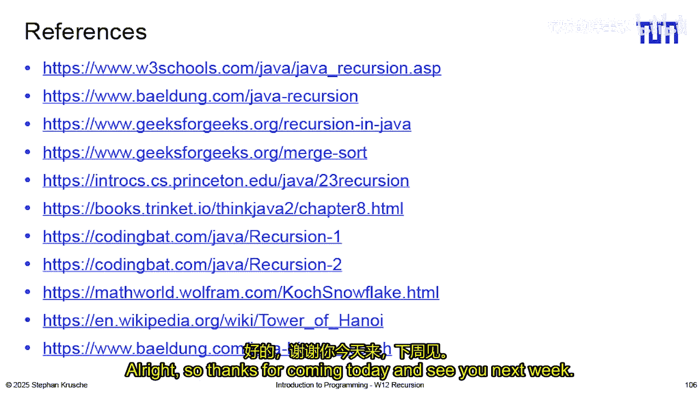

# 计算机编程：从入门到实战：58：归并排序与递归示例 🧩


在本节课中，我们将要学习归并排序算法，并通过一个具体的例子——斐波那契数列的计算——来深入理解递归的概念和应用。

归并排序是一种高效的排序算法，它采用“分而治之”的策略。其核心思想是将一个大列表递归地拆分成若干个小列表，分别排序后再将它们合并起来。我们将首先回顾如何合并两个已排序的列表，然后探讨如何递归地拆分和排序列表。

## 归并排序的核心：合并两个已排序列表

上一节我们介绍了递归的基本概念，本节中我们来看看归并排序的具体实现。首先，我们需要一个能将两个**已排序**列表合并成一个新排序列表的方法。以下是其核心逻辑的伪代码描述：

```
function merge(listA, listB):
    if listA 为空:
        返回 listB
    if listB 为空:
        返回 listA

    if listA的第一个元素 <= listB的第一个元素:
        结果 = listA的第一个元素 + merge(listA去掉第一个元素, listB)
    else:
        结果 = listB的第一个元素 + merge(listA, listB去掉第一个元素)
    返回 结果
```

这个函数不断比较两个列表的第一个元素，将较小的那个取出放入结果列表，然后对剩余部分递归调用自身，直到某个列表为空。

## 递归实现归并排序

理解了合并操作后，我们现在可以构建完整的归并排序函数。其策略是：如果列表长度小于等于1，那么它已经是有序的，直接返回。否则，将列表分成两半，分别对这两半递归调用排序函数，最后将两个已排序的半部分合并起来。

以下是归并排序的递归实现框架：

```
function mergeSort(inputList):
    if inputList的长度 <= 1:
        返回 inputList

    leftHalf = 获取 inputList 的左半部分
    rightHalf = 获取 inputList 的右半部分

    sortedLeft = mergeSort(leftHalf)
    sortedRight = mergeSort(rightHalf)

    返回 merge(sortedLeft, sortedRight)
```

这个算法的魔力在于递归。`mergeSort` 函数会不断地自我调用，将列表越分越小，直到变成一个个单元素列表（自然有序）。然后，再通过 `merge` 函数像拉链一样，将这些小列表有序地“拉”在一起，最终形成一个完整的有序列表。

## 递归示例：计算斐波那契数列

为了加深对递归的理解，我们来看另一个经典例子：计算斐波那契数列。斐波那契数列的定义是：第0项是0，第1项是1，从第2项开始，每一项都等于前两项之和。其公式表示为：

**F(0) = 0, F(1) = 1, F(n) = F(n-1) + F(n-2) (n >= 2)**

这个定义本身就是递归的，因此可以非常直观地用递归函数实现：

```
function fibonacci(n):
    if n <= 1:
        返回 n
    else:
        返回 fibonacci(n-1) + fibonacci(n-2)
```

然而，这种简单的递归实现存在严重的效率问题。因为它会重复计算大量相同的子问题（例如计算 `fibonacci(5)` 时会多次计算 `fibonacci(3)`），导致时间复杂度呈指数级增长（O(2^n)），计算稍大的 `n` 就会非常慢。

## 优化递归：记忆化与迭代

为了解决重复计算的问题，我们可以采用**记忆化**技术。其思路是创建一个缓存（如数组或哈希表），在第一次计算出某个 `fibonacci(k)` 的值后将其存储起来，后续需要时直接取出，避免重复递归计算。这能将时间复杂度优化到 O(n)。

实际上，对于斐波那契数列这类问题，使用**迭代**方法通常是更简单、更高效的选择。以下是迭代版本的示例：

```
function fibonacciIterative(n):
    if n <= 1:
        返回 n

    创建一个数组 fib，大小为 n+1
    fib[0] = 0
    fib[1] = 1

    for i 从 2 到 n:
        fib[i] = fib[i-1] + fib[i-2]

    返回 fib[n]
```

迭代方法同样避免了重复计算，并且只使用循环，没有函数调用的开销，性能通常更好。

---

本节课中我们一起学习了归并排序算法和递归的深度应用。我们了解到：

1.  **归并排序**通过递归地“分”与“治”，实现了高效的排序。
2.  编写递归函数必须包含两个关键部分：**终止条件**和**调用自身且参数规模缩小**，否则会导致无限递归（栈溢出）。
3.  递归代码虽然通常简洁优雅，但可能带来性能问题，如斐波那契数列的简单递归实现效率极低。
4.  可以通过**记忆化**或改用**迭代**方法来优化递归算法，提升效率。



递归是一种强大的编程技巧，能将复杂问题分解为相似的子问题。掌握它需要多加练习，尝试用递归思维去分析和解决实际问题。