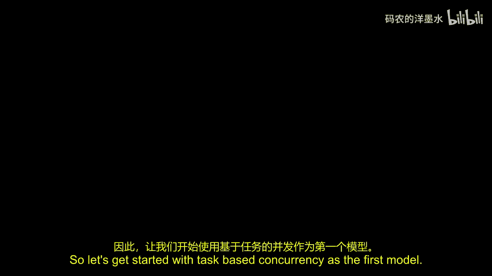
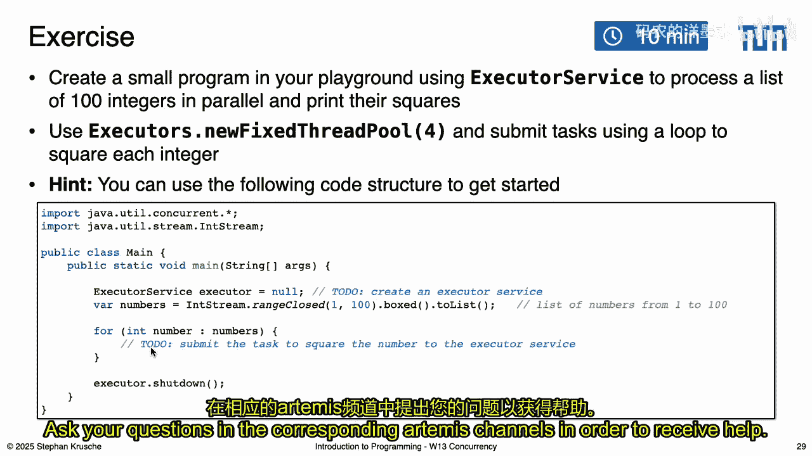
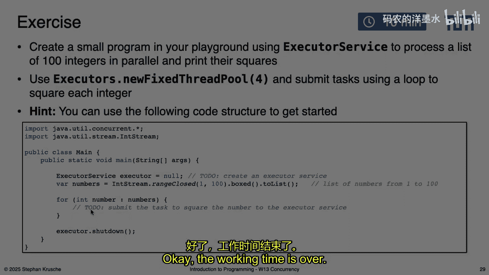
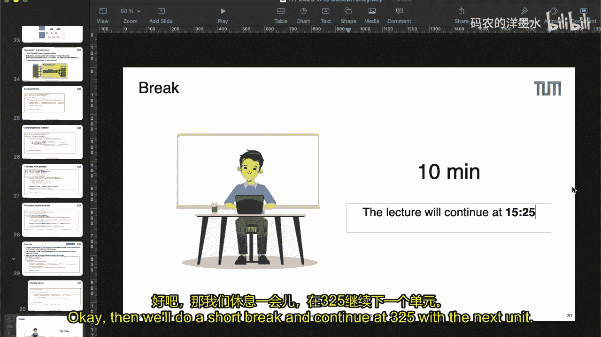

# 【全集】慕尼黑工业大学 计算机编程：从入门到实战 中英字幕 p59 Lecture 59 - 现代并发 -BV1WFrTBZExY_p59-

So let's get started with task based concurrency as the first model。 Yeah， again， short reminder。

 parallellyma is not the same as concurrency。

Paralyma means tasks run at the same time on different courses。

 while concurrency means you manage multiple tasks simultaneously and they may or may not execute in parallel。

😊，And in the figure you can even see all the four different examples， it the first one。

 not concurrent and not parallel， you have one CPU core and two tasks that are just executed one after each other。

😊，Then we have concurrent， but not parallel， where we have。Tasks running at the same time。

 or it looks like theyre run at the same time， but we only have one CPU core。

And then we have the two versions of parallel， the first one。

 no concurrency tasks are completely split and run on the different CPU courses。

 and the last one where you can see we have time slice and the tasks are distributed over or multiple tasks are distributed on the same CPUU core。

And。When we talk about task based concurrency， we have to also talk about socalled threat pools。And。

Task cues， you see a figure here that tries to show you on a very high level how that works so the idea is that you have a lot of tasks potentially in a runnable that need to be done and those can be simple tasks you have a number and you want to square it yeah that would be a mathematicale computation。

 but those could also be very heavy tasks， very longrun task like video editing。

or like calculating very complex formulas or sending a request to ChetGBT and waiting for the answer any kind of task that you would have in your computer program and you put all those into a queue and this queue is managed and queue has an access to a threat pool a threat pool is nothing else and a list of threats for example here we have six different threats maybe because our operating system has or computer has six core that could be a good match。

And then we have many， many tasks coming in and the threat pool will automatically distribute them in the best way to all the threats that are available so instead of creating the threat on your own and instead of managing their state you just put tasks into a queue and then let the system distribute them among all the threats that you have in account。

😊，And if one thread finishes to work and is free for the next one。

The so calledled executor service can then grab the next task in the queue。Alloccate it to a thread。

 run it and give you the result in the end。That's basically the idea。

 so you have a task queue where you put in tasks and you have completed tasks in the end。Question。

Yeah， so the question is， is handling threats only a concern of C and Chava does it on its own。

 or do you also have to read Chava？Well。You can work with Cha without doing anything with threats。

But if you do concurrent programming， you might need to deal with them。

We show you high level concepts now where you don't directly interact with a threat。

But you should still understand what a threat is， and you will see code in a slide now we talk about executor services and tasks and runables。

 but they are all backed up by threats afterwards。Okay， I hope this answers your question。

Taskbased concurrency means that we have a task that represents a unit of work。

 and now you have to do a good job as a programmer。 if you have longrunning tasks。

 you need to think about how can I divide them into smaller tasks， divide and conquer again。

 like writing a computer program it's dividing all the programming tasks into smaller tasks。

 it's the same if you have a video editing software。

If you have a video editing software that only has one task。

 you can't split it up into multiple course yeah you have to think about and this might even change the algorithms behind that。

 how can I split the work of rendering a video of downloading an image of playing music into smaller tasks so that they can be executed in parallel。

😊，Work concurrently。And in fact， those tasks ideally are also separated in terms of memory because if they work on the same data structures。

😊，It might be limited。In terms of parallelism。However。

 if you work on tasks and submit tasks to executioncutors for executioner。

 then you don't need to manage the threats manually。

 the executor service will do that automatically for you。😊。

So the idea is we have a pool of reusable threats in a so called threat pool executor。Additionally。

 we have a task queue。And then when our application adds tasks， for example。

 in terms of the runabouts that we have seen in the previous code examples。

 the threat pool executor will distribute them automatically onto to the different threats and。😊。

The runables will then give us back the result of the computation。

And depending on the work load and the tasks that you have。

 you have the choice for multiple different pool sizes and even different types of executor services。

 you can have a fixed threat pool， you can have a cached threat pool。

 you can even have dynamic threat pools where the number of threats can be increased or decreased。

 depending on the system load， for example， so this interface is quite flexible for you。😊。

Let's see how that works in code， this was a long introduction， you need to import two classes。

 the executor service and the executor's class， and then you simply say executor service executor equals。

😊，Executors start new fixed fixed threat pool and then you decide how many threats you want to have in this simple example we take two。

 but you can also do 8， 16 or any number that is within the limits of the operating system。😊。

And then we can simplify two runabouts。With the same notation as before。

 we have the task one with the Lambda expression and here we do very simple things yeah we just print something to the console but of course on the right side of the Lada expression after the arrow here there could be also a very heavy task or you could call methods in other parts of your program yeah so think about this as a very simple example where you could extend things and we create two of them two tasks and as you see we submit them so the executor service as a submit method that takes a runnable instance and this is basically telling the executor service。

 hey we have some work please put it to the queue and whenever a thread is ready work on it or let the runnable work on it and then pass it back。

😊，So in some sense， the executor service is like a small scheduler within your Java application。

And as soon as you're done， you can then shut down the executor。

 and then the executor will wait until all the tasks have been fulfilled。

And then it will clean it clean up itself。 and then you could potentially continue with some other work。

And this is also to synchronize the work in the end again。

 because think about if you spawn multiple threads and do work in those multiple threads。

 at some point you might want to collect all the results again and put them for example into a list and print it to the console or you want to tell the user。

 hey， video editing with eight threads， now finished， here is the final video you can watch it now。😊。

That's the idea。 and this is why we have a shutdown method in order to shut down the executor service again。

Question so the question is can the output of the first runable be included as an input into the second runable？

😊，Theoretically this is possible， we will not talk about this now。

 but a little bit later when it comes to futures and computable futures。

 then you will see that you can really compose them and put the output of one into as an input into the other one with execut their services it's not that easy actually they are really more there to parallelize the work。

😊，Great， here's another example order processing。 We again create an。

execut a service now with three threats and we have a four loop from one till five and we submit a few runabouts now in line runables we don't give them a variable and here we simply say processing order with some number and also print the current threat name and if you copy and paste this。

Sorry， if you copy and paste this into your playground， you will see that。

There are certain threat names in the background based on the executor service that you choose。

 and you will also see that those randomly appear and there is no guarantee to have a specific order in the end。

 so it could be the case that you have the order as we define it here， one， two， three， four， five。

 but it also could be the case that you have one， three， five，2。

4 depending on how everything is scheduled。Any questions regarding this code？

Okay then let's continue， here's another example where we simulate fetching data and we simulate this to be a bit slower。

 we don't have a real database implementation here， this is why we use the method threat do sleep。

 which actually tells the threat to just wait for 2000 milliseconds or two seconds and do nothing。😊。

And with this， we could simulate an expensive thing。

 fetching something from another system involves network delay， IO。

 input output weight or disk weight， and this could sometimes happen or take a little bit of time。

And what you see now is that executor。submit。Actually， gives you as a。

Return value if you want to use it AO called futureture。What is a future， well。

 a future is some kind of work in this case from a runnable。Or no， sorry from a call bill。

 Yeah I'll tell you in a minute what that means。Where。We don't know the output yet。

At the moment of assigning it， we have an object， but the result is not really available yet。

 We have a variable， but it's kind of null internally。And only if the。Concurrent operation。

 the callable here has finished。Only then we get it。In the end， and if we want to wait for it。

 we can also wait until we get it and this is using the get method so the get method will block the current execution in the current thread and wait until the result is available。

😊，And with the callable， which is an alternative to the runable。

 you have a mechanism where you have no input again。

 so the left side of the Lada expression is empty。😊，But you have a return statement now。

 and you have a result。So if you use a callable instead of a runnable。

You can produce a result then you could wait with the get。

 and then you could basically give it into the next task， so this already answers your question here。

But as you see， this is not already quite flexible Yeah so this is just a very simple example because callable has one。

Input parameter， we also should specify the type， sorry one output parameter， one return type。

 we should also specify the type here here's a string。

 but it could also be a full user object if you have defined that in the reality。😊。

Any questions regarding this code example？So the two differences are that instead of using a runnable。

 we use a callable， a callable has a result， so executecutor submit has a return value that we can use and whenever we use get on this return value。

😊，Then。We wait until the。Callable has finished the work。 here it will take exactly two seconds。

If you have a normal computation， you can't really say that， yeah， sometimes it takes longer。

 sometimes it's faster， and then we can print it to the console and shut down the executor service again。

Great， here's another example。😊，Notification service example。

 we again have a scheduled threat sorry now we have a different threat pool before we had a fixed threat pool。

 Now we have a scheduled threat pool。 The interface to use is slightly different here because what we now want to do is we want to schedule something at specific points of time。

So we create a send notificationer， this could be a notification that you sent to your users here again。

 it's a super simple one with a system out print line and a runable。

 but of course this could also be something else。And now we ask the scheduler to schedule something at a fixed rate。

Based on our runable that we have defined here。We say wait zero seconds， yeah。

 this is the initial time weight。And then we say， do it repeatedly after five seconds。

That's the idea。 So we schedule something。We do it the first time immediately。

 and then every five seconds we want to be executed。

And then we can also schedule now the scheduler to shut down after 20 seconds to stop the execution because otherwise this would run forever。

Any questions regarding the。Scheduling of runables for specific time intervals。Okay。

 then we'll continue and we'll start with our first exercise。

 please open your playgrounds and I'll kindly ask you to create a small program now that uses the executor service and we want you to process a list of 100 integers。

And you should print S squares， and we want you to do that in parallel now。

 leveraging all the cores of your nice laptop。😊，And I provided a little bit of sample code for you that you can copy and paste。

 we have a main class with a main method， we already have defined a variable for the executor service。

 but we have not created one yet， so this is your first to do create an executor service。

Then I'll show you a little trick how to get a list of numbers from one until 100 using an in stream and arrange closed method。

Now this means give me all the values from integers between 1 and 100。

 and it's much shorter than saying new error list， 1，2，3，4，5，6， and so on。😊。

And then we have prepared a for loop。Where you go through all those numbers and your task is then to submit something a runable。

To the Executor service。And print the result within that so that we can see all the computations in the console。

This is not an artemis exercise you have to do it in your playground and you are free how to do it yeah you can use whatever executor service you like and you can also adapt that I'll show you an example solution in a few minutes but this is really something where you can be flexible and no test cases limit your creativity so have fun and in a few minutes I'll show you the solution the tutors will go around so if you need help just ask just raise your hands and if you watch us online if you watch the recordings then。

😊，Ask your questions in the corresponding Artemis channels。

In order to receive help。

Okay， the working time is over， who of you has already a solution， raise your hands？Okay。

 a few of you。Because of time reasons we have to continue， so I'll show you an example solution。

And this is how it could work。What we changed， we edit the statement here executors。

new fixeded threatpool， for example， with number four。And then in the for loop， we submit a runable。

 and this is a Lada expressioner with no input， an arrow and one。Curly praise。

 you can also leave it out if you don't need it and here we say system。

out printline number times number and the idea here is that Lada expression gets the data from the outside from the outside scope from the for loop。

This is quite important， Cha manages this automatically for you。

 of course you could theoretically also create a different data structure and put it in as an input and then getting it out as an output this is also possible but this was not required for this exercise any questions regarding this。

😊，Okay， then we'll do a short break and continue at 325 with the next unit。

