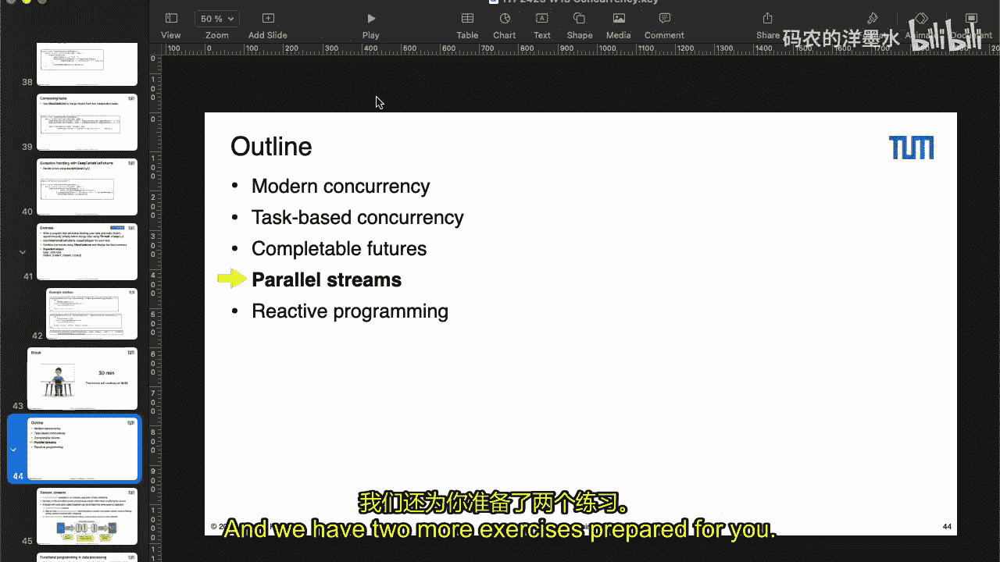

# 【全集】慕尼黑工业大学 计算机编程：从入门到实战 中英字幕 p60 Lecture 60 - 基于任务的并发 -BV1WFrTBZExY_p60-

In our next unit， we would like to talk about futures in more detail and also about completable futures。

Why is asynchronous programming important and you will see that when we talk about futures and compable futures we will go into the area of asynchronous programming。

 well it's important because in a synchronous program for every request you would need to wait until the response can be delivered and typically in that time the program is blocked。

 you can't do something else while in an asynchronous program。The whole idea is more event driven。

 multiple requests can come in and while the time between request and response is still there。

 you see this as a little blue shadow here in the meantime the system could still handle other requests and you don't have to wait until request one is completely finished。

😊，Before you start request two， so the right side is a program with parallelismma and the left side is a program with a pure sequential order and you see that the right program is much faster because it can also use more resources。

 more CPU course so asynchronous programming allows us to continue with some other work while we do a computational task and wait for the results。

And this is how it works with futures， futures are placeholders for values that will be available someone in the future。

 you see that they use generics so that you can be independent of the concrete type。

 it can be a future of type integer string or your own data type， this doesn't matter。

 you can specify that。And here we have again， another very simple simulation of a long running task with threat sleep。

 and then we simply return 42。 So quick questioner， what do we submit to this。Executor service。

Is it a runnable or a callable。Who you thinks this is a runnable， raise your hands。

Who if you thinks this is a callable？Okay a few hands and this is correct yes。

 as this returns something， it must be a call， a callable is something where you do not have an input so the left side is empty。

 but you do have an output。😊，So， but we don't give it a name， yeah。

 this is an anonymous callllable and we simply passed the Lada expression into the method as a parameter。

Now， the。Future will be immediately there。And。It could also be the case that the Executor service。

 depending on how many threats are available， will immediately start computing the future。

And if you want to wait until the future result is available， you need to call the get method on it。

Gett will block the current thread until the result is available and then we can print it to the cold console like in the previous example。

 so this is a little bit like a review of the previous code。No problems。

And our futures have certain problems， they are blocking when you call the get method and you can't really compose tasks directly。

 so coming back to your questioner， can you easily have one task is divided into two other tasks and they wait for the results。

 no chaining is not really possible combining is not so easily possible。

And there's also lack of a built in support for non blocking callbacks， so a future is synchronous。

 even if you would。alow concurrency and concurrent programming at some point you must be synchronous and you must wait so this is a small issue and this is something that we can fix with completable futures。

 a completable future is basically an extension of a future that allows you to chain。😊。

And to define what happens after the task completes。

 you can even combine result from multiple tasks and also add exception handling in order to gracefully accept a handle if something goes wrong so if we have a task we could split it up into multiple subtasks and then run them potentially on multiple threats and then we could synchronize again in the end when they are all already。

 in order to continue working that's the idea of the complete future。

Let's see how that looks like in code， we have an example here with an asynchronous task execution where we then chain the transformation and consume the result in the end。

😊，How does that work， you see that the completable future has a supply asInc method。

And in this supply async method， we have， again， a callable。

 we have something that takes an input and produces an output。Now， instead of capturing a variable。

 we chain the computation and invoke after the rounded race。😊，With the dot operator an next method。

 then apply。And the result of the first computationer is fed in as an input into the next Lambda expression。

 we give it the name result。😊，And then we can append something or do something with this result here。

 we append word， so that we get hello word。And then we could do that multiple times， then apply。

 then apply， then apply， we chain together those tasks。

 and then if we are ready we say then accept and accept would be something where we synchronize things again。

 where we wait until something is ready， and then we in this example past the method reference of the system our printline method in order to print the result hello world to the console。

Let's see encode code how this works， so let's copy and paste this into our playground。Here we go。

You see everything is imported from the Javava U concurrent package。

 and you see that we have the compable completable future and you see that we have this。嗯。

for some reason auto completion does like me， we have to supply acing method。

 and if you carefully look， you see that supply aIcing takes a supplier。And there's also run asyn。

 which takes a runnable， and there are a few other things。this is a Lada expression here。

 and this basically returns a result yeah， so this is a task that returns a result。

And then we can invoke the then apply method。As you see it here， and this one takes a function。

A functioner gets an input and then also creates an output。 That's the idea of a functioner。

 And this is why we have。😊，An input here， yeah， it's not an empty input。

 it's we have one variable here， and we create an output。😊，Yeah，And then we can， potentially， again。

Okay， it has to be exactly this position。 We can potentially again apply something， right。

 we could say result it。Result plus。Exclamation mark。 and then。At some point we accept。

 and this means we print it to the console。And every task that you put in here into the chain。

Can then be。Computed independently or。If you support that。

 you can also do multiple things in parallel and then chain them together in the end we will see that in a few moments if we run this。

Yeah it looks like everything was done sequentially。

 you don't really see that things here run in parallel and concurrently。

 but this is possible in particular if you would have multiple things going on at the same time。

Any questions regarding this？First example of completable。Future。So different syntax。

 the normal future is the one where we have variables and the completable future is the one where we chain the。

In vocations one after each other。As you see， then apply can be used to transform results。

The method then composed can be used to chain dependent tasks。 This is also called flat mapping。

Here we have a first supply async task one， and then we compose another completable future。

 we take the result of task one。And here we have another completutable future with a supply async。

Where we combine the result of task one with the second result。

And then we say accept and print it to the console。Slightly different example。

 so instead of saying then apply， we say then compose and then compose allows us to chain dependent tasks into it。

Any questions regarding this example。It's just a different method name。 We can also。

Copy and paste this into our。Playground。 and have a look。As you see。

 this becomes now a bit more difficult。You have to learn the syntax and how it works。

And I need to copy this correctly。😔，Here we go。And if you carefully look at this。Then， compose。

It has a lot of different methods。takes a function。And allows us to compose multiple tasks。

Into the whole chain。And then you can also run the program and see that the result will be task one plus task2。

We can also merge results from two independent tasks。

 so let's assume we have created task one and task two， they could run independently in parallel。

 the system will then distribute them among a potential threat pool。

And the first one simply returns 20， the second one returns 22， again。

 very simple examples assume there are more heavyweight computations that even can leverage what's going on here。

 and we have two completutable futures。😊，And we can say。

Do task 1 and then combine this together with task 2。In another function， the sum of two integers。

Yeah， so the first two tasks can run in parallel。And with this syntax here， then combine task  one。

 then combine task 2， plus another function that takes two input parameters， a plus B。

We combine both， so we would need to wait until both tasks have finished now。

 otherwise the result is not available。And then we can take again， Yeah， we chain this。

 we take it again。And we print the result to the console。So we do two tasks in parallel。

 then we combine the results in another task， and then we have a fourth task where we print the result to the console。

And as you see， this is， if you've learned the syntax quite flexible。

 you can decompose larger tasks into smaller ones， run those in parallel。

 combine the ones that you need in the end and really come up with rather complex programs where all the parts that are independent can run。

😊，Concurrently or in parallel。Any questions regarding this yeah so the question is why do we specify combine here that's basically the syntax of how to do that yeah we combine task one and task two with another one that's basically how you would read it right so only if those two are available we can combine them into a third task that's the idea Yeah so good question the question is can we assume that all the memory is handled implicitly if the different tasks access the same memory no you cannot this is why those tasks should ideally work on their own data structures。

And this would also mean that if you have a common data structure where you get your input from。

 you need to divide this。😊，In Lambda expressions， if you remember。

 we have this concept of effectively final。Something needs to be final in order to put it into a Lada expression。

 otherwise we cannot guarantee that it works because the a Lada expression， if it is a runable。

 could be computed in a separate thread。😊，And if multiple threats then't change the result or a variable。

 we would have an issue。It's different if you have a static variable here， for example。

 then you could mix it up， but you could end up with race conditions or even with wrong results in the end if you do that。

And the idea with Lada expressions is that you do not use state from outside you have an input。

 this input is immutable， even if it is changed somewhere else， like in a method call。

 and then you have an output。😊，And if。You cannot easily。Divide your data structure。

 Then it's also difficult to compute things in parallel。 So this is part of the trick。

 it's not enough to just define tasks and activities。

 You also need to make sure that the data structure supports that。 coming back to a video。

 if you do video editing。If you have one screen yeah you need to think about how can I divide the screen into multiple parts and then one pipeline maybe only does the upper left part。

 the next pipeline， the upper right part and so on yeah then you could think about that but I'm not sure if this is a good idea yeah I'm not an video expert or you find some other ways yeah maybe one task render as the first five minutes of the video I the second task render as the next five minutes of the video and so on。

 but you need to find a way in order to intelligently。😊。

Split your data structure into ideally immutable parts that are not worked on in different threads。

 otherwise you might end up with race conditions。We can also handle errorss using the exceptionally method。

 so here we have again a completable future with the supply acing method and let's assume in some aspect of our task an exception is thrown could be a null pointer exception or something else。

 we just throw a runtime exception here。😊，And then if we would directly accept this。

 it will not work and if we have multiple tasks and just one of them fails。

 this could mess up the whole result in the end。😊，So what we could do is we could use to exceptionally method it。

And in it kind of catch the exception。 Yeah， this is like the traditional catch mechanism。

 just reinvented for completable futures。😊，And this then will handle the exceptional and try to recover from it。

And then we could continue with our chain。Task， execution。

So the question is why are we talking about this when our machines are all single core computers。

 and this is wrong in my opinion， yeah， I don't know of any computer which is a single core computer anymore。

I'm pretty sure that you also have a multi core computer and as I said before even even my watch has multiple core now nowadays so even for watches。

 this is important and even if you would only have one single core programs can still leverage from having multiple tasks that could run in parallel theoretically even if you have only one single core it might make sense while you wait for a heavy computation result compute on a server that people can still use your smartphone it would be super bad if the whole smartphone is blocked for five minutes just because you have a bad internet connection and you are waiting for the result from the remote service and then you can't use it anymore。

 I don't think this is a good user interface。Yeah I understand that this is difficult yeah this is not the easiest part of the whole course series。

 but try to think a little bit into this world and try to understand it。

 we are aware that you won't be an expert afterwards。

 but maybe this is a starting point and it will help you later on in your career when you do more programming and you see something like that。

😊，Okay。Great， let's do another exercise to practice this a little bit again。

 you can do this on your own in your playground， write a program that simulates some kind of fetching using threat sleep。

😊，And then use the completable future supply asyInc for each of the tasks and then combine the resultss using the then combined method and then to you want to display the final summary and the expected output is from two tasks the first one should print user colon Chanddo and the second one should print orders colon and then a list of orders but those are really just strings yeah you don't have to fetch something realistically from a database or something like that those are just strings that your tasks or your suppliers or callables return and you just do that two times yeah you invoke completable future supply async two times。

Those simply return those strings and then you combine them in the end so the whole code will be around eight to 10 lines of code depending on how extensive you write it。

 get started， Tos will go around and help you， can ask your questions online and we will continue in around 10 minutes。

Okay the working time is over， let me show you a potential example solutioner， here we go。

 we have our first completable future， we call it fetch user data。

It uses the supply aInc method and it simply invokes threat dot sleep and if you invoke threat dot sleep。

 then your。Integrated development environment will most probably warn you that you need to handle an interrupted exception because sleeping can be interrupted potentially。

 therefore we wrap all this in a dry catch。But this is the only reason why we have this。

 otherwise to compiler complaints， and in fact we only return the first string in the slide user colonon Chndo。

The second one is similarly， we wait a little bit longer in this example。

 you can use arbitrary numbers and try out different things。1，200 milliseconds。

And then we also return the string as defined in the lecture slides。

We have fetch user data or first compable future of type string and Fe order history。

And then we would like to combine them。So we say fetch user data， then combine fetch order history。

 those are the two tasks like in the previous example。And they create two kind of results。

 this is why our following third task has a Lada expression with two input parameters， user。

 this one here， and orders this one here。😊，And in our very simple example。

 we can simply combine them using a new line operator。😊，And then， print out the whole。

Rere out to the console with the then accept method。

Are there any questions regarding this example solution of the task okay then let's do a little bit longer break now and we'll meet again at 435 with the remainder of today's workshop then we will dive a bit more into parallel streams and do reactive programming and we have tumor more exercises prepared for you。

 stay tuned。

