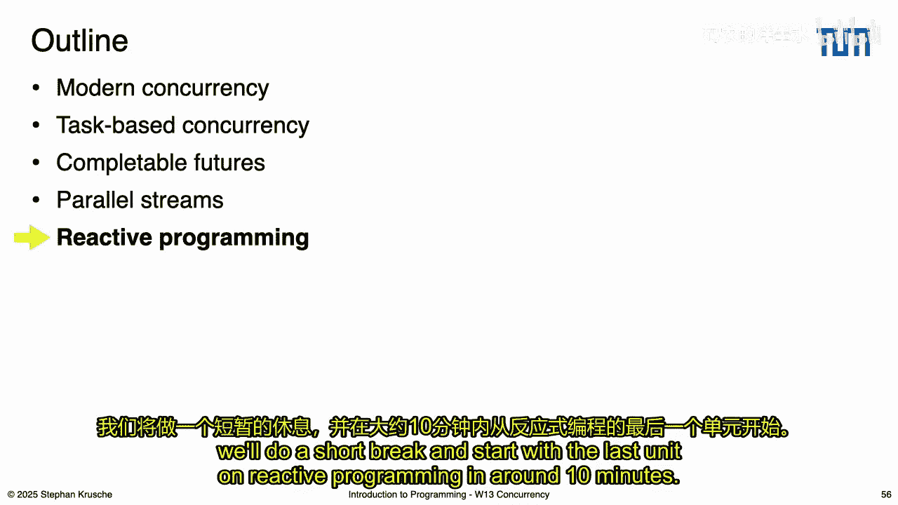

# 【全集】慕尼黑工业大学 计算机编程：从入门到实战 中英字幕 p61 Lecture 61 - CompletableFuture -BV1WFrTBZExY_p61-

Okay let's continue， we hope you could refresh yourself a bit in the break in our next unit we'll talk about parallel streams。

 we already covered streams， so this is a small review and we show you again how you can execute the Lada expressions that you put into streams in order to filter map or reduce something in parallel and what that means in terms of concurrency。

Quick review， streams are operations， functional style operations on discrete sequences of data elements。

And。The idea is that you start with a stream source。

 you might want to convert your list or your set into a stream， then you do multiple operations like。

Filtering it， mapping it， transforming it， and so on。

AndThen you have the result and the result always needs some kind of terminal operation。

 typically a collector or a reductioner， if you have a list。

 you can reduce it to one single element by summing up integer values or concatednating strings。😊。

That's the main idea， so you always create a stream。

 you have multiple operations and then you terminate a stream and while you do those stream operations on multiple elements。

 the stream source typically provides multiple elements。😊，The actual operations themselves。

 they can easily be paralleled with a parallel stream， so instead of using the default stream。

 you simply describe parallel stream and suddenly you already have concurrent programming。😊。

And again， streams then focus on what should be done rather than how it should be done they have a relatively simple syntax compared when you need to do deal with threats that could be blocking and could be waiting and could be sleeping and so on and instead you need to describe what you want to do。

 you would like to filter something you would like to do a multiplication or you would like to transform elements from one input into another output and so on。

The stream operations themselves are so-called declarative and this makes them typically more concise and easier to read but also to write when it comes to programming in particular if you have very short Lada expressions if you do method calls。

 if you have a big Lada expression then of course their code is not easy to read and the whole idea is that they support functional programming。

😊，You can either do all the stream operations sequentially or。In parallel。

 parallel streams try to split the data， if you have， for example， a list of 10 elements。

 then each element can be transformed in its own thread。😊，Of course。

 sometimes it makes more sense to not split each individual element into a thread because sometimes you have certain chunks in your data。

 but this is done automatically for you， there are certain customization options。

 but normally you don't need to interfere with that。The only thing is that it's important。

 it only makes sense to do parallel streams if you have a heavy computation。

If you have a very simple computation， the overhead of creating a thread。😊。

Making sure that it runs probably copying memory around。

And then terminating the threat again might be too high。

 and then it does not really help you All the examples that we have in the slides are simple operations where you traditionally would not use a parallel stream。

Just because we cannot show you very complex computations in just a slide。

 but keep that in mind that the task should be heavy enough， otherwise it does not really make sense。

Here's the quote example。 We have a list of five integers。

And we can do a normal stream in order to calculate the square of those numbers。

 So the result would be 1，4，9，16 and 25。We used a sequential stream without anything just stream。

 or we used to parallel stream。 We get the same results。

 and the computational is done in multiple threads concurrently。again， for this example。

 it probably doesn't make sense， it's just here to understand the syntax。

 but if you have more complex operations that take quite a lot of time。

 then a parallelous stream can make this much faster。

Notice that you do not specify the amount of threats here， this is determined automatically。

 for example， based on the CPU course， if you have eight CPU core。

 it will use up to eight threads or up to eight parallel executions but you can also customized that there are ways to do that question。

So the question is about the order of the operations。

 whether they need to be in a correct order for the parallel stream or not。

The parallelization here is not about the tasks。The tasks。

 if you have multiple map or field operations， are still done sequentially。Everyone。

 every task or every operation gets an input and produces an output。

 so we can't really mix them up the order。What is parallelzized here is the。

Part where you have input values。Right。Because think about it， our input here is  one2  three，45。

 our output is 1，4，9， 1625， and it doesn't matter which of those I calculate first。😊，In this stream。

 you would say， okay， one is mapped to one by one。Then2 is map to2 by  two。

 So we would really process this sequentially in order。But for the parallel stream。

 we can't even guarantee it could be the case that 4 times 416 is calculated first。

In the first threat， in parallel， it calculates five times5 and so on。

It's not the operations that are parallel here。Applying the operation to one input element。

Were multiple input elements at the same time。So the question is。

 could it be the case that4 is printed before one， no。

 because the stream that we're using here is a list？And we。Use it for each loop here。

 and it guarantees us that the order will be correct。 in the end。

 just the execution of the calculation here。Here， the order is not really defined。

 but this is the nice thing with streams。 Anyway， we have this natural。😊。

Decomposition yeah we want to apply one operation multiple times to multiple input elements。

 and it doesn't make a difference if we first do it for the first element or the second element。😊。

So by nature， this is always the case in streams。But on the other hand， they also do not always fit。

 right， because you first need to convert something into a stream and not every task can be converted into a stream in the end。

 right？For many， we can do that， but not for all of them。Here's another parallel stream example。

 we can also get access to the current thread name printed and with that even understand what kind of thread currently is working on。

 you see that we even process the corresponding number one to three- five on a specific thread and with that we can kind of monitor what's going on with the threads in the background。

😊，Parallous streams are ideal for CPUUbound tasks where you can divide them into independent chunks those are the chunks that are part of the input and that are later on part of the output so if you have to do multiple computations at the same time。

 then this is a very good way and they work also very well for large data sets。

 if you only have 10 elements they will not be a big advantage， but if you have1 million elements。

Then it could be the case that it's much， much faster because it's a big difference if you do one element at a time or eight or 16 elements at a time。

You should not use streams when the computation is too simple or when it depends on other aspects than the CPU。

 remember we have multiple CPU core but we might not have multiple network connections or multiple disk drives of course in those areas we also try to do concurrent access but sometimes this is not possible and if you have IO heavy operations that wait for input。

 it doesn't really make sense to parallelize them because if eight things wait for input。

They are not faster than if one thing waits for input in the end。

And if you misuse that this can even make the performance worse because starting threats and managing them and also killing them afterwards or stopping them has some overhead。

Here's another example where we have not just five elements。

 but a really huge list of elements we have， in fact， 211555。

000 and exactly one element in our stream。😊，And what do we do here， first of all。

 we do some printing in order to monitor how it works。

 we create a parallel stream on this large number set。

And then we reduce it so we take the sum of all those elements。

Taking the sum is also something that we can easily parallelize because it doesn't make a difference if we first calculate  one plus2 or if we first calculate2 plus3 or3 plus four。

 so this perfectly works， but notice that not all operations can be done in parallel of course， yeah。

 sometimes if you do certain operations in the reduce， they also depend on a specific order。😊。

And if we copy and paste this into our playground， we can see how this works。

 let's do that for a moment。And then we can also notice if there's a difference on my computer when I created the slides。

 I saw a difference。 Let's see if we see a difference here as well。😊，So。

Doing this takes 498 milliseconds and here you see the results， you might have guessed it。

 it's a quite simple computation， I guess。😊，And if we do a normal stream。Without parallel。

Let's see how long it takes then。810 milliseconds。 So it's almost twice as fast。

 not a huge difference。 because summing up values is a computational。

Fast operation we can't really save a lot of time and creating a threat。

 managing it and stopping it does some overhead There is an improvement when it comes to threading in Java in a later version we are still using KDK17 here in a later version they are so- calledled virtual threads which are a bit more lightweight so with those to situation could change as well but still you see small performance improvements but not super huge ones。

😊，Any questions regarding this example？We also have one more slide about monitoring parallel streams。

 monitoring here is basically a very simple part of monitoring of course this could also be much more complex here we simply print out the threat name and what kind of number is processed we here have 500 numbers now。

 not 200 million and we do a multiplication and then if we do parallel streams we'll see that up to N course representing the number of course in your CPU will be used so for everyone here in the audience it might be different depending on your computer。

Great， let's practice this， let's use parallel streams to process data sets more efficiently。

 we have an Artemis exercise here， so please open Artemis and start W13 E2 now parallel data processing。

We would like you to use parallel streams to calculate a total revenue。

In order to find the five top transactions and we also ask you to do some measurements。

 we would like to measure the sequential performance using the default stream and the parallel performance using a parallel stream and of course in your example there might not be a huge difference because we have small data not very heavy tasks to compute but I think it's good to try this out and to get started you have around 10 minutes to work on this。

 the tutors go around and help you okay the working time is up we will not show you an example solution today this is an exercise that you have to solve on your own and you will get feedback on Artemis and you have time until tonight in order to finish it we'll do a short break and。

Start with the last unit on reactive programming in around 10 minutes。

