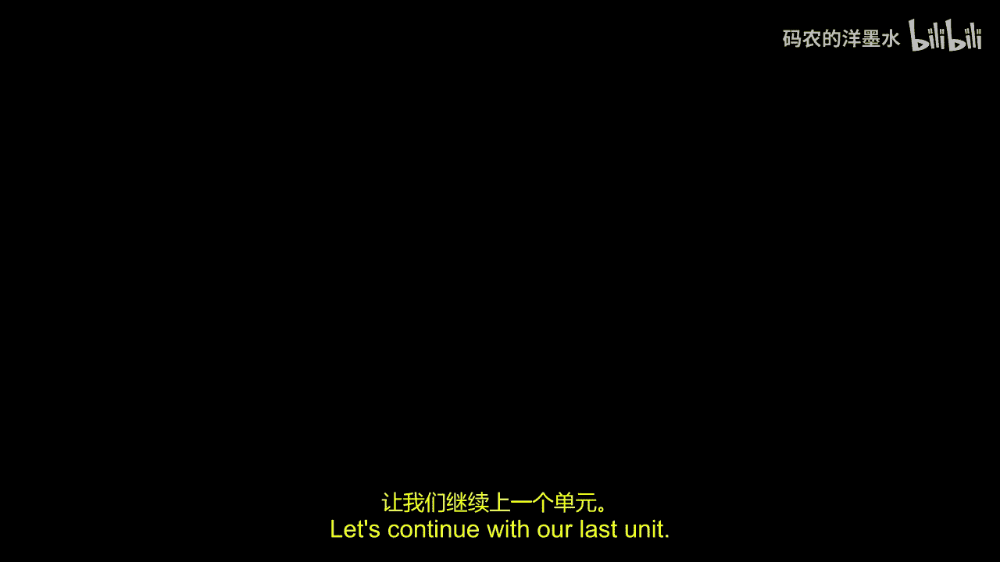
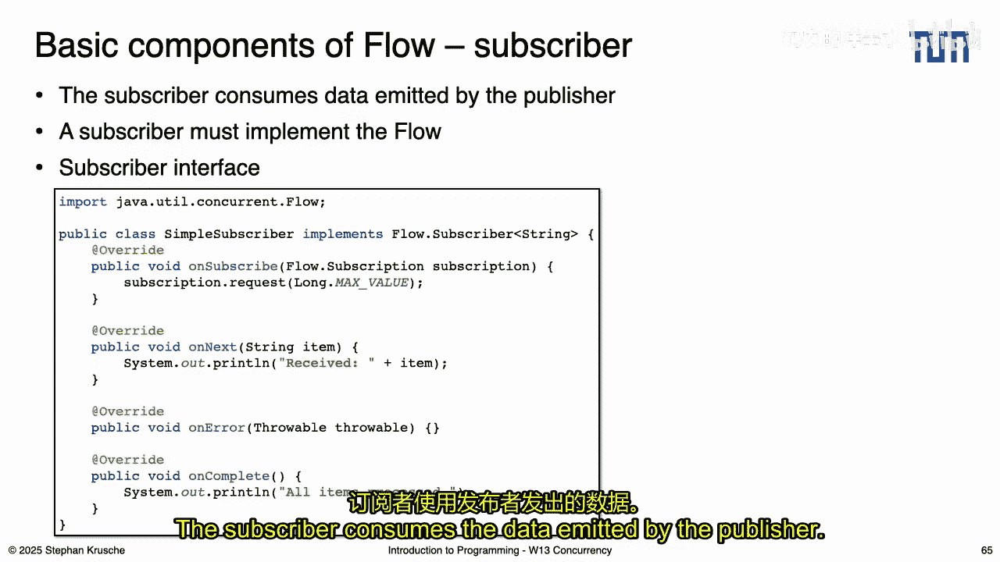
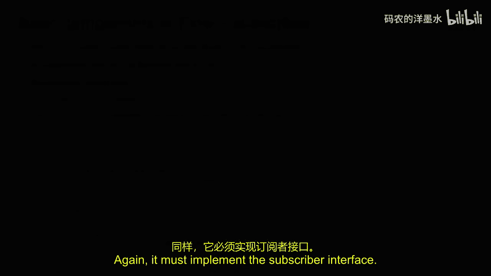
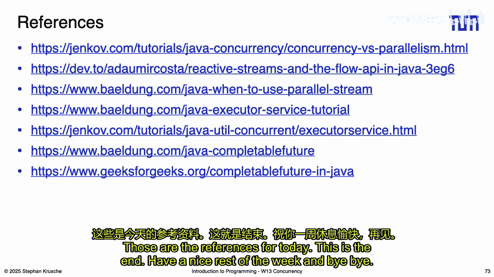
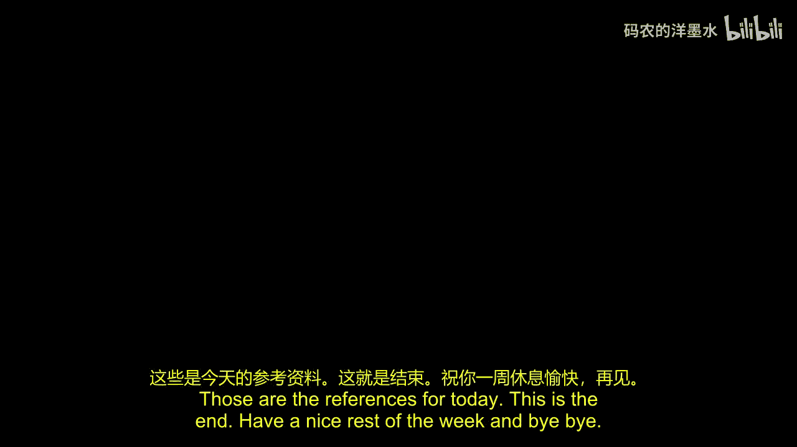

# 【全集】慕尼黑工业大学 计算机编程：从入门到实战 中英字幕 p62 Lecture 62 - 并行流 -BV1WFrTBZExY_p62-

Let's continue with our last unit for today， we would like to discover the area of reactive programming and we can only touch the surface in one unit it's a huge area where people focus on reactivity and on how you can scale up small tasks and have a system that scales and is reactive。

There is even a so-called reactive manifesto where you can see they have four specific attributes of a system。

 a system should be responsive， so it should respond in a timely manner。

 those systems are typically message- driven so instead of invoking methods。

 you send messages between small systems and you communicate over message cues in an attempt to ensure loose coupling between components and in order to support asynchronous programming。

 those systems should also be elastic， which means they stay responsive under a high load。

 doesn matter for those systems if you have five end users or 10，000 end users。

This is why all the operations are as small and as atomic as possible。And last but not least。

 such a system that might be decomposed into 10， 15 smaller so called microservices should also stay responsive even though one component fails。

If a component fails， there might be another one that takes over or then simply one functionality in your system is not working。

 but all the rest is still working and is still responsive。😊，There's whole website about this。

 if you're interested， you can read more on reactivemanifeso。org。

Why is reactive programming interesting well if you have large volumes of data that can be worked onchronous in an asynchronous way。

 you can handle this much more efficient typical applications that use reactive programming are microservices。

 realtime notifications， yeah if you want to get a real-time notification if something happens。

 for example， if you watch soccer and you always want to be notified when a goal happens。😊。

And if you have systems that contain data pipelines where data is sent between multiple systems in order to process it。

Reactiveive programming is then concerned with also with data streams。

 so it's a little bit similar to the stream idea in Chava。

 but the focus is on propagation of change so instead of just focusing on streams of data and operations on them。

 we focus on changing data and every change is then published to a subscriber and the subscriber is notified about that and can then deal with the change data。

There are different change propagation algorithms， which means you have one part of the system and you need somebody to notify the other part of the system that change happens。

There is pooling or polling where the consumer who wants to get notified is active and needs to regularly pull the data。

There is a push mechanism where the produce that produces the data。

Notifies the consumer about it in an even sense， a selfcontained value so that no further information has to be sent and the consumer can work on the change without any additional information。

And then there is also a mixture of both a push pull principle here。

 it means that you only push like a very simple notification。Hey， some data has changed。

 but then the consumer needs to pull the content。I give you an example where this could make sense。

 let's assume you write a message on WhatsApp and WhatsApp should notify you about that。

 yeah you would like to get a notification on your smartphone。

 it should ring or silently vibrate when you get a WhatsApp message and then for small text messages。

 you typically use to push principle。Yeah so the system。

 the server is sending you a push notification with the whole content。

 all the text is sent in a notificationer， except it's a very， very long one。

 and then you can read the text even if you're offline while opening the push notification。😊，However。

 if you have large video or image data， the WhatsApp Serva might decide to just notify oh hey。

 here is a new image， here's a new video maybe with a little thumbnail and a preview。

 but then if you click on it， your smartphone pulls the whole video。

 download the whole 50 megabyte video， because you might not need it immediately。

 but this then means if you are offline when you。Handle the notification。

 then you can't get the data。And this is basically the distinction here。

Reactive programming then focuses on a so called publisher subscriber model。

 here the idea is that we decouple the producers called Plish。

From the consumers of the data called subscribers and in the middle we typically have a channel or a pops up service or a message queue in which we emit all the data into。

And then the subscribers can process the data and do however they want in which time they want。

 and then even if the publisher does not work anymore for a reason but already has published the data into the channel。

 the subscribers can still work on it。And as you can see here from the numbers。

 you typically can have multiple publishers。😊，But every data point one， two。

 and three in those little circles might be processed by all the subscribers。😊。

If an subscriber subscribes， they might still process all three data points because the subscribers might have a different functionality in mind。

maybe one of them processes the text so that you can get it in a push notification and the other one uses the text and searches for any violations of the code of conduct of WhatsApp yeah。

 so if you do illegal statements if you talk about， I don't know。

 harmful stuff then maybe they pull you out or they flag you in the system and this could be done by a different subscriber。

If you have such a publisher subscriber mechanism， then there can be a problem which is called back pressure。

Back pressure means that you have in your data flow， in your data flow。

 in your message queue in the middle， you have too many things， there's too much data。

That overms the subscribers and this for example happens if you have very fast publishers。

 maybe they do 100 operations， 100 published operations per second。

 but you have a relatively slow subscriber because handling the data takes a lot of time and then they might only have one operation per second and then of course。

 there is a very long queue with a lot of data and this queue might overflow at some point。😊。

And back pressure then means that you。Tell the publishers hey， please publish us， we are overwhelmed。

 please stop working， take a break， take a nap or do something else， but don't overload us。

 we cannot handle the data anymore and then of course you can think about what you do you can for example hire more subscribe us yeah if also are workers or actually。

😊，Scale up the system and start more subsystems of the subscriber so that they can work on the data or you can think about is it really necessary that we publish the data so fast。

 can we make it a bit slower， is every change do we really need to to track every change or is it also find if we only every second change or something like that？

So this is something that you might need to handle with。What are the benefits。

 well you can have a high concurrency and really use all the infrastructure appropriately and do even large scale data streams efficiently。

 and it can then also ensure the resilience and the responsiveness of those applications。😊。

Now Java has a built in framework or functionality for published subscriber models or reactive programming。

 the so-called flow API which implements the reactive streams specification we have four main components。

 the publisher， the subscriber， the subscription and the processor and we will go through them one by one here is the publisher or code for the publisher again think about it the publisher produces data and sends it to the subscriber so you could implement your own simple publisher by implementing the flow do publisher interface。

Generic interface so you need to specify your type in this example， it's a very， very simple example。

 we have just an array of strings， hello reactive word。

 and then we need to override the subscribe method and provide a subscription logic。😊。

A publisher must implement this flow interface and can then use the functionality here in order to publish those data points and of course here we have a fixed a final string area but in reality this could also be getting data from the outside new string items that go into the publisher and that are publish to the subscribers next we have the simple subscriber the subscriber consumes the data emitted by the publisher again it must implement the flow subscriber interface。

We have too many new lines here。And you see this is a bit more difficult now。

 this subscriber interface now asks us to implement four different methods。

And here we basically have。Dealing with the next element on next so we received an item and then we could deal with it in this very simple example which has printed on error which means something didn't work out and an error happened。

 we can do error handling and on complete which means that we're done all the data was processed if we only have three data points we do it three times and then we're done and then the subscription is basically over in addition we have this unsubscribe method which notifies us that the subscription mechanism has taken place and gives us this subscription and then we can call the request method on it。

And last but not least， we have the subscription。This is done in the main method， the code is here。

 so here you see we have the three data points again， we create a simple subscriber。

 and then in the subscriber we call the unsubscribe method and have an anonymous inner class for implementing the subscription。

😊，And the subscriptioner basically uses the data and overrides the recast method in the recast method。

 we simply go through the data until there's no data available anymore。

 this is also why we are using a while loop here because in this very simple example we only have three data points。

 but in the reality we don't really know how many data points we have。😊。

And the subscriptioner should really make sure that whenever something is requested。

 the on next method on the subscriber is invoked and if the data is empty。

 if there's nothing on it anymore oncomplete is invoked there's also a cancel method， for example。

 when there is too much data it might be canceled but normally the request method is invoked。And。😊。

In the end， we can then put everything together。 We can create our publisher。

And call the subscribe method and pass our simple subscriber on it and with that we have connected the two of them and we also have implemented the subscription mechanism in the middle and in our simple example we just forward the data of course there could also be more difficult examples where you then deal with back pressure as well。

Any questions regarding the code that I've shown you here。Again， this is not easy。 Yeah。

 this is a new model that you have to understand。 But I think if you。

Get about in this mood about the idea that someone is publishing something and whenever there's a publication。

 another subscriber starts working on it and we can have multiple data that flows from one subsystem then to another subsysem。

 that's basically the idea。This is one implementation in JavaA but many programming languages offer such a reactive programming way。

 for example， RXJS for Javascript is a very famous framework in the web application world and basically every programming language has a similar one。

 there's also RX Javava which is even more complicated than the flow API and offers lots of different mechanisms and then for every language RX Python。

 RXC and so on， theres a framework that does that。😊，And this is why we think that it's。

Quite nice to see how it works in a very simple way and to get used to it because in the future there will be more and more reactive programming。

😊，There are a couple of real world applications that use that in particular。

 if you have event drivenven systems， for example， stock price updates or sensor data monitoring in your smart home environment or also chat applications where a lot of different messages appear and in such cases the publisher emitidst the data events and then even multiple subscribers can process them independently。

 that's the idea。So there are two mechanisms in some sense。

 you have mechanisms where multiple subscribers handle all the data because they are just interested in that one。

😊，Or you have a mechanism where you have multiple subscribers and they are only interested in part of the data and are then basically helping each other out。

And based on that， you have to implement those subscribers differently。

When should you use reactive programming， it's suitableable for applications that have high throughput that needs to be scalable and that needs to be responsive。

 especially large companies do that a lot because they have to deal with many。

 many end user REfests and in such cases it makes sense。

 it does not really make sense for very simple applications and for applications that only have a few users then reactive programming is not really needed。

We have one more exercise for you to try this out， and we'd like you to simulate a temperature monitoring system using Java flowlow API。

 so you need to implement a publisher that emits random temperature readings in Celsius。

You need to implement a subscriber that locks those readings to the console and additionally emits warnings if the temperature is higher than 70 degrees Celsius。

And we will implement a very simple back pressure mechanism so that 10 readings are consumed at the same time so instead of doing this individually。

 we wait until 10 readings are available。And then those 10 readings are consumed immediately because this is easier。

 you have three tasks， you need to implement a temperature publisher。

That generates and manages the data flow， you also need to implement the temperature subscriber which subscribes to the events。

 locks them， and warns if they are too high temperatures。

And then we have a reactive temperature monitor that allows you to test the system with some existing code that you just need to in comment。

Please work on this in the next around 10 minutes。 The tutors go around if you need help。

Probably not an easy exercise， yeah I should probably have said this is a medium one。

 so it might be the case that you need a little bit more time。

 take it as initial working time and then you have time to finish the remainder until tonight。

 have fun。Okay， the working time for now is over， you can still work on it based on the feedback in Artemis until tonight。

We have a few next steps， we prepared one tutor group exercise T13 E1 for you。

 we still have the project work where you need to implement your game and we have two articles about concurrency versus parallelism and completutable futures that we recommend you to read in case you are interested。

 all this is to you by next Wednesday and when we will have our final content workshop and talk about topics beyond programming。

 quick summary for today we talked about concurrency that allows us to keep systems responsive and that might look like things run in parallel but not necessarily。

 this might be the case in the background。True parallelism with multiple CPU cores。

 for example will significantly improve the performance if the software is optimized for it。

 and today was all about how can you program in a way that you optimize for multiple core we talked about taskbased concurrency where we already abstract away all the threat management。

 the low levell concepts that are super difficult to understand where it can easily come up with race conditions。

😊，And it's much simpler to work with， even though you still need to learn how to use it。

 in particular we talked about futures that represent some kind of asynchronous computation that will be available at some point。

 however they are quite limited， so we also talked about completable futures that also use a more modern syntax for chaining。

 combining andarrow handling。Next we had a look into asynchronous programming based on parallel streams that we already learned before。

 so we did a small review about that， they can help us a lot for the sequences for operations on sequences to do them in parallel。

 however， you carefully to look at the specific use case and you need to avoid that the threat management behind the parallel stream operation leads to too much overhead。

Reactiveactive programming， our last topic for today is a very modern and robust model that is used in many programming languages nowaday to handle asynchronous data streams and many people now think also in asynchronous data streams。

 they don't think in the traditional object oriented way anymore。 Everything needs to be a function。

 Everything now needs to be to convert it into a publisher an observable or a subscriber so that it is as reactive as possible。

 So this is one model that you can work with the publisher subscriber model it tries to decouple。😊。

Data production from data consumption on the other hand with a message queue in between where you sometimes need to handle back pressure in order to ensure a stability of the whole approach so this was a quick glimpse into those topics。

There you can spend much， much more time on those and I hope you will have more chances in the future to deal with those topics because I think they are becoming more and more important and the developers of the future。

 which I consider you as well， even if you might get into a management position need to understand how that works。

Those are the references for today， this is the end， have a nice rest of the week and bye bye。😊。

