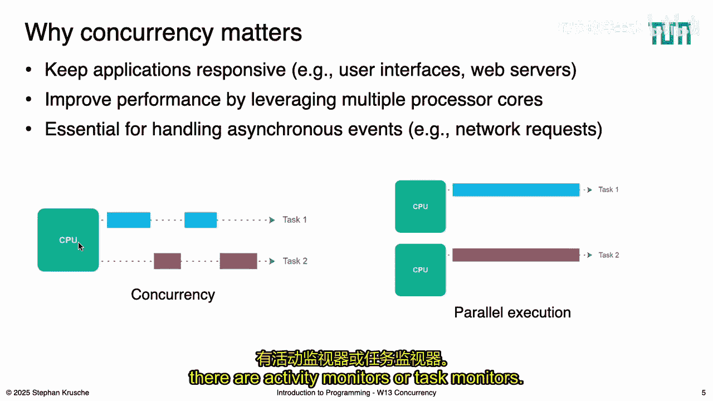
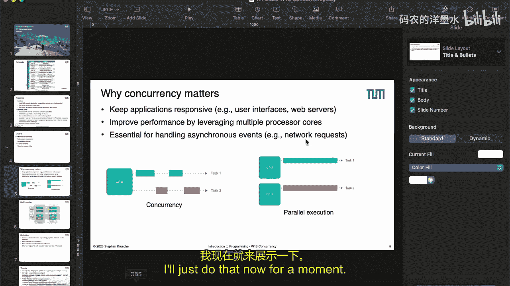
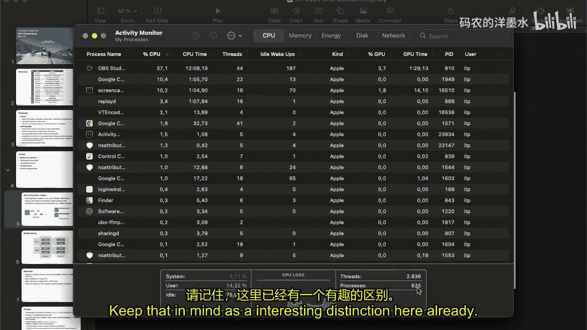
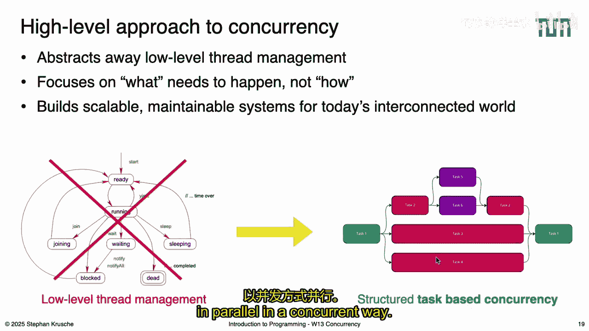

# 【全集】慕尼黑工业大学 计算机编程：从入门到实战 中英字幕 p63 Lecture 63 - 响应式编程 -BV1WFrTBZExY_p63-

Welcome to the workshop 13 on the topic concurrency in the course Introduction to programming。

 we are back Live， I'm healthy again and really enjoy to be here again in front of you to teach you something that is relatively new in this course and we didn't teach this last year。

 but we think this is more and more important topic nowadays when it comes to concurrent programming and how to handle multiple CPUs。

 multiple course in an efficient way so that your end users。

 the persons who are using your software have the best responsiveness and the best user experience。

This is。Slowly going towards the end， we have one more workshop next week where we talk about certain。

Aspects beyond programming and have a little glimpse into software engineering。

And then we have a course review in two weeks and then we'll have the second supervised exam。

 and I know that you're all eagerly working on the project because it's so exciting and so motivating you also need to。

Do a little bit more things on those challenges and then present in the last tutorial group to your fellow students。

But let's get started with our workshop today on concurrency。

We assume that you have a good understanding and basic object oriented programming concepts and that you also are aware how to use sda expressions。

 this will be quite important today and how to use streams。

 we will review against streams in the second half。

Today's learning goals include that you have a better understanding why concurrency is needed in modern applications that you understand。

How to asynchronously program， we will see what that means。

 and we will show you how to do that with socalled futures。as the futures are not good enough。

 we have a second version， the so-calledcompletable futures。

 so the idea is that at the end of this workshop week you should be able to use completable futures in order to have more control about the tasks in task-based concurrency and the composition of multiple tasks and how they relate to each other because sometimes those tasks that you want to give it to a computer they have dependencies and you can only continue if multiple tasks have already finished computing with the next step。

😊，We will also talk a bit about streams again， and in particular about parallel streams and how they can make it more efficient your data processing。

And in the last units we talk a little bit about reactive programming， about responsiveness。

 resilience， elasticity and message- drivenriven architectures。

 and we hope that you get a better understanding of those principles you will not be an expert after this。

 you will have to exercise and practice more about this but we hope to give you a nice overview into this topic because it becomes more and more important。

We'll start with a little bit an overview of what modern concurrency means and what the basic concepts are before we go into a task based concurrency。

Concurrency matters because you want to keep your applications responsive if you develop a user interface。

 you don't want the user to wait just because there's a heavy computation going on and if you develop web server then you also don't want that all your1 million Whatsapp users are waiting because just one other person has sent a message and processing this message takes a bit longer right so ideally we can receive those requests from the end user directly in the user interface or when it comes to the web service in a concurrent way and then even ideally we can execute them in parallel notice that concurrency is not the same as parallelma something can look concurrent even if it's not parallel on the left side here you see a little graphics where we have one CPU and it looks like two tasks are executed concurrently。

Though this is not the case， they are executed sequentially。

 but the operating system makes sure that one task gets， I don't know， one second。

 the other task gets a second and then the first one pauses and so on and so on and in fact。

 if you look into your operating system， there are activity monitors or task monitors I'll just do that now for a moment。

😊。

And open the activity monitor on Mac OS。then you will see that we have a huge amount of processes running at the same time。

 in fact we have 2，700 threats， for some reason the process number takes a while。

 625 processes are running at the same time and if I would only have one CPU core。

 they would still run concurrently。On one CPU。But， not in parallel。This computer has multiple cores。

 so they also run in parallel。Keep that in mind as a interesting distinction here already。

 so as we get more and more process course nowadays in the hardware or even my smartphone now has I think six course or something like that。

 we need to leverage them in order to make the tasks that the computers do faster so that users have to wait less time and those tasks are also becoming increasingly complex while 10 years ago with only limited amount of CPU performance。

 people could edit one video with， for example， 720p at the same time in a reasonable amount of time so that they don't have to wait like I don't know five hours until the video was fully transcoded。

 we can do now4 videos with 4K simultaneously on the same laptop with the same waiting time。😊。

So hardware has advanced drastically in the last years。

 offering more and more applications and use cases。😊，And therefore。

 it's also essential to program the software in a way that it can leverage us those multiple CPUs。

 because if you develop a video editing software， which still has the same performance as 10 years ago on a single core。

 now on a multi corere processor， your end users will hate you。😊。

Keep that in mind responsiveness and performance are one of the most important metrics when it comes to user experience think about yourself use if you browse something in the internet and your favorite website。

 have whatever it is，It takes unusually long to load。

which unusually longest two seconds by the way if I open a website it must be there instantly and if it takes two seconds I already think about what's going on yeah my brain starts tinkering about what's going on and if it doesn't show up after five seconds I'll try another website I don't have the patience to wait for a website longer than five seconds nowadays and I heard a younger generation even has less patience if the TikTook video is too long and it's not an interesting opening you swipe to the next one already and this is something that we have to take into account this psychology。

 this expectations but it uses and we have to take into account。😊，So multithreading is a norm。

 it's not an exception anymore， every application should have multiple threats if you have heavy computing and should leverage that we have more and more CPU course and then this means an application can do multiple tasks at the same time concurrently or even in parallel and the operating system will take care to distribute those tasks to the different CPU course in a fair way so that all applications are treated fairly。

 of course some applications might get more CPU time because they are more important。

 your operating system has a few important aspects to do and if those need time than your application might need to wait。

 but in general or the operating system tries to be as fair as possible。😊。

So shorter underration for longrun programs， better utilization of a single CPU also。

 but also better utilization of multiple CPUs， a multiple CPU core。

 and a better end user experience in terms of responsiveness。

 fairness and user experience are the main motivation。

 why you should think about concurrent programming。😊，Question。Okay， so the question is。

 can we talk a bit more about the underlying hardware architecture， I would say not too much。

 there are separate courses for that， where I introduce you to computer architectures and to hardware engineering。

 what I can tell you now is that if you have only one single core，You cannot do。

Multiple processes in parallel。 This is not possible。 It just looks like that。

And the operating system， intelligently， intelligently。

Distributes the processes and tries to do that in a fair way。

 but only one process and only one threat at a time will be executed。

They might only get 10 milliseconds， so for us， one second is a time measurement that we can understand。

 and in one second it could be the case that 100 different processes run sequentially。😊。

Because of this very short timeframes that the operating system sometimes gives your threats and your application。

 but it only runs in a single line。If you have multiple cores。

 the operating system will make sure to distribute them to multiple cores as well。

And then those processes could also run in parallel。But eventually， also when it comes to disk IO。

 input output or to network reads or something like this。

 it can be the case that only one operation at a time can be computed。

But it would be super bad if you would need to wait for this， right。

 and if not something else could go on on the user interface， for example。

So I hope this addresses the question a little bit when it comes to。

Programming concurrently many people think about threats。

 threats are one of the first encounters of computer scientists to allow to spawn multiple tasks at the same time and a threat is then nothing else as the execution of a program and the execution of a program can then have multiple threats so far we mostly only used one thread。

 the single sorry the main threat。But sometimes you have seen already that it could be the case that background threats or multiple threats are spawn and those could potentially run in parallel a thread is then one single execution path through your program and at each point you could branch out and then the main branch would continue to run but you can branch out and start a new thread and you can do this as often as you want until you hit certain hardware limits。

The main thread is executed through the main method and one important thread that is used in Javava is the one that takes care about garbage collection。

 this is started in parallel by the runtime system and this is executed at several points of time and then cleans up all the objects that are not needed anymore in your program。

 this is how it looks like your main thread deals with objects。

 they are denoted as blue circles here。And whenever there is an object that is not really used anymore like this one here。

 it has no incoming reference， if there's no incoming reference it means the object is not needed anymore then the garbage collector can potentially kick in。

 grab it and free it up so that you can use additional other objects again and the garbage collector thread runs in the background and the system takes care that at some point the main thread is interrupted and the garbage collector kicks in gets a little bit of execution time a few milliseconds to free up memory and then the main thread runs again。

 and most of the times you don't notice this because the CPUs are so fast。😊。

But this behavior can lead to severe harm。How could this be the case。Well。

 there are operating systems where you need some kind of real time guarantee。

 I give you one important examples and those are airbags in cars。

Think about you program an epic system。And this is all about safety。

 rescuing the life of your passengers， of your users。But suddenly。

 when the car crashes and the air pack should blow up where you only have a few milliseconds。

 otherwise it's not worth it anymore。The garbage collector kicks in。

 and you have to clean up a huge amount of， I don't know， music objects here。

 because you listen to the internet radio on the car as well。Well， that would be quite bad， right。

 Yeah， if you're。Airbag is delayed by 80 milliseconds and you die just because the garbage collector kicked in while this is perfectly fine for most Java applications。

 garbage collecting can be an issue for realtime systems and there are also programming languages that do not have garbage collection or where you can deactivated dis it because you have those hard requirements when it comes to the real-time execution of the system。

😊，So。A very nice tool on the one hand， but it can also lead to severe issues in certain situations。

We use multiple threads to work with multiple different things at the same time you can do something useful while the user is waiting for a network request like display a little animation on the screen or let the user use other parts of the application and new threads can be created and started by the program whenever you need JavaB provides two actually provides one class。

 the thread class for this and an interface the so-called runnable let's see how that works we will go through a little bit of code now we can for example create a class called My thread and in my thread we extend the thread class which is perfectly fine we create a subclass。

😊，And。In our main program， we instantiate this class using the new operator。😊。

And then we invoke start and if you do that， if you invoke start on the thread。

 then the thread is spawned and everything that comes afterwards will be executed in this thread。So。

No， sorry， that strike us through yeah， that was wrong。

The start method actually invokes the run method in the background and everything within the run method is executed in the new thread。

And everything that is afterwards is still executed in the same threat。So this program。

 if you copy and paste it into your playground， will have two threads， the main thread， which will。

Print out thread has been started and a background thread with no name， Yeah。

 you don't give it a name。That says， I'm running。And。This is also just printed out to the console。

And everything from hello to the system outprint on is done in the separate threat。

 and when the threat has finished， it can also again be garbage collected from the garbage collector。

Let's try that out， let's copy and paste this into our playground。

 let me see I think I'll have to start it。And let's see what's going on here。Here we go。

 I'll just paste this in。And。Then if we start the program。It takes a few moments。

 and then you will see threat has been started。 It is shown in the console。

 and then I'm running it shown in the console now。For the console。

 we always have a sequential order because the console will。Agregate all the locks。But。

The program can run in parallel if you have multiple course。

 and then we cannot really say which lock statement I'm running or threat has been started is executed first because this is purely done concurrently and it depends on the operating system。

Which threat is given more priority in this particular case。

 We can also add a break point in order to verify at which threat the system is running。

 So if I debug the application now。You will see that this。Breakpoint is hit in the main thread。

 you see main here。And now if I keep going。Okay， for some reason， the other threat was not。Stopping。

 okay， not sure why this did not work。 Let's try that again。

The problem is that it is actually hitting this at the same time。

 so we if we click into this drop down menu here here you will see that we have multiple threats。😊。

There are also some of them in the background that are required from the operating system and for the Java virtual machine and the main thread is here and then we have the second thread and this is waiting at the same time it's just called my thread and you see some additional aspects here it was started from the main thread and it has a certain number here。

 thread minus0 if you would create even more threads then you would see different names here and as you also can see you can give them a priority so a priority helps the operating system to determine how much compute time the thread should actually get。

Great， and then if I resume both threats might be resumed， and then we see what's going on here。

Any questions regarding this first variant on how to create。Threats。It's not super difficult。

But we will see that handling threats can become quite difficult because sometimes you need to synchronize multiple threats。

 They have to wait for each other， and you can end up in race conditions and deadlocks。

 This is the difficult part about concurrent programming。Great。

 here's a second variant with a runable we can create a class that implements the runnable。

 Yeah this is an interface， not a class。 so instead of extends。

 we have to use implements otherwise it's basically the same and we also create a threat but not my threat just a standard threat because we don't have a subclass and we pass an instance of my runable which means that the start method will also invoke the run method afterwards and it will basically do the same as in the previous slide。

 so we implement runable each runable must implement run method like threat would do it and then we can create or initialize a new thread we can ask it to run in parallel if we have multiple C course and then right after the own program execution is continued。

😊，Since regarding variant 2 yeah so the question is if you write something in Javava。

 is it by default only in one thread， yes， except you use classes from the concurrent package。

 which we will see later on so if you don't spawn a threat or runnable。

 then everything is running in the same thread it could be the case that a framework does some thread handling for you and then you don't really notice that you're running in a separate thread so if you for example。

 use LiTD X for your project work could be the case that they spawn a few threads in the background and then this is already concurrent。

Good。Now we also have a third variant even simpler here。

 we don't need to implement or extend anything instead。

 use Lada expressions because runnable is a functional interface。

 I hope you remember that functional interface means it only has one method and this means we can also use it as a lambda expression or as an anonymous in a class and we can create a thread without even using the term runnable Yeah。

 so everything that has。😊，No argument。Then an arrow， and then something is considered a runnable。

 It can run， and it can be spawned in a separate thread。Any questions regarding variant 3。Okay。

 great。 Then we are almost done with the basics。 Quick look into scheduling。

 I already told you that the operating system typically allocates this。 in most situations。

 There are far more threats than CPUs。 you have seen that 1000 threads on my machine here。

 even though I'm not running too many applications at the same time。

 and probably has8 CPU course or something like that。 this might change in the future。

 but will it will take a long time until we have more course than processes。

 And the operating system has something that is called a scheduleula and this。😊。

Part of the operating system， which is also just a program written in a programming language。

Takes care of managing all the available CPUs， takes care of allocating execution windows or time windows to the threats so they can run and it has to actually do a lot。

 this is why if you talk about schedulers in the operating system courses here at Technnic University of Munich you probably will talk about them for two or three lectures because scheduling them。

 first of all there are different policies timelizing naEive methods。

 priority distributions but there are also a lot of security concerns because what you typically would like to avoid is that some data from the first program still happens to be on the CPU core and on the registries on the memory that is next to the CPU core when a second program is running because then the second program could steal the data。

😊，Yeah， so in terms of security， there are a lot of different mechanisms when you change from one thread to another one to make sure that all the data that those threats can handle and consume are completely separated。

😊，While within your program you might have shared access to data for multiple threads。

 you definitely don't want that for multiple applications。

 you don't want your WhatsApp application on your computer to steal your bank account password or something like that。

 the operating system should protect you from that and there are a lot of mechanisms to make sure this is the case。

And then we'll now start talking about the Chaba threat state model and this is now where the real fun will happen and where you will not have fun anymore as a management student。

 so this is something for the hardcore computer scientists now yeah you have to understand the different states and how they transition into each other yeah we'll start with ready and then we go into running and then you see threats can be in the training in the waiting state in the sleeping state they can be blocked and they can even be dead。

 yeah this is a final state。😊，And who if you understands this， raise your hand。great。

 who if you want to learn more about this？😊，Well， that's also nice， yeah， but we will not cover this。

😊，Sorry in my opinion this is way too low level yeah this is how it all started in the 70s yeah but not yet we are not anymore in the 70s yeah we have 50 years later and we have much better ways to do concurrent programming that are much easier to understand when you don't care about the thread state anymore and I encourage you if you want to learn this do it but I personally struggle with that and I know that many students struggle as well this is why we will not cover this in this course。

😊，Instead， we will focus on more high levell concepts and when we do that。

 let's recap again quickly that concurrent programming is really a foundational skill because modern software demands responsiveness and scalability and you don't want to block something and this is so important for many。

 many use cases， many， many applications， and we see here something that is actually。😊，Quite old。

 Yeah， we have taken this， I think， 10 years ago or even 15 years ago。

 and back then the computing time for video editing on a single quote was nine minutes。😊。

And you see the software that they have tested here was already optimized yeah on a quador it only took two minutes and 39 seconds and this is quite well and of course nowadays we even have eight12 course and it might even be faster but you see that this is really important no one wants to wait nine minutes if the task can be done in two and a half minutes so this is really important to have those skills and distributed systems become more and more important today it's not just you have one app that does everything individually know the app is communicating with servers over the internet with other users with potentially nearby devices if you have an air tech for example to find a key that you've lost in your living room and more and more systems are distributed into small services and if you have a blocking operation there it can lead to a poor。

😊，Use experience into to lots of inefficiencies。 So concurrent programming is about optimizing the resource usage。

 ideally with small services and keeping the system responsive。

And we want to focus on a high level approach to concurrency。

 we want to abstract away all the lowlevel threat management and rather focus on what needs to be done and not so much on the how。

 of course we also need to focus a bit on the how yeah we need to teach you how you can have multiple tasks at the same time。

 but as soon as you learn this and you will see this is relatively easy with highleve APIs。

 you can really focus on what and ideally come up with a system where structured task-based concurrency is possible where you simply define。

 hey， I have a few tasks and you also define how they depend on each other and then the program。

 the framework， the Java virtual machine or whatever you use determines on how to run them in the best way in parallel concurrent way。

That's our goal for today。