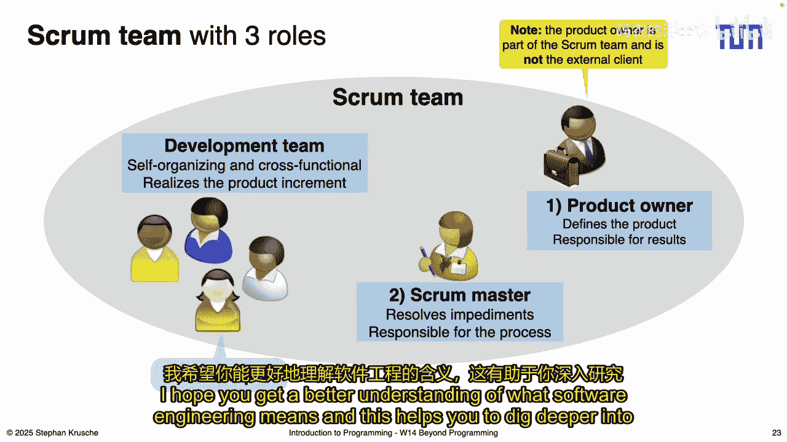

# 【全集】慕尼黑工业大学 计算机编程：从入门到实战 中英字幕 p64 Lecture 64 - 软件工程 -BV1WFrTBZExY_p64-

Welcome to today's workshopBeyond programming the course Introuction to programming。

 we are almost at the end of this course， this is our last workshop with new content which is relevant for the supervised exercise and next week we will do a quick course review with you and then also potentially do another test exam so that you can try out the exam mode again to be as confident as possible when we have the supervised exercise。

We assume we have a good understanding about the covered topic so far in particular object oriented programming today we try to go a little bit beyond programming and talk a little bit about an overview of software engineering activities which could be the next step in your study program that you take the introductional software engineering course in the summer we also talk a little bit about code reviews that help you to improve the quality of the code。

 we'll cover client server communication because I think this is a very important topic and even if you so far mostly the only work with single applications you will see the distributed systems are the standard and not the deviation anymore and it's good to get some first insights here and we'll also look a little bit into development workflows in particular in modern ways how to deliver and deploy software continuously so you get。

Better understanding of those。Let's get started with software engineering。

 which is a collection of techniques， methodologies and tools that help you with the production of a software system and most of the time and practice and industry。

 This will be a very complex and huge software system。

 and you try to develop it in a high quality in terms of end user perspective， of course。

 so that you have a nice usability that you have a nice performance that the system is reliable and so on。

 that are different quality characteristics。You have to do that within a given budget。

 otherwise you will not get paid anymore， and you should also do that within a given deadline because otherwise your end users won't have any advantages and if your competitors are faster。

 you might not have an income afterwards anymore。And this is the typical project triangle。 Yeah。

 we talk about quality， cost and money。 And in addition to that， we now have a fourth dimension。

 which is change。 Our world is not standing still only because today， something is。Part of a law。

 Something is part of the current technology。 Something is part of the public opinion。

 Does' mean that in half a year， this is still the case。 The world evolves faster and faster。

 And so the software does。 And this means you constantly need to adapt the requirements。

 the software technology and。You need to stick to legal regulations in order to make your software work in the best way for your end users。

And this is something where we have a few practices that actually help you to achieve that。

🎼So the challenge is to deal with the complexity。 so far you only developed very trivial software。

 very trivial programs， even the game that you developed as part of the project work is a rather simple software compared to the software that runs in industry where you have millions lines of code。

And you have to deal with change。Let me quickly explain you what we mean with techniques。

 methodologies and tools。 We start with techniques。

 Those are formal procedures to create a result using a welldefined notation this could be a recipe。

 for example， in the real world。 Yeah， if you like cooking， you have a specific recipe， step one。

 start the oven。 Yeah， step two， put all ingredients together， step3， put it into the oven and so on。

 So you have a recipe with step by step instructions in order to achieve a good result in the end。

 and in computer science or soft et， this could be a quickword algorithm。 There's certain input。

 for example， a number， some numbers in a list。And you have a certain output。

 They should be sorted from the smallest to the largest one。 And in between。

 you have certain steps in your algorithm that you need to accomplish。

 And this is called a technique。We then have a methodology。

 which is a collection of techniques that is applied across software development。

 across all the different activities that we have， and it is typically unified by a philosophical approach。

An example in the real world could be a cookbook。 If you， for example， like the Italian cuisine。

 you could have an Italian cookbook with pizza， pasta， Tiramisu and so on。

 And all of those follow a certain approach and others， they might。Preferre the Chinese cuisine。

Where you have noodles and hot sauce and whatsoever。 And this also is a collection of recipes。

But it follows a different， in this case， cultural approach or philosophical approach。In software。

 you we， for example， have object oriented analysis and design where you think of all the parts of a system as being objects。

 some of them mimicking， mimicking the objects in the real world。

And then you design the software around that。Another approach that is a little bit different would be functional decompositioner。

 where you see everything as a functional and you try to decompose large functions into smaller ones。

 Dis them accordingly into your program so that you can have a nice software afterwards。

Tools are then instruments or automated systems to accomplish a specific technique。

This could be in the kitchen， this could be an oven stove pot So this is then part of your recipe in order to achieve something in software engineering。

 on the other hand， this could be the integrated development environment。

 Inche or wishes your code that you all are using based on a compiler， an editor。

 a debugger and so on。 and in software engineering， modeling is also important。

 So this could also include modeling editors or more general socalled case tools。

 computer added software engineering tools。And with those tools， you can achieve the results faster。

Because you automate certain steps that you don't want to do manually。

 No one is wants to manually compile code。 But 50 years ago， people had to do that。

 right when there were no compilers yet。And this means that the technologies are also advancing。

 the tools are advancing and the way we program is advancing。 Now we are all writing code by our own。

 but in the future， it might be the case that generative AI assists us more and more and then we just describe what kind of software we would like to have and then it generative AI will deal with all the nity details。

Soft engineering is then more than just writing code。 You focused a lot on coding。

 coding coding in this course， because this is an essential aspect of software engineering。

 but at the end， it's much， much more。 first of all， it's a problem solving technique。

 you have to understand the problems of your stakeholders， the end user， the customer。

 other involve people who pay for the software， And only if you understand the problem correctly。

 and if you solve it adequately， no matter what kind of programming language you use no matter what kind of technologies you use。

 the end users to be not interested in this sense。Only if you understand the problem and if you solve it。

 then you can have a good software and make money out of it。

Prototyping is important here where you develop a small version of the system， you try it out。

 and if it works， if your assumptions about the problem and about the solution work。

 then you continue working the full fledged solution and you need to follow certain design principles。

 Otherwise your software might be slow， unusable and not reliable and then your end users won't have a good time。

You need to deal with complexity。 We use models for that。

 and models are then always abstractions of the reality。 So we don't want to specify the reality。

 If you develop a car， it consists of so many different subsystems that you cannot， in any way。

 describe the full complexity of a car。 But this is also not what we want。

 We want to have a simplified version of it to better understand it。And to agree on certain aspects。

 for example， that a car normally has four tires。 And if we understand this。 and if we agree on this。

 then we can distribute the work among the different specialists。

 and some people can work on the engine。Some other people can work on the window system how you lift and open and close to windows。

 and some others can work on the multimedia system， for example。

 But no one in a soft imaging team will perfectly understand all the subsystem。

 So we need to create abstractions， prototypes in order to have a good understanding in general and then go into the details when it is appropriate。

And when you want to deal with change， there are certain techniques and certain processes， like。

 for example， also agile methods that can help you to do that。

Couple of insights that we already identified。 First of all。

 you need to talk to people in particular to the customer。

 So soft finishing is also a lot about communication。Because if you don't communicate well。

 you might develop the wrong software in the end。 Then you can have the best coders。

 the best programmers， but you develop the wrong solution。

So you have to understand the problem scope and illicit requirements。

 talk with people what are the requirements of the system。We are typically solving complex problems。

 not the easy ones。 The easy ones are mostly solved。 Of course。

 you can always try to simplify a problem。 but nowadays with a small software that only consists of 1000 lines of code。

 you typically will not make a lot of money。 And if you have a complex problem。

 it's important to analyze it to break it down into smaller pieces。

 and to synthesize the small solutions again into a larger solution。

 And this is called divide and conquer。 And in software engineering。

 we have two processes or two activities for that， analyze means we break down。

All the little problems until we can solve it， and integrational means we bring all those little solutions together。

 integrate them into a larger solution so that end users can use the whole software。And。

We cannot really build a system if we are not able to change the problem statement if change occurs。

 so。ForReformulating requirements， changing requirements and also having this。

Philosophy that you adapt to change and that you' are not resistant to change is super important。

If you think about human beings， the more we work out a plan may it be for a birthday party or for a Christmas meeting or for your personal wedding。

 the more you work out a plan。The less flexible are we。Because our plan is perfect， right。

 We spend so much time in planning in order to develop the perfect plan。

 And then we are unhappy if the plan doesn't work out。 No matter if the day is fun or not， right。😊。

And if certain things occur and people don't have fun， we resist in changing our plans。

 And this is something that especially for soft ph， you have to overcome。

 So it's not good to plan everything in detail。 It's good to have a rough plan to know how it roughly goes and then to be flexible and to adapt to the current situation。

 And this is something that we need to learn。And last but not least。

 we have abstractions that allow us to deal with the complexity in particular with modeling。

 This is also why we introduced it to modeling already as part of the programming to very simple models。

 but of course， you can also have rather complex models， but in the end。

 it's always important that they help you to communicate in my opinion。

So modelling is all about communication， providing a common vocabulary。

 And this is also what we sometimes call conceptual model， or informal model。

 It's not super important that all the nitty details are correct in a model。

 It's much more important that we understand it that we can talk about it and that it provides a common understanding。

 So in my opinion， most of the time a model should target a human being。

 a developer or potentially an end user or a customer in order to explain the complex aspects。

 And in order to better understand it。Of course， models can also be used for analysis and design to even generate code for from the case tool to the compiler。

 you've probably seen that there's a very strong mapping between class diagrams and the code so you could come up with a class diagram and then generate the code。

 but it turned out that this is not super helpful because the code changes anyway。

 and then the code gets inconsistent to the model and then you don't really have something that helps you in the end。

But of course， models are also good to document decisions， the so-called design and rationale。

 Why have you decided to develop the software like that， What were your main reasons。

 What kind of alternatives did you consider and what were the advantages and disadvantages of those alternatives。

 it's good to document this and to make this available for people who come late into the project or for people who。

Leave the project and then hand it over to other people。

 It's always good to have a documentation and modelling can help you here as well。

What are the most important models in software engineering。

 We can create a so called object model where we model the structure of the system。

This is important to understand。The structure of the system and to understand what kind of entities we have。

We can create a functional model。 This is on the end user perspective。

 What are the functionalities of the system， The socalled use cases that our end users should be able to do。

 If you develop a application like Microsoft Word。 then you could say a use case is that your end users want to write something。

 And they want to edit something。 and they want to review something。

 and they want to change the font and they want to make it bold and change the color。

 Those are all use cases that you can define in the beginning of the project。 Of course。

 Microsoft Word has a ton of other use cases。 And then you can give this to the developers and ask them to implement it。

😊，You can also think about the dynamics of the system。 Yeah。

 how does it react to certain external events and you could define the activities that your system supports not only externally but also internally。

 what kind of algorithms do you need internally in order to implement that on a high level。

 not on a very detailed level， this is part of the programming later on。

 but if you create a dynamic model in the beginning。

 you would like to understand how the system works。If you talk about cars， a dynamic model could。

 for example， be that a car has certain states。 It can park。 This is a state。

 and it stands still on a specific spot。 It can drive and it's on a street and moves around and then potentially other states。

 and you could think about what kind of transitions do we have between the states。

 What does the end user need to do to start a car。 for everyone who knows how to drive cars。

 this is trivial。 but if you've never done that， and no one tells you， you will probably not succeed。

 Yeah， I mean， it's not super obvious， especially for the old cars。

 So there's a specific place where you have to enter the key， turn it around。

 and then suddenly you can start driving。 Yeah， of course。

 new cars have stop buttons or even drive automatically but think about this。 Yeah。

 this is something that you know， in your mental model。

 but it's good to write it down because there might be people who have never driven a car and who don't know how all this。

WorkAnd this is why we need models in software engineering。All those three models。

 object functional and dynamic model together build the system model。

 and the system model is then the basis for the development。

Another important distinction is that we typically differentiate between the so called application domain and the so called solution domain。

I tried to do that also several times as part of dis course already and gave you examples from different areas。

And。If we talk about the application domain， this is the environment in which the system is operating later on。

 This influences the requirements， elicitation and the analysis， and this。

Means we need experts from those areas， because typically our developers， the programmers。

 they are very confident in the solution domain， but not necessarily in the application domain。

 An example for an application domain could be the financial area。

 or you have banks and transactions and money。 and you need to understand how all this works。

 If you don't know what a bank account is you can't properly support a bank account in a system。

But there are many different application domains， and it can never be the case that we know all of them。

 It typically can be an expert in one application domain， but then not necessarily in all others。

The solution domain， on the other hand， focuses on the technologies that are used to build a system。

 programming languages， architectures。Cod。How you deploy the code and so on and so on and so on。

 This is very technical。 And this could be completely independent of the application domain。

 If you develop cars， you can write a software in many different ways。

 with many different architectures。And still work for the same application domain me。And ideally。

 in soing， we need experts in both areas， we need domain experts in the application domain area。

 who understand how costs work， who understand how financial aspects work。

 who understand how the university system work if you want to develop software for the university。

And on the other hand， you need people， programmers。

 developers who know how to build the software afterwards as soon as they have understood the requirements。

Both models and sorry， both domains then contain abstractions that you can use in order to create a system model in the application domain。

 we're talking about a bank and a bank account and money and in the solution domain we talk about buttons and text fields where you can enter the amount of money that you want to transfer and we talk about an alert that you get or a push notification that you get when you have transferred money from one bank account to another bank account and we have to bring both together and we have to think about how can we represent certain application domain concept。

In the solution domain， in a database， but also in application service。

 but and also in the user interface， how can the user interact with a bank account。

 How can the user transfer money and so on。When we talk about all those activities。Analysis。

 requirements， elicitation， implementation， testing， and so on。

 Then we typically are also interested in a software life cycle。

 which describes the activities that are important for what the specific project that we have in mind and relationship of these activities。

Examples， as I mentioned before， requirements elicitation， but also system design， the architecture。

 configuration， management and delivery and a software lifecycl model tries to come up with best practices that you would like to implement in a software lifecycle later on the software lifecycl is the instance of the software lifecycle model。

 and the model allows you to better understand how you want to develop software because there are many different ways to do that in order to understand it。

 monitor and control it。Here is an overview of a software lifecycl that is suitable for model based software Engine。

You start in the application domain by getting a problem statement from your customer。

 This can be a full fledged document with many different sections。

 but it could also be just an email that the customer sends you。

 or you had a discussion in the subway driving from Guing back to Munich about an idea that you would like to develop。

 And then you just summarize the most important aspect of the discussion in a small document in some text。

 but it's a starting point of every project。 Every project should have a problem statement So you get started with some baseline ideas and requirements。

Now， ideally， we have a diverse development team consisting of people of different colors， people。

 female developers， male developers， and also people from different cultural backgrounds。

And also experts in different areas。 You need someone who knows how to create an architecture。

 You need someone who knows how to test software， and you need someone who knows how to implement software。

 So nowadays， teams become more and more diverse。 And this is actually good。

 because if you have diverse people in the team， the diversity of the。All people is respected。

 as good as possible。And then we go through certain steps in order to come up with the final software。

 we start with requirements elicitation， create use cases and assign them to certain roles in our system。

 we can analyze those and create some first objects in our application domain， like for example。

 a bank account has different subtypes， a checking account， a savings account， and so on。

And then we can come up with an architecture， we can think about if we want to develop a banking software。

 we need some kind of client server application。 Ily， we have it in the smartphone， the Sbaka app。

 for example， but then there's also some service at the Schbaka data center that stores all the data。

 and this also has to be connected to some kind of other services because you want to interact with other banks。

 and you try to come up with the different subsystems and how they communicate with each other。

Then you can for each and every subsystem， think about how to realize it。

 think about all the different solution domain details when we talk about the user interface。

 we need to think about do we use buttons do we use dropdown menus or do we use multiple choice boxes for the different activities that users want to do when we talk about the application server I you。

 for example need to talk about the interfaces， how you can achieve database consistency and so on and this is done in the object design。

At some point， you start implementing the software。

 you produce source code in a specific programming language。

 It can be the case that you different subsystems have different programming languages。 For example。

 a server could be written in Javava and a client for iOS could be written in Swift or objective C and corresponding Android app could be also written in Javava or Kotlin using different frameworks。

 Yeah so this means that you can come up with a heterogeneous project with multiple programming languages。

And， of course， we also should verify if the software is working correctly and test the software。

 And we do this on multiple different。Few points。 we can test the code if the code is working correctly。

 if it compiles。We can test the architecture if the interfaces communicate well with each other。

 we can test the use cases Also， can do a system test from the end users perspective。 Is it possible。

 If I want to transfer money from mybaca account to your， I don't know， comm direct account。

 Is it working or is it not working， Then you go through the whole system。

So those are the six most important activities we see。Well。

 we indicate an order because typically you can't really implement something if you don't do requirements alicitationer。

But there is not necessarily an order， and it can also be the case that you do it multiple times。

 iteratively and incrementally in order to develop the software step by step。

There are also certain project functions or activities that span the whole life cycle。

 in particular quality management， configuration management and project management。

 those are activities that you have to do throughout the whole project in order to make sure that all the workflows are going correctly and then hopefully not only at the end of the project but also in between you can deliver the software system to potential end users they can test it。

 they can provide feedback and this again goes into the whole development workflow。

Looks rather complex， but the main messages， we have certain activities that we do in a regular basis。

 We have certain activities that we do throughout the whole life cycle of the project。

 and we start with a problem statement， and we end up with a software system。

 and then we do all these steps multiple times。Let's go through those STM activities quickly and understand the most important aspects。

 What is requirements， elicitation and analysis， Well， we would like to understand the requirements。

 So we need to do requirements elicitational， This means we talk to people。

 we ask them what are the requirements in your opinion and we write them down， make them consistent。

 complete understandable in terms of functional requirements， what are the functions of the system。

 but also in terms of quality attributes I this for this particular software is usability important。

 is performance important is reliability important and so on those are the so-called non-functional requirements。

And then we can analyze this and try to come up with the first system models in terms of use cases。

 objects and the dynamic behavior， and of course we do this iteratively multiple times until we are confident with the result。

And the result for the next。Activity would then be the analysis model with the dynamic model and the object model and the functional model in here。

 So all three together provide the system model， which can be aprint。

 a blueprint for their further development。😊，And of course。

 in a project that change occurs you don't specify every little detail。

 you try to come up with a high level overview of the most important aspects and then later on in the project you can detail all the important aspects。

In the system design activity， we have eight different sub activities。

 We try to come up with certain design goals， Is performance more important than usability。

 or is it the other way around。We create an architectural style of the system and try to decompose the system into smaller subsystems that make it manageable to implement them。

We talk about concurrency。 remember an important aspect。

 can we do things in parallel in order to make it faster in terms of processing some threats or if it not possible。

 we need to talk about the hardware software mapping if we develop multiple subsystems on which hardware devices will they run an application server typically runs on a virtual machine in the data infrastructure and a mobile app typically runs on a smartphone。

 but they are multiple smartphones。 Yeah I could have an iPhone 11。

 but I could also have an iPhone 16 and of course， they might behave differently。

And you also need to think about， do you build the software on your own or do you buy external software。

 Do you reuse open source software。Persistent data management is all about making the data available after you restart your system here。

 you can either use databases or files， and you have to think about what you want to do here。

Global resource handling talks about access control Here。

 You need to think about what kind of roles do we have in a system and to which use cases or functionalities do they have access。

An administrator can typically do everything， but a normal user might not be able to do everything within an application。

 There might be certain limitations。That the normal user should not be able to do。

 And then there are a few more aspects where you talk about the。

Style of software control that you wna have and about failures in terms of boundary conditions。

In object design and implementation， it's all about reusing existing solutioner。

 you think about design patterns and other aspects in order to implement the subsystem appropriately。

 you have to specify interfaces between the subsysts。

 How do they communicate with each other in particular if they work on different hardware nodes。

 You have to think about the communication mechanism。 You might need to restructure your objects。

 and you might need to optimize your object model to address performance criteria。During testing。

 we verify that the software works correctly。 We can do internal testing where we distinguish between unit testing on the smallest scale。

 You only test if one functioner or one class is working correctly。Integration testing。

 you test if multiple subsystems work together correctly。

 and system testing where you test the whole system in terms of requirements， in terms of functions。

And on the other hand， we have external testing typically done by the client， where the client。

Performs some kind of acceptance testing against the initial client expectations。Now。

 all those activities might have a specific order。 and in some projects。

 you have a certain focus on some activities where in other projects。

 you have an focus on other activities。 So there is no one size fits all software process model or software lifecycle model that works for all kind of projects。

 And this means tailoring is super important。 adjustjusting the lifecycle model to the specific needs of a project。

 And this is you can name certain activities。 you can remove activities。

 You can think testing is not important。 We just develop a prototype that should be demonstrated and it never goes into a production system and you can also reorder activities。

 You can， for example， first right test cases as a specification and then implement a software。

 But ideally， the project manager thinks about that。

 what kind of software lifecycl do we want to use and what kind of tailoring is necessary。😊。

It's important to understand that there are different types of process models。

 so calledled defined processes on the one hand and empirical processes on the other hand。

Defied processes follow certain rules， sometimes very strictly。 They are completely planned。

 and they avoid deviations because the deviation is seen as an issue that will lead to problems。

 This is typically good for manufacturing processes。 like you see in the figure here。

 but it's not very well suited for software engineering。Empirical processes， on the other hand。

 are not entirely planned。 You have a rough plan， but you don't really know how the conditions work out in the end。

 And this means you try to inspect what's going on。 You try to look for changes。

 and then you adapt to those。And if you have already been sailing on the oceaner。

 you probably know that even if you look at the weather conditions。

 you can't really say how the weather will turn out in the end。 And you can't plan the whole trip。

 You can just say， hey， I want to go from A to B。 But what happens in between。 You don't know。

 You have a rough plan。 And then you might drive differently。

 because of certain activities and actions。 And in the first case。

 if there's a strong wind wave coming， all the people might need to ch to the right side to prevent the board that the boat is falling down。

And this is something that， I mean， you can have a good understanding about that。

 You can understand what kind of conditions cause such an action。

 but you don't know if this happens or if it does not happen。

 So you have to inspect the conditions and adapt accordingly。

And this is much more suitable for software engineering。 Notice that in empirical processes。

 which are also called ad child processes。A deviation from the。Plan is seen as an opportunity。

Because if you identify this deviation as early as possible， you can fix it as early as possible。

 And you don't want to stick to the plan if you develop the wrong software。And this， again。

 means prototyping is important。 Communication is important。

 And if you fix the deviation earlier as your competitors。

 you might have a big market advantage later on。Here's an example of an empirical process control model that is mostly used in industry nowadays。

 It's called Scrum。 Who you has heard about scrum already， Raise your hands。 Okay， that's good。

 Then I don't need to take too much time here in scrum， The main idea is that you have。

A product backlog in the beginning， you create this in the kickoff meeting。

 And this is a list of the most important requirements， relatively vaguely specified。

 because you don't want to do analysis paralysis in the beginning。

 You don't want to spend months in understanding all the requirements in detail。In a。Iteration。

 which is called sprint。 That is 2 to four weeks long。

The team tries to come up with a potentially shipable product increment。

 and it does that by starting with the sprint planning meeting where you take the most important requirements out of the product backlog。

You detail them as much as possible so that you can implement them and you put them into the sprint pack。

And then you define a sprint call， and you do everything to achieve this sprint call。

 and you try to avoid。Changes that lead to disruption。You really try to focus like this。

 Now You don't look to the left。 You don't look to the right。 You focus on getting things done。

 And this is important because if there too much disturbance that developers cannot get into the flow。

 and they cannot get something done。😔，A sprint is 2 to four weeks long and has a daily scrum meeting every day where you talk about status。

 impediments and promises。Until the next day， which in the steady scrum is only 50 minutes long。

 People should not sit in meetings all day。 They should focus on getting things done on realizing the potential ship of the product increment。

Which can then already after the first iterationer send out to end users so they can use the software。

 If you want， you don't have to do that。 This is optional， but if you want， this should be possible。

And at the end of the sprint， we do a sprint review meeting where we discuss， hey。

 what did we achieve， We demonstrate this， we take it off all the finished backlog items we are done and all the unfinished ones in case we couldn't finish all of them go back to the product backlog and our candidates for the next sprint。

And then an exprint occurs。 And in this2 to four week iteration plan。

 we developed the software step by step。And the idea is that we fully develop features。

 not just the user interface， not just the database。 No。

 we implement a whole feature so that it can be used by end users。

 and we start with the most valuable ones with the highest priority。

 with the ones that achieve the highest value for the end user and the highest money income for the company。

And then we do the other ones later。That's a quick summary of Scrum。

 We have some more details on the slide， the most important artifacts。

 I talked about product backlog， sprint backlog and product increment。The different meetings。

 you'll have the project kickoff meeting once in the beginning of the project in order to come up with an initial version of the product backlog。

 notice the product backlog can always change。 You can always add new items。

 remove existing ones if they are not useful anymore or change existing items。

In the beginning of a sprint， you have to sprint planning meeting every day。

 you have daily scrum meeting，50 minutes long。 Then at the end of the sprint。

 you have to sprint review meeting。And additionally， at the end of the sprint。

 you can do a sprint retrospective where you do not focus on the work outcome， but on the process。

You focus on what went well， what went wrong， How can we improve working together。

 What kind of tools and workflows do we need to improve the process。

The Scrum team consists of three different roles。 We have the so called product owner。

 The product owner is part of the team and is the liaison to the outside world。

 The person who is communicating with the customer， with managers， with end users。

 Notice the product owner is not the traditional customer。 It's the person who talks to the customer。

That's the idea。 The product owner is responsible to define the product and the values and the priorities and is responsible for the results。

 because if you do the prioritization wrong， if you put the wrong things on the product backlog。

 then the development team will realize the wrong functionality。

Then we have a scrum master who is responsible for similar like a manager。

 but not a traditional manager who decides everything。 This is really the modern manager。

 the facilitator， the coach， who helps the team thrive。

And who is responsible for the process so that you follow the guidelines of Scrum。

And it's responsible to resolve impediments。 So if some developers cannot work because information is missing。

 they don't have access to tools。 there is a misunderstanding。 There is some disagreement。

 this Scma should look for solutions for those impediments。

And then we have the development team that consists of multipleable， self organizing。

 diverse and cross functional team members，Develop， Some of them are experts in architecture。

 Some of them are experts in testing。 Some of them are experts in usability and user interface design。

 They work together。 They realize the software， They realize the product increment。😊。

And they get help in terms of steering from the Sc master and in terms of prioritizationer for the product。

 from the product owner。 But they should communicate them with them on the same level。

 There should be no hierarchy in the team。 And if the team decides to use certain processes certain tools and they have a good reason for that that this is fine。

 The Scrum master should not intervene and should should not decide this on its own。Anything。

That is Aunt this was really a short overview， but also a very comprehensive overview。

 I hope you get a better understanding of what software engineering engineeringing means。

 and this helps you to dig deeper into those topics in a future semester。

