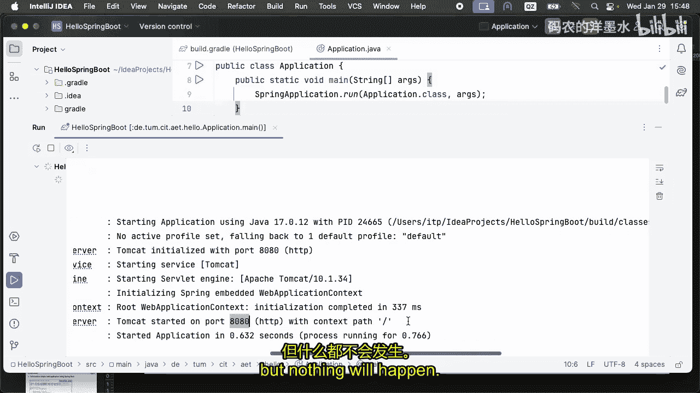
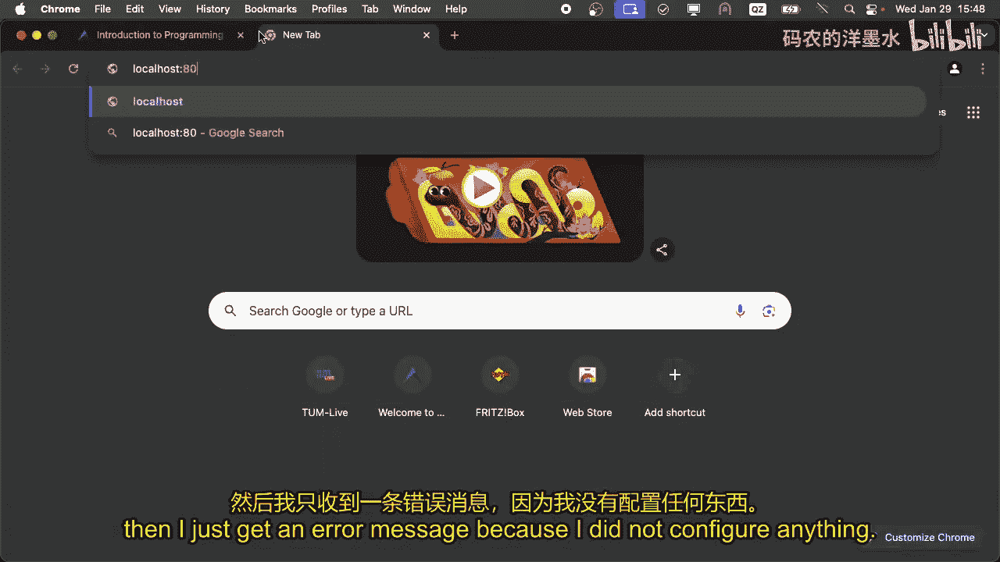
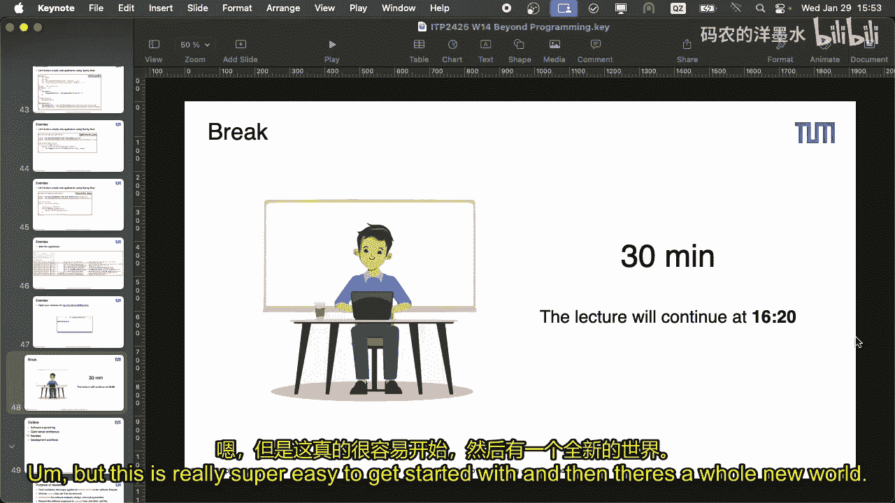
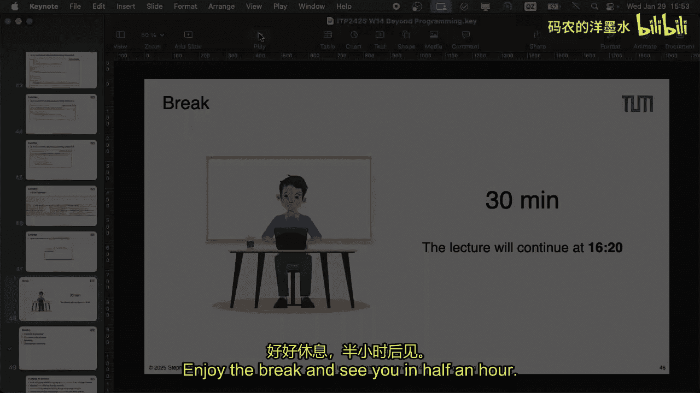

# 【全集】慕尼黑工业大学 计算机编程：从入门到实战 中英字幕 p65 Lecture 65 - 客户端 - 服务器架构 -BV1WFrTBZExY_p65-

Okay， let's continue after this first break in the next unit。

 we would like to talk a little bit about the client serverva architecture。

 something that you might already have heard， but where you probably do not really know all the insights yet and of course I can't give you all the insights。

 but I can try to give you some first overview why this is necessary what client Serva is about and what you should take into account when developing software following this architecture。

We will also show you a little example in the end how you can easily start developing a application and test it in your browser。

 and we'll do this together so。Think about getting started already。

 One thing that I would like to say immediately in the beginning is that many people call this nowadays。

 front end and back end。And to be honest， I hate those Tus。

 and I would like you to get rid of them and to strike them through in your brain because a proper computer scientist。

 software engineer programmer， or even a manager with a focus in technical areas does not use those bullshit Tus。

To be honest， this is， this really bullshit。 Yeah， what is a front and what is a backend。 Yeah。

 I always say， I show you my front end。 if you show me your back end， yeah and。

I guess you immediately can see that you should not say that in many conversations， probably， yeah。

 this can also be understood completely wrong。 and we have technical terms to describe what we want to develop Yeah。

 of course， are marketing people there are people in the management area that use those terms。

 but if you talk with a technical person and you use those terms。

 the technical person thinks you're an idiot， really。So get rid of them。 Yeah， use appropriate terms。

A front end is typically a user interface in a client application。

 and a backend is typically something like a server or cloud based application that runs on some kind of infrastructure。

 And I will not use those terms anymore。 And I hope that you also understand that you should not use them。

Before we introduce client Serva， let's quickly think about what the reality in software systems is nowadays。

 we have more and more distributed systems。And developing a distributed system is much more complicated than developing a single standalone application。

 If you just run one main program in Javava on your computer， this is much， much， much easier。

Then developing a distributed system。 So why is everyone developing a distributed system？ Well。

 first of all， the hardware power is distributed。 So in order to come up with really cool use cases for your end users and in order for them to download and potentially buy in your software。

You need to provide them with those cool features。 And this is not always possible on end user devices。

And distributed systems are typically also easier to scale and more resilient to failures。

And this is why nowadays， almost all systems are distributed。

 Even the games all have a multiplayer mode now and do not fully work standalone anymore。

 Even all the games on your smartphone that are for free。 Typically load data from the Internet。

 May it be advertisements or may it be in game data that they show to you。

 So there are rarely cases of standalone software that is not communicating with any other software system。

 Most of the software is distributed nowadays。And when it comes to distributed systems。

 there are certain challenges。 First of all， the systems need to need to be connected with each other。

 If a client application on your phone， like the email client cannot talk to the email server。

 You cannot download the emails and you cannot send the emails。 It's simply not possible。

 So we need to make sure that the subsystems connect with each other。

 And I'm not talking about the Wifi is down here。 I'm talking about the technical way。

 how to connect them with each other。Then distributed systems are heterogeneous in your browser。

 You most likely have a Trascript application on your smartphone。

 you most likely have a cotton application。 if it is Android and a swift application， if it is I。

But on the server， on the server side， you typically have Chava applications where there's a wide range of things you can do for。

Geneneerative AI and artificial intelligence in general。 Many people use Python nowadays。

 So they distributed systems， subsystems， They have their own languages， their own platforms。

 their own protocols that you need to understand， and that you also need to connect later on。

And last but not least， security is an important challenge if you develop software not everyone should access all the data。

 so authentication authorization and encryption is possible because if you develop a bank software。

 you don't want someone to steal the pins and the tents in order to steal the money in the end。

And all those aspects are in particular challenges for distributed systems。

 because if you have a standalone app that is only used by one user on one device。

 this is typically not an issue。So client Ser helps us to solve some of those challenges and the idea here is that we have shared resources and shared services that many。

 many distributed clients want to use， want to access and where we basically would like to control the access and the quality of the service。

Simple example， if you currently write something into WhatsApp here。

 I see a couple of people on the smartphone， then you have a distributed system and not everyone should be able to access your account。

But millions of users are using it at the same time。

And the main problem is how can we manage this set of shared resources and services and still make them easy to develop so that you can modify them。

 that you can reuse them， that you can scale them up if you have millions of users that they are ideally available all the time and so on。

 and the solution is that most systems nowadays using some kind of client server architecture。

 where the client is typically very close to the end user。On your smartphone， on your watch。

On your personal computer， the server is typically somewhere in the cloud or somewhere in a data infrastructure。

 but typically far away from the end user。And then you have multiple clients。 Yeah， not only mine。

IPhone， but also your iPhone interacting with the Whatsapp server and the Whatsapp server is also theres also not just one server。

 No they are mild with servers because otherwise they can't scale this up。

But the main idea is that the client initiates the communication and sends a request。

The server handles this request in whatever form and then sends a response back。Again。

 an overview here that client server is used in many different application areas。

 also in database systems。 The client here would be the user application。

 The server would be the database， and then the client can request a server from the server。

 There are certain functions that are more in the client side。

 typically a user interface typically some kind of first check if the input data is valid。

 Yeah if I want to transfer money on my spark has the app。

 then the app can already check if the ebon is correct or not。

 This doesn't have to be done by the server， but if the ebon exists。

This is a check that has to be done by thewaba because the client cannot access all different es and make sure that it accesses。

 So some sanity checks are done by the client。Certain functions， by the server， typically。

 you have some kind of centralized data management， a database with all the user data。

 You need to make sure that data is。The data integrity and data consistency is established and also some kind of security so that people can only access the data they belong to。

So the idea one or more servers provide services to clients and those clients can then resent requests。

 The services will be executed。 there's some kind of business logic， some kind of functionality。

 some kind of delegating this to other systems involved and then the response is sent back to the client。

 It's important that client and server talk the same language。 Otherwise。

 they do not understand each other。 And I'm not talking about a programming language here I'm talking about the communication protocols。

 nowadays， most communication is done over HtDP。 but there are also other protocols for client server。

 And even if you talk HtP， you need to make sure that you talk with the same data scheme and the same interfaces。

 otherwise this will not work out。 So the client and the server， even while they are decoupled。

Based on the interface， they are also that they have a strong dependency of each other and the data on decline。

 even if it's implemented in a different programming and language。

 is typically the same as on the server。 Otherwise， they can't speak with each other。

Responses are typically relatively immediate。 Yeah， sometimes it can take a few seconds。

 but most of the times you try to make it super fast。

 and the end user is only interacting with the client。 It's never interacting with the server。

 No one of you goes to the Whatsapp company， Cloud data infrastructure and communicates directly with the server over there。

 You're all using your smartphone and maybe a desktop application or something like that。

 but you're not interacting with the server。 This is super important。

They are different communication styles in such distributed systems。

 We can broadly distinguish between so called message based way air communication styles and method based communication styles。

In the end， a method based one still uses some kind of messages internally。

 but it looks different for you。As I said， nowadays。

 most communication is done using HTTP rest or similar protocols。

 so most communication is messagebased。 However， there are also certain standards like remote procedure control remote method invocation coreba and GRPC where from the development perspective。

 it doesn't look like you send a message to the server， a request and then the server response。

 though it really looks like you invoke a method， like you do it in your Javava program。

 but the method is then not executed within the same computer in the same process。

 No it is transferred to another computer and to another process is invoked over there handed over there。

 and then the response is automatically sent back。So from a developer experience。

 this can be a bit easier。 but still， even though it might be a bit easier to invoke a method in many systems。

 we prefer a message based communication。The idea is always that the client acts as a requester and is sending a request to a web service。

Which we also call a replyer。 a request could be hey。 Dear web service。

 please give me Schnaan's LinkedIn profile， for example， and then a reply says。Okay。

 you are eligible to access Stefan's LinkedIn profile。 Here is Stean's LiedIn profile。

 Please display it in your user interface。 And then the client could be the website of LinkedIn。

 And then the website displays my profile picture， my name， what I'm working， my history。

 my posts and so on。 That's basically the idea here。The idea is also that ideally。

 the whole communication is stateless。 This means that the reply， the web service。

Does not even know what kind of requests have already been sent。

 The the web service only needs to know if the request that the client is authenticated or not and what kind of role the client has。

 But otherwise， it does matter if you have already asked for Marcusus linked in profile beforehand before you ask for mine or not。

 this should not make a difference。 And this is what we mean with stateless。Now。

 when it comes to client server， many， many applications nowadays use rest as an architecture or as a communication protocol。

And rest is a perfect fit for client server because it uses HTDP， uses a request response mechanism。

 and in addition to that， it provides a so-called client side rest layer and a server side rest layer。

 and those make sure that you follow a specific communication style。

And this specific communication style is important to guarantee that certain aspects of client server and distributed systems work。

 I don't want to go into detail here， but if developers follow the rules of rest that we will see in a few moments。

 then it's typically easier to maintain the software。

 there are less errors and there is a better user experience。

Rest works with so calledled resources and resources are similar like objects。

 so you store certain objects withbound resource， and then on this resource。

 you can invoke certain methods。 You can get objects of the resource you can。

Change objects of the resource。 You can delete objects of the resource if you have permission to do that。

 and you can create new objects within this resource。

We typically use objects or instances of classes within those resources。

 An example could be that you have a user with a name and a comment in a social media platform that can be added to an article so someone is writing an article and then users can create comments on that。

And then we have examples for objects， Yeah， I which I found would be an instance of the class user。

 so I could be in the user resource and an announcement for ITP could be an instance of the class article So if I'm writing an announcement that should be sent to you this could be considered as an article in the article's rest resource。

Resources then should always be nouns or things。 Yeah， like users， articles。

Comments and should never be verbs by actions。This is to the convention and resources should be identifiable。

 for example， the UI。Your are I is a universal resource identifier。

 We will see in a moment what that means。Now， let's assume we have such a resource。

 you see here the abstract way of modeling such a resource and then a concrete instance the user。

Then we use the so called cru operations。 create， read， update， delete。And with those。

 we can then manipulate the objects in the resource。We can create a new user。

 We can get the existing users read the information about them。 We can update them。

 And when we can delete。😊，Create would mean you create a new user。 Now。

 maybe you create a new account on your website。 Then the data is sent to the server in a so called post request。

That follows the create idea。 And then this new user is also created in the server and potentially stored in the database。

We can read something。 This is denoted by the sunglasses in the yellow box。

 and this could be give me all information about one particular user about Stefa。

And then the server says， hey， here is the information of Stean。

 but doesn't give you information about other users。

Could be the case that you update certain aspects of the objects。 Yeah， like update Defs email。

 if my email changes， I can update it。 and then the changed email will be stored on the server side and in the database。

And I could also delete my account。 Yeah， if I don't no longer want use when I use LinkedIn。

 I can delete my account。 and then most probably there is a delete request send to the server。

 delete the user with the name Stefa。And those are the four main methods that allow you to interact with rest resources。

 With that， you have already understood 95% of the communication between clients and Sws。

There are a few others， but this is the most important aspect。

Now we can map the crude operations to the HtTP verbs。

 HtTP is an protocol that is used to communicate over the web。

 It's the default protocol over the web and HtTP messages they always consists of a universal resource identifier。

 for example， LinkedIn dot com slash profiles slash Stean。

The H TDP method that we will see now and some additional information key value pairs that allow you to customize the communication and potentially also a message body that can contain arbitrary data。

 like the data that you want to transfer。 if you create an object。

 And you need to send some data with it。 And this is then stored in the body。

So create means we create a new resource， and this is done with the post method。

Read means we retrieve existing resources。 and this is the get method。

Update is done with the put method。 Here。 we update an existing resource with a specific identifier。

 Otherwise， this will not work。And in delete means we delete an existing resource with a specific identifier using the delete method。

Notice that forget， you could theoretically distinguish between get many objects in a list。

Or potentially even get all objects， even though this is not a good idea。

 because this can take some time。And between get one object that is behind a very specific identifier。

How do we identify resources with the URLs uniform resource identifier Most often this is a URL。

 you probably all have used URLs so far in your browser when you type in the address and when you want to enter a new website URL is called uniform resource locator and this is how it typically looks like。

We have a protocol。 This is most of the time HPS nowadays。 S stands for being secure。

 so this is a secure encrypted communication。 Then you have some kind of host name。

 some people also called this the domain。 This is typically the bound to a specific organization here。

 for example， to the technical University of Munich tom do D and some subpart of the domain then bounded to smaller departments of the university CIT stands for our school CT computation Information and technology and ASE stands for applied software engineering。

 which is one unit in the school of the technical University of Munich and we are located in Germany。

 so therefore we use D in the end。Then we can optionally have a port most of the time end users don't see a port。

 but communicationer sometimes uses ports because a port allows you to have multiple connections on the same computer。

 This is like one number that routes you to a specific application on this web service and then we have a path here we have slash articles and with this path we can then send the request to the server behind this URL。

And to this specific path， yeah， So if we now call get with this URL。

 it means give me all the articles that you have stored on this particular web service。

That's basically the idea。 Any questions regarding those URL R I or URL L。

Then let's continue a restful API then consists of an API standing for application programmer interface。

 that this is the interface to the web service consists of a collection of endpoints。

 You do not only have one resource， but multipleable resources and one endpoint is always identified by one specific path and one specific method。

 So with the same URL， you can have multiple different methods。 You can get things。

 You can post things。 you can put things and so on。So our resource then has to create， read。

 update and delete method and typically has a specific identifier。

 and one endpoint can then consist of multipleable resources。

And this means we can nicely map the UL constructs to the API。 Classes are mapped to endpoints。

 Objects are mapped to resources， and we can even nest end points with associations。

 So let's assume we have an article's collection。That consists of multiple articles。

 Articles have an identifier and a text， and you can publish them。

 and each article could have multiple comments and every comment is bound to one article。

 You cannot write a comment that belongs to two articles， right。

 and an article could be a newspaper article， like， for example， on。Seegel D。

 but it could also be a social media post in our application。

 and comments are then comments by end usersos， where you say， hey， this is a nice article or no。

 sorry， this is bullshit。 I don't think this is a correct way to address this political problem or something like this。

That's basically， the idea。Now， here's an example of the Web service state and what the specific client web。

Would do in order to change this state。And the state is then something that could be persisted in a database。

 But right now， we focus really on the server side。 And what do we have here， We have a newspaper。

 which is an articles collection， and this newspaper consists of multiple articles。 Right now。

 we have two of them， a 1 and a 5。And Article 1 has three comments， C11， C 12 and C 13。

 and you see the text here are abbreviated， of course， in reality， there would be longer text。

 but here we just use very simple ones， but that could be the current statement you start your website Sply and you see two articles and three comments for the first one that could be also visualized in the user interface。

Now， let's assume a client interacts with that and sends a get method to articles。

What would be returned， Well， those two articles， a 1 and a5 would be returned。

 denoted by the sunglasses。Let's assume someone calls posts on the article's endpoint。

Then the person would need to deliver all the data in the body。

And this would would mean that a new article is published and is created。

 And now you can see three articles in the newspaper， and this could be， for example。

 an article called A2。Next， you could change an existing article， change the text here。

 Maybe you found a typo， and you would like to correct it， and then you invoke put。Slash articles。

 slash  one， because one is the identifier and uniquely idents article 1。

 And then with the message body， you change some existing values。

Delete would mean the article is gone。 Maybe you think the article is outdated。

 Yeah It's from five weeks ago， and we don't need to show it anymore。 then， or it was wrong。 Yeah。

 maybe it contains some fake news。 Then you can call the delete method。 And here， again。

 slash articles slash 5 identifies the very concrete one here。Next。

 you can also navigate through the articles towards the comments， so you could say slash articles。

 slash1， this one here， slash comments， and this would give you all the three comments of article one in a list and then the client could display them in the scenario could be the end user clicks on the article in the main page。

 the comments are not shown。 but the user clicks on the article and then you display all the comments on the article。

Of course， we can then also create new articles by posting a comment to article 2。

 and we have a new comment in here。 We can change existing comments。 Yeah， maybe again。

 there's a typo in there。 and the user wants to change it using the put method。 And again。

 you see how we navigate here slash articles slash one。Slash comments， slash2。

 and then we deliver a change。And， of course， we can also delete comments by using the nest that。

그액션요。Does that make sense， how it works。Any questions regarding mapping those web requests to the operations and how they would change the state。

Great， and we can continue Now， when the client and the seller talk to each other。

They typically have different programming languages。

 the client could be developed in Javascript as a website。 server could be developed in Javava。

 And even though Chava and Javavascript sounds similar， they are completely different。

In terms of technology， and。You somehow need to make sure that those two applications can communicate with each other。

 Now， ideally， we would like to exchange objects。 Yeah， as we've seen comments and articles。

 and you just want to send an article to the web server， or you want to retrieve an article。However。

 if decline client in the server use different ways of storing those objects internally。

 We need to bridge this gap。 And this is typically done using serialization and decalization。

 most notably nowadays， we use Chas a Chasson format for that。

 you have already learned about Chaser in the programming languages workshop。

 And the idea then that before you send an object to the server。

 you serialize it into a string in a specific format called Chaser。

And then when the server the string is sent over HTTP over the web。

Over the wfi or over the cable to the other computer。 and then the other computer can use the string。

 can use the cha and decize it back into an object。

So when we send a comment from the client to the server， we first transform it into a chasing string。

 send it over the web， then the server retrieves the string。

 decalizes the string in form of Cha again into a comment。

 and then both parts can talk with each other in terms of comments。

 but as always this serialization and desialization in between。

Jason stands for JavaScriptscript object notation， It's an open format that's easily readable and compact and programming language independent。

 so every programming language can use it。 Here's an example if you have a movie with those six attributes and the Godfather as an example object。

 the corresponding Jason would look like this。😊，Right。

 so the client doesn't send an object in memory to the server。 No。

 it serializes a string looking similar to this one here。

 sending it to the server and then the server can say， oh， okay。

 this string corresponds to this object and then transforms it again。 That's the basic idea。

When you talk about HTDP， it's important that you do not only handle the success of the communication。

 but also error messages， and HP has several status codes in order to do that。

If no error has occurred， you typically have an error code in the 200 area， 200 meaning okay。

201 meaning something was created after a post request。

 and it could potentially also be a 300 if something is redirected because the where has changed。

 for example。If an error has occurred， we distinguish between client errors 400 and server errors 500 client errors means for example。

 that something was wrongly specified by the client or the data is wrong or it's not allowed that the client accesses the data because this is only for other user groups。

Or something is not found， I guess you have all seen the 404 error message in the web server already in the web browser already。

Everything with a5 in the beginning means the server understood the request。

 but something did not work out well。 either the request is not implemented yet or there was some kind of internal error。

 And then， of course， the server should also already should always tell the client what was going wrong so that the client can potentially recover from the error message。

Great to see how that works in action with a very， very simple example that you can all now work on with me。

 I brought you a little bit greater script， and we'd like to open Inchain now and come up with a small application together。

 So please open Inchain。😊，So we click on new project and theoretically there is already a generator for spring。

 but it might not be available。 So what we do now we do a simple Javava project and we call it hellello spring boot because spring boot is the framework that we want to use for it。

 You store it whatever you want。 We use cradle JDk 17 and groovy as the settings and you can use any group I。

 whatever you want。I' create that now。Set up the SDK to 17。 if it doesn't work automatically。

 and then you can immediately delete the main。Class， because we don't need it。

 And instead you open the build gradle file。And you copy and paste the whole file from slide 43。

Now after pasting it in， let's quickly inspect what we're doing while we're using Chava and we're using a spring framework called Bo with some dependency management to automatically handle this Chava version 17。

 and then we have two dependencies the spring boot starter web and a spring Bo starter Tomcat。

 a runtime that basically runs the Surva in the end。This can take a few moments。

 but it should work out fine， Gadle needs to download all the dependencies。

 if you get network errors then you have to try it again the dependencies are not that small so it can take a few moments。

Next， we need to create a an application。This is an example here that is super simple。

 It's a spring application。You see theres a main functioner。

 And what we want to do now is we want to create this in code。 Yeah， So first of all。

 we need to make sure that we have this package name。 Otherwise， we will get errors。

 So I get rid of the existing package name。And。Create a new package。Called D E dot tom dot C。

 I T dot A E T dot Hello。 You can， of course， use any other language any other package name。

 But then you need to adapt the code from the slides。

And then I copy and paste the whole application chartva and。I can just click on this package， and。

Paste it in。 will then be automatically。Created as the corresponding Javava file。

 And you see it's super， super simple。 We just have an annotationer that says Ed spring applicationer。

 and then we have a main method。 and this simply says spring application run and passes the arguments。

 That's it。 It's not very difficult。 And even if you don't understand this code。 Yeah。

 it doesn't matter because this is just a default config that every spring application has。 Yeah。

 spring application is a web server application that can easily follow the rest architectural style。

 and the annotation simply means that we tell the framework。 Hey， yes spring。

 This is our application to get started with。Now， this is not we could theoretically already start this。

 but then nothing would happen。 Now This would be an empty application that would basically do nothing。

You get some locks here。What's going on Yeah， and then you see that there is already some kind of interface running on 8080。

 which is the port for HTDP， but nothing will happen。 So if I open our local host dot 8080。

 then I just get an error message because I did not configure anything。

 this is like the 404 not found。

And what we have to do here is we need to create a so called rest controller。 You can go to slide 45。

 copy and paste the example code。And paste it in on the same level as the application。

 We keep it simple。And with this， we now have one controller on a very specific mapping slash hello。

 and it simply returns a string。Here， we could do， of course， more complicated stuff。 Yeah。

 this is say get method。 So we could also get the articles collection， get the comment collection。

 This is what something that we could implement here。 But again， we keep it as simple as possible。

 Now， I stopped the web service and I run it again。We again。

 use annotations to tell the framework what we have in mind here。And now if I again。

 go to local host 8080， I still get the error message。 But if I now say slash hello。

Then I see Ho spring boot。 And this is really， this is no static data。

 This is really the data that you see in the。Intelliche class here。And we can prove that。

 Tell me some random name。Alex， okay， so we do hello， Alex。

 so that you see And with three question marks that this is not a fake yeah。

We have to restart the application again， some locks here that tell you what's going on here。

 And now if I reload the page， it says hello， Alex with three exclamation marks。

 So you basically or we basically together developed our first web server。

 Isn't it amazing how easy it is with Spring boot to make that possible。 Of course， in reality。

 a web server would be much more complicated you would need to normally store data in a database。

 you would have an object model that you access here。

 you would have this automatic serialization into Chaer and decentsialization from Cha into the object world。

 but this is how you can get started。It's easy， as you see it here。And then hopefully， you see a few。

Locks like this that the spring boot application could successfully start。

Using Tomcat and completed initial initialization。 And then if you navigate to the browser。

 you can see the text that you have inserted into the controller return in the method， say hello。

Questions。Yeah， that's a very good question。 So the question is， if I start this。

 is this only available on my local machine or also available on other computers。I would say， it's。

You can think of it that it's only available on your local machine， but theoretically。

 if you are in the same wfi with your iPhone or smartphone。

 you could access it as well based on the IP address of their computer。

So it's available in the local network， but not to any other computer only to the bosois and the same local network。

 and it's not available in the Internet yet to make it available。

 you would need to create an executable file and then run it on a web server and this web server also needs to be configured in a way that every incoming message is rooted to this particular application。

Yeah， and there are ways so that you can make it available from your computer to the Internet。

 This is possible， but this is not super secure。 So this is something that you should not do except you have a very。

 very good reason。Any other questions regarding this？Okay， if you haven't done it yet。

 Try out afterwards。 based on the recordings。 We'll do a break now and meet again at4 20。

 I hope this was a good first glimpse into the world of client Ser with F。

 we can do five workshops on that。 So stay tuned。 you find a lot of information out online。

 But this is really super easy to get started with。 And it there's a whole new world。

 And enjoy the break and see you in half an hour。😊。

