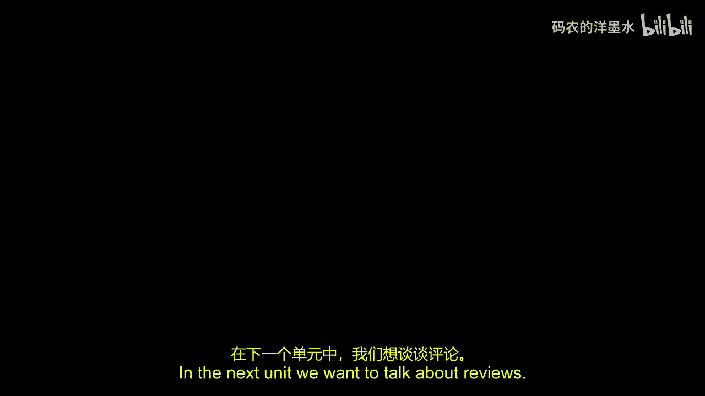
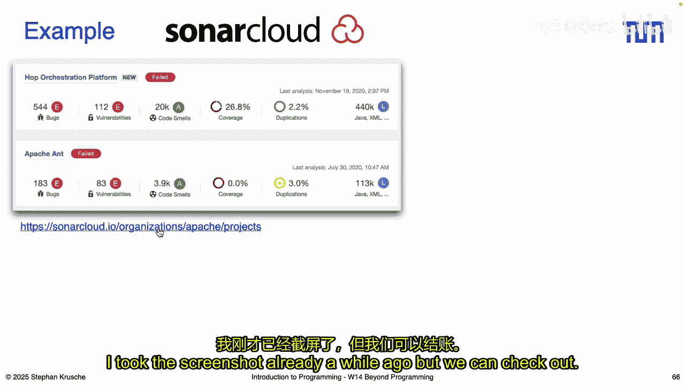
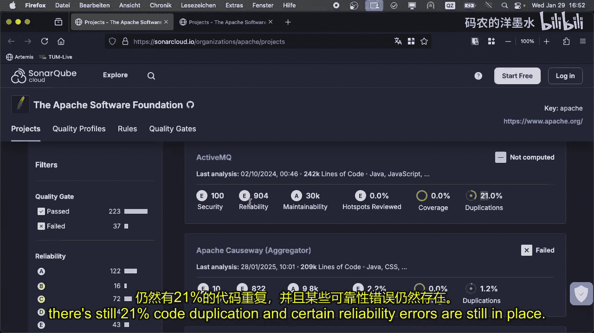
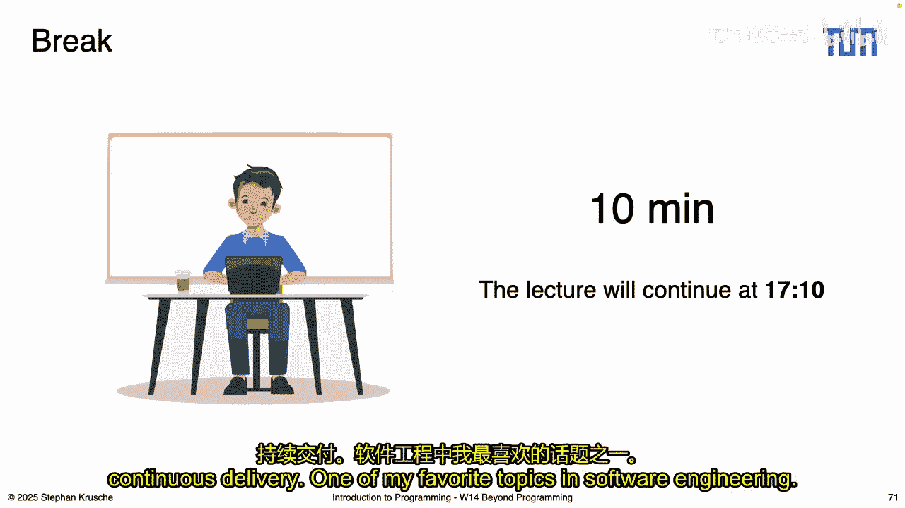

# 【全集】慕尼黑工业大学 计算机编程：从入门到实战 中英字幕 p66 Lecture 66 - 复习 -BV1WFrTBZExY_p66-

In the next unit， we want to talk about reviews。

Reviews are important to reduce the amount of。Falultse， so。This is a fault avoidance technique。

 and we apply them at various points in the software process。

Notice that the earlier you identify issues in your software， the easier and then。Chheeaper。

 it is to fix those。And reviews are then part of many different activities。

 not only in terms of code， but also in terms of what is the quality of the models and what is the quality of the requirements。

A review means that one other person first creates a document。

 and then a second personer reviews the outcome for issues， mistake， bad practice， and so on。

And it can be very， very formal， are very formal review techniques。

 but this can also be very informal。 Yeah， you meet someone accidentally and you just talk about your idea and then you notice。

 oh， I have a few flaws in the idea that I have。In any case。In a soft engineeringing project。

 reviews are very important and they require you to invest time and effort。 and， of course。

 the organization and has to cover those costs。 but it has been shown that reviews are very effective。

And they can uncover not only code issues， but also design issues or requirements。

 issues that constitute to more than 50% of the errors in the software at the end。

We have different types of reviews， depending on the face of the software project or the activity。

 You can analyze， sorry， you can review the analysis results。 You can review the architecture。

 You can review the code。 You also have to sprint， review and scrum， as you've just learned。

And on the other hand， we can distinguish how formal and informal a review is with the inspection being the most formal review technique that is known in software engineering where。

Even not the person who has created the artifact is presenting it。

But another person is presenting the artifact who has not created it。

 And in there are sitting 6 to8 people in the audience reviewing things together。

 Theres a formal protocol。 There are certain roles defined in order to come up with the best。

Outcom and the best analysis， whether the work product has a good quality or has issues that need to be resolved。

In between their walkthroughs and peer reviews where people。

Synchronously or the same computer back with each other or where they even do it asynchronously。

 nowadays， many。Develop as you work in distributed teams， for example， in open source communities。

 and then they create。Code in branches， for example， and then others review the code in peer。

 sorry in pull requests and provide feedback whether the code has a good quality or not。

When it comes to code review， the objective is to improve the code quality and to identify issues that would lead to bugs and to a bad experience of the end users。

Some people also say that we would like to achieve something that is called clean code。

The advantages are not only the improved code quality， on the one hand。

 which is an obvious advantage or benefit。 But on the other hand， also。

 the knowledge transfer between the involved people we hope that you experience this in your project work as well。

 If two people work on the same code。 Then both of them have a better understanding of what's going on。

 And when you again， think about more complex projects with hundreds of developers involved and a high fluctuation it could be the case that every year。

20% of the people leave the company and 20% join the company。

 So you have a fluctuation of 20% of the developers。Then， of course， it's good。 If some people leave。

 then someone else knows how this code is actually working and what the code actually does and what is the meaning behind it。

And it can also improve the develop communication and the culture and the team。Of course。

 there are also challenges。 You need to invest time and money and it will slow down development。

 and reviews are rather repetitive and many people don't have fun reviewing something。

 So software developers they really like inventing new code ideally on the greenfield without any dependencies。

 What I don't like is writing tests writing documentation and review。

 So this is where the managers need to hunt after them need to motivate them。

 need to incentivize them why this is important。 Otherwise they won't naturally do it。

Study code analysis is a technique that allows us to automate repetitive aspects of code reviews with so called Ls and other rule detectors。

 we can identify common issues in the code， make sure that we have the correct formatting and so on。

And already fixed many， many issues。 However， many code reviews are still needed and useful because static code analysis and even the best LLM cannot identify all the issues in the code。

 So one back best practice could be that you only review the code manually。

 if all the automatic checks that you have implemented before may be static code analysis may be test cases have passed。

 And only then a person is spending some time and is looking over it。

Their are typical issues or programming mistakes in code。

 it could be that you have the wrong code style that the code is hard to understand only the developer understands。

 but no one else， we basically tried to get rid of this Yeah when I took over the slides from the previous professors there was a lot of code it was hard to understand and we tried to make it easier to understand。

 but of course there's always a tradeoff。It can be the case that the code is not reachable because of empty blocks or because of if L statements that do not really make sense。

 it could be the case that the code is too complex that it include security issues。

 could be the case that people just have duplicated the code and when it comes to architectures。

 it could be the case that some classes are having too many dependencies with each other。

 which leads to high coupling or in another way they have no dependencies at all。

 which can lead to the issue， low cohesion。We have a little exercise for you now。

 Please look at the slide，55。And raise your hand and tell me what kind of issues you find in the code。

This is not a good code。 Yeah We can find plenty issues。W would like to start。Any volunteer。

We don't have many left yet。 This feels a little bit like a tutor group in a big lecture hall。

 but in any case。You stayed here， you survived all the triggers to not come to guardings。

 Thank you for that。 But now you also need to be involved。Who can find a mistake。In the court。

You are out of scope here。 I know that you can easily do that。

 You would like someone in the audience。 Otherwise， I pick someone。What about you。Yeah。

 with the yellow bottle， yeah。Yeah， you， yeah。Yeah。

 so this code would not even compile if you would put it into the compile。

 It would not be not compile because variable 3 is not defined。What else you see， it's super easy。

Yes， very good， so。array index out of bound exception here， because we have only index 0 to 4。

 but we access index 5。 What else？ Yes， we have the same colon missing here。 What else。

The division doesn't really make sense because we would divide by zero， Very good。

Indentation also seems to be off here， Or maybe the closing braces are missing。 Yeah。

 you can't really see that immediately。Here we have the opening brace in the same line。

 Here we have it in the next line。Then some variables start with an upper case letter。

 some others with a lower case letter。 So that's not super consistent in the definition of the for loop。

 we have commerce instead of semimic colons。 So this would also not work。So you see。

 it's not super nice to review bad code。 Yeah， of course， it's nice if you find something。

 And if you can help someone improve， but it's probably not your most liked activity。

 Here's an example solution with some issues。 We talked about arithmetic exception here we have a symbol that can't be found variable 3 A next out of bound formatting issues。

 there's no space in here。 here， some。Jaba cannot find symbol because it's s written with a lower case letter。

 And here we have an upper case letter。Foratting errors， naming errors。

Missing Simic colon and so on and so on。 So this is really super bad code。

 But this is something that we see in practice。 Yeah， of course。

 it will compile because the compiler helps you。 But regarding the variable names。 Yeah。

 we didn't even talk about variable names。 They are not very helpful。 Yeah。

 what is war1 War 2 bar 3 and so on。 why is。They are not having a better name。 Yeah。

 it it's super important to have speaking names。 Otherwise people will not understand what's going on。

 And I guess no one could tell us what kind of algorithm we use here。 I also don't even know it。

 doesnt make a difference， but if you see variable names。 And if they have a speaking name。

 it's much easier to understand。Now， of course， it will take a lot of time and a lot of pair of eyes in order to fight all those issues。

 of course， in the best case， developers don't even write bad code。

 but this is unfortunately not always possible and the good news is we have some tools that help us。

 first of all， we have static analysis。And then we also have dynamic analysis in order to verify that software。

 correct。What's the difference， Well， static analysis means you do not execute code。

 You're just looking at the code structure， at the white space， at the formatting and on many。

 many other aspects。 You can either do this manually， like we did it。A few moments ago。

 manually going through the code， looking， comparing with best practices， with code rules。

 whether you follow them or not。 But of course， this is cumbersome。

 and it would be better to have some automatic tools to do that And there are plenty of those tools for every programming language。

 like， for example， spot bugs where you can easily find syntactic and semantic errors or departure just from coding standards。

Now， static code analysis。However， on the other hand， cannot find all the mistakes。

 There's also a use case for dynamic analysis where you execute a code and where you write tests。

 either focusing on the input and the output， this is called black box testing because you don't look into the code。

 the code is like a black box， you don't look inside or on the other hand， white box testing。

 where you see the code and where you specifically test the implementation of a subsystem or a class。

And we want to first have a look into static analysis because that's related to code reviewing dynamic analysis is a little bit out of scope。

 but you will learn it in the software engineering course next semester。Theyre different S C A tools。

 and all of them work by reading the source code。Extracting a model out of it as an intermediate representation。

 Ana this model， whether it follows certain rules or not。

 and then providing an output a result to you that says， hey。

 this is good code or no this is bad code I found the following mistakes。

The intermediate representationer could be different。

 It could be a symbol table where you define all the symbols and allocation。

It could be an abstract syntax tree that your compiler uses， for example。

 when you do refactoring as well， it could be a control flow graph where you see how the code is actually navigating through the code where you can identify if there are dead ends that could never be reached。

And it could also be a call graph where you see which method is invoking which other method in order to identify something about the call semantics of your program。

All those。Representations， all those intermediate representations help us to find out certain aspects of the code。

 for example， about whether you follow best practices and about whether what kind of metrics you have in the code。

 whether it's very complex or rather simple。 And this helps us to analyze the code and to identify improvements。

In some sense， the warnings and arrows that you see in in Teleche or Vicious to your code are already based on static analysis。

 So static analysis is already built in into the IDdeE。

 every compiler warning or every compiler error about something that is not working is some kind of static analysis。

 but there's more。 There are metrics where you can find structural anomalies in your code。

And there are other tools such as S box， PMD or checktile for Java and many。

 many other tools for other programming languages。 so again。

 the focus here on understanding the idea and not only making it possible to use it for one programming language。

In fact， there are so many tools and so many different ways to set it up that there is a trend to centralize this。

 and Soar cube and Soar Cloud have done this in a very nice way。 There are also other examples。

 but those are the ones that are particularly nice because you can simply upload your project to Github。

 register an account at Soar cube or Soar cloud and then automatically get study code analysis for your project。

 it tries to set it up from scratch automatically depending on your programming language and depending on certain best practices that are agreed on in industry。

 and it makes it really， really fast and easy to get started with study code analysis。

 What is important for study code analysis is that you integrated into your workflows。 So ideally。

 every commit is checked against certain issues and every commit in your Git repository is actually very if it fulfills the rules or not and how many deviations。

You have how much technical depth。To you。Come up with technical depth。

 meaning that you have issues in your code that need to be fixed at some point in the future。

 And of course， the more technical depth you have， the less quality you have in your system。

 and of course， then it's much harder to maintain it and to implement new features in the future。

If the system would never change anymore， would be fine。

 but I don't know any system that stays constant and doesn't change over time。

 all the systems are further developed。Let's have a look at a quick example using S bugs。

 I created a repository that we can use for this under the following link。

 so please clone this repository now together with me in Intelliche。Let's do that。

 We say file new project from version control。 we paste in the link。 You should not。

Need any authentication。 This is an open source repository。We clone it。And while it is。

Configuring itself， we can install the spot bugs plug in。 How do you do that， Well。

 you go to intelliche settings。And then you go to plugins。

 and then you go to the marketplace and you search for spot bugs。And then you install this。

And then we might need to restart inicche。But it might also work without restarting inche。

So please do that now， give you a few moments。And you'll see it on the slides how it works。

You open file and then preferences or settings， depending on the operating system。

 And then you go to plugins。And you search for spot bugs in the marketplace。

 and then you click the install button。Tutourors can also go around in case you need help and they don't sit all the time。

 and you do something for your health。Great， now the next step would be if you have done that already。

 is that you again open in teleche。Open the source folder。 You see， we have a course， a main class。

 a student class and a to online class。And now what you could do is you could basically right click。

On the project。And then there should be an entry spot box in the contact menu。

And then here you could say analyze module files or project files it doesn't matter。

 not including test sources。And with that， we basically start the static analysis。And。

In S bugs was able to find 7 bugs or potential bugs in four classes in your code。😊。

And you should have this little。Buck icon on the left side here。 And if you click on it。

 and if you click on the application， sorry， I'm in the wrong window now。 let me just。

Close the other one。So here we are。 again。 If you click on this little icon in the left side bar。

Then you can navigate into the errors and see， for example， that。

We have an error in the student class in line 18。What's the issue here， Well。

 the issue is the following。Replace all yeah we have a foreign name here and we want to replace certain letters with some others based on a regular expression。

 and we don't even need to understand regular expression doesn't matter。

 but the issue here is that and this is well summarized in here。

The return value of the method is ignored。The what's what what happened here。 Well。

 the developer thought that replace all bes in place on the string itself。And four name is changed。

Itself， the variable for name is changed， but you， after taking this course， know it much better。

 A string is immutable， right？ Every method that you emvoke on a string will not change the string itself。

But what would we do here is we return something。Yeah， and this return value is ignored。

 And this is an indication or a pattern for a mistake。 Now， what can we do to fix that？ Well。

 we could create another variable and store it and then assign it to the attribute here or we could simply copy and paste this code and directly assign it into the attribute。

And now， if we run spot bugs again。Analyze project files， not including test sources。

 We see that the number of bugs decreased by one and there's no error message anymore at this place。

 you can have a look at all the other bugs and you have now a few minutes to work on this and fix the issues there is no example solution here here。

 this is really just for you to try it out and this might help you in your future if you have a child program to find certain issues and to fix them。

 So I'll give you a few minutes， work on this now and in case you have issues or you find something is not working。

 raiseise your hand and then the tutorials will go around。Okay， time is over。

 We hope you have been able to。Tri it out and fix at least a few of the mentioned issues。

 If you have not been able， you can still do it afterwards。

 but because of time reasons we have to continue。Let me show you how that looks like in Soar Cloud where they automatically configure S bugs and other Linting tools for you。

 It's easy to set up and it's integrated into the development workflow leading to something like continuous code quality and you can see whether some commits in a branch fail the quality gate or whether they pass the quality gate and they also give you a really nice overview on the browser how long it takes to fix the issues and what kind of recommendations they have。

 Here's an example that you can look it up on your own as well。

 This is an Apache project on Soar cloud I took the screenshot already a while ago。

 but we can check out if if it has been improved in the meantime or not。

Well， let's see what's going on here if we go to this website。

Then we see it looks a bit different now。 They improve the design。

 but basically the security rating of this project here still E。 There's still 21% code duplication。

And certain reliability errors are still in place。 So even though people use it。

 it doesn't mean that they improve their code in the end。

 but it really gives you a few nice insights。 Also how much code you have。

 what kind of languages you use and so on。

If you dig in to one project， you can search for different types of issues。 for example。

 bucks or security vulnerabilities， code smells and。

Soar Cloud tries to automatically create some priority or severity for you and distinguishes between blocker。

 critical， nature， minor and info issues。 And then if you look at one specific issue， you see， hey。

 this is a bug。 It's a blocker。 It's still open and not assigned yet。

 and we estimate that this will take you five minute to fix it。

And if you combine all those time estimates， you get an overall estimate of the technical depth of your project。

 How much time would it take to fix all the。Issues。

 there are 544 bucks and 112 vulnerabilities and 20 K coat smells。 How much time would that take。

Notice that some of the cold smells can be fixed automatically， in particular， if it comes to。

Certain best practices to formatting or to the use of specific practices。

 some aspects can be fixed automatically， but most of the issues that are found here have to be fixed manually。

We can also see the results for the example that I just gave you。

I set it up Sona cloud for the SB example and we see that they identify the same seven issues categorized into four bucks for the return value of to replace all method and three code smells and then you see how much effort it should take to fix that I don't really think it's 10 minutes Yeah if you I am really quickly going to the code it's rather one minute to fix it。

 but of course there is some overhead involved， you have to read this。

 you have to navigate into your project you have to commit it in the end you have to integrate it into the main branch so overall this can definitely take 10 minutes。

Any questions regarding study code analysis， Soar Cloud。Yeah。

 so the question is are you allowed to use this plugin for the supervised exercise， Yes。

 you are allowed to use it but it might not help you because our code is designed in a way that you typicallyically don't run in such issues and it might also lead to an overhead if you constantly check that。

 but as long as you're not using an AI tool and S bugs is not yet based on AI。

 it might be based on AI in the future we don't know。

 but currently it's not based on AI so you could potentially use it。

What you can't do is upload your code to Soar Cloud。 This is not possible。

 but if you use the spot bugs plug in or any other plug in for static code analysis within inche。

 this would be fine。There are certain limitations to static code analysis。

 As you've seen in the Soa cloud， screenshots on the slides， they find lots of lots of mistakes。

 and sometimes those mistakes are irrelevant。 They don't really matter。

But sometimes there are important mistakes and if you now find 20k issues。

 it's not super easy to find out which of them is relevant and which of them is not important at all。

 and there are certain experiments， for example by William Po in a Cha One conference publication that steady analysis can find5 to 10% of software quality problems。

 but this also means that the other software quality problems cannot be found and sometimes there's way too much noise。

 way too many false positives， way too many error to fix it。And then。

It's sometimes also irritating or misleading for the developers。 And， of course。

 there are problems that you cannot find with static code analysis where proper dynamic analysis。

 Aka testing is needed。 so static code analysis can help you。

 but it doesn't replace manual code review and it doesn't replace testing don't get fooled by the marketing of the tool providers。

And。😊，Recommendation from our side。Do not skip writing test cases。

Even in a relatively small project like your game development。

 it might make sense to write test cases to make sure if you change functionality。

 the existing functionality does not break。 This is also called regression testing。And。In practice。

 do not skip manual code reviews。However， what you can do is only manually review the code。

With the effort of a human being。Is all the tests passed that you have。

And if all the study code analysis tools that you have configured for your project where you think there's a meaning behind it。

Pass。Only then。A human being should be involved in a code review。 And before this is realized。

 the developer who has created the code should make sure that tests pass and that steady code analysis。

 as configured in a project passes。Because if those minimal requirements are not fulfilled。

It's quite unfair to ask a human being， another developer。

 to spend some time provide feedback and to improve the code。

 because the human developer doesn't know if the steady code analysis can would be able to find the issue as well。

So steady code analysis can improve the code quality and the maintainability of your code。

 but it's not a magic bullet or silver bullet。If you use it effectively。

 it's cheaper than other techniques for catching the same kind of bugs。

So it's definitely worth to integrate it into the process， for example， having Soar Cloud。

 checking all your commits and all your pull requests in an open source project。

It's also a very good idea to combine it with dynamic analysis with tests。

 but you have to invest some time in manual code reviews or potentially LLMs reviewing your code if they become better they might be replacing human code reviews in the future。

 but right now be threaded out in some projects also the LLMs can replace human code reviews。

This might， however， change in the future。Great， we'll do another short break and continue at 5。

10 with the last unit for today， where we discover a few more development workflows and dig a little bit into continuous integration and continuous delivery。

 one of my favorite topics in software engineering Sta。😊。

