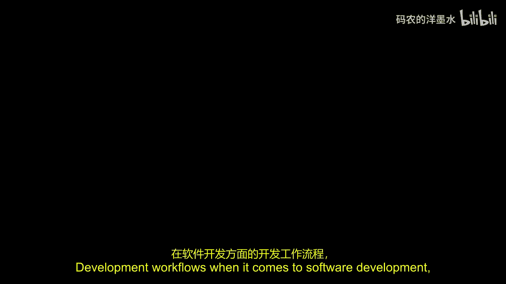
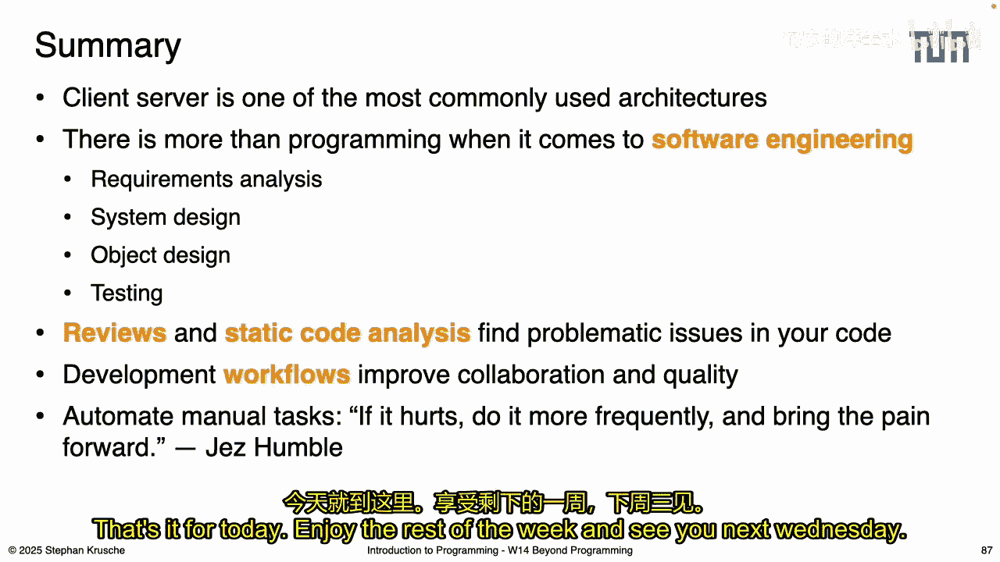

# 【全集】慕尼黑工业大学 计算机编程：从入门到实战 中英字幕 p67 Lecture 67 - 开发工作流 -BV1WFrTBZExY_p67-

Development workflows。

When it comes to software development， we have a lot of modern workflows that help us to collaborate and to configure the software in a way that we can achieve the goals in the best possible way and something that you have already learned to use is Git as a development workflow。

 not only for every homework in class and tutorial group exercise。

 but also as part of the team project。 Here's a quick review it's super important for software developers to master Gi and to understand at least how the basics are working。

 you can add changes in your working copy something where you have changed code to the staging area and you can commit those into a local repository。

 which means you can do that offline It's super fast。

Then if you want to share the code with other fellow developers。

 you have to push it into the remote repository。 If other developers have contributed to the code repository。

 and you want to。Receive their changes you need to fetch them and merge them into your working copy。

 which is also called get pull a combined command。 You fetch the changes first from the remote into the local repository。

 and then you merge them into the working directory。When you pull changes。

 you can experience merge conflicts Who if you experience the merge conflict in a team project。Okay。

 a few that's good。 Yeah， that's intended。 You need to learn how to deal with them。 Of course。

 there are best practices to avoid them。 but in practice， they still happen quite often。

When multiple developers work on a。courseour on a Git repository using distributed version control。

 it theoretically could be the case that you have multiple remote repositories。

 but the default is that you use one remote repository， no matter if it's hosted on Artemis， Gitla。

 Github， Bi bucket or any other Git provider。Then the developers typically interact with their local repository and synchronize the changes when they are ready to sync with other developers using the remote repository。

 Additionally， there's typically some kind of web interface involved where you can see the code in the browser and where you can potentially do additional workflows such as code review。

 what we just talked about and pull requests。When it comes to gi。

You have so far just worked with one branch， which is perfectly fine for beginners and very small projects only involving two developers。

 However， if you involve more developers， it makes sense to have more branches because then people can work more independently on a specific feature or a specific bug fix。

😊，You can see a simplified branch management model here that many people are using in practice。

 It's not the only one。 there are many more branching models。

 there are many more ways to collaboratively work together。

 but this is one that is easy enough for beginners to get started with and flexible enough to cover many different scenarios。

😊，How does it work， you have the main branch， the development branch， and multiple feature branches。

 and instead of a feature branch you could also have a bug fix branch， so here we just combine this。

The actual development happened on the feature branches， not on the development branch。

If you want to develop a new feature， you create a branch。YouWork on it every。

Circle here represents a commit。 You commit your changes to the feature branch。

 Mile people could work on the same feature branch as well。

 It is sometimes the case that there's a unique mapping， one developer， one feature branch。

 but this doesn't have to be the case。 And I encourage you to also have multiple developers working on the same feature。

And then at some point， the feature is done。 you are happy with the code quality。

 and then you merge it back into the development branch。😊，This has a very important advantage。

 which means that only finished features are part of the development branch。

Some of you came here in a break and said yeah， my game is not fully working， some features are done。

 some features are not done， and of course in the end this is not a good state and while this is fine for a course like this and we will handle this in the grading in the reality if you have something on the development branch where everyone else is creating feature branch from。

 it should be finished it should work， it should be tested。Otherwise。

 other people will have issues in their own feature branches。

And that's the main idea of the development branch。 In fact。

 the development branch is something where you integrate work that is。Fully done。

 We also call this internal promotional。 And this is then when we talk about Scrum again。

 a potential release candidate， everything that is on a development branch could be later on you see。

 we could have multiple features finished in here。 merged onto the main branch in order to release it to external users。

 And with that， you can keep track on the main branch， which version has already been released。😊。

On the development branch， you can keep track of。Done features that are finished internally。

 but not yet put not yet necessarily sent to end users。And on the feature and or back fix branches。

 the actual development work。Notice that by separating your work into multiple branches。

 you do not prevent merch conflicts。 This is not a mechanism to prevent mergerch conflicts。

 This is a mechanism， so you can quickly try out things。

And even get rid of it or developers can focus without getting too much disturbance by others because assume you have 20。

50， 100 developers working on the same kit repository。

 then there are a lot of commits on the development would be a lot of commits if you only would have on branch。

 and then it's even unlikely that you can push your changes because everyone else has pushed them beforehand。

You still need to distribute the work in a way that you minimize merge conflicts and those merge conflict conflicts can actually happen when you update your branch from the development branch so the first developer here if the first development branch was faster。

 finished the work earlier， maybe it was also smaller and then integrated into development and then the second developer who is working in parallel on the same time needs to update the branch and here still a merge conflict could happen。

But it's in more distinct places。 And we make sure that the yellow things are done and are working without any major issues so that we do not disturb the developer when he or she pulls the changes。

Does that make sense。That's a very good question。 Yeah， I get it。 So the question is。

 what happens if you have features that depend on each other， How would you structure this。

 And this structuring has to be done outside of the Git repository。 Git does not really support that。

 I mean， you could set up branches that depend on each other。

 But that's typically ending up in a mess。So there are people who create one branch to finish the first part of the feature。

 then create a second branch that contains the second part of the feature。

 and then they stack them on each other。But I've never seen a case in practice where this worked out fine。

 There were always conflicts， and there were always issues。

 and someone didn't understand that are stack branches and merged them wrongly。

 So I would personally not recommend to do that， I would personally split the tasks in a way that they are independent of each other and only start a feature branch if the feature is independent of each other。

 If this is absolutely not possible， think about first finishing the first part and then starting with the next part。

Or。Potentially combining the two parts together into one branch and let multiple people work in one branch on that。

When it comes to branch management， we should also talk about so called pull requests。

Some people also call a merge request。 so for me， this is a synonym。And。

What I've just shown you in the previous slide where you finished some work on the feature branch and then you integrate it into the development branch was a very high simplification。

 It was an abstraction。 It was a model that simplified the reality， because in reality。

 this involves multiple steps， as you see here。😊，And a nice work floated support set is pull request。

Poll request is a feature that many vendors nowadays offer， and the idea is you have a person。

 a gatekeeper who is responsible for quality， could be someone who is a reviewer sitting on a development branch。

And you first have to convince them， hey， dear reviewer， this is a really nice feature。

 This is not bullshit。 I tested it。 I have a good coat quality。 I followed all the best practices。

 Please， please， dear reviewer， pull my finished feature into the development branch。😊。

That's the story behind the pulling request。 So the developer requests from the reviewer or from the maintainer。

 or however you want to call this role that the changes are pulled into the development branch。

And because this is typically not。An easy thing。We have tool support for that。

 And the tool support means you can open a pull request。 And within the pull request。

 everyone involved in this feature can discuss。Reviewers can say， hey， this is a bad change。

 I don't like it。 Why are you doing this change。 This violates our best practices。 Hey here。

 are you not following the coding statements， And then the developer can communicate with those can say。

 no， sorry， you misunderstand the development guidelines。 I actually follow them。

 Please have another look or could say， hey， good feedback。 Let me incorporate this。

Create another commit and then update the pull request automatically。And at some point。

 enough reviewers， you can configure this in your project have approved the pull request。

And then you can merge the pull request and merge the changes into the development branch。

So a pull request is a means for asynchronous code reviews。And communication among developers。

 And it's a very famous tool， in particular， in open source development environments。

We can create a workflow for this code review。 I'll show you an activity diagram here， all the。

Rounded rectangles are activities， all the。Defa or normal rectangles are entities or objects。

 and we have a dashed line because the left side of the work floor and of the activities is the responsibility of the developer and the right side is the responsibility of the reviewer or maintainer。

So how does this work， the developer will commit source code into a feature branch。

And we have to comemit。At some point， the developer is confident that the feature is done and requests to merge all those commits in the feature branch into the development branch and opens a pull request。

 You can see the pull request is on the edge here because both are involved in it。

And there can even be multiple reviewers， not only one。Now。

 the reviewer needs to review the changes based on understandability。

 conformance to the architecture， conformance to coding guidelines。

 checking that steady code analysis has passed thus all test cases are green and so on and so on and so on。

And potentially， will find issues and request improvements。Those improvements。

 improvement requests are basically feedback for the developer。

 The developer can improve the source code， according to the feedback or potentially also deny the feedback。

 if there is a very good reason。When the developer decides to improve the source code， we have again。

 new commits and the changes are committed in the feature branch。 we go again to the pull request。

 There can be another review and then hopefully at some point the reviewers approve the pull request。

 they all say， hey， you follow the guidelines。 That's good and merge and we can merge the changes in the development branch and then we're done。

That's the basic idea。And while this is a really good workflow to prevent something which is called the broken window theory for coding。

 which means that bad codes spreads out into the repository， like broken windows in neighborhoods。

It can definitely also slow down the development process。 in particular。

 if developers are lazy and do not provide a good quality as part of the pull request description。

And if the review takes a lot of time， because reviewers are also developers and do not have time to review code。

So there's always a trade off between how much quality checks you implement。

And how fast you can be and how much time previousers have to improve the code。

Any questions regarding this workflow， if you are interested to try out this workflow。

 join one of our other courses that we offer as part of our research group。

 and then you'll definitely explore them in the future。Next。

 I'd like to show you a development workflow that helps you integrating your software。

 testing your software and finding potential issues based on testing。

 And this is continuous integration。 How does continuous integration work。

 continuous integration is connected to the source code repository in the version control server。

 So whenever a developer pushes commits。A continuous integration server is notified and will check out。

 compile and test this。Couldd。According。To the。Quality requirements that you have。

And according to the test cases that you have defined before。

 the continuous integration server will then inform the developer about the status。

 statusus could be。 The code does not compile。 Please fix it。

It could be the code does not pass all the test cases that we have。 Please fix the test cases。

 or it can be。 Everything is green。 Go ahead and keep going。And of course。

 there are many different checks that you can implement in a continuous integration build plan in order to verify that the code is correct。

 Notice that this is all done automatically。 So continuous integration does not involve manual checks。

 except the developer looking at the  error messages， of course。

Continuous integration typically is a more distributed I follows a more distributed architecture。

 of course， multiple developers will interact with the version control server。

 which can trigger a continuous integration builts we have a built plan or built process that can be customized to every project for Java。

 This is different than for Python or for Javascript。And then the continuous integration。

 Surva can delegate this to build agents。In fact。Artemist also uses continuous integration and test cases to verify that the code that you submit as part of your homework is correct。

And in Artemis， we have。I think more than 20 build agents running at the same time in order to parallelize this。

And in the peak times， we get more than 150000 bills per week in our infrastructure。

So continuous integration is a really nice topic that profits from scaling a lot。

 And you can assume that Gitthub with the open source repositories that you have there and other services online。

 they have millions of builds per day in order to verify that software works correctly。

When it comes to continuous integration， you have to understand the concept of regression testing。

Recreion testing means that every commit， every change in your version of control is tested again and again and again in order to identify that everything that has worked so far is still working。

So this is a super nice technique because it prevents us from introducing changes and making existing functionality fail。

😊，And this happens a lot in industry as well。 I just installed the newest operating systems from Apple。

 And while they provided bug fixes and new features。😊。

Some of the existing features that I use do not work anymore。

 So I was a little bit sad yesterday after installing the updates。😔。

Would have been better if the Apple would have done more regression testing。

 and this would not have happened。 but this happens in reality。 So the better your test suits are。

 the less regressions will occur in the code and the。Better the user experience will be。

So big benefit， however， in very complex software system， you have 10 thousands of tests。

Or even millions of test cases。 In fact， the Artemis code repository on Github includes in total。

 more than 10000 test cases that are executed for every commit。And this can be quite costly。

 and time intense。Assume you are a developer， and you need to wait five hours until all the 1 million test cases are executed。

 then you don't get quick feedback。There techniques to resolve that instead of retesting every test case again and again and again。

 you could do some kind of test selectional using dependency analysis。

 and you could say if there was a change in subsystem 1， we don't need to test subsystem 10。

 which is on the complete opposite of the architecture， because they are not connected to each other。

 can focus on subsystem1 tests， maybe all the related subsystem are tested as well。

 in particular if the interface was changed， but not necessarily all of them。And of course。

 you can do test case prioritization in order to make sure that the most important functionality is still working。

 but maybe some minor functionality you don't know yet。

And you need to decide when to execute the tests。 Do you do it every build after every change that you introduce or do you do it on a nightly basis or on a weekly basis。

 Very large software can only be tested fully on a weekly basis。

 and it's not possible anymore to do it for every commit。Now。

 if we take continuous integration and go one step further。

 we can enable something that is called continuous delivery。😊。

You see that it is based on continuous integration， but instead of stopping the process here。

 we have another role， the so called release manager。

 the release manager is responsible to get the build of the continuous integration server。

 the executable file， and potentially upload it to a continuous integration server。

A continuous integration server could be something like an app store or test flight on Apple's smartphones or any other website where you can try out what's going on or where you actually ship the software to the end user。

And then you typically notify the user， the user as a new release， please try it out。

 they install it on their device， for example， a mobile phone。And provide feedback。

 And this feedback in test flight is then uploaded to the continuous delivery server and could then be stored in an issue tracker and notify the responsible developer that something does not work。

 So we go one step further here。 We do not only have internal testers。

 But we also enable external testers or even real end users to immediately get a change after pushing the commit to the continuous integration server。

😊，And， in fact， with continuous delivery， you automate all the steps in the process so that with one button click。

 you can。Push the software， deliver it to the end usersrs， and they can try it out。And with that。

 it can produce valuable software in short cycles。 And this is something that many companies do nowadays。

When it comes to continuous delivery， we can distinguish。It to continuous deployment。

Continuous delivery。No matter what kind of build plan or pipeline you have， Yeah。

 like the code needs to compile， the code needs to pass all the unit tests。

 The code needs to pass all the platform tests and so on and so on and so on。

 there's always one manual step done by the release manager。

 and this is pressing the button releasing the software to the actual end users。

While in continuous deployment。This is automated， as well。So in continuous deployment。

 it's really the case。 If I changed something on my computer， I committed all the stages pass。

The software。Is delivered to the end user。And if you have a fast pipeline and your software is not super huge。

 this can be done within 10 minutes。And there are many companies who do that。 Netflix， for example。

 you might have watched a TV show on Netflix， they。

Use continuous deployment techniques to minimize the time between you develop something on your computer and getting it out to the end users。

And while this is a very complex and risky process， of course。

You have to better have really good unit tests， platform tests， even post deployment tests in place。

 Otherwise， you might end up with issues。Some companies。

 they do it so far that after deploying their software to the production systems。

They have post deployment tests。 and if those post deployment tests notice certain issues or certain key performance indicators like performance usability that you measure in the software going down that they automatically roll back the software to the previous version so that the end users are not affected。

And there's also something called cannerary releases。

 where you first release the software to a few end users。Potentially also on a regional basis。

 So it could be the case that I don't know。 Apple first publishes a feature only to everyone in California。

 And only if those people are happy and the measurements are good。

 everyone in the United States gets it。 And if those are all happy。

 then everyone in the world get world gets it。😊，So there's really a huge potential with those continuous deployment pipelines to do very complex。

 but also very， very nice things。 This is one of my favorite topics。 I think you can see that。

 This is why I like to introduce you to the basics of it。

 I think the basics are super easy to understand。 But of course， then you can go many。

 many steps into the future。😊，With that， we support something that some people call continuous software engineering。

 and this is a stage in a company or in a business environment where you have the capability to develop code。

 release it automatically， and learn from it in short cycles。

And this is something that is a lot of fun in my opinion。

 So if you join a big company and they don't know about this yet after your studies。

 please introduce them to those techniques。Learning from software is important because only if we learn from our endthust。

 we can improve the software， notice that learning from software can include getting user feedback with App store reviews。

 for example， but this。Most of the time also includes implicit measurements。

 need to measure how is the return on investment， How is the user engagement。

 How is the incoming money stream changing when you change the software， Is it going for the good。

Then you keep going， is it going for the verse， then you need to find out why is it getting worse and what can I change in my business model and in the software in order to make the end user happy。

 So monitoring and metrics is a super important topic here as well in order to learn something from your end users。

Before we finish， let me show you a few more slides。 We are almost at the end。

Where we also talk a little bit about the deployment of software in terms of operating it。

Traditionally， software applications were directly installed on the bare metal hardware。

 and it was just an operating system in between。When you talk about web service applications。

 so the apps that make our client apps on the smartphone possible。Then。

This would mean a company would need to buy hardware and operate the hardware on its own。

This can be leading to high maintenance cost， and additionally。

 the apps might not be isolated from each other。 so there might be security and privacy related issues。

Now， since quite some time the deployment was already virtualized， not only in the cloud。

 but also in the infrastructures in the data centers of the companies instead of installing something on the barebone hardware。

 people have so- calledled virtual machines， and within those virtual machines。

 the actual applications from。Now， while this can improve the isolation。And。😊。

Can also decrease the money that you need to invest into hardware。 in particular。

 if you let it run in the cloud， it's still rather heavyweight and slowed because each and every virtual machine has its own operating system and starting up the operating system or shutting down the operating system in case you have updates can take quite some time。

 We're talking about minutes here。And this is why in the last 10 years。

 there is a very strong trend going towards container deployment using tools such as Docker and Kubernetes。

Here。The hypervisor is not needed， but we have a much more lightweight container on time。

 And instead of having a full virtual machine， we have a very slow and lightweight container that runs the application in a completely isolated way。

 So E 1 can never access data of E 2。😊，Except it breaks out of the container。

 which would be a security bug within the software of the container runtime。

And this is super lightweight and fast。 such containers。 If they are small can start up in seconds。

 So instead of starting up your virtual machine in minutes， we are talking about seconds。

 And this is why every modern development team basically changes to containers。😊，In additional。

 those containers allow you to easily scale your software because you can run multiple containers at the same time in so called clusters。

How does that work， Well， you develop your application， for example， a spring boot app。

 which we've done in the second unit today， and you describe the infrastructure as code what you need。

 You， for example， say， hey， in order to run spring boot， I need Javava。

 please install Javava in the container。And I need。Greater。Potentially。

 in order to do something or I need any other dependencies。

 And all those are part of a so called image description or docker file。 So in the image description。

 we did describe the app that we develop and all its requirements towards infrastructure。

 And then we can build。Images out of this。 imagesm are layers where you have multiple things that are installed。

 Yeah， first of all， the operating system layer， this is typically a very lightweight Unix version。

 sometimes less than 10 MBby large。Just a kernel， for example。

 And then some other dependencies like Java， the JDK， and then your application。

And the image is like a template for the runtime environment。And from the image。

 you can easily spawn or run multiple containers。 So the container is a little bit like the object。

 and the image is a little bit like the class。 Yeah， you define the class ones。

 and then you can instantsate multiple objects， you define the image ones。

 and then you can create multiple containers that include your application。😊，And with that。

 you can easily scale your app and even implement auto healing functionality。

Any questions regarding virtualized deployment containers and the container process？ Yeah。

 so the question is， do we combine multiple apps within the image in the container or do they run isolated。

And the best practices that they run isolated。 So for each app， you have your own container。

 but you are basically free how to do that。 you could if you want。

 have a layer with one app and another layer with a second app within one image。

 But this is discouraged。 So best practices that every image has the requirements like the JDK runtime or like a Python runtime or like a node environment for Javascript。

And then you install one app into it。The app is built during continuous integration。

And then it's inserted into the image， which means whenever you change your app。

 you create a new image for every version of your app， you have a new image version。

And then later on， during runtime， you can spawn those containers。

And those containers can then run in Kubernetes clusters。

Where the cluster manager automatically scales them up based on the user demands。So it could。

 for example， be the case that your nice spring boot application for， let's say。

 e-commer retail shopping。There's only one container running during the normal times because you only have。

 I don't know，100 users shopping at the same time。But just before like Friday or Christmas or whatsoever。

 where there's a high demand， you run five containers so that you support up to 500 users using your software at the same time。

And this is something that if you used to write tools。

 if you used to write architecture in your software。

 then you can easily come up to the stage where the automatic scaling is easily possible。

We can't go into more details， even if I would like to talk about this for the next two hours。

 because this is again， a super nice topic。 if you are interested in those topics。

 go to the software engineering course， they cover containers and virtualized deployments as well。

 and there are even more elective courses as part of the computer science program where we talk about all those details。

😊，We are at the end of the content wise of the course。

 at least so let me quickly show you the next steps。

 you have to give you a project presentation starting tomorrow。

 you have 10 minutes to present your project and a little bit of time for Q& A the tutors will assess your project presentation and let you know if you have passed it or not and what how many points you get for the project work afterwards。

 So this is the main focus of the tutorial groups， there are no homework exercises and no tutorial group exercises we have two articles about continuous delivery and code reviewview guidelines that we recommend you if you are interested in those topics which are you until next Wednesday。

 February 5 next week we will have no new content anymore。

 but we will try to summarize the most important aspects of the course that might give。

ive some hints on what is important for the second supervised exercise。

So this is it in terms of content。 Yeah， this is the last new content。 Let me quickly summarize it。

 We talked a lot about software engineering， which is a whole world that tries you to。

Come up with tools， methodologies and techniques so that you can coordinate projects。

 It involves management。 It involves communication。

 but also a lot of technical workflows where you get some guidance on how to structure the development。

 how to come up with requirements， how to design the software architecture and so on。

We talked about client Serva， which is one of the most commonly used architectures where we separate the software into two subsystems。

 the clients which are very close to the end users on the mobile phone， for example。

 and server us that run in data infrastructures and data centers and on virtual machines。

 for example， don't use front end and backend strike this from your vocabulary。

 we have better terms in software engineering。And then we also talked about reviews and how they are important in order to improve the code quality and to prevent issues going into the production systems。

 Ste code analysis is an attempt to automate parts of it。

 but you've learned that you should never skip manual reviews and you should never skip tester cases because not everything can be automated。

 And we talked a little bit about development workflows， branch management， pull request。

 code review workflows， continuous integration， continuous delivery and how you can use containers in order to deploy and auto scale your software。

 And I'd like to finish this with a really nice quote by Ches humble about automating manual tasks。

 He says if it hurts。 do it more frequently， and bring the pain forward。That's it for today。

 and enjoy the rest of the week and see you next Wednesday。

