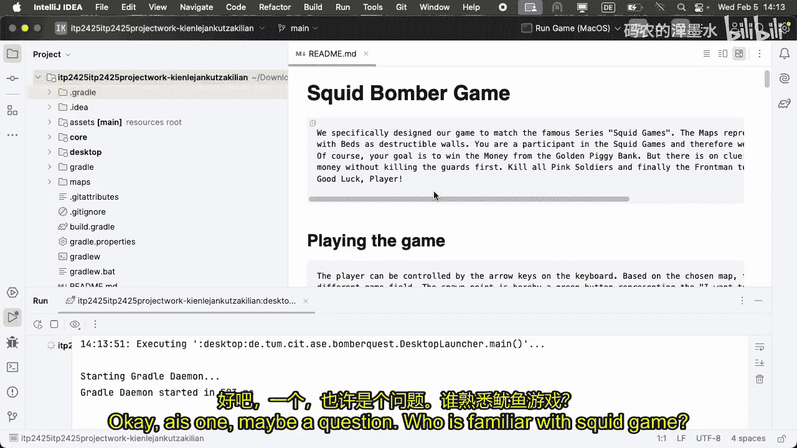
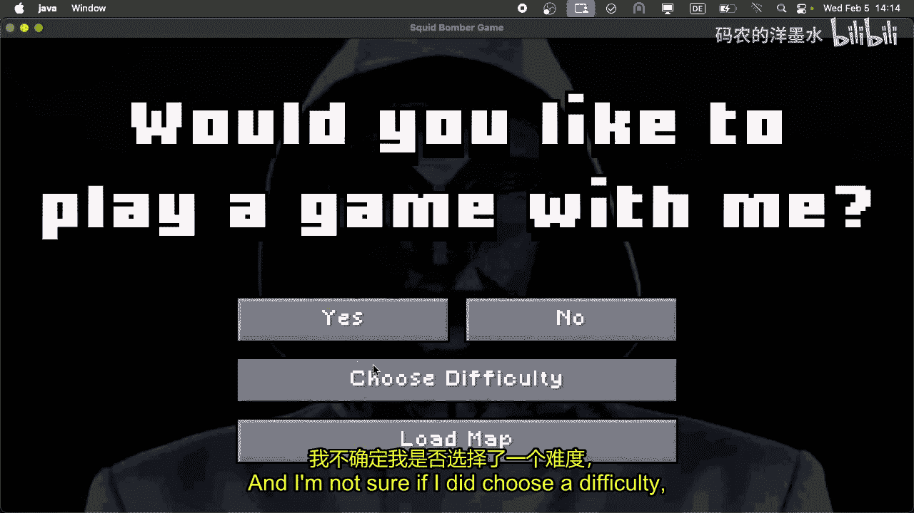
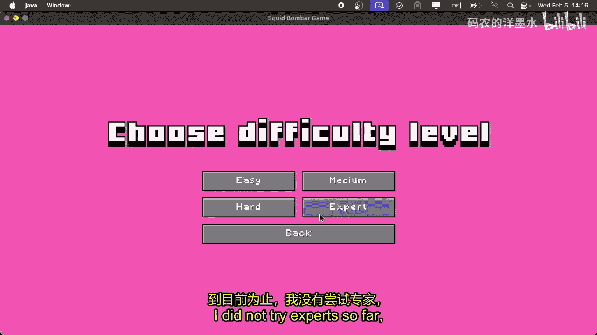
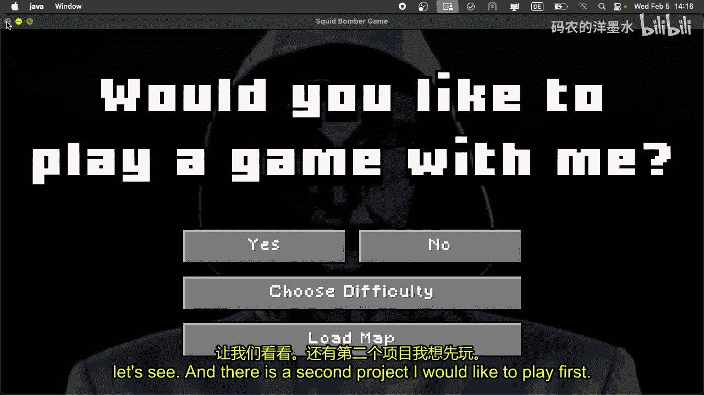
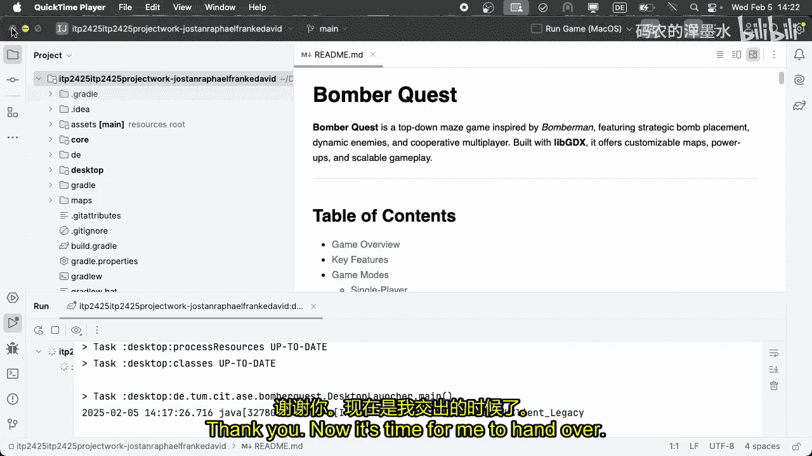

# 慕尼黑工业大学计算机编程：从入门到实战：68：项目展示 🎮

在本节课中，我们将回顾并展示两门课程中令人印象深刻的学生项目。这些项目展示了同学们如何将编程知识应用于实践，创造出有趣且功能完整的游戏。

上一周，同学们在各自的辅导课中展示了他们的项目。我昨天花了很多时间，使用 `git clone` 命令克隆了你们的代码仓库，并玩了很多《吃豆人》游戏，这让我感到非常愉快。

现在，我想与大家分享两个让我印象尤为深刻的项目。前排坐着一些助教，如果他们的学生项目被选中展示，他们一定会非常兴奋。让我们一起来看看吧。

## 第一个项目：经典街机游戏 🕹️

以下是第一个项目的展示，它是一款经典的街机风格游戏。

首先，我想问一下，有多少人熟悉《吃豆人》游戏？好的，看来有一部分同学知道。如果你们能听到声音，一定会认出那经典的游戏音效。当然，我很乐意亲自试玩一下，让你们看看这个团队实现了什么。我认为它的主题非常棒，运行也十分流畅。

我不确定是否选择了难度，但我将从“简单”模式开始。这是我放置一些炸弹的过程。我玩过很多次这个游戏，所以知道接下来会发生什么。你们需要相信我，并观看一会儿，直到我消灭所有敌人。我认为“M”也处理得很好，敌人死亡时地板上会有血迹，效果真的很棒。

开发这个游戏的同学在教室里吗？很好。这应该是最后一个敌人了……好吧，这次操作不太理想。我们可以按 `ESC` 键来暂停游戏。很好。你能试着运行一下吗？当然，希望不会出问题。哦，它只是在这里运行，我猜。是的，这样不行吗？好吧。我没有被教导过。不过，声音听起来很酷。现在你们需要看着，因为我要消灭最后一个了。你们得相信我能干掉这个家伙。但为了展示这个游戏有多酷，让他来干掉我吧。是的，他又来了，第一次玩的时候我没想到会这样。真的很快。所以我认为这是一个非常酷的游戏。它有不同的难度，我还没试过“专家”模式，也许今晚可以试试。

## 第二个项目：地牢探险游戏 🗡️

接下来，我们来看第二个项目。首先，再次感谢第一个游戏的团队，它真的非常出色。

是的，这个游戏运行也非常流畅，角色的移动速度恰到好处，很酷。那么，我们来看第二个项目。开发团队也在吗？好的，下次吧。

我也将启动这个游戏。说实话，要展示它所有漂亮的功能对我来说有点难度。首先，你们可以看到一些骷髅。很酷的是它们还没有死，所以会复活。看，它们又出现了。哎呀。

这里有一个我非常喜欢的功能可以展示，那就是“星星”道具。然后我就可以直接跑过所有骷髅，现在它们都死了，很好。我还可以展示……嗯，我不太确定。是的，你们可以看到这边的“传送科学家”。他可以……是的，传送或者……你能传送两个吗？好的。我们还有第三种敌人类型，一个“召唤师”。哦哦哦哦哦。到这里来。好的。

希望我能找到一些……我想展示的好道具。但是，哎呀，我真的很讨厌你。好吧，在左边你们可以看到第三种敌人。说实话，这是最笨的敌人。但是，是的，它仍然是个敌人。我们需要消灭一些。来吧。好的，这里有一个硬币，说实话我需要这个硬币。哦哦哦，不。往这边走。好的，好多了。好的。好的。

我的时间不多了，我想我找不到它了。不过没关系，我录了一段视频，因为我想向你们展示这个项目中实现的最后一个很棒的道具或功能。让我快速点击一下，好的，就是这里，别看标题，因为会剧透。这是今天下午录的，非常棒，我们又玩了《炸弹人》游戏，请看。所以，你们可以……是的，已经能在那边看到了。那是一把很酷的剑。现在我装备了这把剑。我可以用我的武器杀死敌人，这超级棒。嗯，是的，有一个提示：当我拿到这把剑时，我无法移动，而且我因为举着这把剑而死了，因为我动不了。这就是第二个游戏，我真的很喜欢它，它也是一款相当不错的游戏。完美。

是的，也许你们可以问问你们的同学，或者你们已经尝试过其他一些项目了？你们绝对应该和同学们交流，请他们展示自己的项目，因为其中确实有一些非常出色的同步炸弹项目。谢谢，现在轮到你们来结束了。

## 总结 📝

本节课中我们一起回顾了两个优秀的学生项目：一个经典的街机游戏和一个地牢探险游戏。这两个项目都展示了流畅的游戏体验、丰富的功能以及同学们将编程知识转化为实际应用的出色能力。希望大家能从这些展示中获得灵感，并与同伴们交流学习，共同进步。