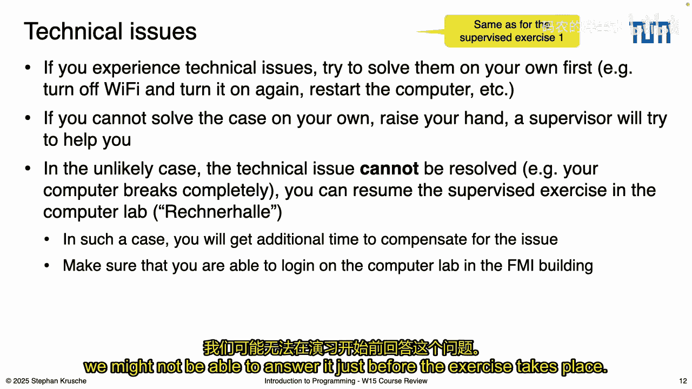

# 【全集】慕尼黑工业大学 计算机编程：从入门到实战 中英字幕 p69 Lecture 69 - 监督练习 2 -BV1WFrTBZExY_p69-

Welcome to the last workshop I know many of you are really sad that the time here ends but I promise you there will be more courses in the university that you will find nice informatics and CIT that you can take in the upcoming semesters we would like to have a quick review today first I'd like to give you some information about the supervised exercise too which will take place next week Monday evening and then we will quickly go through the most important aspects and I'll highlight what I think and what we think are the most important topics。

 you can take this as a starting point but basically everything can be part of the supervised exercise on Monday。

Don't think that this is the only thing that well take into account okay and there's no new information this is just I just copied slides from the other slide deck into today's slide deck in order to emphasize the most important aspect let's get started with the information of the supervised exercise2 we will basically do exactly the same procedure as for supervised exercise one it will start at 7 pm we kindly ask you to arrive latest at 6 30 pm at your assigned lecture hall so that you have enough time to set up everything to prepare everything and to get started we will have again 90 minutes working time plus 10 minutes for any kind of technical issues and you can get up to 100 points。

Content wise， everything that we've covered in the course can be part of it。

 of course the first supervised exercise focused on the first couple of weeks and this one will focus on the other couple of weeks but。

The content of the first five to seven weeks is the basic of everything else right so you can't really let this down and you should really be able to program all the things that we've covered this。

In this course， it will again take place in gardening。

You will receive an email with the actual lecture hall latest Monday morning。

 we'll try to send it to you earlier， but you need to travel to Garing and then we have the same lecture halls as last time and it might even be the case that you are assigned to the same lecture hall。

It's again， the case that you must participate onsite in the assigned lecture hall。

 it's not possible to participate somewhere else in the world nor somewhere else at the compost。

 we will do attendance check so make sure that you have participated in the attendance check and that all the data is entered correctly。

You should use your own notebook， this is a bring your own device exam computerbased。

 if you do not have a proper notebook， you can use a Mac in our lab last time two students had a few issues in the big computer lab next to Magistalis so we will use other computers this times we have Macs。

 so make sure that you get familiar with how to use a Mac it's not super difficult but if you are completely used to Windows you might have a hard time and you need to send us an email I think this was also announced on Artemis I think the deadline was today。

 but if you send it to us until tomorrow we can still figure it out。

The supervised exercise is open book any you can use any resources。

 but you have to work on this on your own， this means you cannot communicate to any other human being and also not to any artificial being with this being a very broad term so in particular copilot is not allowed and any kind of intelligentche plug in that works if AI is not allowed。

 chatGT is not allowed and so on， so work on this alone， no communication with someone else。

We again use the exam mode in Artemis that is very well documented。

 basically the same documentation as last time， make sure that you deactivate any AI features in Teleche or of course if you use any other IDE like Vi Studio code you have to deactivate and disable any AI features in there as well。

 we will have a test supervised exercise after the long break around for 10 it will start around maybe for15 where you can again try this out this will be live this afternoon and then we might also offer you an asynchronous version where you can try it out again at home。

This is also the same slide as last time you can't pass the exam with learning by hard。

 you need to apply the concept so it focuses on understanding and problem solving。

 make sure that you are able to apply the programming concepts that we've covered during the during the workshops during the tutorial groups and during the homework and we are going。

Again， away from this big project work that you've worked on in the last couple of weeks to smaller exercises。

 as you have been used in the beginning of the course to test your individual performance。

 and you can for example review the learning goals of each lecture or workshop。The。

Supervised exercise will mostly consist of programming exercises。

 you have to work on the programming exercises in your IDE。

 this means you need to clone the repository for example into Intelliche and when you want to submit the code you need to commit and push it as you've done it for all the exercises notice that your code must compile on Aremis if it does not compile there we will give you feedback but that's the only feedback yeah we only tell you your code compiles or your code does not compile you will not get any additional test feedback during the supervised exercise and if you have a compile failure for whatever reason and this is your fold and this is not the fold of the build system or the fold of the test cases then you will get zero points for the respective exercise and there is no way to circumvent this this also means that you should not push the code。

In the last minute， because many people will do that， even though we tell you not to do it。

 and this means if you do it in the last minute， you might not get feedback or you might get the feedback too late that your code does not compile and then you risk losing all the other points that you would have gotten without the compile error。

Here's again a summary of the most important rules you must work on your own。

 this means no AI in particular， no open AI， Chet GPT GitHub Copit or any other。System， we can't。

List them all here because every day a new system appears right and I think you are all well educated at the technical University of Munich to decide if something is based on artificial intelligence or not。

 for Intelliche we have specific instructions how to disable this。

 make sure that you apply them and if you have any questions if something is unclear。

 of course you can contact us。Make also sure to close all the chat applications， you don't need them。

 WhatsApp， Instagram， whatsoever， signal， messages， Apple messages， and so on。

And here I want to point out one important aspect on a Mac， you can basically close a window。

But this does not necessarily mean that the app is closed In for In closes。

 but for other apps it might be the case that they are still running and then you see those little dots here you might have noticed that and Windows probably has something similar and if we see yeah supervisors going around and see hey you have Whatsapp with this little dot it looks suspicious the supervisor might think you using Whatsapp in the background on a different tap in your monitors for example。

 and then they might be thinking that you cheat right so make sure to completely close the applications and do not even have them open it's also very suspicious and we notice very good now if you have Inche open and a certain icons on the right side or on the bottom side that indicate that you are actually you have activated AI so make sure that you。

Take this serious。 You can。Research online， yeah you can also look into the slides。

 you could even look up other exercises that are similar to the ones that you see Monday evening but you're not allowed to post questions online so it's not allowed to post a question on stake overflow and it's also not allowed to use any kind of live collaboration tools such as notion or such as Google Docs or any other tool that offers those features because again this looks suspicious if you want to take notes。

 this is perfectly fine but then use a local editor。Of your choice。

 there are many local editors that are free and that are not synced with anyone else， okay？

You can only use one monitor， you must turn off all other devices in particular smartphones， tablets。

 smartwatches， and suspicious behavior when people when supervisors walk around any kind of plagiarism。

 any kind of communication， will be classified as cheating， we have this very。

Weird German word untosh life and you can look up in the study regulations what that actually means in particular you will fail this course and all the other work that you put into the first supervised exercise into the presentations into the project work is basically worthless because we will give you a failed with cheating and this also can have severe consequences up to the point that your X re in the end。

 so please please take it serious we are not interested in doing anything here because this is also lots of paperwork for us and we hope you take the rules into account。

Again， no AI is allowed during supervised exercises there are again a few tips when you use your own computer those are basically the same as previous time。

 you are responsible for it， make sure that you set it up correctly that you have a browser。

 JDK7 in Teche， try out a few exercises over the weekend or Monday morning and see if everything works。

 if you get any error messages make sure that you can fix them。

 the tutors can also help you with that make sure that you either install all the operating system updates beforehand or that you dis this in your operating system because it would be quite bad if an update starts during the supervised exercise。

 close all Windows and applications that are not needed also disable notifications。

 there's no need even though your best friend or your WhatsApp group has some new messages that you get notified during the supervised exercise so make sure to disable all notifications。

 make sure。You can connect to Aerom and buy Unvelan as a backup if for some reason。

 Eerom is not working。And charge your battery， bring a charger potentially with an extension cord because sometimes the our outlets are a little bit far away and in case you use a Bluetooth mouse。

 make sure to charge it so it will work throughout the 90 minutes in the supervised exercise。

In case of technical issues， same procedure as last time， try to fix the issues on your own。

 for example， by disconnecting the wfi and reconnecting， in the first case， restarting your computer。

 you can also do things in Intelliche， I can quickly show you what you can do to repair it。

 let me open it again。So if you open any kind of project and something is not working， you have the。

Poential here to repair IDE and invalidate caches both are options in order to fix potential issues if you for example click on repair IDE。

 there is a step by step tutorial yeah they do a first very simple recovery step then you can tell them if it's still working or not。

 then if it's not working you can do the second step the third step， then it's getting reopened。

Then there might even be a fourth step and so on， and of course you can also invalidate the caches and be very restrictive here to all the options and this might help you out。

In case you cannot fix the technical issue on your own， you can raise your hand。

 a supervisor will come to you， try to help you， but keep in mind we had some bad incidences already。

 we are not an IT support our tutors have a very good knowledge about how to work on a computer but this doesn't mean that they know every model that they know every operating system and that they can fix all the problems so keep calm if the tutor or the supervisor can also not fix the issue。

Then。We have a backup solution， you can change your location， if you're writing it here。

 you can walk next to the FMI building and resume over there。

And then we also would give you an individual time extensioner。

Depending on how long it takes for you to come to walk over there and how much time you basically wasted by trying to solving the issue so make sure that you are able to lock into the computer lab if you go into the aquarium again we have a few Macs there and there is a specific account so there should be no account issues and there should be no performance issues with those computers but you have to use a Mac1 so if you're always using Windows it might be a bit cumbersome。

Are there any questions regarding？The supervised exercise to anything that is unclear。

This does not seem to be the case， then if there are any questions coming up。

 please ask them online on Artemis and we'll try to assist you as quick as possible。

 but also bear with us we can't do a realtime support here so if you ask us a question on Monday afternoon we might not be able to answer it just before the exercise takes place。

