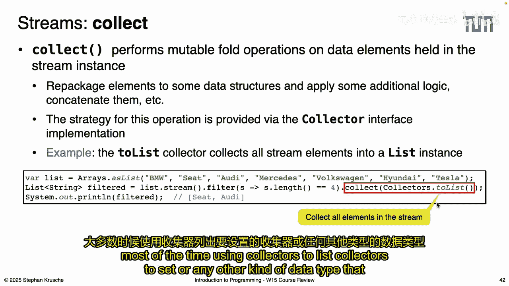

# 【全集】慕尼黑工业大学 计算机编程：从入门到实战 中英字幕 p70 Lecture 70 - 面向对象编程part2 -BV1WFrTBZExY_p70-

Great then let's do the course review and let's get started with object oriented programming i'll do the slides very quickly I will not explain you again everything in detail I just point out the most important aspects so this is not。

😊，The idea that you now start understanding these concepts。

 I assume that you have already understood them， and I just point out what I think is important。

We talked about what is an object and what is a class you should be able to differentiate this as well。

 keep in mind that a class is a blueprint and that many objects can be instantiated for the same class。

 a class and the corresponding objects they focus on three different aspects。

 the identity that is ensured by the name and reference。

 the state which is realized by its attributes， and the behavior which is realized by its methods。

We talked about examples where we can see the class world at the top we modeling it in UML with a class with attributes and methods。

 coding it by defining the class， implementing the attributes and the methods and then we also looked into the object world。

 here's one concrete object out of this class， of course we can have multiple ones and here we showed you how to create an object。

 how to assign attributes and how to potentially also invoke methods。

We talked about the difference between the declaration of object instances and variables and the constructor。

 the constructor is always with the new operator and we typically write it into the same line except there are good reasons not to do it。

 notice that objects store their data in a separate place altogether for one object in memory and then the。

😊，Variable here called R is basically a reference to this point in the memory。

We talked about methods that realized the dynamic behavior， how to define them， how to invoke them。

 and how to structure them based off the return type， the name， and the parameters。

The method signature consists of the name and the parameters， the return type is not part of it。

 and it's also used when you overload methods， so you can't have two methods with the same method signature。

 but you can have two methods with the same name， but with different parameters and this is called overloading。

Keep that in mind。We talked about method calls where actual parameters are defined and inserted as values into the formal parameters so they can be used in there and we also discussed that after the method call。

 everything what you do inside the method will not be available anymore。

 it's basically gone and it uses the copy mechanism here so those values are copied in。

What you can do in order to keep things， yeah， you can use objects and then we copy the reference。

 the reference can be used to change something within the method， this means we have side effects。

 and then you can still use those changes afterwards， but if you have simple parameters。

 this is not possible。We talked about more difficult UL class diagrams where we have inheritance。

 here for example， a checking account and a savings account are more specialized versions of the generalized bank account。

 we have associations， so a checking account has a relationship realized as an attribute later on with saving account。

 and then we have attributes and methods that also use certain。😊，Visibility types， for example。

 plus means public， a sharp means protected and a minus means。Private。

We talked about different characteristics of object oriented programming in particular inheritance。

 abstract classes， interfaces and polymorphism， where polymorphism is probably the most complex topic here。

 we distinguish between more static or compile time polymorphism， which is called overloading。

 the example that I just gave you， two methods with the same name in the same class。

 but with different parameters， and on the other hand we have dynamic or runtime polymorphism overriding where inheritance is involved。

Notice that we distinguish between static binding， what the compiler binds already during compile time and dynamic binding where only the runtime system can decide which method is invoke the one of the subclass or the one of the superclass based on the right side based on the new operator。

We had different examples for inheritance and also how to realize them in code。

 we talked about protected being available to subclasses and extends keyword to realize inheritance and the super keyword in order to invoke specific constructors or methods in the superclass。

We talked about abstract methods and abstract classes that allow us to reuse code even though a concept might not be instantiiateable or might not exist in the real world and it's more an abstract concept。

 but this allows us to implement methods and to define certain methods that all other subclasses must implement。

 so this is also called specification inheritance。We talked about interfaces where we have a specific difference to abstract classes in the sense that we can't really implement something we can only specify something。

 there is one exception with default methods but we did not cover this we can have static methods in there。

 but normally interface has one or multiple dynamic methods where there is no implementation so they are automatically abstract and then classes can implement those interfaces and in fact one class can implement many interfaces and one interface can even extend another interface。

Again， polymorphphyismma with the distinction between static compile time on the one hand and dynamic runtime on the other hand。

We talked about generics also quite early already with the collection data types。

 generics allow us to define functionality in a type independent way。

 so if you implement a list or a set， it doesn't matter what kind of other types you put into the list。

 you can with generics define how to add elements， how to remove elements or how to do any other operation on it in a very abstract way using the diamond operator。

 and then the type is only specified when you create an object for this generic data type。

 for example when you instantiate a list， then you have to define what kind of elements do you put into the list。

 strings， inte chest or custom data types。We talked about wrappper classes that allow you to use primitive types for generics because primitive types themselves cannot be used with generics。

 we have to wrap them in objects and only those objects or class types can then be used with generics so for example。

 the integer which follows the object idea you can also say integer I equals new integer。

can then be used in a list， but the primitive int can't really be inserted into a list。However。

 it looks like it can because Javava offers boxing and auto boxing and auto unboxing。

 so sometimes it looks like you can use those， but you still need to。Convert them first。

 even though Chabi is doing this implicitly for you into their corresponding wrappper classes。

We talked a lot about the Chaba collection framework， so we assume that you can。Naturally use sets。

 lists， maps， and even cues， and it's of course not in a super complex way but in a simple way。

 so make sure that you are able to do that with custom data types with existing wrapper classes or with string think again about this as being a default implementation and many programmers later on will use those default collection types。

😊，We talked about the advantages of generics in terms of type safety。

Identify issues as early as possible ideally during the compile time already。

 and you can do that if you use generics appropriately， then you can prevent issues， for example。

 adding an integer to a string list or accessing something as a string， even though it is an integer。

We also covered error handling where we talked about exceptions and distinguished between exceptions that you need to catch and runtime exceptions on the other end。

 like nullpoint exception that you don't need to catch。

 and we talked about the mechanismer to try catch mechanismer where you can say。

 I like to handle specific errors， like for example。

 the number format exception when we get input from the end user which might be incorrect。

We also showed you how you can define your own exceptions as subclass of the extension class and use them to throw new keywords in order to let other parts of the program know that something happened that you can't deal with something illegal has happened。

 which you cannot deal with and then the call of the specific place has to deal with it， for example。

 by catching the exception or by letting it go and then you can even say that the method rethrows an exception。

We talked about enums as data types of a finite range of values。

 so if you do not want to support any kind of string but only a few ones， there are five， seven。

 10 specific values than you can use enums， we looked into a couple of examples like the P status like what kind of months we have and showed you how to use it together with switch statements on the one hand。

 the old style of dealing with it or even better to switch expressions。

 the new style of how to deal with multipleable if else cases or with enum data types。

 remember also the difference between a statement and an expression。

The switch statement and the switch expressions are very good examples to remember this。

We talked about certain interfaces that are part of the Java programming language， like for example。

 Ittriable and iterator that allow you to define custom data types so that you can use the enhanced for loop that is much easier to use than the traditional for loop or a Y loop and that is much safer in terms of you can't really mess up the index and access elements that are not inside of the data type。

We talked about the comparator， an important interface when it comes to sorting。

 the idea in Chava is that you have a very nice and generic sort functionality that you can use for any kind of data type as long as this data type implements the compator interface and you can let the data type implement this or what you can do is you can also define it on the fly so you can use the sort mechanism to sort a list and on the fly define what kind of characteristics you want to use to sort the list either by using anous inner classes。

A concept where you。Realize an interface without defining a class that's why it's called anonymous inner class or by even using Lambda expressions so that was our first encounter of Lambda expressions or if you have predefined compators you could even use those so we can even say we want to sort an intellectual list in a reverse order with a very concise way without having lots of boilerplate code。

 so make sure that you understand compators and comparable interfaces and that you are able to implement them no matter if you are using Lada expressions or anonymous inner classes that's a matter of choice afterwards。

When it comes to Lada expressions we identify them as references of functions so you can define a functioner with an input argument list。

 an arrow and the corresponding body implementation。

 normally Lada expressions are rather short functions the argument list can be empty can include one element and we can even leaf out the parentheses or multiple element and typically the body is short in most cases it's a one liner sometimes two or three lines if it's a very long method implementation method body or function body then it's typically not a good idea to use a lambda expression。

😊，But with Lada expressions， we can basically do functional programming and even store a function in a variable。

 we， for example， did that with the square interface。😊。

A functional interface is then an interface that can be used with a lambda expression。

 it only consists of one single abstract method and it follows the interface segregation principle。

 an important principle of object oriented programming here you can see the square example where we define one method area。

 and then we can basically capture this lambda expression in a variable of type square and then use it later on and then if we invoke area on it we can pass elements。

😊，We talked about streams， functional style operations that allow us to deal with operations on collection data types mostly。

 so you always start with a collection data type， a list to set a map then you，Turn it into a stream。

 you create a stream out of it， you can we also showed you a couple of stream utilities where you directly start with the stream。

 then you have zero or multiple intermediate operations where you， for example， map data types。

 where you filter or where you do any kind of operations。

 and then you have one terminal operation where you count the elements。

 sum them up or where you turn again the elements using a collector into a collection data type such as a list。

And the nice thing is that if you have many elements in your stream source or in your collection data type like1 million elements。

 you can even parallelize intermediate operations and use concurrent programming in order to do it in a more performant way。

😊，We specifically discovered map and filter map allows us to transform data types or to navigate in an object yeah if you have multiple students in a list and you want to collect them matriculation numbers of all of them then you can also write here student student colon colon get matricgulation number this is a so-called method reference here but you could also use a lambda expression like you see it here。

 filter allows you to filter the stream by defining a conditioner and the condition or predicatet is then tested and only the elements that fulfill this condition stay in the stream。

 all others where the condition is false will be removed and if you have multiple operations then it's good if you can do the filtering first。

Because if you filter something from 1 million to only 10 elements， then all the mapping later on。

 all the other operations will be much faster because you have less elements。

We also discussed the Red operation， which is a terminal operation that takes a sequence of input elements and combines them into a single summary。

 for example， you can use the sum。Reference here in order to sum up all the values from 1 to 10。

 or you can also define your own Red function， for example。

 multiplication by creating the product of three numbers。

And we showed you an example where you basically combine all those operations into one very long lines of code。

 so ideally in reality you still split this up into multiple lines。

But here you have seen how the whole idea is we create a stream。

 we do multiple intermediate operations， and then we do one terminal operation。😊。

We also looked into the collect terminal operation that folds the data elements again into a collection data type most of the time using collectors to list。

 collectors to set， or any other kind of data type that you are interested in。

And last but not least we have five important principles when it comes to object oriented sign。

 we have the solid metaphor S standing for the single responsibility principle。

 every class should only have one shop so that it doesn't get too long。

 we have the openclo principal where we say object should be open for an extensioner but closed for a modificationer。

 if you have a student list and you want to a student class and you want to add a new attribute later on this should be possible。

 but it should not be the case that you turn student into a car or something like this。

We looked into a list of substitution principle that focuses on inheritance and means that subclass and superclass should have a very strong relationship so a car can be a sports car or every sports car is also a car。

 but every sports car is not a bicycle， so you are in charge developers are in charge that they use inheritance in a meaningful way。

Interface segregation principle， we talked about this when it comes to functional interfaces。

 ideally interfaces only one method so that you don't force implementing classes to do something that they don't want and dependency inversion principle focuses on loose coupling where high level components should not depend on low level components and if you follow solid you can create reusable code that has a high code quality。

