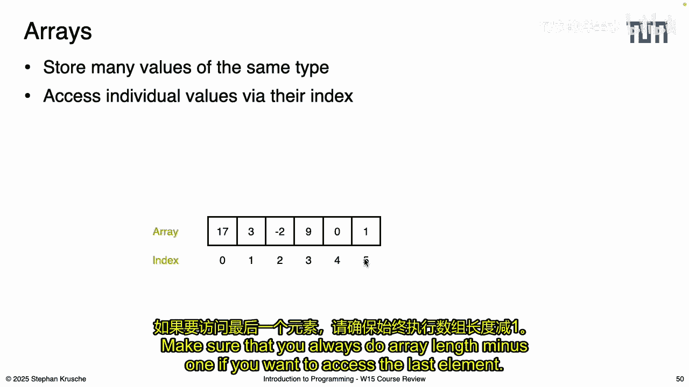

# 【全集】慕尼黑工业大学 计算机编程：从入门到实战 中英字幕 p71 Lecture 71 - 控制结构与数据类型 -BV1WFrTBZExY_p71-

That was our first review unit about object oriented programming next we want to have another look into control structures and data types。

We talked about the most basic type of control structure which is the condition within an if statement where you can have multiple branches depending on the logic in your code。

 depending on the conditions that you have， we can nest if statement， we can have an else statement。

 we can even have an else if statement， and we assume that you are very well familiar how to do that。

We talked about iterations and started with the while loop where we do certain code multiple times until a condition becomes false。

 it's important to always think about a terminating condition here。

 otherwise you have an endless loop and you can also use the brake statement inside in order to break out of the loop when it comes to certain conditions you talked about the do while loop where you execute the body at least once and then you check the conditions。

And we talked about the for loop， its traditional counterpart uses an initialization。

 a condition and a modification and then has multiple statements in the body the basic example is that you have in I equals1 or equals0 I smaller than data type length or size this could be an array this could be a collection data type and then you say I plus plus sometimes you also do it the other way around。

 we start at the last element and go until0 or one and then we would have I minus minus but that's the typical pattern you can basically do whatever you want in the initialization condition and modification but most of the time we'll do it like this。

Here's an example where the control flow is also visualized in a control flow diagram。

 we start with a while loop and then have an if else statement within the while loop and we showed you how to create a corresponding control flow diagram。

 so make sure that you are able to create this if we show you a little bit of code and also make sure if we show you a control flow diagram that you could potentially create code out of it。

 so this is a bidirectional mapping and we want you to be able to do the mapping in both ways。

We talked about arrays as an important data structure with kind of a primitive way of dealing with it。

 however it still follows the reference semantics arrays are。

Also the underlying data structure when it comes to collection data types。

 here we can store many values of the same type and array always defines a type。

 for example you can store ins or you can store strings or you can store your student custom data type and we access individual values based on the index and here it's important that we start counting with zero。

 so even though it's the first element it has to index zero and the last element。

 the sixth element has to index five or also size slash length minus one。

Aray dot length is not accessible as index， make sure that you always do array length minus one if you want to access the last element。

