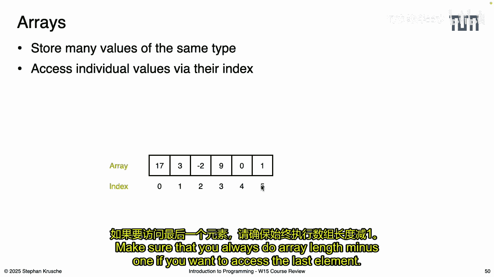

# 计算机编程：从入门到实战：71：控制结构与数据类型回顾 🧠


在本节课中，我们将回顾编程中的两个核心概念：控制结构与数据类型。我们将系统地梳理条件语句、循环以及数组的使用方法，确保你能够理解其原理并灵活运用。

上一节我们回顾了面向对象编程，本节中我们来看看控制结构与数据类型。

我们讨论过最基本的控制结构类型，即 `if` 语句中的条件判断。根据代码中的逻辑或条件，你可以创建多个分支。

我们可以嵌套 `if` 语句，可以使用 `else` 语句，甚至可以使用 `else if` 语句。我们假设你已经非常熟悉如何实现这些结构。

我们讨论了迭代，并从 `while` 循环开始。`while` 循环会重复执行某段代码，直到条件变为假。这里始终考虑终止条件非常重要，否则你将陷入无限循环。你也可以在循环内部使用 `break` 语句，以便在满足特定条件时跳出循环。

我们讨论了 `do-while` 循环，它会至少执行一次循环体，然后再检查条件。

我们还讨论了 `for` 循环。其传统形式包含初始化、条件和修改三个部分，循环体内包含多条语句。一个基本示例如下：

```java
for (int i = 0; i < dataType.length; i++) {
    // 循环体语句
}
```

有时也会反过来，从最后一个元素开始，递减到0或1，此时会使用 `i--`。但上述模式是最典型的。你基本上可以在初始化、条件和修改部分做任何操作，但大多数时候我们会像这样使用。

以下是一个示例，其中的控制流也在控制流程图中进行了可视化。我们从 `while` 循环开始，然后在 `while` 循环内有一个 `if-else` 语句。我们展示了如何创建相应的控制流程图。

因此，请确保当我们展示一小段代码时，你能够创建这样的流程图；同样，当我们展示控制流程图时，你也能够根据它创建出代码。这是一种双向映射，我们希望你能掌握这两个方向的转换。

我们讨论了数组作为一种重要的数据结构，它提供了一种较为原始的处理方式。然而，它仍然遵循引用语义。数组也是集合数据类型的底层数据结构。

以下是关于数组的关键点：
*   我们可以存储许多相同类型的值。
*   数组总是定义一种类型，例如，你可以存储整数、字符串或自定义的 `Student` 数据类型。
*   我们基于索引访问单个值。这里重要的是，索引从零开始计数。
*   因此，即使是第一个元素，其索引也是0；最后一个元素（例如第六个元素）的索引是5，或者说 `size/length - 1`。

`array.length` 本身不能作为索引访问。如果你想访问最后一个元素，请确保总是使用 `array.length - 1`。




本节课中我们一起学习了控制结构（包括条件语句和各类循环）以及数组这一基础数据类型。理解这些概念是编写结构化、高效程序的关键。请务必掌握从代码到流程图、以及从流程图到代码的双向转换能力。