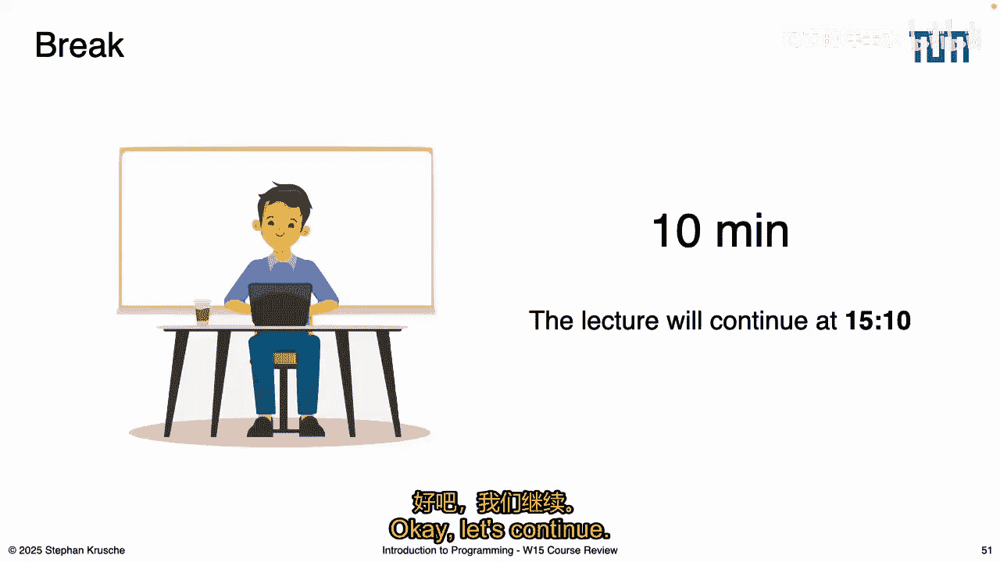
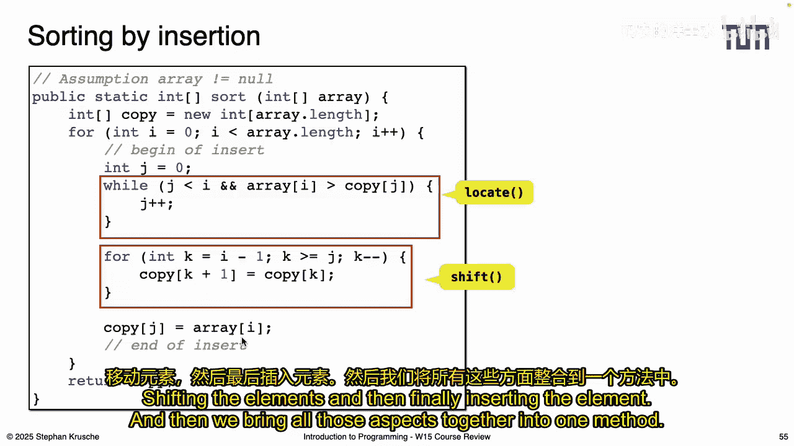
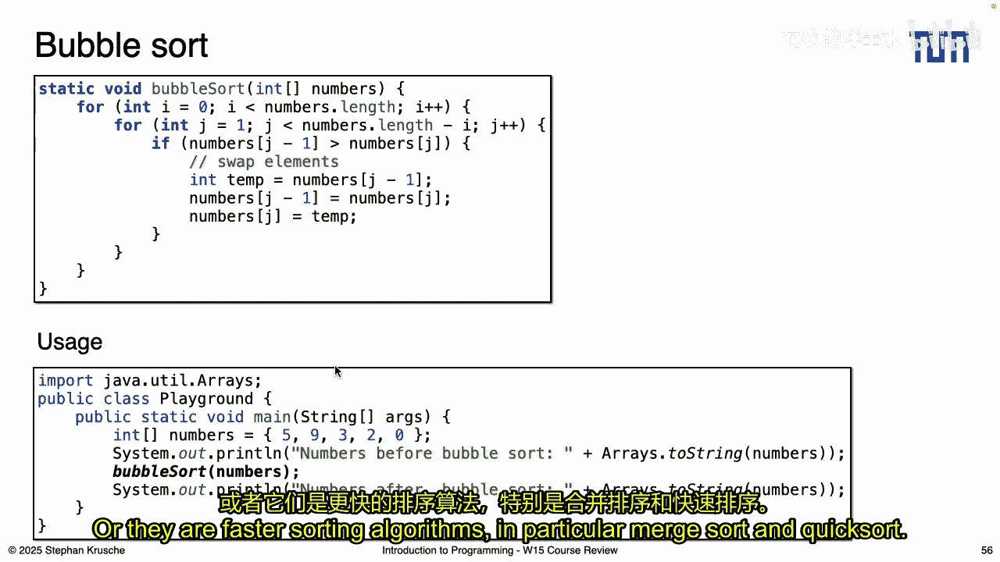
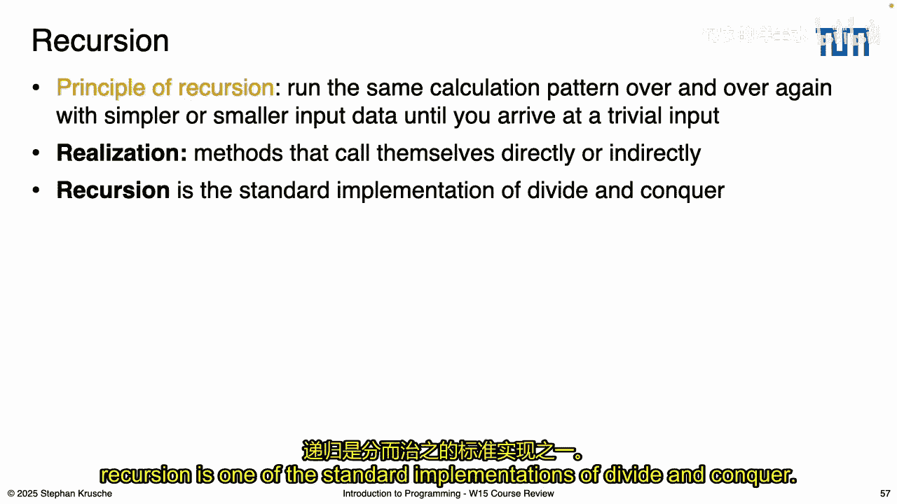
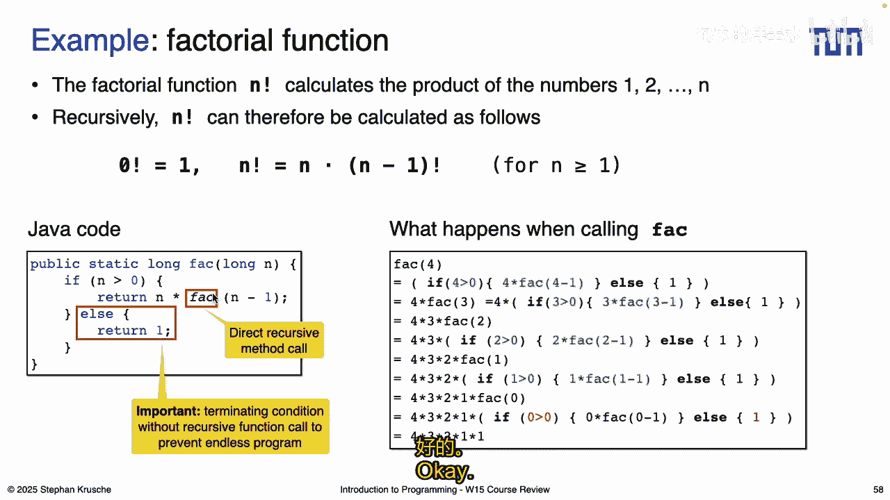
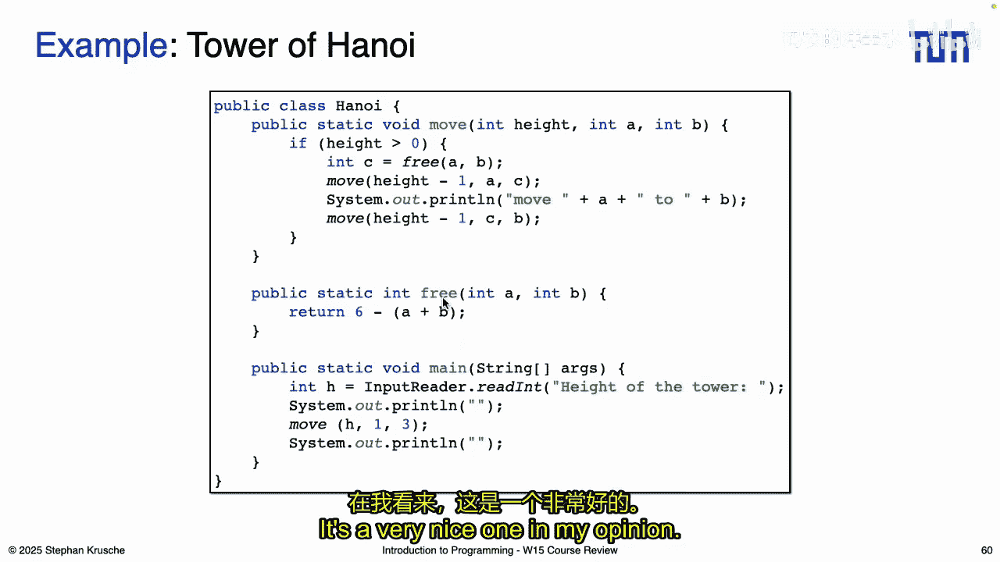
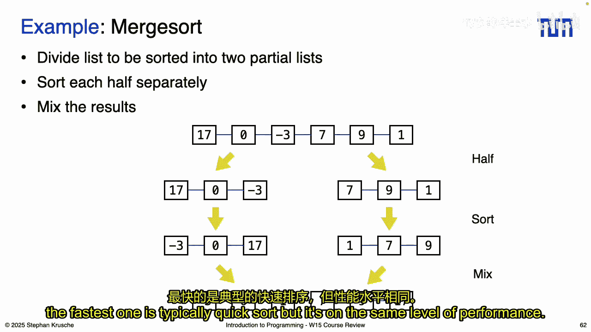
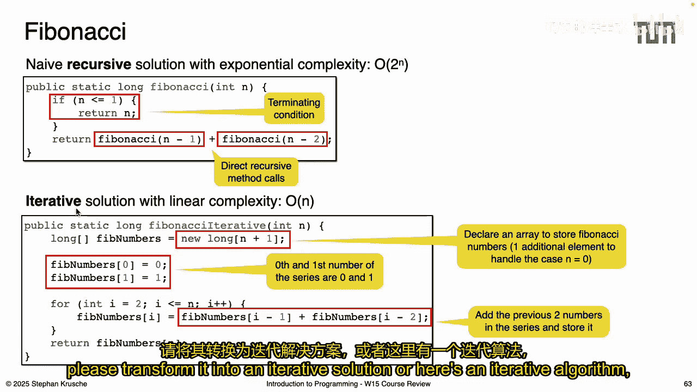

# 【全集】慕尼黑工业大学 计算机编程：从入门到实战 中英字幕 p72 Lecture 72 - 算法与递归 -BV1WFrTBZExY_p72-

Okay， let's continue， we have a few more sections but we'll probably wrap this up in the next 20 to 25 minutes and then we'll have a longer break for you。

We also covered a few algorithms and in particular a topic that many students don't like because it's not super easy。

 it's called recursna， unfortunately I was ill so you had to watch the videos from last year but the videos were quite good and we hope you have a good understanding in this topics let's quickly recap what we've discovered so first of all many algorithms use the principle which is called divide and conquer which is not only an important principle in programming。

 but also in the whole software engineering world， the idea is you have a big problem that you want to solve and you can't really solve it immediately you first need to break it down into smaller pieces into small subproble up to a level that can be easily solved within a few minutes or hours of work by an individual being。

And then you have to combine the partial solutions again to a total solution。

 and this is really a super important concept and describes every project。

 every algorithm in a very generic way， notice that，😊，The divisioner。

Of the problem into smaller pieces involves analysis。 So you need to analyze the problem first。

 Otherwise， you can't break it down。And that combining the partial solutions into smaller ones is also called integration。

And this is why we have terms such as continuous integration where we want to do this continuously from the beginning of the project。

😊，We had a simple search algorithm where you can find elements in an array。

 so the array returns true if the element at the index that we go through with a for loop is the same as the element that we want to found。

 and then otherwise if we go until the end we return false。

We talked about sorting algorithms and covered a few of them。🤧嗯。Sorry。

 one of the first ones being insertion sort where we had a really nice visualization of how this works。

 so be prepared if we ask you to implement an algorithm based on insertion sort that you are able to understand the concepts here the idea is that we create a copy of the array。

 go through it and we locate the positioner to which we insert the element and then we shift all elements on the right and then we insert this element at the specific position and this is the whole algorithm in one method but we also showed you a version with multiple methods for code reuse and for being able to understand those smaller subproblem。

 but this is a very good example for divide and Con we divide sorting into the subproble of iterating over elements in an array。

 then locating a positioner。And then shifting the elements and then finally inserting the element。

 and then we bring all those aspects together into one method。😊。

We also talked about bubble sort and one of the easiest sorting algorithms where you just swap two elements if they are in the wrong order。

 notice that it doesn't have a very good performance。

 but it's super simple and easy to understand and we also showed you how to use it they are more。😊。

Or there are faster sorting algorithms in particular， mergerch sort and quick sort。

We also dived into the world of recurchna where you basically run the same pattern over and over again。

 but you try to simplify the input until you have the trivial input。

You can realize this with direct recursive method calls or with indirect recursive method calls。

 and recursion is one of the standard implementations of divide and conquer。

Here's an example of the factorial function。N exclamation mark that calculates the product of all the previous numbers starting at1 going until n and the basic definition is that the factorial of0 is 1 so that's a trivial example and then the factorial of n equals n times the factorial of n minus1 as long as n is larger than or equal to1 so this is the mathematical definitioner and here we realize it in Shava call with a direct recursive method call why we translate this yeah n。

greaterer or equal 1 is the same as n greater 0 then we have this recursive call otherwise if it is equal to0 we don't do input validation for negative numbers we return one and this is very important this is our terminating conditioner if you don't have a terminating conditioner in a recursive method call you will end up with endless recursion and your computer program will break keep that into account on the right side we have a visualization of what actually would happen in code and how you end up with the right formula okay so the question is how difficult will be the recursive recursion exercise and the supervised exercise I guess you assume there will be one let's see。

😊，Of course we have to break it down into something that is manageable that you can do within I don't know。

 30 to 40 minutes next week right so it won't be a super complex problem。

 we will not give you the snowflake example that we've shown you that's way too difficult。

But we also will not give you or would not give you the factorial function because it's way too easy。

 so it will be something in between， probably something that you can realize within 10 to 15 lines of code。

That's typically the idea。 And recursive functions， it's not about the length of the code。 Yeah。

 sometimes you can write it very concisely here， the complexity is really to understand what's going on and to get the。

Direct or indirect recursive calls or the multiple direct or multiple indirective recursive calls。

 right。 Yeah So this is really a more theoretical and mathematical problem that you turn into code afterwards。

Okay。

Good question。We have another example here， greatest common device can be implemented recursively。

 here we have the terminating condition if both numbers are the same。

 then we return just one of them。 otherwise we take the greatest common device of the。😊，First number。

 and the。Subtraction of the other two numbers， making sure that the results stays positive。

And this means we always make the problem smaller because if you sub a number gets smaller and at some point you will end up with the trivial one where both numbers are the same and then。

You finish your recursion。Here's another example Tower of Hanoi。

 that would be something that would be suitable for the supervised exercise on on Monday。

 I would say， yeah， this is not very simple， not too complex。 And you see， you can realize it with。

Around 15 lines of code if you think through it， the Tower of Hanoi is a very nice game that children like to play where you need to move bricks in the specific order from one tower to another tower and you need to make sure that you end up with the same tower and the same order again by doing some intermediate moves and as one rule。

 smaller pieces can be put on larger pieces but not the other way round。

And here you see where example code where we broke down。The problem into smaller ones。

 like moving elements， freeing elements。 and we have here a direct recursive method call， again。

 a terminating conditioner。And a little helper functioner in order to get this working。

 So double check this example。 It's a very nice one， in my opinion。

We also did binary research using recursive algorithms。

 this is also on a level that I would say this could be a representative example for the supervised exercise。

 here we basically have a find method with a start end index the element and the array and we in the recursive calls we basically change the start or the end index to make the。

Remaining parts smaller， so we basically divide an already sorted array into two parts and we either continue searching on the left part or we continue searching on the right part。

And this is a super important algorithm because it makes searching very， very fast， if you have 10。

000 elements， you can find them in five steps by dividing the list or maybe not five。

 maybe it's 10 steps here， but you can do it very， very quickly， that's the idea here。😊。

We also talked about mech sort where we divide a list into partial lists until we end up with the trivial example。

 yeah we have them， and then we sort them again after they have been already sorted so part of the problem is how can we have the list。

And then part of the problem is how can we combine two sortded lists again with each other and mergech sort is one very fast sorting algorithm。

 so it's good to understand this， it's not a fastest one， the fastest one is typically quick sort。

 but it's on the same level of performance。

We also talked about Fibonacci being an example where the recursive version of it is super， super。

 super slow because we basically sum up values， also by reducing the problem with n minus1 n minus2。

 but as we have it two times here， we end up in a huge dependency tree if we write this down。

 so even for 10，15， it's super slow already and even my computer which is really。

 really fast can't compute the recursive version with。

 I don't know 50 or something like this because it has an exponential complexity。😊，This is a very。

 very good example where the linear version of the algorithm is much better here。

 we simply cache the values in a very small array， it's not even a big array， and then we can。😊。

And then we can compute this much， much faster and we have a linear complexity and we can even calculate Fibonacci for I don't know。

 1000 or something like this in the end， so one thing that you should also have learned when it comes to recursive algorithms is how to turn a recursive algorithm into a linear one using loops。

😊，And an iterative one。 And how to。Transform an iterative algorithm into a recursive algorithm。

 so this could also be an exercise next Monday that we ask you hey， here's a recursive algorithm。

 please transform it into an iterative solution， or here's an iterative algorithm。

 please transform it into a recursive solution。

