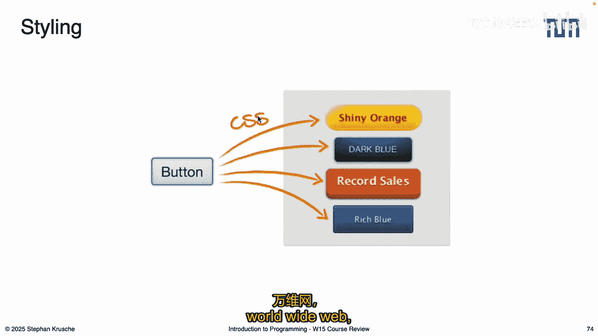

# 【全集】慕尼黑工业大学 计算机编程：从入门到实战 中英字幕 p73 Lecture 73 - 图形用户界面 -BV1WFrTBZExY_p73-

Next， we covered graphical user interfaces。With the technology Java FX as one example how to do that。

 it's not the idea that you learn Java FX by heart。

 again we want to show you something a modern framework and then you should be able to do this with other frameworks as well。

 we talked a little bit about usability。Sorry about usability and its different categories。

 learnability being how fast you can understand the system efficiency。

 how quick you can be if you have learned the system， memorability。

 how good you can memorize the system functions and reuse them one year later。

 arrow handling and something that is quite subjective and hard to measure the user experience or the satisfaction。

 how pleasant is it for the end user to use the software。

Keep in mind that usability and user interface design and usability engineering become more and more important and are very。

 very important skills when it comes to founding a company， founding a startup。

 creating a product that end users need to use， and I see this is in particular for economic students who will end up in companies later on with technical expertise that they are also very familiar with usability in user interface design。

So the question is there were some issues with specific SDKs when it comes to Java FX and unfortunately we experienced this this year。

 we don't know why the Java JD case actually changed in that way， and yes。

 we will make sure that there are no technical issues there will be a clear recommendation what you need to do in case there is a Java FX exercise and then you will survive this without technical issues。

 don't worry about technical issues related to Java FX。

We talked about different quotes in particular， a bullshit quote that is often used in advertising where they say the system is easy to use。

 which basically means nothing because as a，Computer scientist， engineer， software engineer。

 you should know that we need measurable ways in order to determine if something is really really usable or not and of course if you end up in a marketing department in the company you can use that but if you end up in an engineering department。

 please never say the system is easy to use this even is referred to nowadays as unusability。

 many people claim that many companies claim that the system is easy to use， but many。

 many people struggle and there are lots of different things。

 take up Nielsen and the Norman and Nielsen group， the and end group have a lot of very nice examples。

 online like cookbooks and recipes， how everyone can do a decent usability。

We talked about prototyping being an important concept here where we try to externalize our knowledge。

 try to come up with something quickly， you might have heard about the term minimum viable product MVP that's one of the most important aspects for startups and for product development nowadays。

 you come up very quickly with something and then you test it with end users and you verify if your idea works or not。

 and this is also something that you can do in usability engineering。

AndI'd like to emphasize again on what Dennis Boyer said， never go to a meeting without a prototype。

 so always have something with you that you can show to someone else because if you just explain how your software works。

 if you just show the code， that's not good， show them something that you can execute either on your device or even more better。

 you have something like testf if you do mobile app development where they can download it to their device and they can try out a prototype and tell you if it's working or not。

We talked about the basic usability heuristics also defined by the Niels and Norman group。

 visibilityability of system status， matching between the system and the real world。

 which is quite important in terms of the psychology behind it and how easy people can use it。

 we talked about user control freedom， consistency standards， error prevention。

 a technique that is called recognition rather than recall flexibility and efficiency of use as aesthetic and minimalist sign where you try to focus on the most important aspects and leaf out all the irrelevant details。

 there's one category recognize diagnose and recover from errorsOS， and is help and documentation。

We looked into ChaA FX in particular where an FX application is divided into multiple stage。

 each stage can contain multiple scenes most of the time you have one stage and one scene。

 and then within scenes you have node and those could even be nestted by using composite nodes and simple nodes。

We talked about different layouts that are important for an application in order to come up with a design。

We talked about different controls like buttons， lists， choice boxes， scroll bars， progress bars。

 and so on， and how the architectural style model view controller helps you to come up with a system that is easy to maintain and where you have reusable view and model components and a controller in between that mediates between the two of them。

We talked about different shapes and showed you how to create rectangles， circles， and so on。

We talked about styling where you can use a specific coloring scheme， specific font。

 specific visualization of buttons， for example， and discussed quickly how this can be made very consistent using a technique that is borrowed from the Worldide Web。

 which is called CSS。😊。

