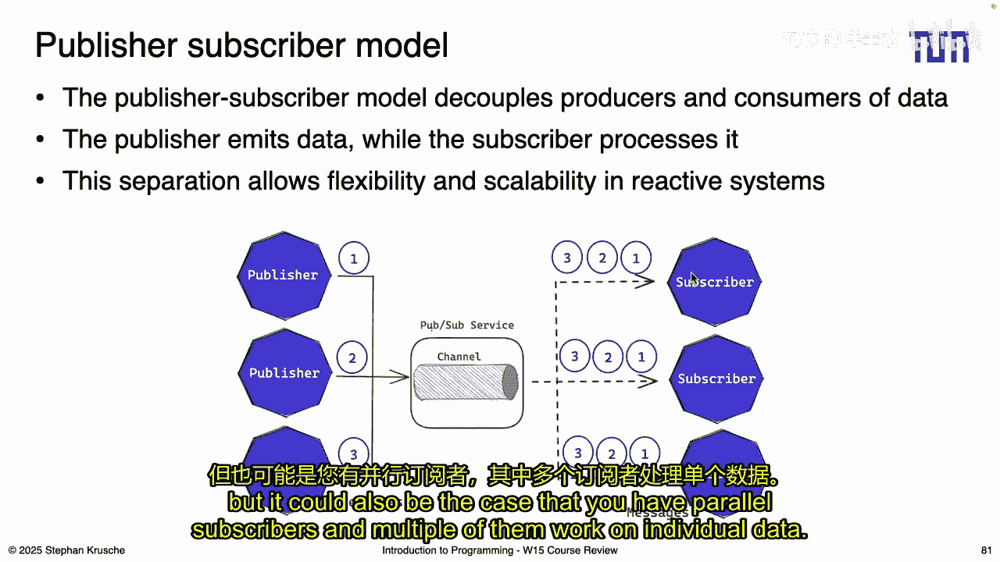

# 【全集】慕尼黑工业大学 计算机编程：从入门到实战 中英字幕 p74 Lecture 74 - 并发 -BV1WFrTBZExY_p74-

Next， we also talked about concurrent programming。

In the section of concurrent programming we motivated a little bit why multithreading is so important nowadays we have very intense applications to users don't run away a lot of time and if we have in particular if we have multiple CPUs on the same computer or multiple course on the same computer then we can do things in parallel threats are the basic concept of doing that。

 but threats are also difficult to understand， we showed you very simple example how to realize threats in Java using the runnable interface we have a Lada expression here that can run within a thread when we start a thread but this is very low level and there are more modern highlel concepts that you should take into account。

In particular task based concurrency where you have threat pools where you define a threat pool that consists of a task queue。

 and then you insert tasks and then the pool automatically spawns threats and make sure that they don't intervene with each other based on the maximum amount of threats that you want the pool to manage。

We talked about asynchronous programming that becomes more and more so important in particular for distributed systems。

 programs should not wait for something but they should keep going and then when the response is coming in asynchronously they can handle it。

 and with that we can reduce the waiting time， the processing time stays the same but the waiting time can be significantly reduced。

We also talked about a reactive manifesto where response。

 message driven elastic and resilient systems are becoming more and more important also to scale up software for millions of end users。

And we talked about the publisher subscriber model where we decouple producers from the consumer of the data using some kind of channel mechanism like a queue in between and then they publish us whenever they have new data。

 they publish it into a queue， then the channel or a queue fields up。

 and then a subscriber or consumer can work on the data as soon as it becomes available。

 and there are different mechanisms， it could be the case that all subscribers work on all data。

 but it could also be the case that you have parallel subscribers and multiple of them work on individual data。

