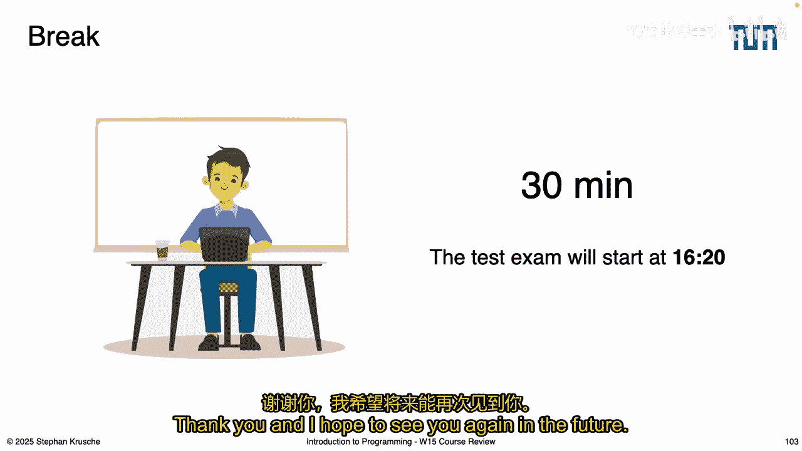

# 【全集】慕尼黑工业大学 计算机编程：从入门到实战 中英字幕 p75 Lecture 75 - 编程之外的内容 -BV1WFrTBZExY_p75-

And last but not least， we took a look beyond programming and showed you what you can learn in the world of software engineering in the future courses。

 we talked a little bit about the differences between compiled and interpreted languages。

 who if you knows what Java is， is Java compiled or interpreted language。

 who thinks that Java is a compiled language， raise your hands。

Who thinks it's an interpreted language？Raise your hands。

Who thinks it's nothing of those two categories。Yeah you can go for compile again great so it's both actually yeah we have a compile step into something that is called intermediate code we also call this spiteite code in Java and then this spiteite code is interpreted at runtime so you all failed already sorry everyone except you actually failed already make sure that you know this yeah this is important knowledge and there will be quizzes on Monday where we could ask you something like this。

😊，We talked about domain specific languages that distinguish themselves from general purpose languages such as Java。

 they are specifically designed for one particular domain。

 we showed you a couple of examples like HTML， XML， markdown， JavaScript。

m sorry not JavaScript Chason and so on， so keep this in mind this could also be part of the final supervised exercise。

 we talked a little bit about graadle being one example of a domainspec language by providing us the opportunity to do automation when it comes to building software and resolving dependencies。

This is basically part of every exercise， so in every exercise we use Gadle in order to configure in teleyChaase or that it can run your software that it uses the right Javava versionner and this is one cornerstone of programming and in soft fing this becomes then more and more important that you are able to define Gadle in a way that you can manage your software project。

😊，We showed you how to add new gradle dependencies like here and what the other aspects actually mean。

 you don't need to be an expert in that， but you should roughly understand what graadil is for and how you could potentially add external libraries。

We looked a little bit into compilers and that they use syntax analysis in order to come up with abstract syntax trees。

 this is quite important in order to do an analysis on the code to tell you if it compiles to allow you refactoring possibilities and to give you hints in the IDE。

 whether you could come up with better code in the future。

Syntax3 are a representation of the code that is used in the compiler。

 and we showed you in a unit how to turn。Code into a syntax3 and you should also be able to turn a given syntax3 into code。

 so this could also be part of Monday's supervised exercise， make sure that you understand this。

We talked about regular expressions with their different use cases for search and replace。

 for input validation， and so on， it looks super complex but the basics are rather simple and we have certain terms like B slashW for words。

 we can specify certain characters and how often they should be part of the text that we would like to validate and this has a lot of different use cases in programming and they are very nice online tools where you can verify if the regular expression is correct or not。

We showed you an example how to do that in Javava， so it could be the case that we ask you based on a textual descriptioner to come up with a regular expressioner and then to verify a few examples with that in Javava。

 here's a simple one， this is one where we assume you know how it works where we。

 for example verify a tomb online。Username， which always consists of two small letters。Two numbers。

 Yeah， with the backslash D。And three more small letters， mind being N E2，3， KOW。

 and yours probably starting with GA or GE and variation of that。

We also looked a little bit into model- based software engineering with the different activities。

 starting with a problem statement， doing requirements， elicitation， analysis， system design。

 object design， implementation testing in an iterative and potentially etile way so that you come up with not only one delivery of a software system。

 but multiple deliveries of the software system。😊，We distinguished defined and empirical processes。

 scruming one empirical process where we focus on having a rough plan。For the project。

 but where we detail out specific requirements， always in the beginning of the iterationer。

To come up with a potentially shipable product increment that has value for end users。

 that's a very important point， we want to focus on implementing something that produces a value for end users。

We also talked a little bit about designing client server applications based on the rest architecture。

 where we use the REfest response protocol and where we typically have automatic chase on serialization and decsalization so that the client。

 for example， a mobile phone can use an object oriented programming language。

 and the web service could potentially use another object oriented programming language and they are still compatible with each other。

We looked a little bit into code reviews and talked about the advantages and challenges of them。

 noticed that it's not only about the improved code quality， but also about communication。

 knowledge transfer， and in some sense the peer programming that you did。Hopefully。

 in the right way as part of the tutorial groups is some kind of。Code review technique。

 you have a driver who is sitting in front of the computer who is typing and an observer who is at the same time reviewing what's going on。

 making suggestions commenting about whether this is a good or bad solution so their code review is integrated into the technique right when you write the code and there's also an improved knowledge transfer and hopefully also some learning between the two involved develop。

😊，We talked about the differences of static and dynamic code analysis。

 static analysis meaning looking at the code either manually or with an automatic tool based on the abstract syntaxt3。

😊，And dynamic analysis being testing， something that we do。

 we test the software that you produce on Monday on the C implementation in ArtemIS。

 and here we distinguish between black box and white box testing。We looked into Git。

 you should definitely be familiar with cloning a Git repository。

 committing code into your local repository and then pushing the code to the remote repository for the project where you were also required to pull changes from your fellow developers and you potentially had to merge mech conflicts maybe a quick raise of offense who experienced merch conflicts as part of the project。

 could you solve them。Great， good learning。 Unfortunately， they will happen。

 but now you have to write skills in order to resolve them。😊。

We looked a little bit into continuous integration where you have computer systems that automatically compile。

 build， and test your software in order to provide you with quick feedback so you know if the changes that you'd like to introduce are working correctly or not。

And you can go one or even two steps further when you do continuous delivery。

 you configure a pipeline not only to build and test。

 but also to deliver the software upon human intervention so continuous delivery means there one manual step could be just a button click and then the software is deployed while one step further continuous deployment means everything is deployed automatically so here you really need to have very good tests and you might need to even。

Roll back your changes if the post deployment tests fail。

We talked about the container process where we use Docker， for example to。

To describe the infrastructure that we need to run for the software in code in a so calledled image from this image descriptioner。

 we can build an image which is a layered。Approach yeah so you define a base image where you for example say I want to use JDK and then you install additional dependencies that you need and then you package your own software and then this is like a template and from this template we can create multiple containers and run them and this is where our software has then integrated in the instance of the container。

Great， so much about the course review， some final thoughts。

 this is a summary that you can use if you want to be very efficient to go through the most important aspects。

 but keep in mind if a topic is not mentioned within the summary slides。

 it can still be part of the exam。😊，Or of the supervised exercise。 So this is not meant to be a。

Really exhaustive。Overview。It's just the most important aspect that you should focus on。

We recommend that you build study groups， it's much more fun to study and learn together， you can。

 for example， do that and program together using the practice mode on Artemis。

 you can explain concepts to each other and see if you can do that in an understandable way it's possible to repeat all the programming exercises that we've given to you I think we are around 70 to 80 on Artemis using the practice mode so feel free to do that then you can just start from the template that we give you again from zero and then redo the exercise this might help you to double check if you have understood the concepts notice that on Monday you also need to be relatively quick you can't think about how to solve an exercise for 20 minutes yeah you have to solve it quickly yeah we will estimate very carefully how much code you can write in this 90 minutes。

But of course， it's not about a 30 minutes break in between or thinking about the things too much you have to be fast。

 you can also repeat all the quizzes on Artemis using the practice mode because there will be a few quiz questions on Monday as well。

And if you do that you are well prepared there's again a hint to the exam mode student guide。

 make sure that you understand the exam mode and that you can use it appropriately and with that being said I wish you good luck not only on Monday but also all the best for your future career I hope we see us again in the next semesters and we will do a short break now before we do the test supervised exercise and I suggest we'll start over at 420 a bit more than 30 minutes and if you have questions in between please come down and ask them here。

 thank you and I hope to see you again in the future。

