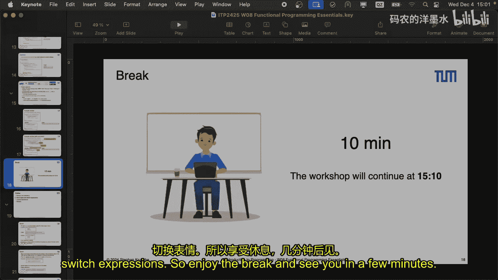

# 【全集】慕尼黑工业大学 计算机编程：从入门到实战 中英字幕 p76 Lecture 76 - ITP测试 -BV1WFrTBZExY_p76-

Welcome to Workshop 8 functionalal programmingEssentials in the course Introduction to softwareft Engineing。

We are halfway through the course and already had the first supervised exercise yesterday。

 we hope that you had a good experience and that you are happy with the course so far today we will focus on iterations and collections and how you program for each loops using those not only for built- in data types but also for your own data types。

 based on interfaces， we will talk about switch expressions， a more modern way to to do control flow。

 you will learn anonymous inner classes and Lada expressions。

 functional programming concepts that are quite important nowadays in order to get things done more quickly。

So we hope that at the end of this week， you are able to implement your own Lambda expressions because those are also quite important when you want to use streams which are operations that allow you to write more concise code。

Let's get started and we'll start with iterators and collections。

Now there are many different ways in order to implement ordered collections of objects。

 we have strings that are ordered collections of characters。

 you've seen lists and arrays that are ordered collections of objects of a predefined type and even lists are implemented in a very generic way so you can use them with any type。

 we've also seen the set， the map， and you could basically come up with your own data types as well。

No matter if they are ordered or unordered， but most of the times you would like to access single elements in a specific order。

 and in order to do that it's important to know if there is another element afterwards to be able to jump to the next element and to remove an element after you have processed the current one。

😊，And。While this is a recurring implementation and the recurring idea。

 the developers came up with an interface for it and this interface is called iterable。

 it's a generic interface so you can apply to any type and the idea is it has three methods next to the corresponding constructor that you can define。

 and those are has next so you can check if your iterable that implements this interface has a next element。

 you can navigate to this next element， and you can remove the currently selected element。

 that's basically the idea of an iterable and this will be the foundation for each group as you will see in a few minutes。

😊，The interface also defines the method iterator and this method iterator then returns an iterator that's basically the object later on that allows you to iterate through all the elements in the iterable data structure so you have to be very careful here iterable is an attribute of something of a collectioner。

 a collection can be itable and the iterator that's a separate object。

 that's the one that is iterating through the collection and they basically play together here yeah so the iterable defines our collection and the iterator is another object that can navigate through the collection。

😊，We can have a simple example here， ittri string， where we implement by iterable based on the character。

😊，Class， character， remember， it's a wrappper class for char elements in chava。And we do that by。

Simply。providing a constructor where we can initialize a string and then we return an iterator and the iterator is our own implementation here iterable string iterator。

 and we will see in the next slide how this could work。

 and here we see that iterable string iterator implements the iterator interface。😊。

So we have the iterable element，This is nothing else than a collection of characters where we can iterate through。

 and then we have the iterator， a separate class implementing the iterator interface and this one is returned by the iterable string so here we create a new iterable string iterator so that it can be used。

😊，And this iterable string iterator now implements the three methods that we just mentioned in the previous slide。

😊，We have has next next and remove we don't implement remove because strings don't support that strings are immutable。

 if you have your own data structure like a list or an array you could potentially implement this。

 but right now to keep it simple we want to focus on has next and next。

Has next basically tells you if you already have iterated through the string。

 so if the current position that we store and set initially to zero because we start iterating in the beginning of the string is still smaller than the length of your data structure in this case。

 the string we。😊，Return true。 Otherwise， if we are， at the end。

 we return false because there is no next element。 There is no next character anymore。

The next method basically has some safety mechanism， if the position would be string length。

 then there would be no next element anymore， because the caller can directly invoke next。

 even if Ha next has not been verified before， then we throw no such element exception。😊。

And if this is not the case， yeah if we are basically smaller。Then we return the string。

The character at the current positioner and afterwards， increased position by one。😊。

Yeah so we have a pointer pointing to the current element。

 we return this element and afterwards we increase position by one。

 so if we invoke this the second time， then we can return the second element and navigate through the whole data structure。

😊，Any questions regarding this？So far， yeah， go ahead。Reシ。Okay， the question is。

 should it be smaller string lengths minus1， or is this correct， because if we are at position 5。

 which would be the last element？And the string has six elements from going from0 to five。

 then has next would still be true， and that's a very good question。I need to double check that。

So if we， let's assume we have the world theert hello， yeah。Hello has five characters， H E LLO。

And position would be four。Then this would correspond to the O in the end。

And then next could still return the current element。It could still return O。And increase it。

And then we would not be smaller anymore。But I guess you are right that。Yeah。

 let me double check that afterwards。And I come back to this。

 it might be the case that we need to say smaller equals or smaller S or smaller M string length minus1 We'll double check that。

And let you know afterwards。But very good observation。Okay， this is how you can use it。

You can create an iterable string。And。Create the iterator and then you could use a while loop while the iterator has an next element。

 you navigate to the next element and you print it within the same line so no new line and then at the endries to system out print line notice that we use a new keyboard here you might not have seen that before called var var is any kind of type it basically uses type inference and it's basically like we don't really care what the compile time type is just use the one that you get here and it allows you to write shorter code for more experienced people so it better fits on the slide yeah that's the main reason here。

And then。You don't need to specify it， notice that this is sometimes good if the type is completely clear from the variable name S in this example it might not be a really good idea because S doesn't really tell you what kind of data type it is。

 but sometimes it's helpful， there's a big discussion always going on between developers should we use it or not。

😊，And if you actually。Follow the iterable and iterator interfaces。 Then you could write this shorter。

 You could write。 You could use it for each loop。 So you don't need to use the wide loop。

You could use it for each loop as we've seen it for collection data types。

 and this basically means that all collection data types where you can use it for each loop。

 they implement the iterator and the iterable interface。

 This is the main mechanism in Javava that allows you to use the enhanced for loop the enhanced for loop is backed up by iterable and iterator。

😊，This is important to understand。This means you can come up with your own data structures and also support people。

 other developers that they can use for each loop。Let's give this a quick try and create open the。

Playground so that you can better understand this。So please follow me and copy and paste this code into your playground。

 we start with the iterable string， you can just copy and paste this into here。

 it will create a compile error because iterable string iterator is not defined yet。

 and we simply go to the next slide， copy all the elements and paste it in at the same time。

And then we have it。 and then within the main class， we could。Copy and paste the usage code。

And now we can also see if it's implemented correctly based on your questioner。Previous。

 we need to import iterator。And it doesn't matter whether we use the Y loop or the for each loop。

 if we run the program now， you can also debug it then， of course， then okay。

 I have some other code that does not work so。Let me get rid of the other code。

We don't need that for now。😔，Okay， I'll start that again。And we see it works。

 So it prints the whole element。 And， of course， you could now。If you navigate。

 you will see that you get into the super class or in the interface。 Yeah， this is not what we want。

 We want to go into the。Iterable string at rateator。

 And you can really put a break point in here to better understand how this works。

 And if we run the code again， well see its position 0。0 is smaller than length。 so we can continue。

 And then we see that0 is not the same as string length， which in this case would be。

Let me see if I can see that here。 No， we have to。Yeah， see。

 this is really backed up by an array we have to count， but it's definitely not equal。 Yeah。

 So we return the element。And we could go through this until the end and see that it's actually working。

 Now， the question before was。Whether we should put -1 here。Let's see what will happen。

If you do that， it only prints hello world。 So the code is definitely correct。

If we leave out the -1 here。And we can also double check if the for each loop actually works。

 and I guess this is even what Intelliche。Recommenments here。

 So replace the while loop with the enhanced for loop。 And this is exactly what we want to do here。

 And then you'll see this is also working。 And even though you're not invoking has next and next here。

 we can still debug this。 we could still use the debugger。😊，Let me go back。

Some reason the breakpoints got deleted， we can still use the debugger and see that within the for loop it actually invokes has next first and then it invokes next and this is a hidden frame。

 hidden frame basically means that this is done by the Javava compiler they produce what they translate the code of the enhanced for loop into the Y loop that you've seen here。

 so in the background this mechanism is used but for us the enhanced for loop is much easier to read and to understand and this is why we can write it like that。

😊，Great。😊，So， let's continue。And let's see how that plays into the Java collection framework。

 We've already used collectioner with this E S the。Element generic type， we've seen a set， a list。

 a queue， and a map that uses the set for the keys and the collections for the values。😊。

And now you can see that actually collectioner and interface extends itable remember。

 interfaces can extend other interfaces and this is something that we can actually see in the code right so we can go to our iterable string。

 we can go to iterable， yeah， this is really the a very simple interface and now if we open the collectioner interface。

😊，And go to the definitioner。Here we can see collection extends iterable。😊。

An iterable uses the iterator， so it has an iterator has a reference to an iterator。

 and this is also an interface， and this is how we would model this。😊。

YeahCoion extends iterable as an interface list is also an interface extends collection and later on array list would then implement the list interface and by implementing the list interface。

 it also conforms to the collection interface and to the iterable interface and it can also use the iterator no matter if you have a linked list or an array list a hashet or another set that's the basic idea so iterable and iterator allow us to use the enhanced for loop and to have a very concise definition of what it means to iterate through some elements and while we could implement this just for the collection interface。

 it makes sense to decompose this into multiple interfaces so that others can reuse iterable and iterator as well without conforming to collection。

😊，Great。😊，When it comes to collections there's also some additional code that we can use and this is stored in the UTL class collections with an S at the end。

 very important distinction， This is a class， This is not an interface collections has a couple of static methods。

 so this is not really object oriented。 Those are more or less functions， and they allow us to。😊。

Manipulate collections in specific ways， we can check if two collections are disjoined if they do not have any overlaps。

 we can count the frequency of a specific element within a collectioner。

 we can reverse the order of a list which is sometimes useful when you manipulate data we can replace all elements。

 all old values with a new value in a list， this is also something that you can do with strings。😊。

And we can sort a lists according to a specific compare two method based on the comparable interface and notice that this one has comparable within the。

Generic type。 and we can also sort a list according to a given comperator。 And here again。

 you see that we decompose things。 We have iterable and iterator。

 which you just have seen in the example。 And now we have。Comparable， so an object can be comparable。

 and we have comparator。So this is a common pattern in programming language that you use those terms and comparable means that you need to specify how you want to compare something。

 so your data type， if you have a point with an X and the Y could implement comparable and then you can define within the point。

 how to compare two objects， you could say I first compare the x values and take the smaller one and if the x values are the same。

 I compare the Y values， and then you have defined how you compare the objects within your data type。

But this is something that you can only use once and specify once therefore you also have the chance to define compators and we will see that later on those compators those can be specified for specific purposes so you can say in this particular example I'd like to sort after X。

 but maybe in the other example I'd like to sort after y and you on demand can define after which attribute or characteristics of your specific objects you sort the list。

😊，So very handy methods that we can use to achieve certain functionalities and you have some example code here in a playground class in the static board main method。

 we create a list with the arrays as list helper method， this is also static。

 we also create a set based on the list and then we can reverse it， we can sort it。

 we can use the thisjo and the frequency and the replace all methods and you always see the gray comments。

 what would be the output， so check it out and make sure that you understand this and those are helper functions that you can use later on。

So this is really， really helpful and really powerful。

 you can see that with all those methods you can quickly create a program and you don't need to think about how do I reverse something。

 how do I sort something， so this is the power of object oriented programming with interfaces。😊。

Now we've seen the interface comp is used here， compator defines one method。

 compare that you have to implement， and the logic of this Compare2 method is or sorry the compare method is similar to the compare two method in the interface Comp。

 they use the same logic。And they basically get two objects of the same type and return an integer。

 and the integer should be smaller than0， normally minus1 if the first element is considered smaller as the second one。

😊，It should return 0 if both are equal， no matter how you define that， this is up to you。

 and it should be large as0 if the first element is larger than the second one。

That's the basic semantic of this method， and then you can sort elements， yeah， so if you。

 for example， want to sort integers。We can do it like that。 We can say we can create a list。Yeah。

 arrays as list， again， our static helper method。And this list has 1846， 18 and 12。

And then we can say collections sort， the method that we've just seen static， again， italics。

 we pass the object list into it and we create a new comparator。😊，And this new comp。

Is now defined in line， it's a socalled anonymous inner class。And this。Allows us to in place。

 define how we want to sort。 we don't need to create an object later on， We just do it in place。

 so this is a new way how to implement a class and directly use it once。Based on an interface。

And this comp has to implement a compare method， and we can simply do that for integers by saying I2 minus I1。

And this is a so called anonymous inner class， a new concept。

 so we define a class and immediately instantiated ones。😊，In order to use it。

 and then it's basically， again， gone， right？ So if you only want to implement an interface once。And。

In place， you can use it like that， you don't need to extract it into its own file in the play in your program。

 in your project， in Intelliche， for example。And。😊，Implement it there and then refer to it。

 no you can directly do it in place。So anonymous in classes can make your code more concise and allow you to declare and instantiate a class at the same time。

And those classes， they do not really have a name， it's not necessary。

 this is why they are called anonymousyous in classes。

 and you use them like a local class so they can only be accessed within this file where you define it。

 they can't be used somewhere else。And in Java， they are actually used quite often。Now。

 if your interface only declares one method。It's called a socalled functional interface。

 And you see how this leads us to functional programming concepts today。

Then you don't need to define it anymore。 And you can use a Lada expression。

which we will learn a little bit later today this is a sneak preview to one of the next units today if you want to do it even shorter and more concise you can just write it like that and avoid all the boiler played around it now while this is much harder to read for beginners。

😊，It's much more concise and you know programmers they love if they can do concise and short code and avoid all the boilerplate around it because if you have less code。

 you have less things to maintain， that's the basic idea behind it and if you compare that to the previous slide。

 you'll see that the most important information you map two integers to i2 minus i1 is written here and in the most concise way that you can think of。

And we don't really need to say that we want to implement an interface and we want to overwride a method if there's only one。

 we can write it much shorter， but more about that later on。

Another alternative that you can use in this particular example is comp reverse order because there is a predefined compator to sort。

😊，Descendingly， and this works out of the box for integers。

 So it's not even necessary to define that because you are not the first one who wants to sort integers。

 Many people have done that before。And this is why they came up with a static method here。

 reverse order in the compator interface that you can use and that allows you to sort the list descendingly。

 and then the result would be the same as before。Any questions so far。Great。

 here's another example for an anonymous inner class we have the interface runable which defines anything that can run typically tasks again see it's run a bill yeah like itable and comparable they always use those names in order to make it easier to understand this so a runnable is anything that can run and you can define your own runable by implementing the run interface the runable interface yeah and again we are using this anonymous inner class statement here yeah we say new runnable。

😊，But based on the interface name。 and if you do that in code。In in your playground。

 if you go into the main and if you say new runnable， the good thing is In Teleliche。

 even without AI will do everything that you need to do here and automatically complete this for you。

 and then you can even create。😊，The corresponding methods。 Yeah， if you click into it。

 you can say implement methods。And then everything is done for you。 Yeah， and I could say var or。

Runable， my runnable equals new runable。 Yeah， and they even suggest to。

Replace this with alumni expression。 but right now we are interested in implementing this。

 so we will not replace this。And the tool support is really great and then you can run the code and in this example it will invoke this method defined in line。

 you can still do that somewhere else， you can still say hey。

able my own runnable class implements runnable， but most of the times this is not necessary。😊。

And anonymousm inner classes can also implement multiple methods so if you define your interface executable where you want to execute something or execute something asynchronously。

 this is also possible and again Intelliche helps you that you override all the methods that are defined in the interface so and in this case we have two methods that we need to implement and additionally you could define your helper methods so an anonymousm inner class is like a real class you can define attributes you can declare even more methods。

 the only thing is that those methods might not be accessible outside because here。😊。

We are using the interface type。 So if I would now define additional methods。

 let's do that in our example Yeah。 if I would say， this one gets， I don't know， a string S equals。嗯。

Test。Yeah， something like this。 I have to write it correctly， private。String S equals test。

 And I have another method。 I could even do it public。 Yeah get S， for example。

Then this code is not accessible， yeah we can run it because we have the interface here。

 but we can't invoke gets even though it's public because we don't have to type right it's an anonymous type。

 we can't really get it， so with an anonymous innerclass this does not really make sense。😊。

Yeah of course we could use it in here we could say get S and do whatever we want。

 but outside of it we can't really access the attributes and the methods because the type is anonymous and it's not available and there also it's not really possible to cast this object to get the runtime type so again you have to distinguish it between the compile time type and the runtime type。

😊，Great， let's do a quick exercise， we kindly ask you to open Artemis and In Teleliche and work on this little W8E2 it's a relatively short one。

 you get around 10 minutes to work on this and the ideas you create a list with some strings。

 feel free to use your favorite car brands or any other kind of strings， this is up to you now。😊。

You can use the arrays as list method in order to get this done。

And then we'd like you to sort the list after their length。

 so the longest car branch should come first。By using an anonymous inner class。 So go back。

 have a look how we did that in。That was too fast here inside slide。

11 collections sorted with the new comp。Do it like on slide 11？

And you should sort after two things first， the longest string， in this example。

 it should be Volkswana， and if two strings have the same length， you sort them alphabetically。

And we have two hints for you。 You can use S2 length， minus S1 length in the compare method。

And you can use the method string compared to for the alphabe alphabetical comparison。

 You don't need to implement it on your own。 So check out this exercise and work on it and the tutors go around if you need help。

 And in around 10 minutes， we continue with the workshop。 Have fun。😊，Okay， we need to continue。

 I'll show you a quick example solution and you can still finish this exercise on Artemis until tonight。

 Here is an example solution there are。This is the solution that we intended with the。

Anonymous inner class。Notice that we say collections。sort， we passed a list。

 you can call it however you want in the theory， and then we have new compator based on string。

 this is important here， this is not an integer list， it's a string list。

And the compare method works like this。 we check whether both have the same length。

And then we use S1 compared to S2， that's our alphabetical sorting， our alphabetical comparisona。

And if this is not the case， if they have a different length。

 then we return S2 length minus S1 length， similar to i2 minus i1 in the previous example for integers。

So， only。So the alphabetic comparison is the second order comparisoner。

 this is only done when the length is the same， otherwise we sort from the longest to the shortest string。

😊，And this could theoretically be。Softd with Lada expressions as well and。

You do not necessarily need to use collection sort， the list itself also has a sort method。

 so this would also be a valid solution， of course this example focuses on the ada and the anonymous in our classes and collection sort。

 but just to let you know we can write this differently。However， the Lada expression as you see。

 is a bit more complex here， it's not the easy one with just the one liner because we have two ways after which we want to sort are there any questions？

😊，You mean in the in the。In the second one in the alternative， let me postpone this question。

 we did not cover a Lada expressions yet， we will cover them in detail later today。

 this is just for you as a reference how it would look like if you will revisit the slides after today's workshop。

😊，Are there any other questions？Okay， those are very typical exercises here so assume something like this could appear in the second supervised exercise in February。

 we'll do a quick break now and we'll continue at 310。10 minutes after 3 PMm with the second unit。

 and then we'll have a look at enum types and switch expressions。

 so enjoy the break and see you in a few minutes。

