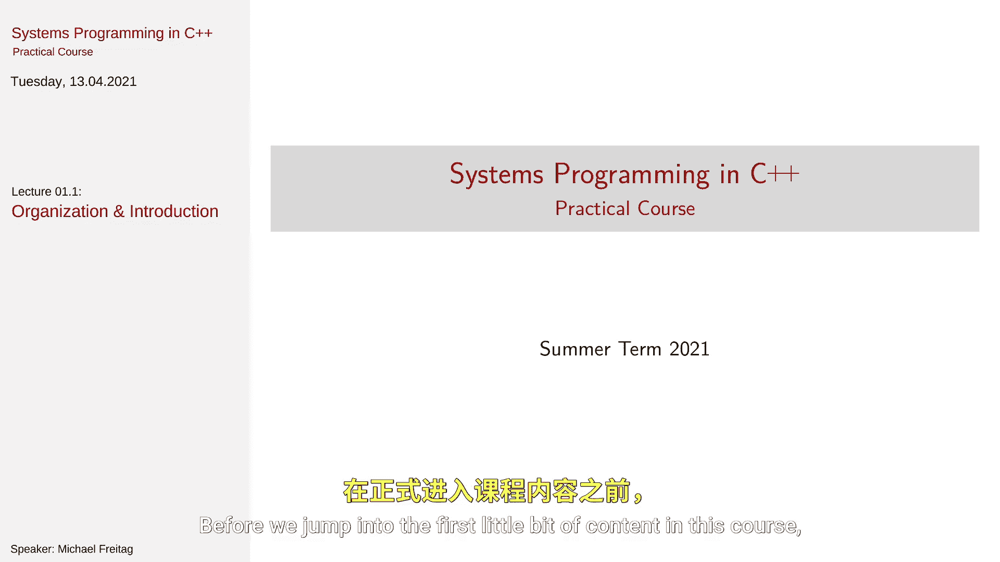
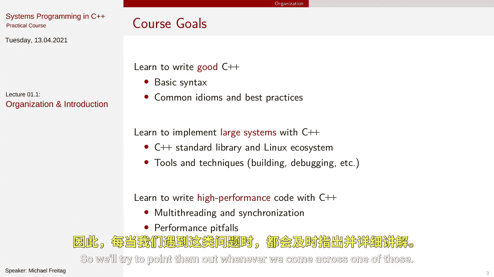
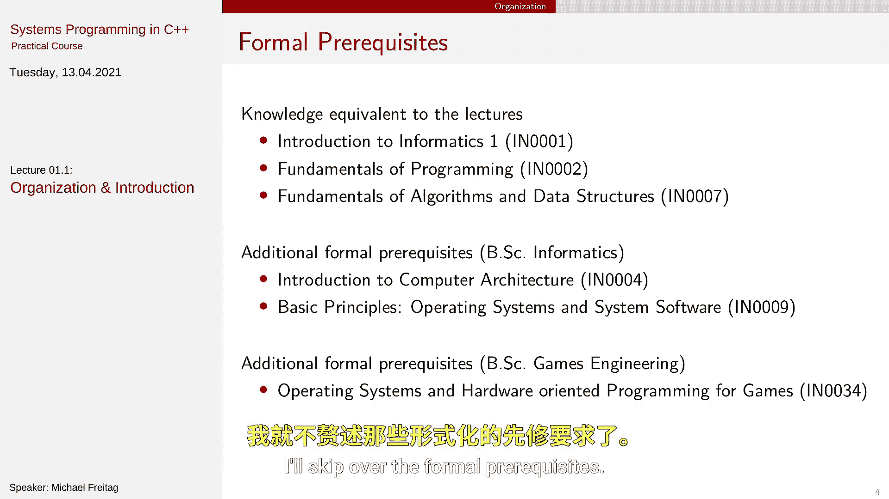
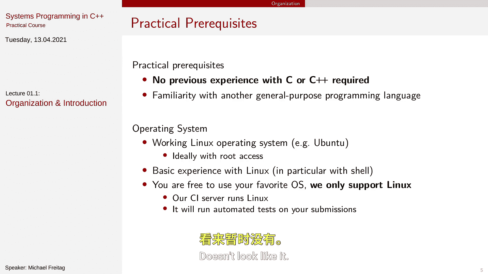
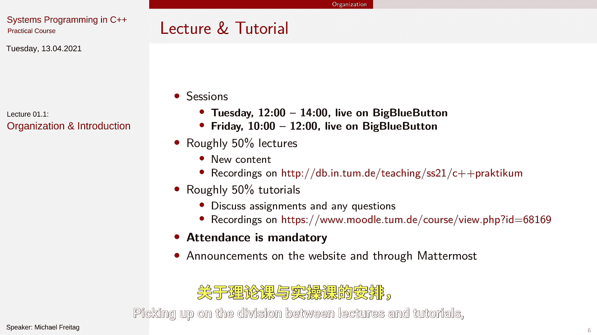
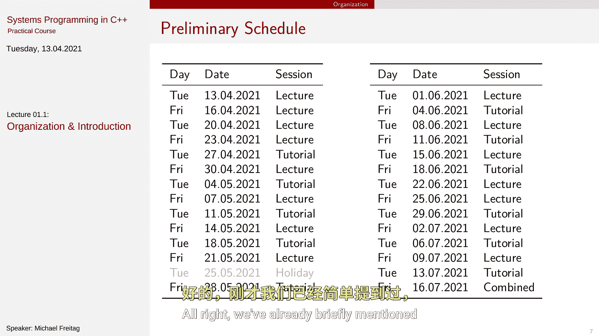
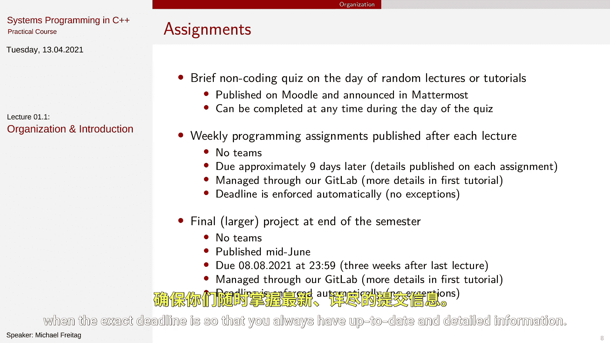

# 001：课程组织与介绍 🎯

在本节课中，我们将了解这门C++系统编程实践课程的整体目标、组织形式以及学习要求。

在深入课程内容之前，我们先花些时间梳理一下必要的组织事项。

部分内容已在启动会议上介绍过。如果你参加了启动会议，请耐心等待，我们会快速跳过这些部分。但这里也有一些关于课程运行方式的新增、更详细的信息。

## 课程目标 🎯

以下是本课程的核心目标。

*   **学习C++编程**：这自然包括掌握基本语法和惯用法。
*   **实现大型系统**：为此，我们将涵盖C++标准库、与Linux系统的交互，以及完成此任务所需的各种工具和技术。
*   **编写高性能代码**：许多人选择C++是因为它承诺能轻松编写高性能代码。因此，我们需要讨论多线程、同步以及可能影响系统性能的常见陷阱。在本课程中，你会发现这类性能陷阱出人意料地多，我们会在遇到时尽量指出。

## 先决条件 📋

我将跳过形式上的先决条件。既然你已选课，这部分不再那么重要。实践方面的先决条件更为相关。

以下是本课程对学生的要求。

*   **无需C/C++经验**：正如启动会议中指出的，我们不要求你有任何C或C++经验。甚至可以说，即使你有相关经验，我们也建议你尝试忘记，真正将本课程视为从零开始。这不是因为我们不相信你已经会写程序，而是因为这能让你更容易按照我们的期望编写代码。本课程不仅是学习如何写C++，更是学习如何写出“好”的C++代码（“好”的含义我们将在课程中阐明）。如果你有经验，这很好，会让你学得更轻松，但请尽量在完成编程作业时，仅使用课程已覆盖的知识。我保证，这将有助于你在作业中获得好成绩。
*   **需有其他编程语言基础**：即使没有C++经验，只要你熟悉其他通用编程语言（如Java或Python），就能完成编程作业。我相信这对所有人都适用，不会有问题。
*   **推荐使用Linux系统**：我们期望你在Linux系统上工作，可以是虚拟机。但我们无法保证所有内容都能在虚拟机中完美运行。理想情况下，你应使用一个纯净的Linux操作系统，最好拥有root权限。过去几年，有些学生在没有root权限的Linux系统（如图宾根大学的机房）上工作时遇到了麻烦。考虑到当前情况，本学期这应该不是问题。
*   **需有基本的Shell经验**：既然期望你在Linux上工作，你需要一些基本经验，特别是使用Shell，无需精通，只需能浏览系统、执行命令等。
*   **其他操作系统的支持**：当然，你仍可使用任何操作系统。但如果你使用非Linux系统，我们会尽力提供支持，但如果某些内容在其他系统上无法运行，你基本上需要自行解决，因为本课程是针对Linux系统设计的。特别是，我们的持续集成服务器（周五Muitz会详细介绍）运行Linux，它将对你的提交运行自动化测试。确保这些测试通过的最佳方法是在本地系统上复现它们。如果你的本地系统与CI服务器不同，可能导致本地测试通过而CI测试失败，这是可以避免的不必要麻烦。

## 时间安排与组织 🗓️

到目前为止有问题吗？看起来没有，很好，我们继续讨论时间安排和组织事项。

你已找到第一次讲座，所以这部分对你来说应该不新。我们在周二12:00至14:00有课。我们会准时在12:00开始，但会尽量将课程控制在90分钟内，所以通常应在13:30左右结束。

周五也是如此，课程时间为10:00至12:00。同样，我们准时在10:00开始，并尽量控制在90分钟内，通常应在11:30左右结束。这两场课程都将在我们现在所在的BigBlueButton房间进行直播。我们将这些课程大致分为两部分：约50%是讲座，我们介绍新内容和C++新知识，这些录播将公开；约50%是辅导课，我们讨论编程作业以及你在完成作业或学习中遇到的任何问题。

正如我所说，录播将上传到Moodle。既然这些幻灯片已经在线，你可以直接点击幻灯片中的链接，跳转到相应网站。

讲座和辅导课都是强制参加的。当然，如果你有正当理由（如补考），我们会例外处理。除此之外，我们期望你参加所有讲座和辅导课，这在很大程度上是因为我们会在周二和周五的课程中介绍重要且新的内容。

如果有任何重要通知，我们会通过网站和Mattermost聊天发布，请务必定期查看聊天。

## 课程安排 📅

关于讲座和辅导课的划分，我们有一个初步的学期安排。

这是初步安排，如果出现不可预见的情况，我们可能需要进行调整，但我们会尽可能遵循此计划。有一个假期与一次讲座时间重合，当然那次讲座不会举行，毕竟那是你们的假期。

## 考核方式 📝

好的。

我们已经简要提到会有编程作业，现在让我们花些时间进一步说明。

正如我提到的，我们期望你参加所有讲座和辅导课。为了鼓励出勤，我们会在随机的讲座或辅导课当天进行简短测验。

这些是非编码测验，通常可以用一句话甚至一个词来回答。

它们将在Moodle上发布，我们会在Mattermost聊天中通知。通常我们会在讲座开始时分发测验纸，但由于我们在线上进行，这有些脱节，意味着你可以在测验当天的任何时间完成。

但测验有时间限制，你可以自己选择何时进行，但一旦开始，通常有5分钟倒计时，你必须在这5分钟内完成测验。

除了测验，你可能在本学期前半部分花费最多时间的是每周的编程作业。这些作业从今天开始，在每次讲座后发布。

这些编程作业必须独立完成，不应有团队合作，我们会检查抄袭行为，所以请不要互相分享代码，独立解决这些编程作业。

它们大约在发布后9天截止。

“大约”是因为截止日期会根据学期内的日程安排而变化，但每项作业都有确切信息，上面会写明具体截止日期，以便你始终掌握最新、详细的信息。

## 总结 📚

本节课中，我们一起学习了这门C++系统编程课程的组织结构、学习目标、先决条件、时间安排以及考核方式。我们明确了课程旨在教授C++编程、系统实现和高性能代码编写，并强调了独立完成作业和使用Linux环境的重要性。接下来，我们将正式进入C++编程的学习。