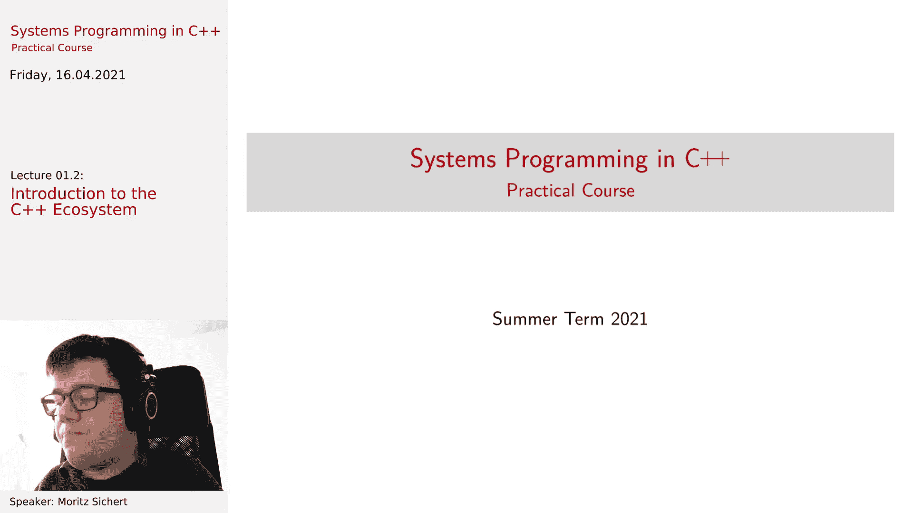
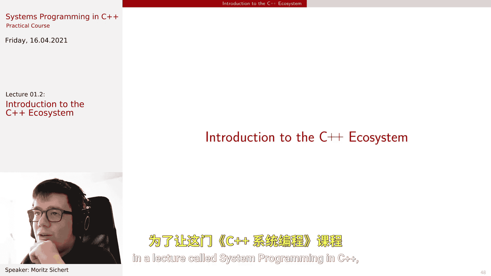
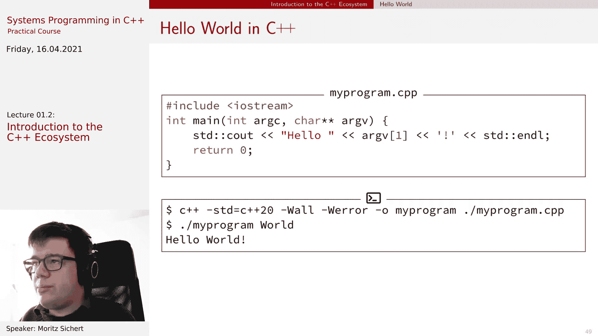
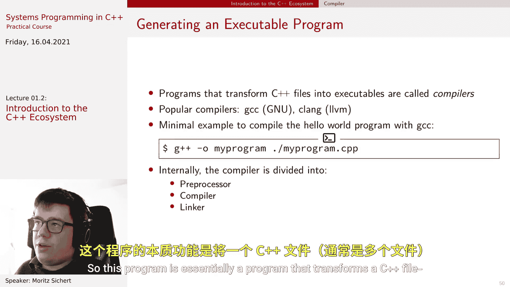
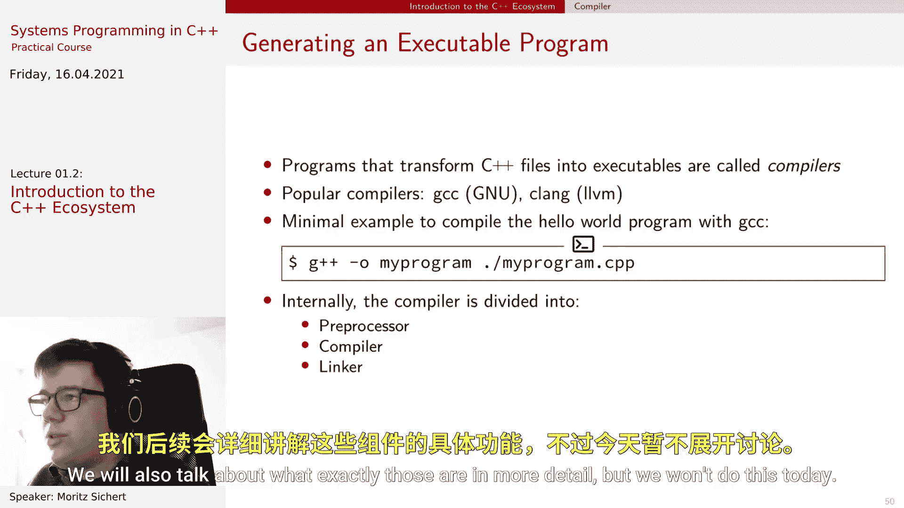
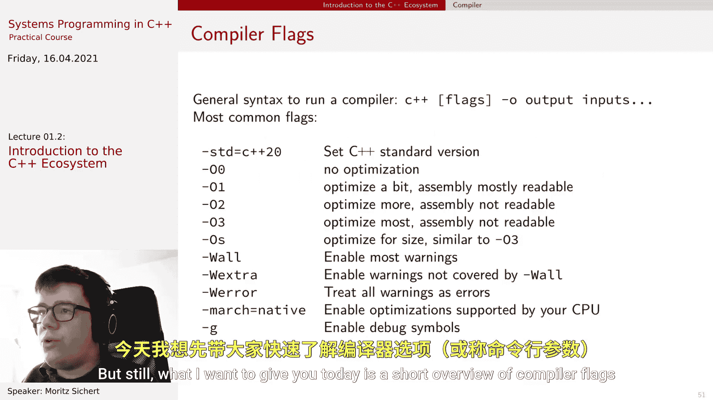
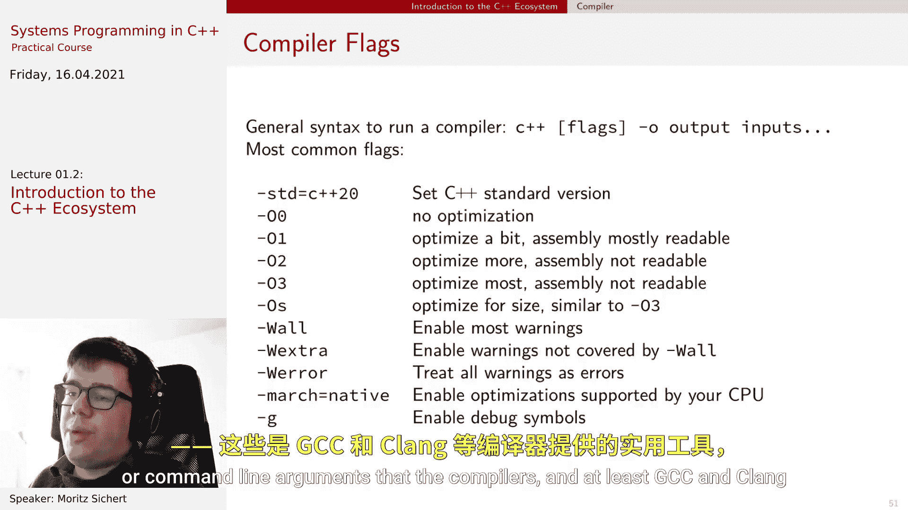
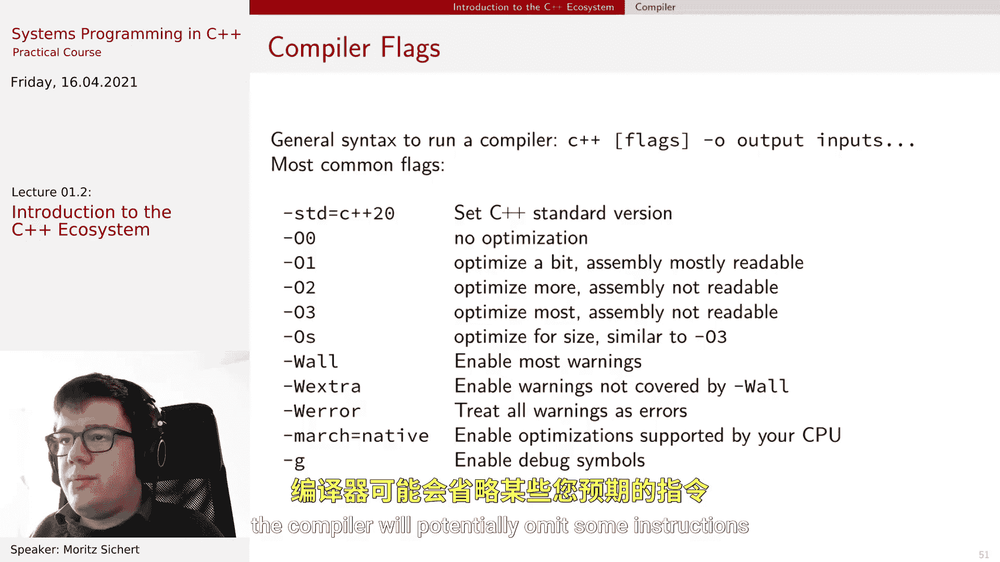

# 002：C++生态系统介绍 🚀

在本节课中，我们将学习C++生态系统的基础知识。虽然不会深入探讨C++语法细节，但了解这些工具和概念对于后续的编程练习至关重要。



## 概述



欢迎来到今天的C++系统编程课程。今天的主题是C++生态系统介绍。这意味着我们暂时不会详细讨论C++语法，这将是下周的内容。然而，在使用C++时，你会接触到许多相关工具和概念。我们认为，了解这个生态系统不仅重要，而且在接下来几周的编程练习中，你也将大量用到这些知识。因此，我们今天将讨论这些内容。

尽管如此，为了让你在这门名为“C++系统编程”的课程中至少看到一些C++代码，我将展示一个简单的C++“Hello World”示例。

## 一个简单的C++示例

以下是一个基础的C++程序示例：

```cpp
#include <iostream>



int main(int argc, char* argv[]) {
    std::cout << "Hello " << argv[1] << std::endl;
    return 0;
}
```



今天我不会讨论语法细节，因为这将是下周的内容。但通过这个例子，你可以了解一个C++程序的基本结构。通常，C++源文件以`.cpp`为扩展名。程序中包含一些语句，你可以定义`main`函数。其中，`std::cout << ...`这一行是C++中打印输出的标准方式。在这个“Hello World”示例中，程序会打印“Hello”以及你在命令行中提供的第一个参数，然后返回0。

正如周二课程所述，C++是一门编译型语言。因此，你不能像执行Python脚本那样直接运行C++源文件。对于Python，你虽然需要解释器，但无需预先编译。而C++则需要先进行编译。

## 编译器的作用

为了编译C++程序，你需要一个编译器。在上面的示例中，我们调用了名为`c++`的程序。你可以在示例终端中看到，我们运行`c++`程序并附带一些参数，然后生成一个名为`my_program`的二进制可执行文件。最后，我们执行这个文件并传递参数，就能在终端上看到预期的“Hello World”输出。

在深入讨论语法之前，我们想先谈谈第二个关键部分：C++编译器。这个程序本质上负责将一个或多个C++源文件转换成一个可执行文件，操作系统随后能够执行它。这类程序通常被称为编译器。任何将某种编程语言作为输入并输出可执行文件的程序，都可以称为编译器。

## 主流C++编译器

对于C++，最流行的编译器是GCC和Clang。

*   **GCC**：全称是GNU编译器集合，来自GNU项目。它主要在Linux系统上使用，是开源的。
*   **Clang**：来自LLVM项目。它同样非常流行，在Linux上也很常用，并且也是开源的。在macOS上开发时，如果你安装了Apple的开发工具，默认编译器通常是Clang。

我们同时介绍这两个编译器的原因是，它们在命令行参数上高度兼容。如果你看到一个使用GCC命令和参数的例子，通常只需将可执行文件名从`g++`换成`clang++`，大多数情况下也能正常工作。

## 编译器的使用

首先，让我们看看如何使用这样的编译器。这里有一个GCC的例子。GCC全称是GNU编译器集合，这意味着它不仅支持C++，还能编译C语言等其他编程语言。因此，它有多种调用方式。如果你想用GCC编译C++程序，必须使用`g++`程序。这本质上是为了告诉GCC启用C++特有的功能。





从一个源文件生成二进制可执行文件的最基本例子是：调用编译器，指定输入文件，并使用`-o`参数来命名输出文件。这样，编译器就会将可执行文件写入你指定的文件中。

## 编译过程简介



虽然上面的命令可以工作，但编译器内部实际上发生了很多步骤。你需要了解的第一点是：C++编译器内部通常分为三个阶段：**预处理器**、**编译器**（狭义）和**链接器**。是的，“编译器”这个词本身包含了“编译器”这个步骤，这确实有点令人困惑。通常当人们谈论“编译器”时，他们指的是这三个步骤的整体。但从技术上讲，“编译器”只是将源文件转换为可执行文件的多个步骤中的一个。我们今天不会深入讨论每个步骤的细节。

尽管如此，我今天想给你一个简短的概述，介绍编译器（至少是GCC和Clang）所拥有的一些常用命令行标志和参数，你可以利用它们来影响编译过程。

## 编译器命令行语法与常用标志

正如你所见，通用的语法是：使用你编译器的C++版本（对于GCC是`g++`，对于Clang是`clang++`），然后是一些可选的编译器标志（通常用`-o`指定输出文件名），最后在命令行末尾列出所有需要的源文件作为输入。

以下是几个你可能总会用到的、最常见的标志。无论是你直接在终端中键入，还是通过某些IDE自动生成这些标志，了解它们都很有用。

*   **`-std=c++20`**：这可能是最重要的一个。它告诉编译器你想要使用C++20标准。正如周二所说，C++有多个标准版本，新标准通常包含更多功能。由于某些新功能在不同版本间并非完全兼容（尽管大多数时候是），你需要告诉编译器你期望使用哪个版本的C++标准，以便它相应地编译你的程序。
*   **优化标志**：有一系列标志会影响优化级别。优化意味着，对于相同的源代码程序，编译器生成汇编代码的方式有多种。根据不同的优化标志，编译器会付出不同程度的努力来生成更快的、但功能与你所写代码等效的程序。本质上，它会更努力地生成更好的汇编代码。至少对于GCC和Clang，默认的优化级别是`-O0`，即不进行优化。你可能会希望使用这个级别，因为当你想要调试程序时，完全不进行优化通常是最好的。因为如果进行了优化，编译器可能会省略一些你期望执行的指令或代码行，因为它可以推断出这些操作不影响最终结果。

## 总结



本节课我们一起学习了C++生态系统的基础知识。我们了解了C++程序的基本结构，认识了将源代码转换为可执行文件的**编译器**，并介绍了两个主流的编译器：**GCC**和**Clang**。我们还简要了解了编译过程通常包含的多个阶段，并学习了一些常用的**编译器标志**，例如用于指定语言标准的`-std=c++20`和用于控制代码优化的`-O`系列标志。掌握这些工具和概念，将为后续深入学习C++语法和进行实际编程练习打下坚实的基础。