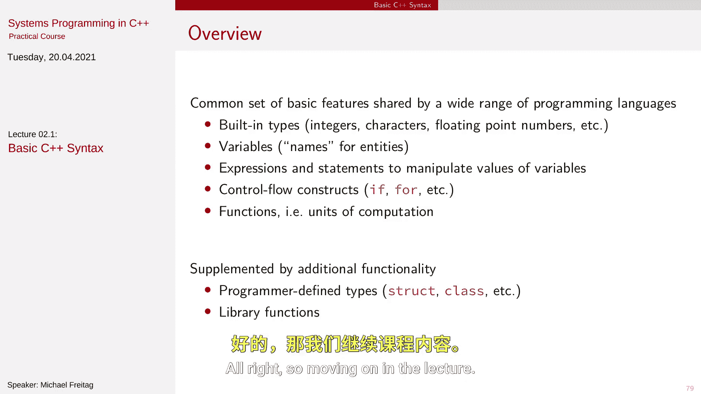
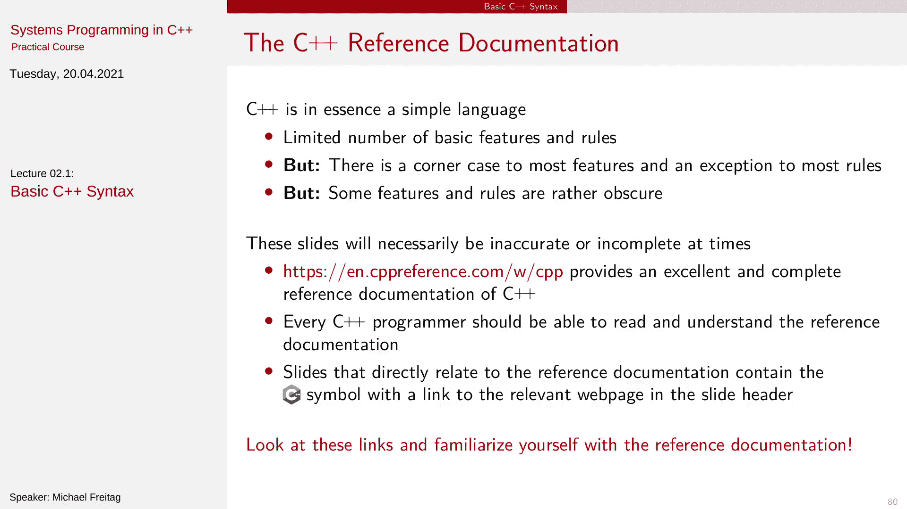
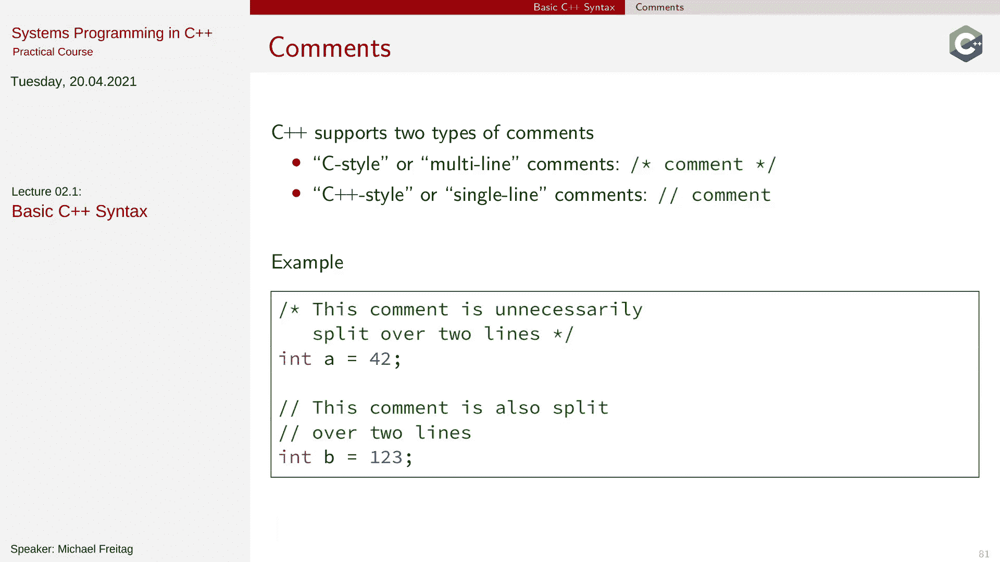
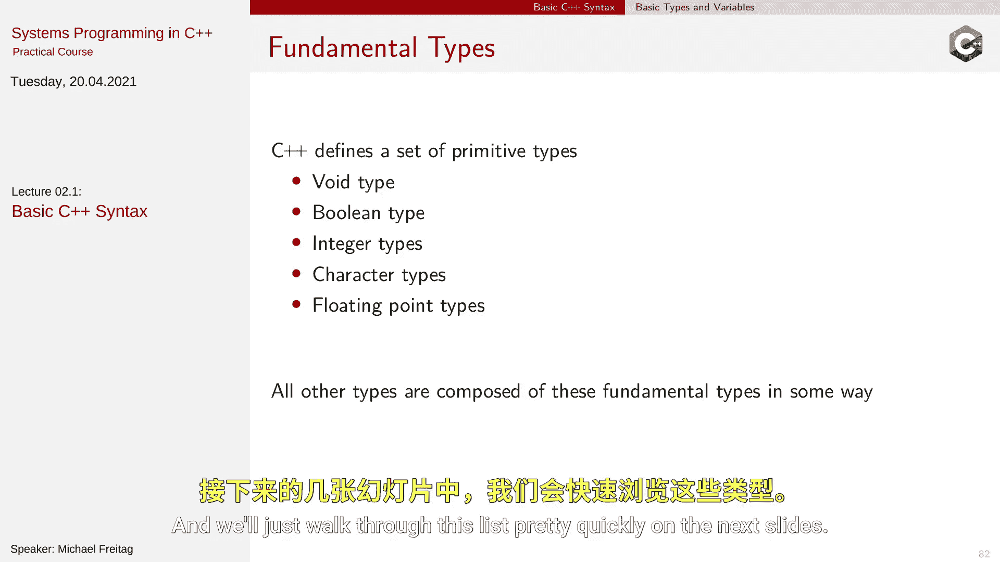
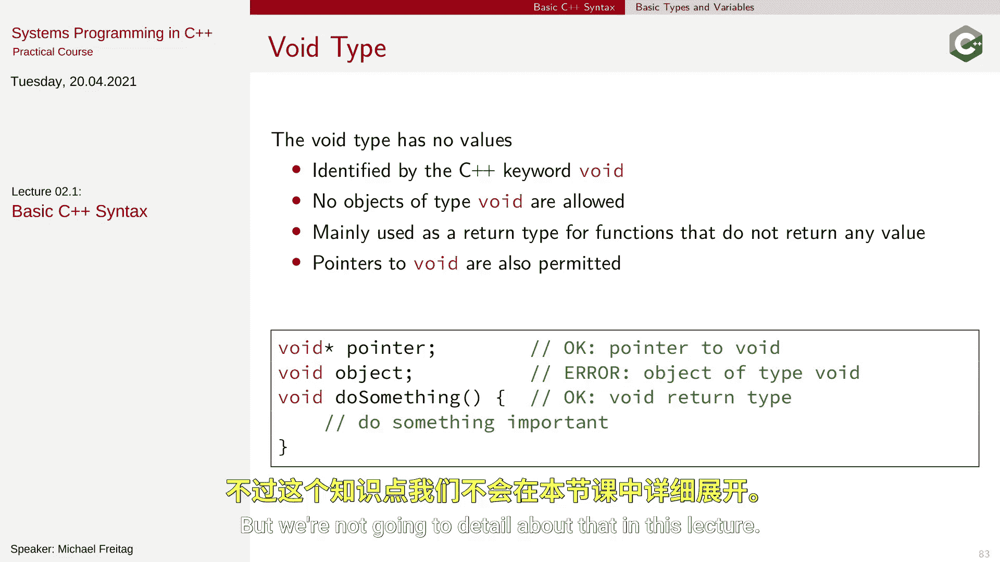
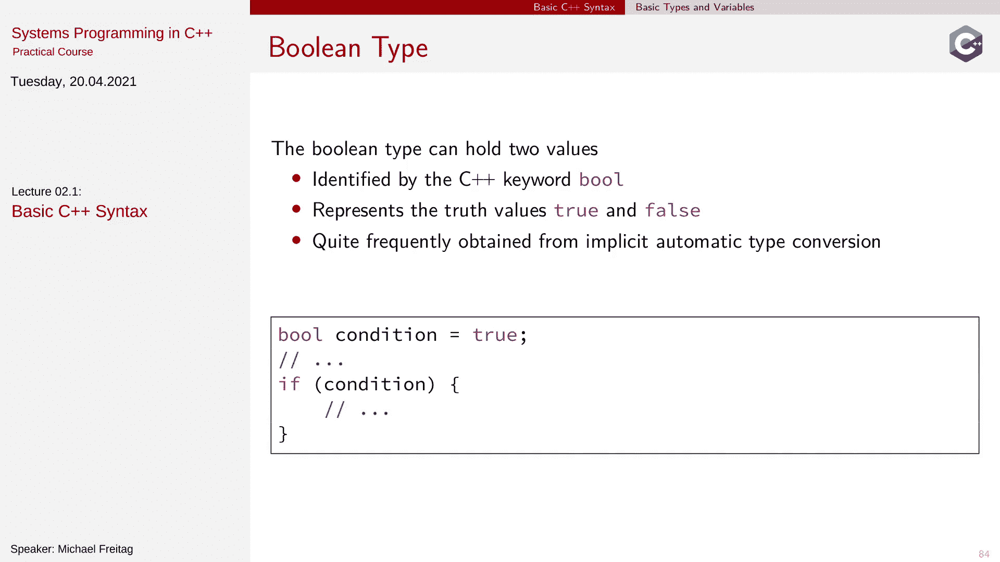
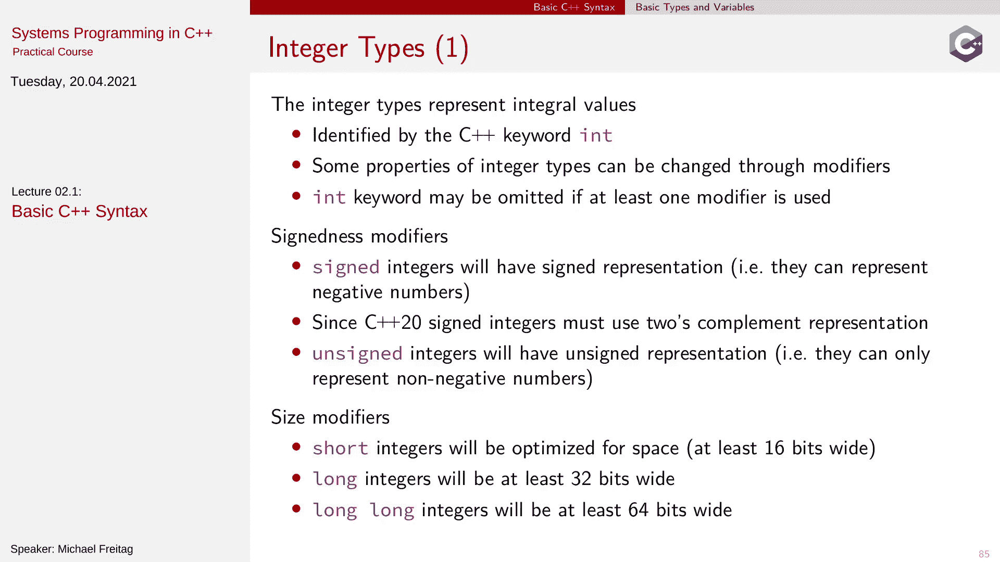
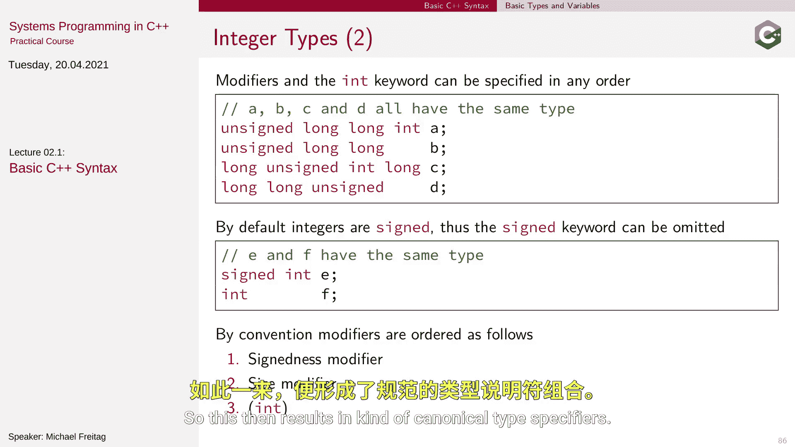
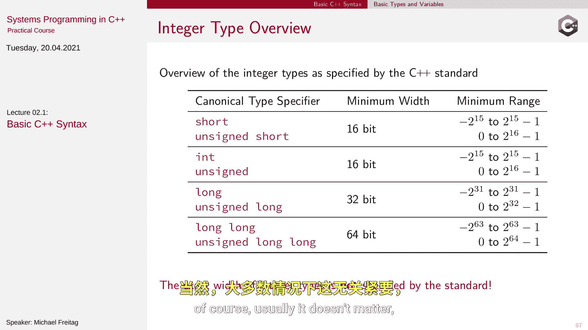
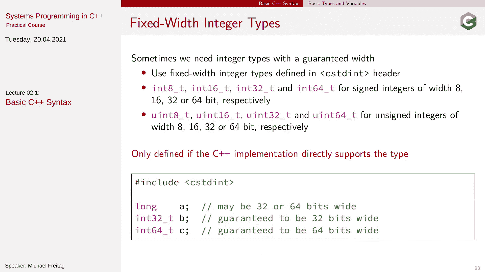

# 003：基础C++语法 🧱

在本节课中，我们将学习C++的基础语法。这包括内置类型、变量、表达式、语句、控制流和函数等核心概念。这些内容与许多其他高级编程语言相似，但C++有其独特的细节和规则。我们将快速浏览这些内容，为后续更深入的主题打下基础。

## 注释 📝

上一节我们介绍了课程概述，本节中我们来看看C++中最基础的功能之一：注释。



与其他语言类似，C++有两种注释：多行注释和单行注释。它们用于在代码中添加说明性文字，编译器会忽略这些注释。

以下是两种注释的语法示例：

```cpp
// 这是一个单行注释

/*
   这是一个
   多行注释
*/
```

## 基础类型 🔢

了解了如何为代码添加注释后，我们接下来探讨构成C++程序的基本构建块：基础类型。

C++提供了一组基础（或原始）类型，它们是构成所有其他复合类型的基础。这些类型包括 `void`、布尔型、整型、字符型和浮点型。

### void 类型





`void` 类型有些特殊，它表示“无类型”。它不能拥有值，因此不允许创建 `void` 类型的对象。它主要用作不返回任何值的函数的返回类型。与其他语言的一个不同之处在于，C++允许指向 `void` 类型的指针，我们将在后续课程中详细讨论指针。



### 布尔类型 (bool)

布尔类型非常简单，它只有两个可能的值：`true`（真）和 `false`（假），由关键字 `bool` 标识。除了直接赋值，布尔值也经常通过隐式类型转换获得。



### 字符类型 (char)



字符类型用于表示单个字符。它通常占用1字节内存，可以表示基本的ASCII字符集。C++中还有 `wchar_t`、`char16_t`、`char32_t` 等用于表示更宽字符集的类型。

### 整型 (int)

整型可能是第一个与你已熟知的语言有显著差异的类型。所有整型都由关键字 `int` 标识，但我们可以通过“修饰符”来改变整型的属性。

以下是主要的修饰符类别：

*   **有符号性修饰符**：C++区分有符号（`signed`）和无符号（`unsigned`）整数。有符号整数可以表示负数（C++20起强制使用二进制补码表示）。无符号整数只能表示非负数。
*   **大小修饰符**：`short` 修饰符优化空间，宽度至少16位。`long` 和 `long long` 分别提供至少32位和64位的宽度。

默认情况下，`int` 是有符号的，因此 `signed` 关键字通常被省略。修饰符和 `int` 关键字的顺序可以任意排列，但这会导致代码可读性降低。



按照约定，我们建议按以下顺序排列：先有符号性修饰符（如 `unsigned`），然后是大小修饰符（如 `long`），最后是 `int` 关键字。这产生了以下规范的类型指定符：

| 类型指定符 | 最小宽度 | 最小值 | 最大值 |
| :--- | :--- | :--- | :--- |
| `short` / `short int` | 16位 | -32768 | 32767 |
| `unsigned short` | 16位 | 0 | 65535 |
| `int` | 16位 | -32768 | 32767 |
| `unsigned` / `unsigned int` | 16位 | 0 | 65535 |
| `long` / `long int` | 32位 | -2147483648 | 2147483647 |
| `unsigned long` | 32位 | 0 | 4294967295 |
| `long long` / `long long int` | 64位 | -9223372036854775808 | 9223372036854775807 |
| `unsigned long long` | 64位 | 0 | 18446744073709551615 |

需要注意的是，标准只规定了这些类型的最小宽度，实际宽度取决于编译器和架构。如果需要确保整数具有精确的位宽，可以使用定义在 `<cstdint>` 头文件中的固定宽度整数类型，例如 `int32_t`、`uint64_t` 等。

### 浮点类型



浮点类型用于表示实数。C++主要有三种浮点类型：
*   `float`：单精度浮点数。
*   `double`：双精度浮点数。
*   `long double`：扩展精度浮点数。

它们的精度和范围由实现定义，但通常遵循IEEE 754标准。



## 总结 📚



本节课我们一起学习了C++的基础语法。我们从最简单的注释开始，然后系统地介绍了C++的各种基础类型：特殊的 `void` 类型、简单的布尔类型、字符类型、具有多种修饰符的整型以及浮点类型。理解这些基础类型是编写任何C++程序的第一步。下一节课，我们将学习如何使用这些类型来声明变量和编写表达式。