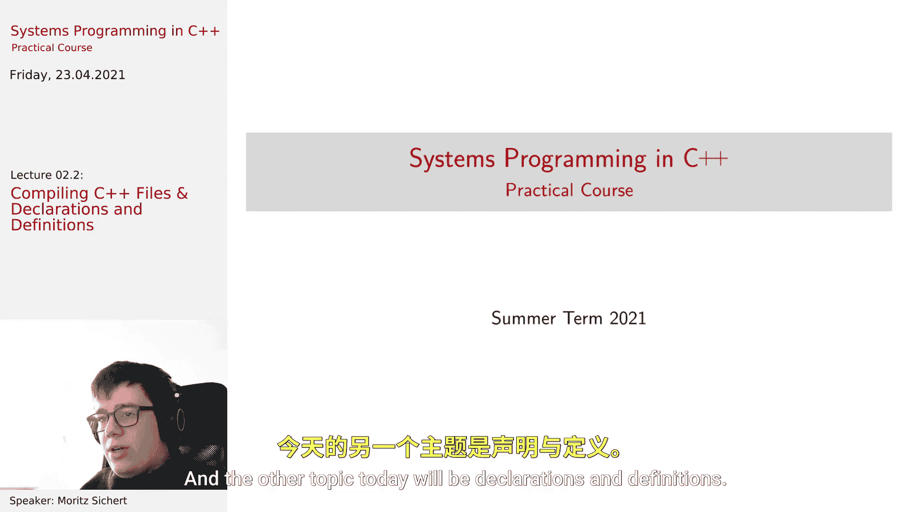
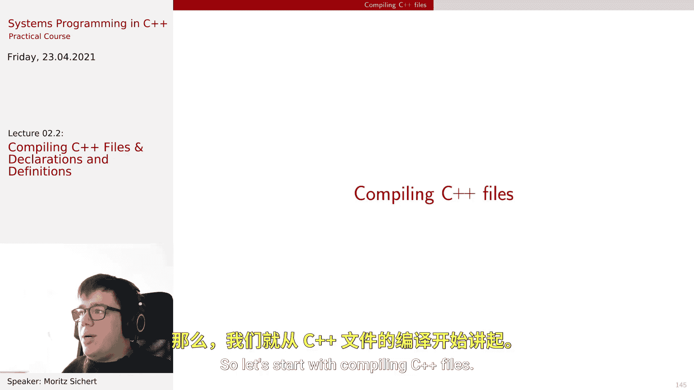
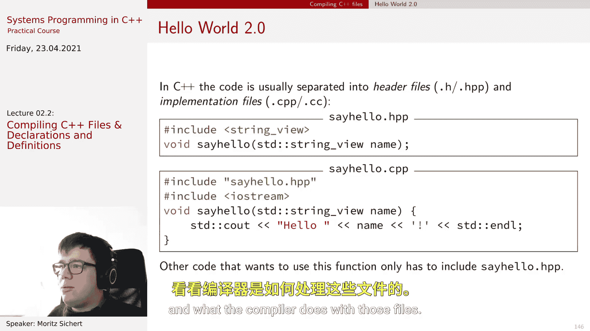
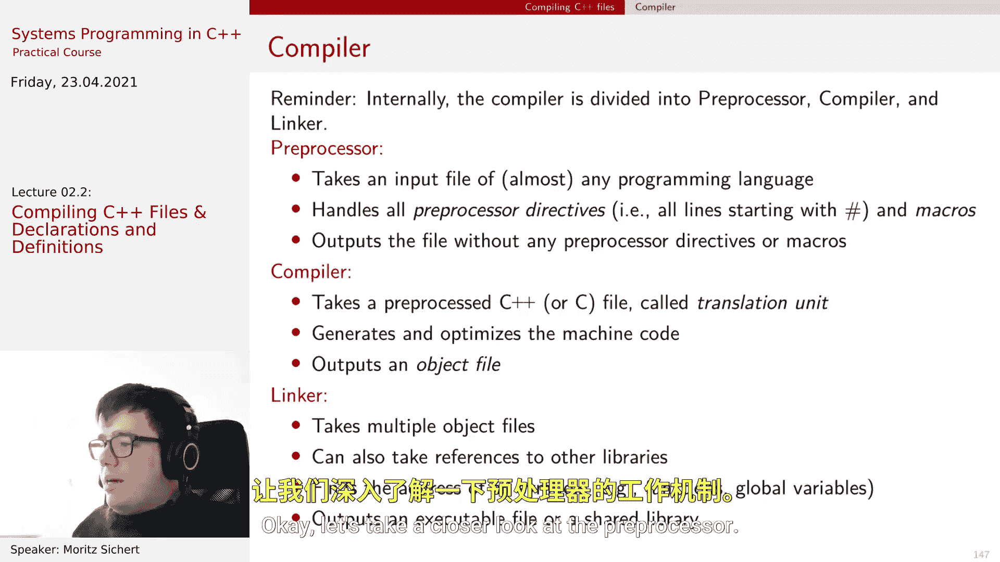
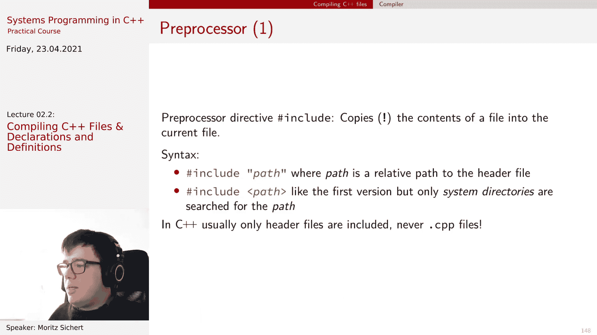
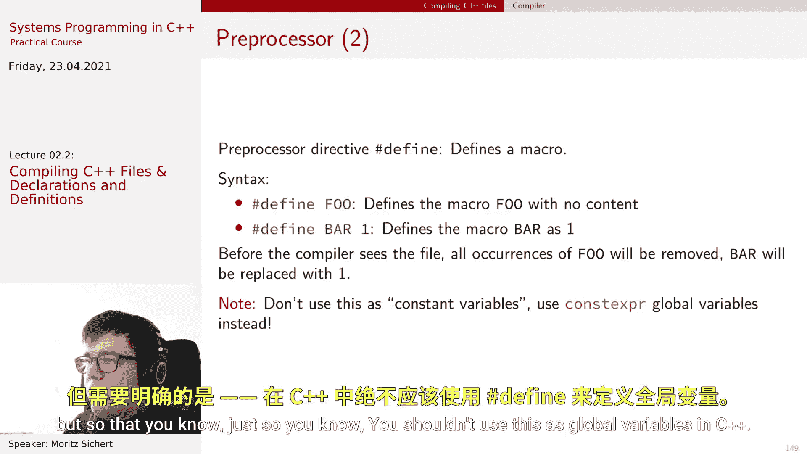
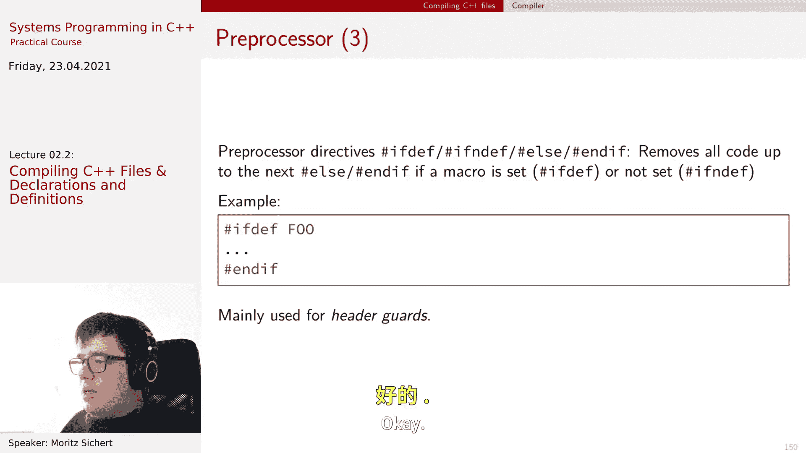
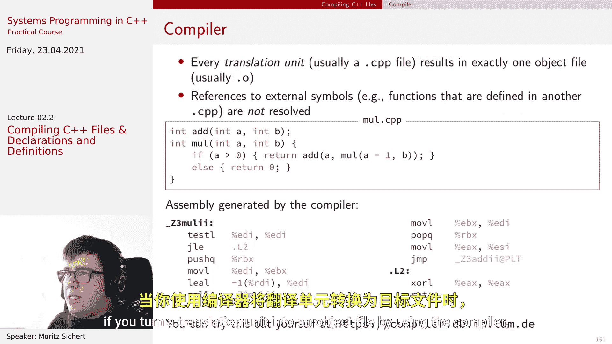

# 004：编译C++文件与声明和定义 📚





在本节课中，我们将要学习C++程序的编译过程，以及声明和定义这两个核心概念。我们将详细探讨编译器内部的工作原理，并解释为何C++代码通常被分为头文件和实现文件。

---

## 编译C++文件 🛠️



上一节我们简要介绍了C++程序的结构。现在，我们来看一个稍长的“Hello World”程序示例，并深入理解编译过程。

正如之前提到的，C++代码通常被分离到头文件（`.h`或`.hpp`）和实现文件（`.cpp`）中。本节中，我们将探讨这种分离的原因以及两者的区别。目前，你只需要知道它们是两种不同的文件类型，但可以引用同一个函数（例如 `sayHello`）。

接下来，让我们仔细看看编译器如何处理这些文件。

---

## 编译器内部结构 🔧

从上周的学习中你应该已经知道，我们通常所说的“编译器”程序，在内部实际上分为三个部分：**预处理器**、**编译器**和**链接器**。

了解这个概念很有用，因为有些错误信息只会在预处理器或链接器阶段出现，而不会在编译器本身出现。因此，至少从概念上理解编译器内部如何工作是很有意义的。

---

### 预处理器

预处理器首先处理输入文件。它的输入可以是几乎任何编程语言的源文件，这意味着预处理器并不特定于C或C++，只是最常与这两种语言一起使用。



预处理器只处理**预处理指令**，即那些以井号（`#`）开头的行，以及**宏**。它的输出是同一个文件，但其中所有的预处理指令和宏都已被替换或展开，不再包含任何预处理指令。只有经过这个处理后的文件才会被交给编译器。

以下是几个最重要的预处理指令：

#### 1. `#include` 指令
`#include` 指令的作用非常简单：它只是将指定文件的内容复制到当前文件中。其语法如下：
```cpp
#include <header_name>   // 使用尖括号
#include "header_name"   // 使用双引号
```
两者的主要区别在于搜索路径：
*   使用双引号时，编译器会先在用户指定的自定义包含路径中查找头文件，然后再搜索系统目录。
*   使用尖括号时，编译器通常只在系统目录中查找头文件。

因此，包含标准库头文件时通常使用尖括号，而包含项目自身的头文件时使用双引号。需要注意的是，通常**不应该直接包含 `.cpp` 文件**。

#### 2. `#define` 指令
`#define` 指令用于定义宏。例如：
```cpp
#define FOO          // 定义一个名为FOO的宏，无内容
#define BAR 1        // 定义一个名为BAR的宏，内容为1
```
预处理器会将代码中所有出现 `FOO` 的地方直接移除，将所有出现 `BAR` 的地方替换为 `1`。

**重要提示**：在C++中，**不应该使用 `#define` 来定义常量**。C语言中常用这种做法，但在C++中有更好的方式，例如使用 `const` 或 `constexpr` 变量，我们将在后续课程中讨论。

#### 3. 条件编译指令 (`#ifdef`, `#ifndef`, `#endif`)
这些指令用于在代码被交给编译器之前，有条件地包含或排除部分代码。例如：
```cpp
#ifdef FOO
    // 如果宏FOO已定义，则保留此部分代码
#else
    // 如果宏FOO未定义，则保留此部分代码
#endif
```
这种做法的一个主要用途是实现**头文件保护**，我们稍后会讨论。

---

### 编译器（狭义）



经过预处理器处理的源文件（在C++中称为**翻译单元**，通常是一个 `.cpp` 文件）会被交给编译器。

编译器的工作是检查语法、进行优化，并将翻译单元转换为**目标文件**（在Linux上通常是 `.o` 文件）。目标文件本质上是该翻译单元机器码的二进制表示。

需要注意的是，一个 `.cpp` 文件可能会使用在其他文件中定义的函数。在编译阶段，这些对外部符号的引用还**没有被解析**，它们只是被记录下来。

---

### 链接器



一个项目通常由多个 `.cpp` 文件组成，因此编译后会生成多个目标文件。链接器的任务就是将这些目标文件，以及可能用到的外部库，组合成一个完整的可执行程序或库。

链接器会查找所有目标文件中引用的外部符号，并将它们正确地关联起来，最终生成可执行文件（如 `a.out`）或库文件（如 `.so` 或 `.a`）。



---

## 总结 📝



本节课中我们一起学习了C++程序的编译流程。我们了解到“编译”实际上包含预处理、编译（狭义）和链接三个阶段。预处理器处理 `#include`、`#define` 等指令；编译器将单个翻译单元转为目标文件；链接器则将多个目标文件及库合并为最终程序。我们还强调了在C++中应避免使用 `#define` 定义常量。理解这些步骤对于诊断构建错误和编写模块化代码至关重要。