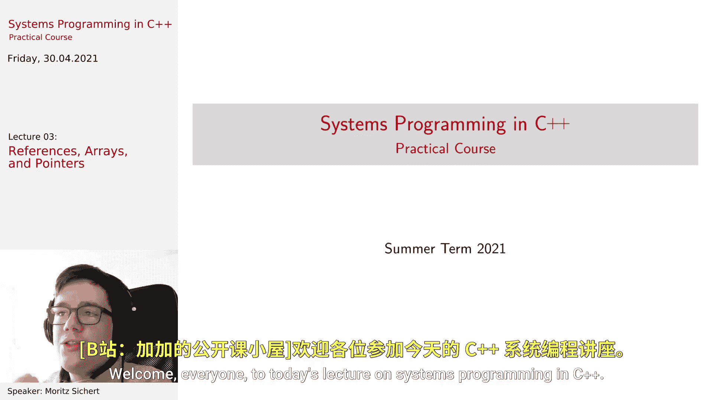
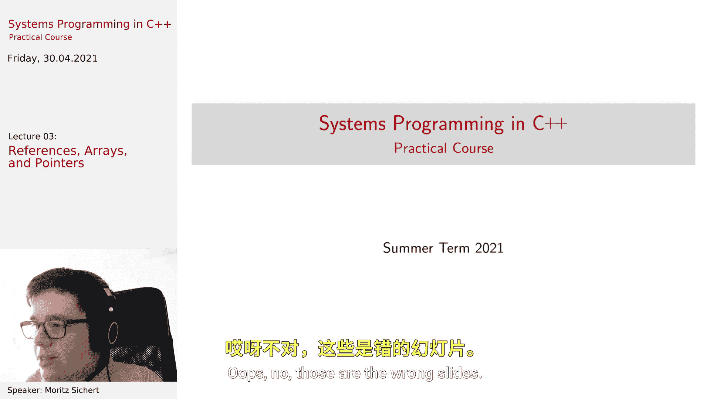
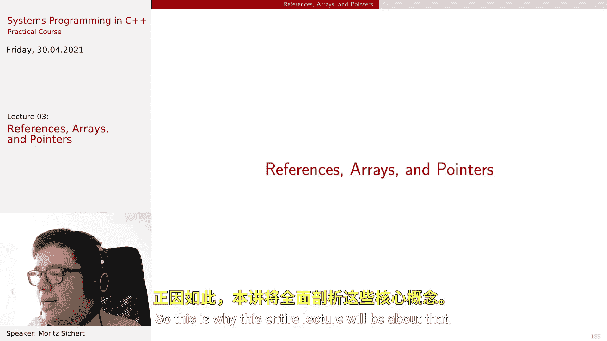
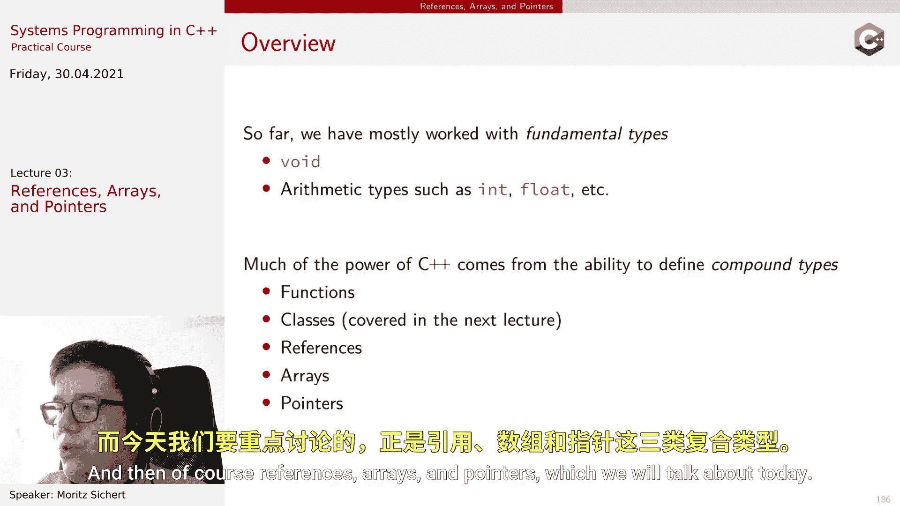
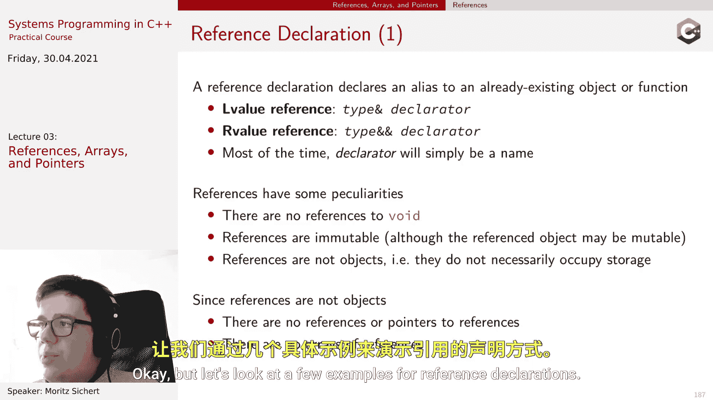
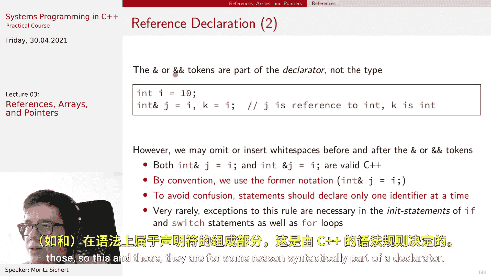
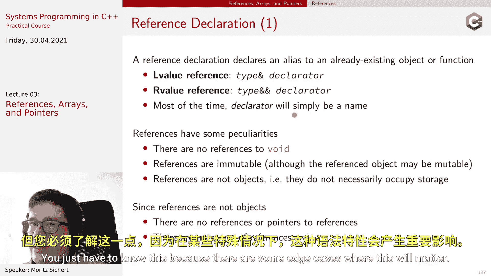
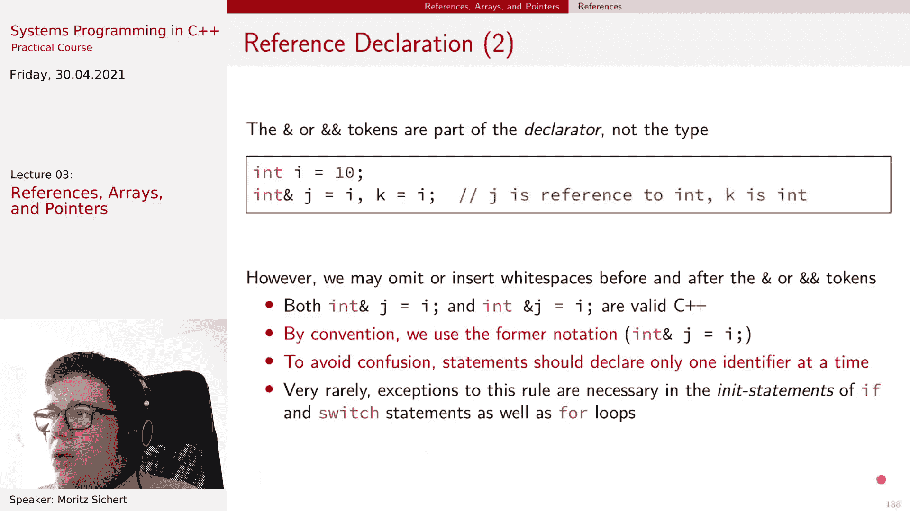
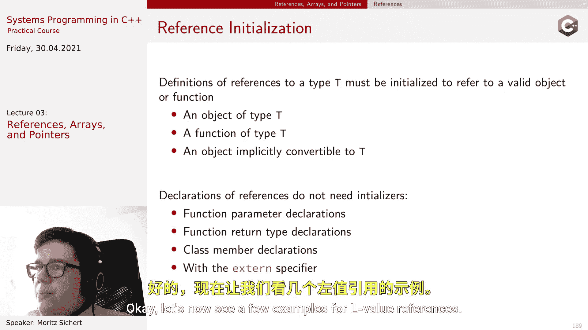
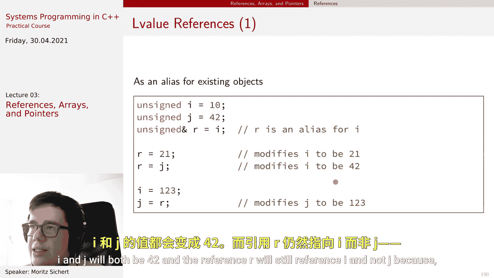

# 005：引用、数组与指针 📚





在本节课中，我们将学习C++中的三个核心概念：引用、数组和指针。这些是理解C++作为一门系统编程语言如何直接操作内存和资源的关键。我们将从引用开始，逐步深入到数组和指针，并解释它们之间的关系与区别。



---

## 引用 🔗



上一节我们介绍了复合类型的概念。本节中，我们来看看引用。引用为已存在的对象或函数提供了一个别名。

### 引用的语法与特性
声明引用的基本语法是在类型后添加 `&` 符号。例如：
```cpp
int& ref = variable;
```
以下是关于引用需要了解的关键点：
*   引用必须初始化，且只能指向已存在的对象或函数。
*   引用本身是不可变的（即不能让其指向另一个对象），但它所引用的对象的值可以被修改。
*   引用本身不是对象，因此不能创建指向引用的指针，也不能创建引用的数组。

### 引用的初始化
由于引用必须初始化，定义时必须为其指定一个目标。以下是一些合法的初始化场景：
*   指向一个类型匹配的对象。
*   指向一个函数。
*   指向一个可转换为目标类型的对象。

在函数参数、返回类型或类成员声明中，可以只声明引用而不立即初始化。

### 左值引用示例
让我们通过一个例子来理解引用的行为：
```cpp
unsigned i = 5;
unsigned j = 10;
unsigned& r = i; // r 是 i 的引用
r = 21;         // 现在 i 的值变为 21
r = j;          // 将 j 的值（10）赋给 r（即 i），i 变为 10。r 仍然引用 i，而不是 j。
```

---

## 数组 📦



了解了如何为单个对象创建别名后，我们来看看如何组织多个同类型对象——数组。

### 数组的声明与初始化
数组用于在连续内存中存储多个同类型对象。声明数组需要指定元素类型和大小。
```cpp
int arr[10]; // 声明一个包含10个整数的数组
```
以下是数组初始化的几种方式：
*   在声明时使用初始化列表：`int arr[3] = {1, 2, 3};`
*   初始化列表可以省略大小，编译器会自动推导：`int arr[] = {1, 2, 3};`
*   可以部分初始化，未指定的元素会被默认初始化（如设为0）。

### 数组的访问与遍历
数组元素通过从0开始的索引进行访问。
```cpp
arr[0] = 42; // 访问第一个元素
```
可以使用循环来遍历数组中的所有元素。





---

## 指针 🎯



数组在内存中是连续存储的。要直接操作内存地址，我们需要指针。指针是存储另一个变量内存地址的变量。

### 指针的声明与使用
声明指针需在类型后使用 `*` 符号。
```cpp
int* ptr; // 声明一个指向整数的指针
```
以下是使用指针的基本操作：
*   获取地址：使用取址运算符 `&` 获取变量的地址。`ptr = &variable;`
*   解引用：使用解引用运算符 `*` 访问指针所指向地址的值。`int value = *ptr;`
*   指针算术：可以对指针进行加减运算，这在遍历数组时非常有用。

### 指针与数组的关系
数组名在大多数情况下可以视为指向其首元素的指针。
```cpp
int arr[5] = {1, 2, 3, 4, 5};
int* ptr = arr; // ptr 指向 arr[0]
```
通过指针算术可以访问数组的其他元素，例如 `*(ptr + 2)` 访问 `arr[2]`。

### 指针的注意事项
指针功能强大，但也容易导致错误，例如：
*   空指针：未指向任何有效地址的指针。
*   野指针：指向已释放或无效内存的指针。
*   内存泄漏：忘记释放动态分配的内存。

---

## 总结 🎉



本节课中我们一起学习了C++中引用、数组和指针这三个核心概念。
*   **引用**是一个对象的别名，必须初始化且不可更改其指向，用于提供便捷的访问方式。
*   **数组**是相同类型对象的集合，在内存中连续存储，通过索引访问。
*   **指针**存储内存地址，能够直接操作内存，与数组关系密切，但需要谨慎使用以避免错误。



理解这些概念是掌握C++系统编程的基础，它们让你能够更精细地控制程序的内存和资源。在接下来的课程中，我们将基于这些知识，探索更复杂的类型和功能。