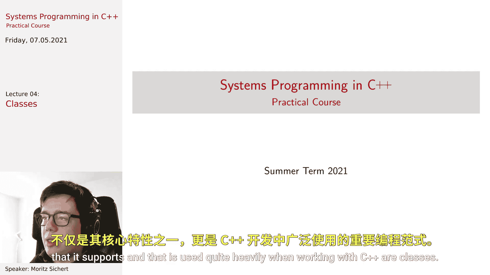
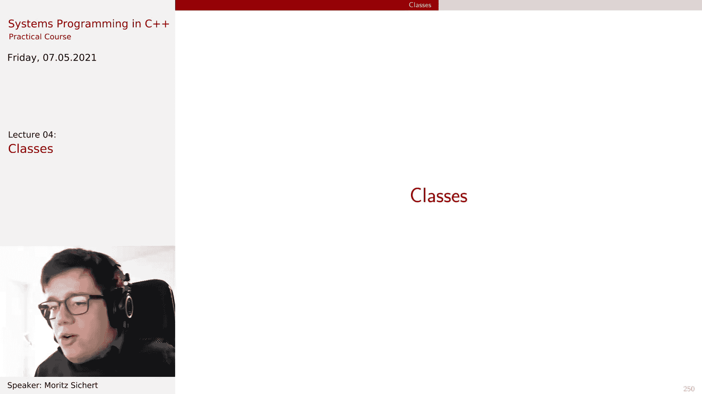
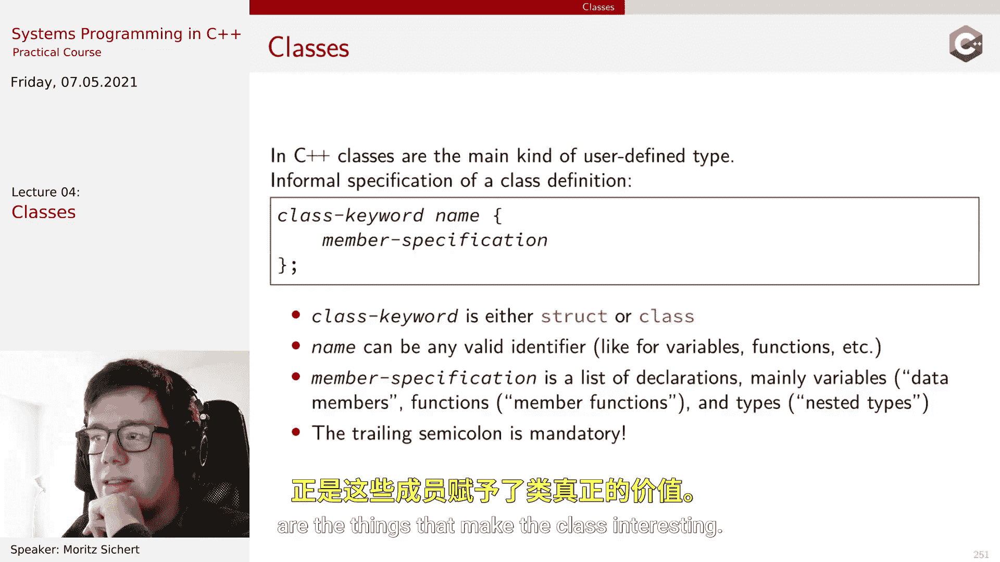
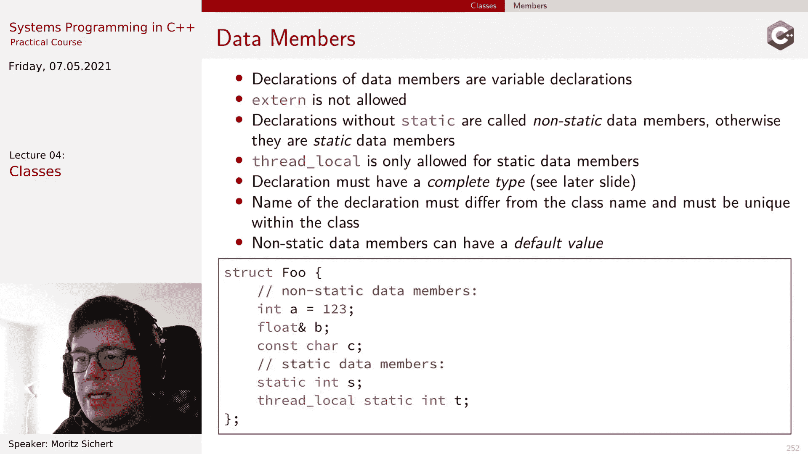
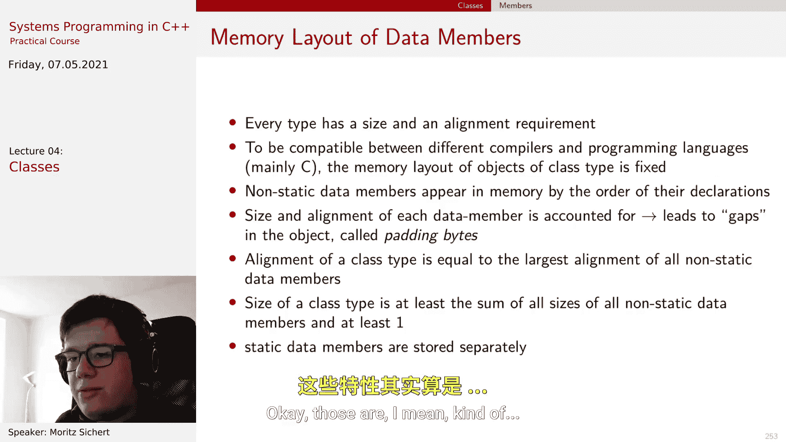
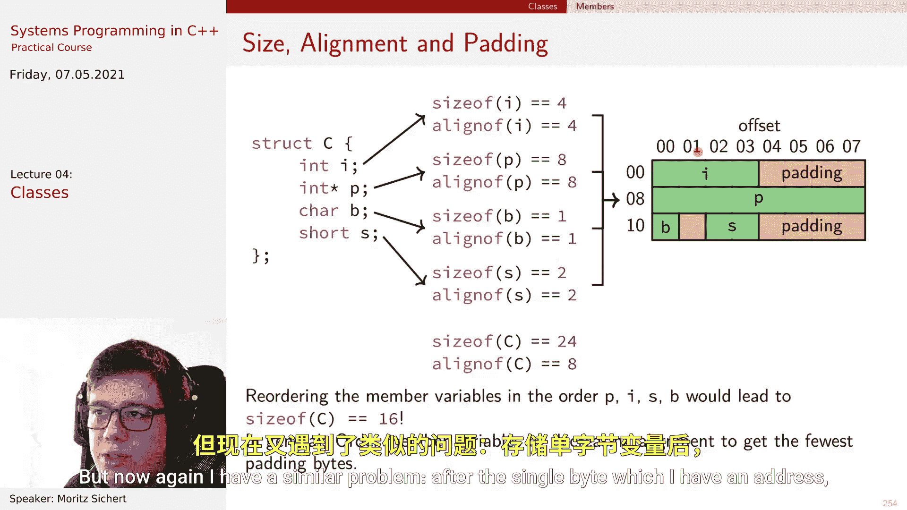

# 006：类与对象 🏗️



在本节课中，我们将学习C++中一个核心概念：**类**。C++是一门支持多种编程范式的语言，而**类**正是面向对象编程范式的基石。我们将从基本语法开始，逐步深入到类的成员、内存布局等细节，确保初学者也能轻松理解。



---

## 类的定义与基本语法 📝

上一节我们介绍了课程概述，本节中我们来看看如何定义一个类。在C++中，类是一种用户自定义类型，其定义语法如下：



```cpp
class ClassName {
    // 成员声明...
};
```

或者使用 `struct` 关键字（源自C语言，在C++中与 `class` 的主要区别在于默认访问权限）：

```cpp
struct ClassName {
    // 成员声明...
};
```

以下是定义类时需要注意的几个关键点：
*   **类名**：可以是任何有效的标识符。
*   **类体**：花括号 `{}` 内是**成员声明**的区域，可以包含变量（数据成员）、函数（成员函数）或类型（嵌套类型）。
*   **分号**：类定义**必须**以分号 `;` 结束，忘记分号会导致编译错误。

---

## 类的成员：数据成员 📊

了解了基本语法后，我们来详细看看构成类的元素。首先介绍**数据成员**，它们本质上是声明在类内部的变量。



数据成员主要分为两类：
*   **非静态数据成员**：每个该类的对象都拥有自己独立的一份副本。
*   **静态数据成员**：使用 `static` 关键字声明，在整个程序中只有唯一一份存储，被该类的所有对象共享。

关于数据成员的声明，有以下规则：
1.  数据成员是**声明**，而非定义。
2.  声明时不能使用 `extern` 关键字。
3.  可以使用 `thread_local` 修饰静态数据成员，使其具有线程局部存储期。
4.  所有数据成员必须具有**完整类型**（我们稍后会讨论）。
5.  每个数据成员的名称在类内必须是唯一的。
6.  非静态数据成员可以指定**默认成员初始化值**（例如 `int a = 123;`），这会影响对象的初始化过程。

---

## 类的内存布局 🧠

C++作为一门贴近硬件的语言，其用户自定义类型（如类）的性能可以达到与内置类型相当的水平。一个关键原因在于，类对象在内存中的布局有严格且明确的规则。

每个类型都有其**大小**和**对齐要求**。对于类类型：
*   **成员顺序**：非静态数据成员在内存中按照其**声明顺序**依次存放。
*   **对齐与填充**：每个成员必须存储在其对齐要求整数倍的地址上。编译器可能会在成员之间插入**填充字节**以满足对齐要求，这会导致对象的总大小可能大于各成员大小之和。
*   **类本身的对齐**：类类型的对齐要求等于其所有非静态数据成员中**最大的对齐要求**。
*   **类本身的大小**：类对象的大小**至少**是各非静态数据成员大小之和（加上可能的填充），并且任何对象的大小至少为1字节。
*   **静态成员**：静态数据成员不存储在类对象内部，它们在程序的数据区有独立的存储位置。

让我们通过一个例子来理解内存布局。假设有一个类 `C`：

```cpp
class C {
    int i;      // 大小4， 对齐4
    char* p;    // 大小8， 对齐8
    char c;     // 大小1， 对齐1
    short s;    // 大小2， 对齐2
};
```



其对象在内存中的一种可能布局如下（假设特定系统架构）：
1.  从偏移量0开始，存储4字节的 `int i`。
2.  下一个成员 `char* p` 需要8字节对齐。当前地址偏移量是4，不是8的倍数，因此编译器插入**4字节的填充**。
3.  在偏移量8（8的倍数）开始，存储8字节的 `char* p`。
4.  在偏移量16开始，存储1字节的 `char c`。
5.  下一个成员 `short s` 需要2字节对齐。当前地址偏移量是17，是奇数，不是2的倍数。因此编译器插入**1字节的填充**。
6.  在偏移量18（2的倍数）开始，存储2字节的 `short s`。
7.  最终，对象 `C` 的大小为20字节（0-19），其对齐要求为8（所有成员中最大的）。

---

## 总结 🎯

本节课中我们一起学习了C++中**类**的基础知识。我们首先介绍了类的定义语法，然后详细讲解了**数据成员**的类型（静态与非静态）及其声明规则。最后，我们深入探讨了类对象在内存中的**布局规则**，包括成员顺序、对齐要求和填充字节，这是理解C++高效内存管理的关键。



掌握类的这些基础概念，是后续学习构造函数、成员函数、访问控制等更高级主题的坚实基础。