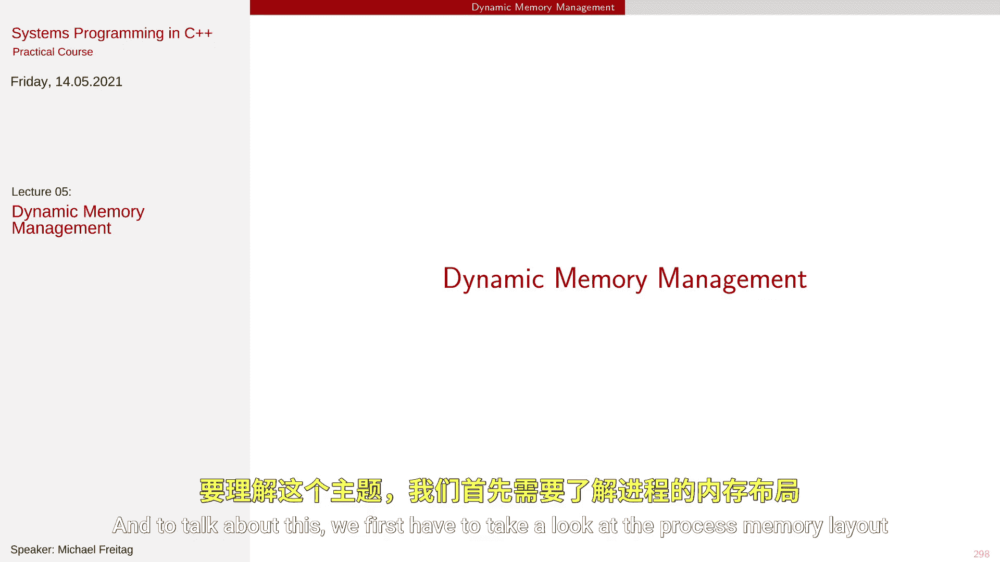
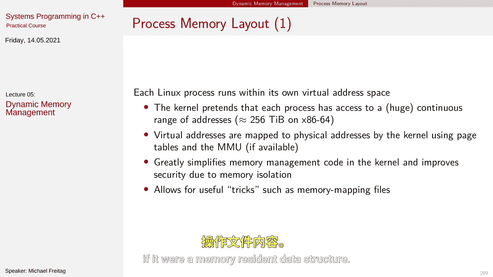
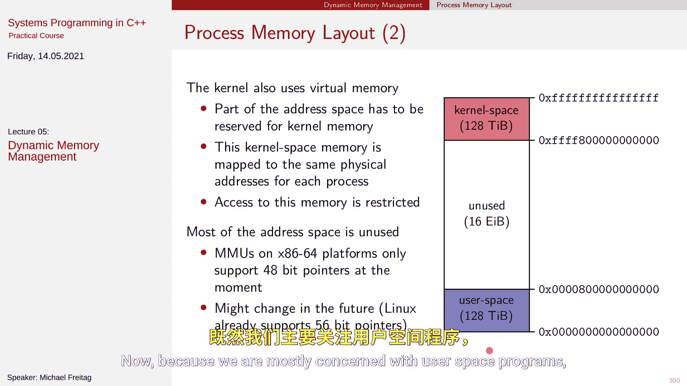
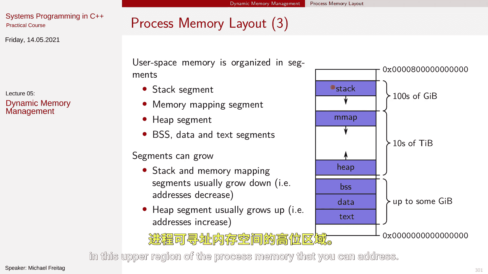
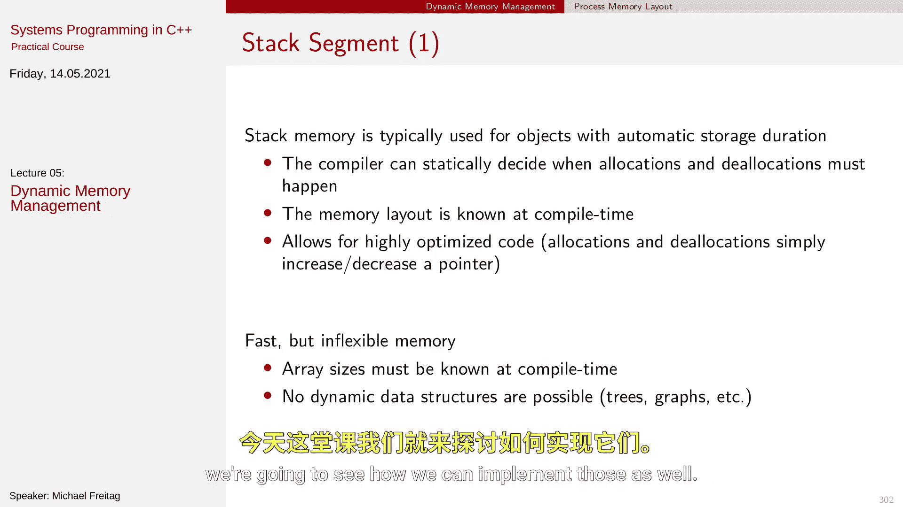
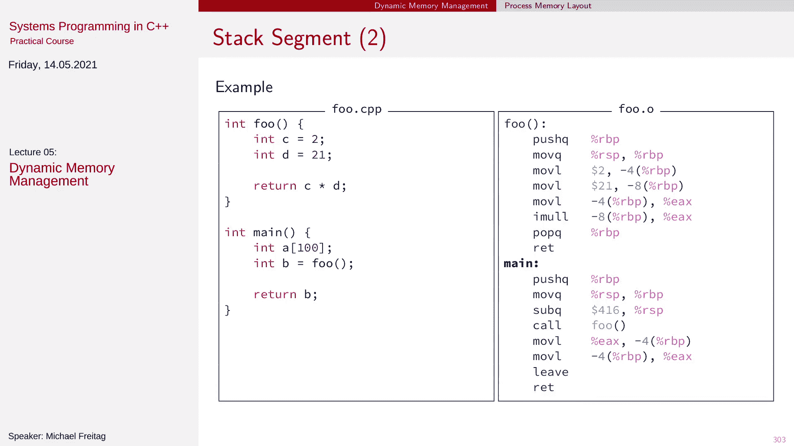
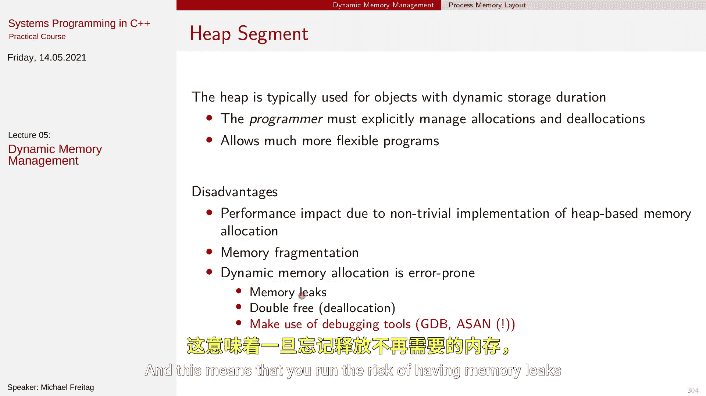

# 007：动态内存管理与所有权 🧠

在本节课中，我们将要学习动态内存管理及其相关的重要概念。这些概念对于编写现代C++程序至关重要，但同时也是初学者最容易感到困惑的部分之一。因此，请务必积极提问，我们将详细探讨这些内容。

## 进程内存布局

首先，我们需要了解Linux（及其他操作系统）上典型的进程内存布局。每个Linux进程都在其自己的虚拟地址空间中运行。这意味着内核会让每个进程认为自己可以访问一个巨大的连续地址范围。

在64位系统上，这个范围可以大到2^64字节。当然，这远大于系统中实际的物理内存。因此，内核内部会通过页表、内存管理单元等数据结构，将这些虚拟地址映射到物理地址。

这种机制为我们的进程提供了便利：它们可以假装拥有这个巨大的地址范围，而内核则负责将这个范围映射到系统中实际的物理内存。这不仅简化了内核中的内存管理代码，还提高了安全性，因为每个进程都有自己的地址空间，不会意外访问或更改属于其他进程的内存。此外，它还支持一些有用的技巧，例如内存映射文件。

## 内核与用户空间

我们必须记住，内核本身也需要内存，并且也使用虚拟地址范围的一部分。因此，地址范围通常被划分为保留给内核内存的部分和用户空间程序可访问的部分。

在一个典型的Linux系统上，通常将最高的2^48个地址保留给内核，然后有一个非常大的未使用地址空间部分，接着较低的2^48字节可供用户空间寻址。目前大多数x86平台上的内存管理单元仅支持48位指针，因此我们无法寻址更多内存，但这在未来可能会改变。

即使有48位指针的限制，我们仍然可以寻址巨大的内存量：用户空间程序有128TB的可寻址内存，内核空间也有相同大小。对于目前编写的程序来说，这已经足够了。

## 用户空间内存段

由于我们主要关注用户空间程序，让我们放大用户空间地址空间的这一部分。我们可以看到，它本身又被组织成不同的段。

*   **栈段**：包含程序栈和所有局部变量。
*   **内存映射段**：本课程中不特别相关。
*   **堆段**：用于动态内存分配。
*   **其他段**：主要包含静态数据。

这些段可以增长。例如，当我们调用一个函数时，可能需要为该函数的局部变量、参数和返回值分配更多栈空间。通常，栈内存段向下增长，即分配更多栈内存时地址减小。相反，堆段通常向上增长，即分配更多堆内存时地址增加。

这些背景信息在某些用例中可能很有用，也使得读取指针更容易。如果我们查看可寻址用户空间内存中的最小和最大地址，会发现它们相当受限。查看程序中的指针时，通常会看到它们以`0x7f...`开头，这是因为指针通常位于该段的顶部区域。

## 栈段与自动存储期

到目前为止，您主要在与栈段交互，因为该段通常用于具有**自动存储期**的对象，也就是您几乎一直在使用的局部变量。

这种内存非常方便，因为编译器可以静态决定何时必须进行分配和释放，并且内存布局在编译时是已知的。这允许高度优化的代码，因为在栈段上的任何分配和释放都只是简单地增加和减少指针（汇编中的基址和栈指针寄存器）。

因此，这个段非常快，我们不需要复杂的代码来分配内存。但它也非常不灵活：例如，数组大小必须在编译时已知，并且我们无法在栈上实现任何动态数据结构，如树、图等。当然，这些数据结构非常有用。在本节课中，我们将看到如何实现它们。

## 堆段与动态存储期

栈段相当直接。您只需编写局部变量就可以透明地在代码中使用栈内存，无需做更多工作。堆段则不同，它通常用于具有**动态存储期**的对象，程序员（也就是您）必须显式管理分配和释放。

到目前为止，您只间接使用过堆内存，例如通过`std::vector`。`std::vector`内部会根据向量的大小执行动态内存的分配和释放。这已经是一个例子，说明使用堆内存如何让您编写更灵活的程序，因为您不再受限于编译时已知的常量大小。

当然，使用堆内存也有一些主要缺点，最显著的是性能影响。堆上的分配需要高度复杂的实现来跟踪堆内存的哪些部分已分配、哪些是空闲并可重用等。

一个相关的问题是，使用堆内存时，如果进行大量小分配，总是存在内存碎片化的风险，尽管这不太可能导致堆内存耗尽。最后，也是本节课剩余部分将重点关注的，动态内存分配非常容易出错，因为您必须管理分配和释放，这意味着您可能会忘记释放不再需要的内存，从而导致内存泄漏。

---

本节课中我们一起学习了进程内存布局、栈与堆的区别、以及动态内存管理的基本概念和挑战。理解这些是掌握C++内存管理的基础。